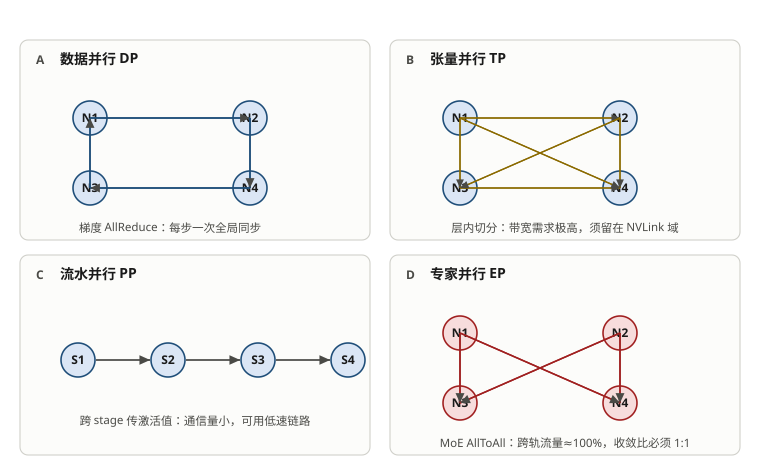
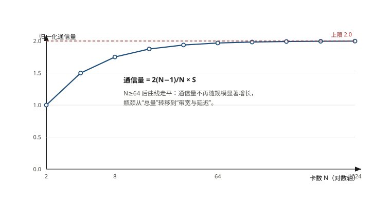
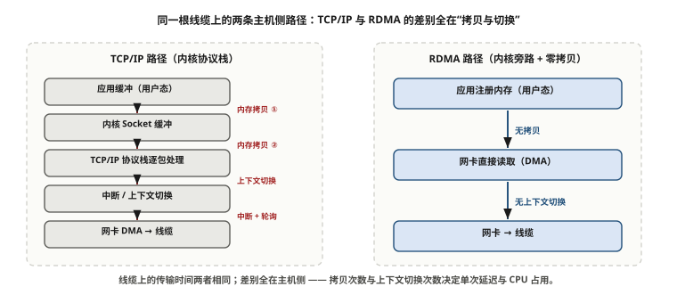
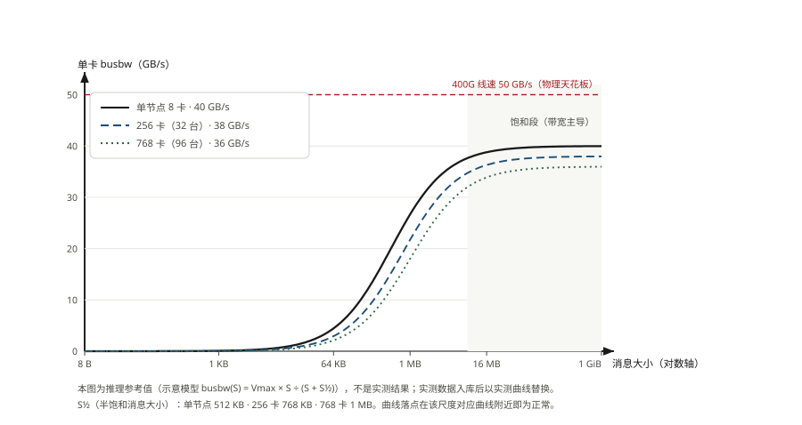

# 第 1 章　大模型训练对网络的极致挑战

> **本章一句话结论**：网络不是算力的配套，是算力的乘数——它决定你花在 GPU 上的钱能收回几成。

---

## 1.1　工程问题：一份写了 300 GB/s 的验收标准

### 一个必须先算清楚的数字

本书主线案例（某省运营商智算中心，128 台 H100 / 1024 卡，详见前言）的合同里，有一行关于集群性能的验收条款，大意是：全规模 AllReduce 的 busbw 不低于 **300 GB/s**，平均不低于 **256 GB/s**。

这行字摆到技术评审桌上时，第一件事是拿出计算器。

```
单端口线速             = 400 Gb/s
换算成字节             = 400 ÷ 8 = 50 GB/s
全网算力端口数         = 96 台 × 8 口 = 768 口
全网理论单向总和       = 768 × 50 GB/s = 38 400 GB/s
```

38 400 GB/s 的总量当然远大于 256 GB/s。但 AllReduce 不是"所有端口同时朝一个方向流"——它受**单卡可用带宽**钳制。

```
单张 H100 的算力网卡        = 1 × 400G = 50 GB/s 单向
AllReduce busbw 的物理天花板 ≈ 单卡带宽 × 一个小于 1 的效率系数
                            ≈ 40 GB/s 量级（乐观）
```

256 GB/s 相当于单卡带宽的 **6.4 倍**。物理上不可能。

**单位写错了。** 按上下文应当是 **300 Gb/s**（小写 b），换算过来约 **37.5 GB/s**，正好落在单卡 400G 端口能跑出的合理区间里。一个字母的大小写，差了 8 倍。

这不是吹毛求疵。如果按 300 GB/s 签进合同，交付时无论怎么优化都过不了验收；如果按 300 Gb/s 签，双方一开始就知道目标在哪。**这一行字的成本，取决于签之前有没有人算过它。**

### 为什么这个错误如此普遍

因为它踩在一个大多数人没有的直觉上：

> 网络设备的一切速率都用 **bit/s** 标称（Gb/s、Tb/s），而存储和文件大小的一切都用 **Byte** 标称（GB、TB）。
> 两个世界在同一块网卡上相遇，中间隔着一个 8。

更麻烦的是，交换机的宣传口径（"400G 交换机"）用的是 bit，服务器的宣传口径（"一块 400G 网卡）也是 bit，但工程师做容量规划时脑子里想的是"一个数据集 8 TB"。**这条 8 倍的换算，在项目里出现的频次比任何人想象的高。**

本书约定：全书链路速率一律写 `Gb/s` 或 `400G`，容量与传输量一律写 `GB`、`TB`。看到这两个单位混在一句话里，先停下来检查。

---

## 1.2　最小必要原理

### 1.2.1　并行策略决定了网络长什么样

一张 1024 卡的集群，不可能把模型装在一张卡上。模型必须切，切开之后就必然要通信。切法有四种，对应的通信模式完全不同：

| 并行方式 | 切什么 | 通信原语 | 通信特征 |
|---|---|---|---|
| 数据并行 DP | 切数据，模型每卡一份 | AllReduce（梯度） | 通信量与参数量成正比，与卡数弱相关 |
| 张量并行 TP | 切单层内部的矩阵 | AllReduce / AllGather | **高频、小消息、延迟敏感**，通常限制在同一节点内 |
| 流水并行 PP | 切层，按 stage 串起来 | 点对点 Send/Recv | 低频、激活值传递，可用流水掩盖 |
| 专家并行 EP | 切 MoE 的专家 | **AllToAll** | **突发、大流量、对收敛比最敏感** |

这张表是全书的地基，后面每一章的取舍都从这里长出来：

- **TP 必须走 NVLink**。它的通信频率是每层一次，消息小、次数多，跨节点走网络会被延迟拖死。这解释了为什么 H100 一个 NVLink 域是 8 卡——正好一台服务器。
- **DP 是网络的主要负载**。梯度同步的数据量大、有周期性，是 RoCE/IB 带宽规划的主要依据。
- **EP 是收敛比的照妖镜**。AllToAll 是"每张卡都朝所有其他卡发不同的数据"，流量模式最接近均匀全互联。收敛比只要不是 1:1，AllToAll 立刻掉速。**如果一个集群要跑 MoE，收敛比这一条几乎没有商量余地。**



**图 1-1　四种并行策略的通信模式**　｜　**读图要点**：DP 每步一次全局同步、通信量随规模放大；TP 通信最密集，必须留在 NVLink 域内；PP 通信量最小；EP（MoE）几乎全跨轨，收敛比必须按 1:1 设计。四张图的连线疏密，就是四类流量对网络的真实诉求。

### 1.2.2　四个原语的通信量：够用就停在这一步

不需要推导，只需要记住四个结果（S 为单次传输的数据量，N 为参与卡数）：

```
AllReduce      每卡收发 2(N−1)/N × S      两阶段：ReduceScatter + AllGather
AllGather      每卡收发 (N−1)/N × S
ReduceScatter  每卡收发 (N−1)/N × S
AllToAll       每卡收发 (N−1)/N × S      但每一份都发给不同的卡
```

三点实用推论：

1. **N 很大时，(N−1)/N 趋近于 1。** 所以千卡规模下，通信量基本就是 2S（AllReduce）——**集群规模对通信量的影响远小于大多数人的想象**。真正随规模变化的是拓扑层数和延迟。
2. **AllReduce = ReduceScatter + AllGather**，这是 Ring 算法的核心，也是为什么 Ring 能跑到接近线速：它把通信切成了 2(N−1) 个可以流水起来的步骤。
3. **AllToAll 的通信量看起来和 AllGather 一样，但对网络的要求完全不同**。AllGather 是"每个人把同一份东西发给所有人"，路径规整、可预测；AllToAll 是"每个人给每个人发不同的东西"，**任何一处带宽不足都会变成全局短板**。



**图 1-2　AllReduce 归一化通信量随卡数的变化**　｜　**读图要点**：纵轴是「通信量 ÷ 单卡数据量」= 2(N−1)/N，横轴是卡数 N。N 从 2 涨到 64 时曲线快速抬升，N≥64 后几乎走平并逼近上限 2.0。**含义：规模扩大不会等比放大通信总量，瓶颈会从“总量”转移到“带宽与延迟”。**

### 1.2.3　busbw 到底在测什么

`nccl-tests` 输出里有两个易混的指标，这是验收时最容易被带偏的地方。

```
algbw (algorithm bandwidth)  = 数据量 S / 耗时 t
                                 → 我只关心"传完了没有，花了多久"

busbw (bus bandwidth)        = algbw × 校正系数
                                 AllReduce 的校正系数 = 2(N−1)/N
                                 → 我关心"如果要达到这个速度，
                                    等效需要多宽的总线"
```

为什么要乘校正系数？因为 Ring AllReduce 里每一份数据都被每一张卡转发过，网络总线上实际搬运的量是 2(N−1)/N 倍。用 busbw 是为了让不同原语、不同规模之间可以横向比较——**它衡量的是"网络的有效宽度"，不是"数据传得多快"。**

| 场景 | 该看哪个 | 原因 |
|---|---|---|
| 判断网络是否达到线速 | **busbw** | 它与端口线速可比 |
| 估算训练会卡多久 | **algbw** | 它就是真实吞吐 |
| 写进合同验收 | **busbw**（且必须写明单位 Gb/s） | 唯一可跨规模比较的口径 |

> **本案例验收用的是 busbw 口径，覆盖 2/4/8/16/32/96 台六个规模点，消息从 8 B 到 8 GiB。** 六个规模点不是冗余——它卡的是"网络能不能随规模线性扩展"，而这一点在所有大规模集群上都是最先崩的地方。



**图 1-3　同一根线缆上的两条主机侧路径：TCP/IP 与 RDMA**　｜　**读图要点**：线缆上的传输时间两者相同，差别全在主机侧：TCP/IP 要经两次内存拷贝、内核协议栈逐包处理与多次上下文切换；RDMA 由网卡直接读写已注册内存，内核旁路、零拷贝。**一次训练步要打成千上万次小消息，主机侧开销会被放大成端到端吞吐差异** —— 这就是 TCP/IP 在大模型训练中一定会崩的原因。

### 1.2.4　TCP/IP 为什么一定会崩

不是"性能差一点"，是**三个结构性缺陷的叠加**。

**缺陷一：延迟高一个数量级。**

TCP 的每次通信要穿过中断 → 内核协议栈 → 内存拷贝 → 网卡驱动。RDMA 把这一整条路绕开，让网卡直接读写应用内存。

| 路径 | 单次往返延迟 |
|---|---|
| TCP/IP over 400G | 20–50 μs 量级 |
| RoCEv2 / InfiniBand | 1.5–3 μs 量级 |

单看没感觉。但 AllReduce 在 768 卡上是 **1534 步**（2(N−1)）串起来的。假设每一步叠加 2 μs 的传输延迟：

```
1534 步 × 2 μs ≈ 3.1 ms
```

如果一次 AllReduce 传的是小梯度分片（比如每步 8 KB），计算时间可能只有几十微秒——**通信时间比计算时间大两个数量级，GPU 全在等。** 这就是小消息区间必须换算法（Tree、SHARP 网内计算）的原因，见第 15 章。

**缺陷二：丢包不是"慢一点"，是"塌方"。**

用 Mathis 公式估一下 TCP 在长肥管道上的吞吐：

```
Throughput ≈ (MSS / RTT) × 1 / √p

MSS = 1500 B，RTT = 10 μs
MSS/RTT = 150 MB/s ≈ 1.2 Gb/s

p = 1e-6（百万分之一丢包） → 1.2 × 1000 = 1200 Gb/s  （不受限）
p = 1e-4                  → 1.2 × 100  = 120 Gb/s
p = 1e-3（千分之一）       → 1.2 × 31.6 = 38 Gb/s     （线速的 9.5%）
```

【推算】这是数量级模型，不是精确预测。但它说明一件事：**在 400G 链路上，千分之一丢包就能让有效吞吐掉到线速的 10%。** 而在 AI 训练里，微突发（microburst）造成的瞬时丢包远不止千分之一。

**缺陷三：TCP 的拥塞控制假设和 AI 流量相反。**

TCP 看到丢包就认为"网络堵了"，于是降窗、退避、重传——这在一个**要求零丢包、要求恒定速率**的训练流量面前，是把偶发抖动放大成分钟级停滞。无损网络的核心思想就是反过来的：**宁可反压源头，也不让中间节点丢包。**

### 1.2.5　三个要求，一句话各自对应什么机制

| 要求 | 量化目标 | 靠什么实现 |
|---|---|---|
| 高带宽 | 单口跑满 400 Gb/s 的 90% | 无阻塞拓扑 + 无损转发 + RDMA 零拷贝 |
| 微秒级延迟 | 单跳 1–3 μs | RDMA 旁路内核 + 浅缓冲交换机 + 关闭不必要的转发功能 |
| 零丢包 | PFC/ECN 计数稳定，无重传 | PFC（反压）+ ECN（标记）+ DCQCN（端侧降速）三件套 |

> **"零丢包"不是"一个包都不能丢"，而是"稳态运行时业务流量不触发重传"。** 现实里控制面流量、ARP、BGP 邻居建立阶段的丢包都属于正常。验收时看的是**压测期间的数据面计数器**。

---

## 1.3　选型对比：三个量级下的网络需求

同一个模型，放在三个不同规模的集群上，网络压力完全不同。这张表是全书端口配比算术的起点。

| 维度 | 32 台 / 256 卡 | 96 台 / 768 卡 | 128 台 / 1024 卡 |
|---|---|---|---|
| 算力端口数 | 256 | 768 | 1024 |
| 单卡带宽 | 400 Gb/s | 400 Gb/s | 400 Gb/s |
| 端点总带宽 | 102.4 Tb/s | 307.2 Tb/s | 409.6 Tb/s |
| 拓扑层数 | 两层 CLOS | 两层 CLOS | 两层 CLOS（用掉上限的 1/8） |
| 收敛比 | 1 : 1 | 1 : 1 | 1 : 1 |
| 通信步数（AllReduce） | 510 | 1534 | 2046 |
| **延迟主导区** | 消息 < 32 KB | 消息 < 96 KB | 消息 < 128 KB |
| AllToAll 可行度 | 宽松 | 需要注意 | **跨轨占比高，Spine 带宽是硬约束** |
| 扩容方式 | — | 纯加法 | 纯加法 + 上联重排 |

三点值得停下来看：

**第一，两层 CLOS 的规模上限只由交换机的端口数决定，而本案例离上限还有 8 倍。**

限制不在下联端口，也不在"Spine 买得够不够"，而在**每台 Spine 必须连到每一台 Leaf**。把约束写全：

```
记 Y = 单台交换机端口数（本案例 128）、L = Leaf 台数、S = Spine 台数
    r = 每对 Leaf-Spine 之间的链路数、m = 每台服务器的算力网口数（8）

1:1 无阻塞： 每 Leaf 下联口 = 上联口 = Y / 2 = 64
全互联：     每 Leaf 上联口 u = r × S
Spine 端口： L × r ≤ Y          ← 给定 r 时，卡住规模的是这一条
端点总数：   E = L × (Y / 2)

代入 u = Y / 2，得：
    E ≤ (Y / r) × (Y / 2) = Y² / (2r)
    r = 1 时取到最大：
    E_max = Y² / 2 = 128² / 2 = 8192 个端点
    服务器上限 = 8192 ÷ 8 = 1024 台 = 8192 卡
    对应 S = 64 台 Spine、L = 128 台 Leaf（每轨 16 台）
```

**这就是两层 CLOS 的「Radix 法则」：规模上限 = 端口数² ÷ 2。** 注意它**与是否同轨组网无关**——这是个端点计数界；同轨收紧的是 r 的可行域。有两点必须分清：

- **上限由 Y 决定**，不由"想建多大"决定。128 口 400G → 8192 端点；换成 256 口（102.4T）→ 32768 端点，**同一套两层结构直接翻四倍**。
- **r 是"上限"与"布线成本"之间的旋钮，不是上限本身**：

| r（每对 Leaf-Spine 链路） | Spine 台数 | Leaf 上限 | 端点上限 | 服务器上限 | 每 Spine 占用 |
|---|---|---|---|---|---|
| 1 | 64 | 128 | 8192 | **1024 台 / 8192 卡** | 100% |
| 2 | 32 | 64 | 4096 | 512 台 / 4096 卡 | 100% |
| 4 | 16 | 32 | 2048 | 256 台 / 2048 卡 | 100% |
| 8 | 8 | 16 | 1024 | 128 台 / 1024 卡 | 100% |
| 16 | 4 | 8 | 512 | 64 台 / 512 卡 | 100% |
| ≥ 32 | 2 | 4 | 256 | 32 台 / 256 卡（**仅非同轨**） | 100% |

> **表里「Leaf 上限 / 端点上限 / 服务器上限」三列，是 `L ≤ ⌊P ÷ r⌋` 算出来的计数上界（非同轨口径）。** 本案例是同轨组网，`L` 必须是轨数 `m = 8` 的整数倍，于是多出一条 `m·r ≤ P`，r 被额外收紧到 **r ≤ 16** —— 上表里只有最后一行因此不可行。**这就是「前置约束一换，可行性就变」的地方。**

**结论：本案例终态 128 台只用到上限的 1/8，四期规划 256 台 = 上限的 1/4。** 只要不把自己锁死在 r=4 这一档，两层 CLOS 一路能走到 1024 台 / 8192 卡——**扩容的代价不是"再加一层"，而是"加 Spine + 重排上联"**（r 降一档，Spine 台数翻倍，规模上限翻倍）。真正必须上三层的门槛，是端点数超过 Y²/2 = 8192，也就是 1024 台 / 8192 卡往上。

> **一个最容易被算错的坑**：把"r=4 时的填满点 256 台"当成"两层拓扑的上限"，就会得出"四期一到顶、再往上必须上三层"的错误结论。**256 台只是 Spine 端口被用满的那一点**——Spine 由 16 台加到 32 台、每对链路由 4 条降到 2 条，仍然是同一种两层结构，规模翻倍到 512 台。**"加 Spine"与"上三层"之间的差价，是这本书里最容易被算错的一笔钱。**

**第二，通信步数随规模线性增长，而单跳延迟是常数。** 所以规模越大，小消息场景越吃亏。这是万卡集群必须引入 SHARP（交换机内做规约）这类网内计算的直接原因——不是"优化"，是"不这么做就跑不动"。

**第三，"纯加法"扩容不是运气，是端口按终态分段规划出来的。** 二期把 Leaf 由 8 台补到 16 台时，新增的叶子只做两件事：加 BGP 邻居、加下联链路——它们插的是"已规划未启用"的空位，现网集群的路由表、轨映射关系、NCCL 配置**一行都不用改**。

| 扩容方式 | 现网影响 | 风险 |
|---|---|---|
| 重排拓扑 | 路由全量重算、轨映射重排、NCCL 配置重生成 | 训练中断，且要重新验证 |
| **纯加法（本案例二期）** | 只增邻居、下联链路与上联链路 | 现网零改动，可灰度 |
| **上联重排（本案例三期，唯一例外）** | Spine 8→16 台、每对链路 6→4 条，需改接已布放跳线 | 路由与轨映射不变，但要停机窗口 |

**能设计出"纯加法"的前提，是一开始就按终态把端口分好段。** 具体怎么分段，见第 3 章。

---

## 1.4　实测与踩坑

### 1.4.1　真实验收标准全解析

本案例的集群级验收条款写得比多数项目都硬，逐条拆解如下（这也是第 13 章的操作依据）：

| 条款 | 具体要求 | 为什么这么定 |
|---|---|---|
| 测试工具 | NCCL（nccl-tests） | 事实标准，结果可复现 |
| 规模覆盖 | **2 / 4 / 8 / 16 / 32 / 96 台** | 六个点卡的是"线性度"，不是绝对值 |
| 消息范围 | **8 B ~ 8 GiB** | 覆盖延迟主导区到带宽主导区全程 |
| 正确性 | `#wrong = 0` | 数据正确性比速度优先 |
| 原语覆盖 | AllReduce / AllGather / ReduceScatter / **AllToAll** | AllToAll 是收敛比的试纸 |
| 单端口吞吐 | **≥ 360 Gb/s（400G 的 90%）** | 逐口核验，不是抽样 |
| 稳定性 | **连续 24 小时，GPU 平均利用率 ≥ 90%** | 且每台服务器、每张 GPU、每个 RDMA 端口都被实际使用 |
| 失败处理 | 掉卡/异常重启/测试中止/结果不可复核 → **从零重新计时 24 小时** | 杜绝"凑够 24 小时" |
| 日志留存 | 原始日志、命令、配置、时间戳、主机名、GPU UUID、镜像版本、结果哈希，**≥ 180 日** | 争议时可回溯 |

三个设计细节值得学：

**① 6 个规模点而不是"最大规模跑一次"。** 只测 96 台，你无法判断 96 台的结果是"网络本来就该这样"还是"网络随规模劣化"。2→4→8→16→32→96 连成曲线，一眼能看出在哪一级开始掉。

**② 单端口 90% 线速，是"逐口核验"。** 抽样测 20 个口都对，不代表剩下 700 个口都对。光模块批次差异、端面污染、MPO 极性接错——这些问题的分布是**离散的**，不抽到就是 100% 漏。

**③ "从零重新计时"是最容易被低估的一条。** 没有这条，实施方会在第 23 小时出问题时"重启一下接着跑"。有了这条，24 小时是一个不可分割的原子单位。

### 1.4.2　一个真实的单位口径争议

回到开头那个 300 GB/s。同类问题在本案例里出现了**两次**：

| 位置 | 出现的写法 | 问题 |
|---|---|---|
| 集群 AllReduce 验收 | busbw 不低于 300 GB/s | 应为 Gb/s，差 8 倍 |
| 存储读取验收 | 聚合吞吐 100 Gb/s | 单位对，但**口径**没写：单流还是多客户端聚合 |

第二个更隐蔽。存储方按"128 盘并发"测出 17.1 GB/s（≈137 Gb/s），超客户锚点 37%。但如果甲方按"单个客户端读一个大文件"来测，可能只有 1–2 GB/s，远低于 100 Gb/s。

**结论：验收指标必须写全三件事——数值、单位、口径。**

```
反例：  存储读取聚合吞吐 ≥ 100 Gb/s
正例：  存储读取吞吐 ≥ 100 Gb/s
        口径：多客户端并发聚合，客户端数 ≥ 32，文件数 ≥ 128，
              单个 8 TB 顺序读，测试时长 ≥ 10 分钟
```

### 1.4.3　待实测数据：先给参考区间，实测后校正

本章涉及的以下三项数据，在本案例现有资料中没有留存（详见参数卡 §9）。**为了让读者有一个可对照的刻度，这里先给出「推理参考值」**——它们由物理上限与行业公开区间推出，标注【推算】，**不是本案例的实测结果**；实测数据到位后，以实测值替换。

| 编号 | 缺口 | 推理参考值【推算】 | 推算依据 |
|---|---|---|---|
| O-01 | 单节点 8×400G 满载 nccl-tests 基线（全消息段） | 单卡 busbw 大消息段 **≈ 40 GB/s（320 Gb/s，80% 线速）**；合理带 **35–45 GB/s**（280–360 Gb/s） | 单卡物理上限 = 400 Gb/s ÷ 8 = 50 GB/s；扣协议开销后取 70%–90%；社区公开区间 280–360 Gb/s【行业公开】 |
| O-02 | 96 台 / 768 卡全规模 busbw 曲线 | 大消息段单卡 busbw **≈ 36 GB/s**；合理带 **34–38 GB/s**（= O-01 参考值的 85%–95%） | 在 O-01 基线上叠加规模化折损项：ECMP 摊分不匀、尾延迟、跨 Spine 多一跳 |
| O-03 | 768 卡 AllToAll 实测 | 大消息段单卡 busbw **≈ 28 GB/s**；合理带 **26–30 GB/s**（= 同规模 AllReduce 的 70%–80%） | AllToAll 要 8 条轨同时均匀参与，"最慢的那条轨"决定结果；1:1 收敛比保证每个目的都有独立等价路径 |

**参考曲线怎么来的（可自行复算）**：

```
示意模型（只用于给数量级，不是 NCCL 的真实实现）
    busbw(S) = Vmax × S ÷ (S + S½)

                    Vmax（饱和值）      S½（半饱和消息大小）
  单节点 8 卡            40 GB/s              512 KB
  256 卡（32 台）        38 GB/s              768 KB
  768 卡（96 台）        36 GB/s              1 MB

含义：消息小于 S½ 时线路还没喂饱（启动延迟主导）；
      消息远大于 S½ 后曲线拐平到 Vmax（带宽主导）。
```



**图 1-4　nccl-tests busbw 参考曲线（推理值，待实测校正）**　｜　**读图要点**：纵轴是单卡 busbw，横轴是消息大小（对数）。顶部虚线是 400G 线速的物理天花板 50 GB/s；三条曲线分别是单节点 8 卡、256 卡（32 台）、768 卡（96 台）。**读法**：实测曲线落在对应参考值的合理带内即为正常；整体低于下沿要查配置或链路，曲线不拐平要查是否测到饱和。**本图是推理值，不是实测结果**——第 13 章拿到现场数据后，应以实测曲线替换重绘。

**这三项不影响本书的方法论部分，但影响"结论有实测背书"的程度。** 有这批数据的人，欢迎补上——这是本书留出的位置。

---

## 1.5　现场检查清单

> 打印出来，在方案评审前逐条打勾。**任何一条没打勾，不要进入采购流程。**

### 单位与口径

- [ ] 所有性能条款的**单位**已明确写明 Gb/s 或 GB/s，无一遗漏
- [ ] 所有吞吐指标的**测试口径**已写明（单流 / 多客户端聚合 / 客户端数 / 文件数）
- [ ] 全项目文档中 `Gb/s` 与 `GB/s` 使用一致，无混用
- [ ] 单卡带宽 × 卡数 与 条款要求值做过一次量级核对（防止超物理上限的指标）

### 并行策略与网络需求匹配

- [ ] 明确本集群要跑的并行策略组合（DP / TP / PP / EP）
- [ ] 若含 **EP（MoE）**：收敛比是否按 1:1 设计？（这是硬约束）
- [ ] TP 的通信边界是否限制在单节点 NVLink 域内
- [ ] DP 的梯度同步数据量已估算，并据此推导出所需带宽

### 规模与拓扑

- [ ] 终态规模已确定，且**按终态一次规划**端口分段
- [ ] 已算出两层 CLOS 的规模上限（= 端口数² ÷ 2，本案例 **8192 端点 / 1024 台 / 8192 卡**），并确认终态未越界
- [ ] 已确认「每对 Leaf-Spine 链路数 r」的取值（本案例取 4），并验证 L × r ≤ 128
- [ ] 若越界，三层的方案与成本增量已出
- [ ] 扩容路径确认为"纯加法"：新增设备不改现网路由、轨映射、通信库配置
- [ ] 扩容所需的机柜、供电、配线空间已预留

### 验收条款

- [ ] 规模点不少于 5 个（覆盖小中大）
- [ ] 消息范围覆盖延迟主导区（≤ 32 KB）与带宽主导区（≥ 1 GiB）
- [ ] 正确性判据（`#wrong = 0`）已写入
- [ ] AllToAll 已纳入必测原语
- [ ] 单端口吞吐为**逐口核验**，非抽样
- [ ] 稳定性测试含"失败即从零重新计时"条款
- [ ] 原始日志留存期限已约定（建议 ≥ 180 日）

---

## 1.6　成本与工期影响

### 这一章的决策值多少钱

| 决策点 | 不做/做错的代价 | 说明 |
|---|---|---|
| 单位写错（GB/s 当 Gb/s） | 验收直接无法通过，返工洽商 2–4 周 | 本案例实际发生 2 次 |
| 测试口径未写明 | 验收争议，可能触发整改与延期付款 | 存储 100 Gb/s 条款 |
| 未按终态规划端口分段 | 扩容需重排拓扑 → 训练中断 + 全量回归 | 一次中断按天计 |
| 收敛比按经验定（非 1:1） | 若跑 MoE，AllToAll 掉速，训练效率下降 | 影响长期算力成本，非一次性支出 |
| 未测算两层拓扑上限 | 扩容到一半发现要上三层，机柜/供电/预算全部重来 | 三层比两层多一整层设备与线缆 |

### 量级参考

以本案例一期（32 台）为例，网络相关投资的分配是：

| 模块 | 占比 |
|---|---|
| 计算网（交换机 + 光模块 + 线缆 + 配线 + 冷备件） | 63.2 % |
| 存储网（存储交换机 + 存储设备 + 光模块） | 28.2 % |
| 业务网 | 3.3 % |
| 带外网 | 1.7 % |
| 施工及配套 | 3.6 % |

**计算网加存储网占 91%。** 这意味着：预算评审时把 90% 的注意力放在这两块是合理的；而在**验收条款**上省下来的那点笔墨，可能在这一章的清单里变成几周的返工。详细的 BOM 与议价方法见第 16 章。

---

## 本章要点回顾

1. **Gb/s 与 GB/s 差 8 倍**，这是本案例真实踩过的坑。所有性能条款必须写全「数值 + 单位 + 口径」。
2. **并行策略决定网络形态**：TP 锁在 NVLink 域内，DP 是带宽主负载，**EP（MoE）是收敛比的硬约束**。
3. **AllReduce 通信量 2(N−1)/N × S，N 大时趋近 2S。** 真正随规模恶化的是延迟和拓扑层数，不是通信量。
4. **busbw 衡量网络有效宽度，algbw 衡量数据传得多快。** 写进合同用 busbw，且必须标单位。
5. **TCP/IP 在 AI 训练面前是结构性失效**，不是性能不足：延迟高一个数量级、丢包导致吞吐塌方、拥塞控制逻辑与训练流量相反。
6. **两层 CLOS 的规模上限 = 端口数² ÷ 2**（128 口 → 8192 端点 / 1024 台 / 8192 卡）。要提前三年算出来，而且要分清"拓扑上限"与"某一档排布的填满点"。
7. **"纯加法"扩容不是运气，是设计出来的**——前提是端口按终态分段。
