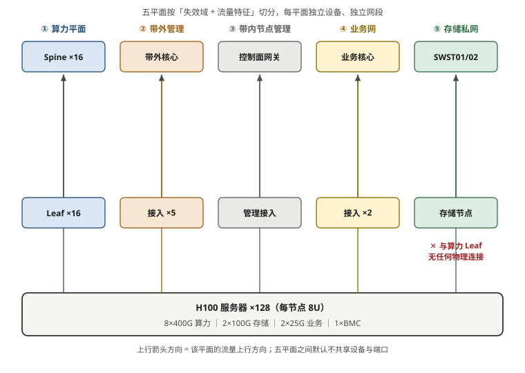
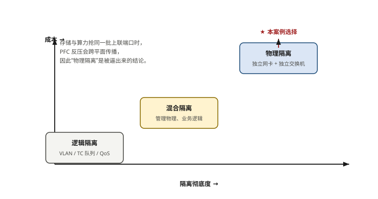

# 第 2 章　智算中心「五平面」网络架构设计哲学

> **本章一句话结论**：平面不是按设备类型切的，是按"失效域"和"流量特征"切的——切错了，省下来的钱会以带宽争夺的形式还回去。

---

## 2.1　工程问题：一次"融合组网"省下的钱，怎么变成不可控的带宽争夺

### 事情的起点

本案例最初拿到的服务器配置单上，只有 8 张 400G 算力网卡。存储怎么接？很自然的想法是——**算力网那么宽，分一点给它不就行了**：

```
融合组网方案（v1）
  服务器 8×400G ──► Leaf ──► Spine
                              │
                              └──► 存储交换机 ──► 存储节点
                     存储流量与算力流量共用 Spine 层
                     靠 QoS 优先级队列（TC）+ PFC/ECN 逐跳隔离区分
```

这个方案在纸面上很漂亮：省掉每台服务器 2 块存储网卡、省掉独立存储布线、省掉存储平面的独立核心。**按 128 台算，光服务器侧网卡就省 320 块。**

评审会上的结论只有三个字：**不接受**。

理由也很清楚——**存储流量和算力流量会在 Spine 的上联端口上抢同一份带宽，而这份带宽是不可控的。** 具体表现是：

- Checkpoint 写入是**突发型**流量。几千张卡同时在几秒内把显存刷到存储，瞬时带宽需求远超稳态；
- AllReduce 是**周期性**流量，对丢包零容忍；
- 两者叠在同一个端口上时，PFC 反压会**跨平面传播**：存储侧的拥塞把 pause 帧推到算力侧的 Leaf，算力侧的 AllReduce 被迫降速。

**PFC 是不区分业务的。** 它只认优先级队列——只要 pause 帧发出来，上游就得停。你以为隔离了 TC 队列就安全了，实际上共享同一个物理端口这件事本身，就已经把两个平面的失效域焊在了一起。

### 最终方案与代价

| 版本 | 时间 | 方案 | 结论 |
|---|---|---|---|
| v1 | 09-14 | 存储交换机上联 Spine，QoS + PFC/ECN 逐跳隔离 | 被否 |
| v2 | 09-15 评审 | 维持共享 Spine，增加独立 TC 队列 | 甲方仍不接受 |
| **v3（定案）** | **09-16 / 09-18** | **物理隔离：服务器增配 2×100G 专用存储网卡，独立存储交换机，两网无任何物理连接** | 采纳 |

v3 的增量成本（这里给方法，具体数字见第 16 章）：

```
服务器侧：2 × 100G 网卡 × 128 台
网络侧：存储交换机 2 台（64×400G）
布线侧：全部独立，不共用任何一芯光纤
```

**这笔钱买的不是带宽，是"不可控性的消除"。**

### 这一节要带走的东西

"隔离"有三种手段，成本是阶梯式上升的，**而它们的失效域边界完全不同**：

| 隔离手段 | 实现方式 | 失效域 | 成本 |
|---|---|---|---|
| QoS 隔离 | 同端口不同 TC 队列 | **共享**——一个平面拥塞，另一个受 PFC 反压 | 最低（配置成本） |
| 逻辑隔离 | 独立 VLAN / VRF，可共用物理链路 | **共享**——同上，且路径故障互相影响 | 低 |
| **物理隔离** | 独立网卡、独立交换机、独立光纤 | **独立**——一个平面全挂，另一个照常 | 最高 |

**判断标准不是"贵不贵"，是"两个平面的告警，需不需要同时响应"。** 如果需要，就必须物理隔离。

本案例里，存储和算力的确需要独立失效域——因为算力网挂了整个集群停训，存储网挂了只影响数据读写，**两种故障的业务影响等级不同，混在一起会让运维无法分级响应。**

---

## 2.2　最小必要原理

### 2.2.1　五平面全景（本案例实际划分）

```
【① 计算网】  10.1.1-8.0/24 + 10.255.0.0/16
   服务器 8×400G ──► Leaf ×16 ──► Spine ×16
   特征：突发大流量 · 零丢包 · 微秒级延迟

【④ 存储专网】10.0.40/41/42/43.0/24
   服务器 2×100G ──► 存储交换机 ×2 ──► 并行存储 / 冷存储
   ═══ 与计算网之间无任何物理连接 ═══
   特征：Checkpoint 突发写入 · 稳态读取 · 可容忍毫秒抖动

【③ 业务网】  10.0.30.0/24 · VLAN 30
   服务器 2×25G ──► 业务交换机 ×4（MLAG 两组）
   特征：中低频 · 镜像拉取有突发

【② 节点管理】10.0.20.0/24 · VLAN 20
   与业务网同框承载、不同 VLAN
   承载：OS 管理口 · K8s/Slurm 控制面 · 监控采集

【⑤ 带外管理】10.0.10.0/24（设备侧）+ 10.0.11.0/24（BMC 侧）
   千兆接入 ×5~6 + 带外核心 ×2
   特征：极低频 · 但断了就等于失去所有远程能力

【预留】      10.0.60.0/24 ~ 10.0.89.0/24
   监控 / DNS / NTP / 跳板 / 运营商对接
```

> 注意：原始的规划思路里有一个"控制/同步平面"（PTP 时间同步）。本案例最终**没有为它单开物理平面**，而是落在逻辑隔离的预留段里。原因见 2.2.4。



**图 2-1　五平面全景：每平面独立设备、独立网段**　｜　**读图要点**：同一个服务器机箱里，五张网卡各自上到**不同**的交换机：8×400G 算力进 Leaf/Spine，2×100G 存储进存储专用交换机，2×25G 业务、管理口、BMC 各走各的。**注意存储私网与算力平面之间没有任何连线** —— 这正是本案例被逼出来的关键决策（见图 2-2）。

### 2.2.2　划分依据：三条线

平面怎么切，业界没有统一答案。但有三条线可以把决策钉死：

**线一：流量特征是否兼容？**

| 平面 | 典型带宽占用 | 突发性 | 延迟要求 | 丢包容忍 |
|---|---|---|---|---|
| 计算网 | 极高（可达线速） | 中（周期+突发） | **< 3 μs 单跳** | **零** |
| 存储专网 | 高 | **高（Checkpoint）** | 毫秒级 | 低（协议自身可重传） |
| 业务网 | 低 | 中（镜像拉取） | 毫秒级 | 可容忍 |
| 节点管理 | 低 | 低 | 秒级 | 可容忍 |
| 带外管理 | 极低 | 极低 | 秒级 | 可容忍 |

**计算网和存储网在"丢包容忍"和"延迟要求"上是两个极端**，这是它们必须分开的第一理由。业务网和节点管理都能容忍秒级中断，所以可以同框不同 VLAN——**这是本案例省下的唯一一处。**
**线二：失效影响是否同级？**

```
计算网故障   → 集群停训，业务中断，最高级别告警
存储专网故障 → 数据读写受阻，训练可能带病运行，中级别告警
带外管理故障 → 无法远程管理，但业务不受影响，低级别告警（但影响面最广）
```

**带外管理是所有平面里最反直觉的一个：它的流量几乎为零，但它是所有远程能力的唯一入口。** 所以它的"逻辑优先级"最低、"安全优先级"最高——必须与其他平面物理隔离，且只允许跳板机访问。

**线三：安全边界在哪里？**

带外管理（BMC/IPMI）历史上是重大安全风险的来源：BMC 固件漏洞可以绕过操作系统直接控制服务器。所以它必须**独立物理平面 + 独立认证 + 只允许跳板机访问**。本案例把它拆成两个网段（设备侧 10.0.10.0/24、BMC 侧 10.0.11.0/24），也是这个逻辑的延伸。

### 2.2.3　容量配比：五平面怎么分配"宽度"

一个能直接用的经验配比（本案例采用，且与业界实践一致）：

```
计算网 : 存储网 = 8 : 1  ~  4 : 1
（按端点带宽总量比，不是按交换机端口数比）

本案例基线：每台服务器 8×400G 算力 + 2×100G 存储
           端点比 = 3200 Gb/s : 200 Gb/s = 16 : 1   ← 偏保守
```

等一下，16:1 和 8:1~4:1 差得有点远。这里有个容易搞混的地方：

**配比要按"峰值并发"算，不是按"端口数"算。**

算力网的 8×400G 是"每张卡一条轨"，任一瞬间不可能 8 条轨都跑满（不同轨承载不同并行维度的流量）。而存储网虽然只有 2×100G，但 Checkpoint 期间是真的会持续跑满。

按实测经验折算：

```
算力网峰值等效宽度 ≈ 8 × 400G × 0.5（并发系数）= 1600 Gb/s / 台
存储网峰值需求     ≈ 2 × 100G × 1.0（Checkpoint 期间满跑）= 200 Gb/s / 台
实际配比           ≈ 8 : 1
```

**这条"并发系数"是容量估算里最容易被忽略的变量。** 只用端口数比会严重低估存储网的相对压力，导致 Checkpoint 期间存储侧成为瓶颈。

### 2.2.4　控制与同步平面（PTP）该放哪

高精度时间同步（PTP，IEEE 1588v2）在智算集群里的作用，不是"让日志时间戳对齐"这么简单——它是**故障定位的时间基准**。

```
没有 PTP 的世界：
  GPU 侧日志：14:03:21.482  某卡 AllReduce 超时
  交换机侧日志：14:03:21.391  某端口 PFC 触发
  → 相差 90 ms，无法判断谁先谁后

有 PTP（< 100 ns）的世界：
  两者时间戳直接可比 → 一眼看出是 PFC 先触发，还是 GPU 先超时
```

**在千卡规模上，跨设备排障的时间对齐精度要求是微秒级的**——因为一次 AllReduce 超时可能只有几十微秒，NTP 的毫秒级精度完全覆盖不了。

本案例最终没有为 PTP 单开物理平面，原因有三条：

1. PTP 流量极小（每个端口每秒几十个报文），不需要独立带宽；
2. 现代交换机的硬件时间戳可以与业务流量共存，前提是**开启硬件时间戳而非软件打戳**；
3. 项目交付范围内没有独立的 PTP Grandmaster 设备。

**但它被规划在预留段（10.0.60.0/24 ~ 10.0.89.0/24）里，随时可以启用。** 这是一个务实的做法：**不采购，但预留位置**。第 11 章会给出完整的部署方法。

---

## 2.3　选型对比：三个量级下的五平面

| 维度 | 32 台 / 256 卡 | 96 台 / 768 卡 | 128 台 / 1024 卡 |
|---|---|---|---|
| **计算网** | | | |
| Spine / Leaf | 8 / 8 | 8 / 16 | 16 / 16 |
| 端点总带宽 | 102.4 Tb/s | 307.2 Tb/s | 409.6 Tb/s |
| **存储网** | | | |
| 存储交换机 | 2 × 64 口 400G | 2（端口占用 30/128） | 2（端口占用约 38/128） |
| 服务器接入 | 2 × 100G | 2 × 100G | 2 × 100G |
| 并行存储节点 | 3（300T 全闪） | 3 | 3（300 GB/s 覆盖终态 256 GB/s） |
| **业务网** | | | |
| 业务交换机 | 2（MLAG 组 1） | 2 | 4（MLAG 组 1+2） |
| 服务器接入 | 2 × 25G | 2 × 25G | 2 × 25G |
| **带外管理** | | | |
| 接入交换机 | 5（覆盖先行机柜） | 5 | **5（175 接入 / 240 可用）** |
| 带外核心 | 2 | 2 | 2 |
| **网段消耗** | | | |
| 计算网 | 8 × /24 | 8 × /24 | 8 × /24（四期扩 /23） |
| 存储网 | 4 × /24 | 4 × /24 | 4 × /24 |
| 业务 + 管理 | 2 × /24 | 2 × /24 | 2 × /24 |
| 带外 | 2 × /24 | 2 × /24 | 2 × /24 |

三点观察：

**① 平面数量不随规模变，平面内的规模才变。** 32 台和 128 台用的都是同一套五平面拓扑，只是交换机数量和网段用量线性增长。**这本身就是架构设计的目标——让扩容发生在平面内部，而不是改变平面结构。**

**② 唯一"非线性的"是带外管理。**

```
128 台：BMC 128 + 设备带外 45 + 运维 OPS 2 = 175 个接入
5 台 48 口接入交换机 = 240 口
余量 = 65 口（27.1%）
```

**27.1% 的余量够用，但并不宽裕**（临时设备、调试笔记本、备件机柜）。本案例的做法是：**5 台接入交换机在一期就按终态布点、端口按终态预留**，所以二期 64 台 BMC 上线时不需要新增交换机。这是"按经验配交换机"会漏掉的一类问题——**带外接入数 = 服务器数 + 网络设备数，而网络设备数本身随规模增长，很容易被漏算。**

**③ 存储交换机的端口占用必须留 4 倍以上余量。**

```
96 台：约 30 / 128 口（23.4%）
128 台：约 38 / 128 口（29.7%）
256 台：约 70 / 128 口（54.7%）
```

**为什么留这么多？** 因为存储扩容往往和算力扩容不同步——存储设备贵、采购周期长，实际项目里存储节点经常"先买 3 台、跑一年再按需补节点"。预留端口成本几乎为零，而后期补交换机的成本约 29 万元/台。**这笔账一定要提前算。**

---



**图 2-2　三种隔离方案的彻底度—成本取舍**　｜　**读图要点**：横轴是隔离彻底度、纵轴是成本。逻辑隔离最省但共享端口；物理隔离最贵但失效域彻底分开。**本案例选物理隔离，不是因为它先进，而是因为“存算共享上联、PFC 反压跨平面传播”这条风险无法用配置消除。**

## 2.4　实测与踩坑

### 踩坑一：BMC 网段与设备网段撞号

**现象**：IP 规划表更新到某一版时，发现服务器 BMC 和网络设备带外被规划在**同一个 10.0.10.0/24 网段**里。

```
错误规划（v4）
  10.0.10.0/24 = 设备带外 + 服务器 BMC

  设备侧：Spine 16 + Leaf 16 + 存储 2 + 业务 4 + 带外接入 5 + 带外核心 2 = 45
  BMC 侧：128 台
  合计 173 个地址 → /24 装得下

  但问题不是装不下
```

**真正的问题是**：设备带外和 BMC 的**管理边界完全不同**。
- 设备带外：网络运维团队管，SSH 进交换机；
- 服务器 BMC：服务器运维团队管，Web/IPMI 进服务器；
- 两者混在一个网段里，**访问控制、审计、故障隔离都做不了**。

**修正**：BMC 整体移到 10.0.11.0/24。

**根因不是"地址不够"，是"规划表版本迭代时没做全局地址冲突检查"。** 这类问题的典型特征：**每次改规划表只看改动的那一段，不做全表冲突扫描。**

**防复发的方法（写进检查清单）**：

```
每次发布规划表前，做一次机器校验：
1. 所有网段两两做重叠检测（含子网包含关系）
2. 所有已分配 IP 做唯一性检测
3. 网关地址不与任何已分配地址冲突
4. 预留段的起止边界不与已用段相邻（留 1 个 /24 缓冲）
```

### 踩坑二：地址分配从 .1 开始，导致网关无位可放

早期版本里，服务器 IP 从 `10.0.20.1` 开始分配，结果网关 `10.0.20.254` 和网络设备地址都没地方放，只能往高段挤，越挤越乱。

**本案例采用的规律（强烈建议照抄）**：

```
算力服务器：10.1.<轨号>.<10 + 服务器序号>
            S01 → 10.1.k.11     S128 → 10.1.k.138
BMC：      10.0.11.<10 + 序号>   → .11 ~ .138
节点管理： 10.0.20.<10 + 序号>
业务 IP1： 10.0.30.<10 + 序号>
业务 IP2： 10.0.30.<60 + 序号>
存储口 A： 10.0.42.<10 + 序号>
存储口 B： 10.0.43.<10 + 序号>
整机备件：统一 .200
网关：    一律 .254（带内）/ .1（计算网在本轨叶子）
```

三条规则，价值极高：

**① 偏移 +10**：`.1 ~ .10` 恒定留给网关、VRRP 虚地址、网络设备。
**② 序号可推算**：任何一台设备的任何一张网卡的 IP，都能从"服务器序号"心算出来，不需要查表。128 台 × 8 张卡 = 1024 个 IP，全部由公式生成，无手工。
**③ 备件统一 .200**：整机备件上架时，不需要重新规划，直接取 .200。

**★ 四期扩展的预留方式也体现了这个思路**：

```
三期：每轨 10.1.k.0/24（可容纳 254 个地址，实用 128）
四期：每轨扩为 10.1.k.0/23（可容纳 510 个地址）
      网关 10.1.k.1 不变 → 服务器无需改网关
      现网 128 台 IP 不变
```

**用 /24 → /23 而不是新开网段，是为了让扩容不影响现网。** 如果新开 10.1.9~16.0/24，那么现网的轨映射、路由、NCCL 配置都要动——"纯加法"就破了。

### 踩坑三：预留段被"顺手用掉"

项目里有一段预留：`10.0.60.0/24 ~ 10.0.89.0/24`。

**预留段最大的风险不是不够用，是被随手用掉。** 施工期需要临时调试地址、监控系统需要地址、跳板机需要地址——如果没有明确规定，会有人从最近的空段里取。

**做法**：预留段在规划表里**显式登记用途**，并按用途细分：

| 段 | 用途 |
|---|---|
| 10.0.60.0/24 | 监控系统 |
| 10.0.61.0/24 | DNS / NTP |
| 10.0.62.0/24 | 登录跳板 |
| 10.0.70.0/24 ~ 10.0.89.0/24 | 运营商对接 / 未分配 |

**未被分配的部分，在规划表里写"未分配"，而不是留空。** "留空"意味着"谁都能用"，"未分配"意味着"要用得先申请"。

### 待补数据

| 编号 | 缺口 | 影响 |
|---|---|---|
| O-09 | 存储需求 256 GB/s 的口径最终书面确认结果 | 第 10、16 章 |

---

## 2.5　现场检查清单

### 平面划分

- [ ] 每个平面已明确：**流量特征**（带宽 / 突发性 / 延迟 / 丢包容忍）
- [ ] 每个平面已明确：**失效影响等级**与告警级别
- [ ] 每个平面已明确：**管理责任团队**与访问边界
- [ ] 两个平面的告警**需要同时响应**吗？需要 → 必须物理隔离
- [ ] 计算网与存储网已确认隔离方式（本案例：物理隔离，无任何物理连接）

### 网段与地址

- [ ] 每个平面有独立网段，两两做过分组重叠检测（含子网包含关系）
- [ ] 网关地址有专属位置（带内 .254 / 计算网 .1），不与分配地址冲突
- [ ] 地址分配有可心算的规律（本案例：偏移 +10 + 序号）
- [ ] 整机备件有统一保留地址（本案例 .200）
- [ ] 预留段已按用途细分登记，未分配部分写明"未分配"
- [ ] 扩容方式确认不改变现网地址（本案例：/24 → /23，网关不变）

### 容量配比

- [ ] 计算网 : 存储网 的配比按**峰值并发**算，不是按端口数算
- [ ] 已引入"并发系数"修正（算力网非全时满跑，存储网 Checkpoint 期间满跑）
- [ ] 存储交换机端口占用 ≤ 50%（为后续扩容留 4 倍余量）
- [ ] 带外接入数 = 服务器数 + **网络设备数** + 运维设备数（设备数最易漏算）
- [ ] 带外接入余量 ≥ 20%（低于 15% 建议增补交换机）

### 时间同步

- [ ] 是否需要在排障中做跨设备时间对齐？需要 → 必须规划 PTP
- [ ] PTP 是否要求交换机**硬件时间戳**（软件打戳精度不够）
- [ ] 若不立即采购，是否已在预留段登记位置

---

## 2.6　成本与工期影响

### 这一章的决策值多少钱

| 决策 | 金额/工期影响 | 说明 |
|---|---|---|
| 计算网与存储网物理隔离 | 增量见下 | 换来独立失效域与运维可分级 |
| 存储交换机端口余量不足 | 后期补 1 台 ≈ 29 万元 + 停机窗口 | 预留端口成本≈0 |
| 带外接入余量不足 | 增补 1 台千兆交换机 ≈ 6 800 元 + 施工 | 金额小，但会被施工期卡住 |
| 网段撞号 | 返工改地址 = 重新配置 + 重新测试 | 本案例实际发生 1 次 |
| 地址无规律 | 128 台 × 8 卡 = 1024 个 IP 需手工核对 | 工时以周计 |
| 扩容需改现网地址 | 训练中断 + 全量回归 | "纯加法"破功 |

### 物理隔离的增量成本结构

```
服务器侧：2 × 100G 网卡 × 128 台
网络侧：  存储交换机 2 台
布线侧：  独立光缆 + 配线 + 端接
配套：    独立 VLAN / 网段 / 监控接入
```

按本案例报价口径，**存储网（含存储设备本身）占一期总投资的 28.2%，计算网占 63.2%**，两者合计 91%。**物理隔离的"网络侧增量"（2 台存储交换机）在总盘子里的占比很小，真正贵的是存储设备本身。** 所以"要不要物理隔离"这个决策，不应该被交换机的钱影响——**它是架构决策，不是成本决策。**

---

## 本章要点回顾

1. **平面按"失效域 + 流量特征"切，不按设备类型切。** 判据：两个平面的告警需不需要同时响应。
2. **PFC 不区分业务**。共享物理端口就已经把两个平面的失效域焊在一起，QoS 队列解决不了这个问题。
3. **隔离三阶梯**：QoS（共享）→ 逻辑（共享）→ 物理（独立）。成本与失效域隔离度同向上升。
4. **容量配比要按峰值并发算**，算力网有并发系数（≈0.5），存储网 Checkpoint 期间满跑（≈1.0）。
5. **带外管理流量最低，逻辑优先级最低，但安全优先级最高**，必须物理隔离 + 只允许跳板机。
6. **带外接入数 = 服务器数 + 网络设备数**，后者最容易被漏算。本案例 175/240，留有余量。
7. **地址分配要有可心算的规律**（偏移 +10 + 序号），1024 个 IP 全部公式生成。
8. **预留段必须显式登记用途**，未分配部分写"未分配"而不是留空。
9. **扩容不能改变现网地址**——/24 → /23 而不是新开网段。
