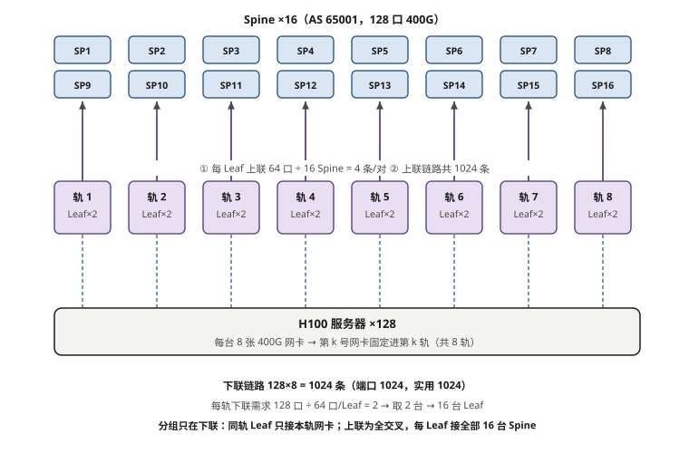
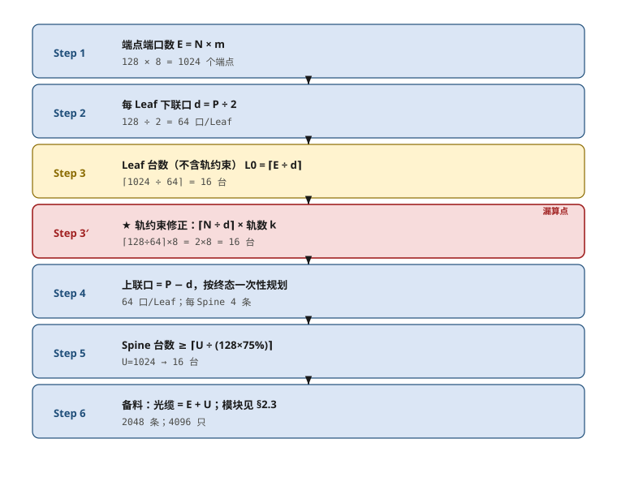
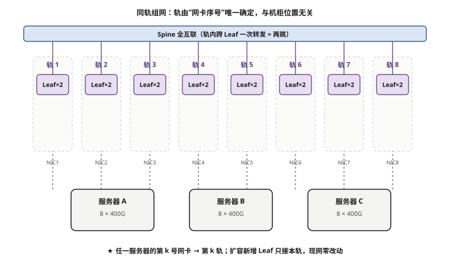
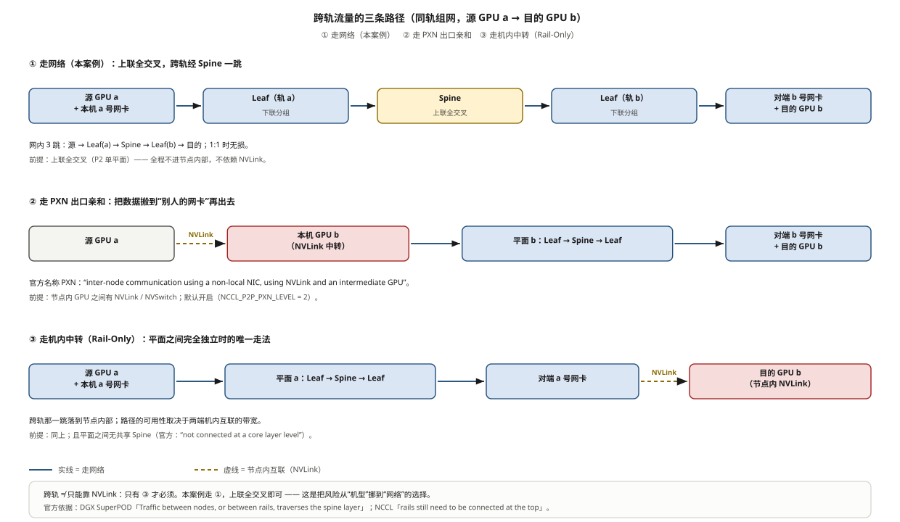
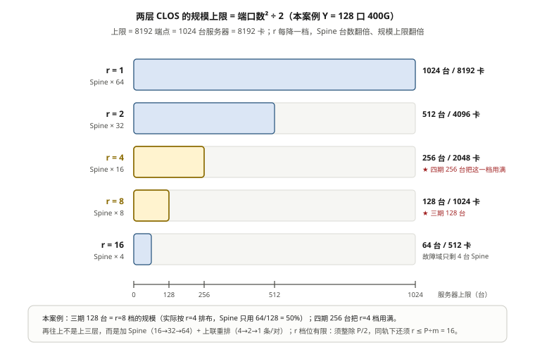

# 第 3 章　算力网络拓扑设计实战

> **本章一句话结论**：端口配比不是"要买多少台交换机"的问题，是把「卡数」翻译成「端口账」、再把「端口账」翻译成「分期施工图」的问题。

---

## 3.1　工程问题：一份物理上无法执行的合同条款

### 条款原文与它的算术

合同技术条款里有一句看起来很合理的话：

> **所有服务器相同序号的高速 RDMA 网卡，统一接入同一台 Leaf 交换机。**

按照"每张卡一个 400G 口、同序号网卡归同一台 Leaf"来理解，实施时算出来的是这样一笔账：

```
96 台服务器（当时规模）的同号网卡 = 96 个下联端口
按 1:1 无阻塞，还需要 96 个上联端口
合计 = 96 + 96 = 192 个 400G 端口

单台 128 口 Leaf 的极限：
  下联 64 口 → 最多接 64 台（每台占 1 口）
  96 台 > 64 台
```

**180 个端口装进一台 128 口交换机做不到。这不是"选型不好"，是物理上不存在这样的设备。**

### 意图没错，写法错了

把这句话拆开看：

| 成分 | 内容 | 评价 |
|---|---|---|
| 意图 | 同号网卡构成独立轨道，不跨轨混接 | **完全正确，必须保留** |
| 实现路径 | "统一接入**同一台** Leaf" | **写死了设备数量，把方案锁死** |

条款的意图是**拓扑性质**（同号网卡在同一轨道、彼此不混），写出来的却是**设备实现**（一台交换机）。当这两者冲突时——比如端口数装不下——就产生了不必要的合同差异。

### 该怎么写

```
✗ 错误写法（绑定设备）
  "所有服务器相同序号的高速 RDMA 网卡统一接入同一台 Leaf 交换机。"

✓ 正确写法（绑定性质）
  "所有服务器相同序号的高速 RDMA 网卡应接入同一组 Leaf 交换机（同一轨道），
   任一轨道内同号网卡不得与其他轨道混接；
   单台 Leaf 的规格与数量由投标方按终态规模与无阻塞要求确定，
   但应满足：轨内任意两台服务器之间，其该号网卡的转发跳数 ≤ 2，
   且上行带宽不低于下行带宽。"
```

**三条通用原则**（写技术条款时反复用）：

1. **写性质，不写设备**。性质是需求，设备是实现。
2. **给可验证的判据**。"转发跳数 ≤ 2"可测，"同一台 Leaf"只能在纸面上对。
3. **留出上游约束**。任何写法都要能通过"最坏情况下装得下吗"这一问。

> 这个案例在本书第 17 章还会出现一次——那里讨论的是**商务层面**怎么处理已经签下的差异条款。这一章讨论的是**技术层面**怎么设计出满足意图的方案。

---

## 3.2　最小必要原理

### 3.2.1　"无阻塞"的严格定义

先破除一个常见误读：**无阻塞 ≠ 不丢包。**

| 概念 | 含义 |
|---|---|
| 无阻塞（non-blocking） | 任意端点对之间，**在流量均匀分布的假设下**，可以同时以线速通信 |
| 不丢包（lossless） | 稳态运行中业务流量不触发重传（靠 PFC/ECN 实现） |
| 零超配（1:1） | 下联总带宽 = 上联总带宽 |

三者关系是：**无阻塞需要 1:1；不丢包需要无损机制。可以做到不丢包但超配（结果就是拥塞时降速），但做不到无阻塞且超配。**

**超配比（oversubscription）的严格算法**：

```
超配比 = 下行总带宽 / 上行总带宽
       = 下联端口总数 / 上联端口总数        （同速率交换机时，可简化为端口数比）

1:1    = 无超配
2:1    = 上行只有下行的一半 → 均匀流量下峰值可达线速，不均匀时排队
```

> **⚠️ 本案例文档里写的"上行带宽不低于下行带宽"是「每台 Leaf」口径，不是全网总量。**
> ```
> 每 Leaf 上联 48 条 × 400 Gb/s = 19.2 Tb/s
> 每 Leaf 下联 48 条 × 400 Gb/s = 19.2 Tb/s    （768 条 ÷ 16 台 Leaf = 48）
> 收敛比 = 19.2 : 19.2 = 1 : 1
> ```
> 全书统一用这个口径。把"每台 Leaf 的端口账"和"全网带宽总量"混用，是这套算术最容易出错的地方。



**图 3-1　两层 CLOS（Spine-Leaf）与 8 条轨的对应关系**　｜　**读图要点**：16 台 Spine 在顶、16 台 Leaf 居中（8 轨 × 2 台）、128 台服务器在底。**每台服务器的第 k 号网卡只进第 k 轨**，所以 8 条虚线是“轨”而不是“冗余”。上联：每 Leaf 64 口 ÷ 16 Spine = 4 条/对，共 1024 条；下联：1024 条。

### 3.2.2　端口配比六步法（可直接套用）

这是本书最实用的一段。给定「服务器数、每台端口数、交换机端口数」，六步算出全部设备的数量。

> **⚠️ 前置约束：这套算术成立在三条前提上，缺一条就要改写。** 本案例三条都满足。
>
> | 编号 | 前置约束 | 本案例 | 不满足时会怎样 |
> |---|---|---|---|
> | **P1** | **同轨组网**——轨 = 网卡序号，每轨独立成组（轨数 k = m） | 甲方要求，8 条轨 | 轨约束消失 → **Step 3′ 取消**，Leaf 回到 L0（一期 8→4 台、二期 16→12 台，三期起相同） |
> | **P2** | **单平面**——全部轨共享同一组 Spine，跨轨流量经 Spine 转发 | Spine 8→16 台共享 | 若改成 8 个**独立平面**：规模上限 ×8（8192 台 / 65536 卡），但平面之间在网络层不互通，跨轨那一跳只能落到**节点内互联**（NVLink / PXN），没有 NVSwitch 的机型做不了 |
> | **P3** | **1:1 无收敛**（合同口径：上行不得低于下行） | 三期全程 1:1 | d ≠ P/2，「下联口 = 上联口」的前提不成立，**从 Step 2 起全部重算** |
>
> **P1 与 P2 是两个独立的开关，别混在一起**：**P1 决定「谁接哪台 Leaf」（下联怎么分组），P2 决定「跨轨怎么走」（上联是否共享）。**
> 本案例是「同轨 + 单平面 + 1:1」；本书后面所有端口数字都在这三条之内，非同轨的对照见 §3.2.3 末尾。

```
已知：
  N  = 服务器台数
  m  = 每台服务器接算力网的端口数
  P  = 交换机端口数
  r  = 每对 Leaf-Spine 之间的链路数（决定 ECMP 粒度与冗余度，通常取 4）

Step 1  端点数          E = N × m
Step 2  每 Leaf 下联口   d = P / 2                （1:1 划分）
Step 3  Leaf 台数        L = ceil(E / d)
Step 4  每 Leaf 带服务器 = d / m
Step 5  Spine 台数       需同时满足：
            ① 吸收上联：S × P ≥ L × (P/2)
            ② 全互联：  L × r ≤ P          ← 给定 r 时的 Leaf 上限（r 越小上限越大）
            ③ 端口余量：每 Spine 占用 ≤ 75% × P
Step 6  校核            每 Spine 实际占用 = L × r
```

**用本案例终态验算一遍**（N=128，m=8，P=128，r=4）：

```
Step 1  E = 128 × 8 = 1024 个端点
Step 2  d = 128 / 2 = 64 口/Leaf
Step 3  L = ceil(1024 / 64) = 16 台？
```

**停一下——终态算出 16 台，恰好等于实际用数。但换二期就不一样了：二期 96 台按这个算法是 12 台，实际却用了 16 台。差的 4 台去哪了？**

因为**轨（rail）约束**。这是本案例拓扑设计里最关键、也最容易被忽略的一步：

```
单卡单轨：第 k 号网卡只能接入第 k 条轨
→ 每轨要独立承载“全部 N 台服务器的该号网卡” = N 个端口
→ 每轨 Leaf 台数 = ceil(N / 64)
→ L = 每轨 Leaf 台数 × 8 轨
   终态 128 台：ceil(128/64) = 2 → L = 16 台（= L0，无额外）
   二期 96 台：ceil(96/64) = 2 → L = 16 台（L0 = 12，多买 4 台）
```

**所以完整的六步法要加一个 Step 3'：**

```
Step 3' 轨约束下的 Leaf 台数
        每轨端口需求 = N × 1（每台服务器在该轨占 1 口）
        每轨 Leaf 台数 = ceil(该轨端口需求 / d)
        L = 每轨 Leaf 台数 × 轨数
```

| 算法 | L | 差异原因 |
|---|---|---|
| 只看端点数（Step 1–3） | 终态 16 台 / 二期 12 台 | 允许任意服务器接任意 Leaf |
| **加轨约束（Step 3'）** | **终态 16 台 / 二期 16 台** | 每轨必须独立满足，不能跨轨凑 |

**终态 128 台恰好整除（128÷64），轨约束没有多买；二期 96 台则从 12 台变成 16 台，多出 4 台——多出的部分就是“轨道隔离”的代价。** 这笔钱买的是：轨内流量路径可预测、NCCL ring 路径固定、排障时轨的归属清晰。

继续算完：

```
Step 5  Spine 台数：
        ① S × 128 ≥ 16 × 64 = 1024 → S ≥ 8
        ② L × r = 16 × 4 = 64 ≤ 128  ✓（Leaf 台数不是约束）
        ③ 每 Spine 占用 ≤ 96（75%）→ S ≥ 1024 / 96 = 10.7 → 取 11
        ④ 且 r = 64 ÷ S 需为整数（ECMP 均匀摊分）→ S ∈ {8, 16, 32}
                                     ↑ ③④ 一起把 S 抬到了 16
Step 6  每 Spine 实际占用 = 16 × 4 = 64 口 / 128 口 = 50%  ✓
        S = 16 台
```

**注意 ③④ 的作用**：如果只看端口总数，8 台 Spine 就够（8 × 128 = 1024，刚好塞满）。但那样每台 Spine 端口占用 100%，**四期扩容时没有任何位置可插**。本案例把“每 Spine 占用 ≤ 75%”写成硬准则，并要求每 Leaf 到每 Spine 的上联口数 r 为整数（ECMP 均匀摊分），Spine 因此定在 16 台——四期加到 256 台时，每台 Spine 占用 2048 ÷ 16 = 128 口、刚好用满。**这就是“为了三年后的扩容，今天多买 8 台交换机”的算术依据。**



**图 3-2　端口配比六步法（可直接套用到自己的项目）**　｜　**读图要点**：六步里唯一容易漏的是 **Step 3′ 轨约束**：只按 E÷d 算是 12 台 Leaf（二期口径），但每轨必须独立成组，⌈96÷64⌉×8 = 16 台。本案例二期就差点漏了这 4 台，也是合同争议的算术根源。

### 3.2.3　轨（Rail）的定义与收益

```
轨 = 网卡序号

   服务器 S01                                    Leaf 层
   ┌──────────────┐
   │ GPU0 ─ 网卡0 ┼────────────────────────────► 轨1  Leaf 组（2 台）
   │ GPU1 ─ 网卡1 ┼────────────────────────────► 轨2  Leaf 组
   │ GPU2 ─ 网卡2 ┼────────────────────────────► 轨3  Leaf 组
   │   ...        │                              ...
   │ GPU7 ─ 网卡7 ┼────────────────────────────► 轨8  Leaf 组
   └──────────────┘
                    Spine 层（共享，不区分轨）
```

**四条设计规则**：

| 规则 | 内容 | 原因 |
|---|---|---|
| R1 | 轨归属由**卡号**唯一确定 | 与机柜位置解耦——服务器换柜不改轨 |
| R2 | 同轨 Leaf **只接本轨网卡** | 轨内路径可预测，排障边界清晰 |
| R3 | 轨之间不设 Leaf-Leaf 直连，跨轨流量全部经 Spine 转发 | 保持 CLOS 结构，避免环路与不规则路径 |
| R4 | **上联侧不做轨分组**：每台 Leaf 都与**全部** Spine 建立 r 条链路（全交叉） | 8 条轨必须收敛成一张网；Spine 只做无状态转发，简化 ECMP |

**⚠️ 这一段最容易读错，值得单独钉死：分组只发生在下联侧，上联侧是全交叉。**

```
轨道（下联：分组）                         每台 Leaf 的上联（全交叉：不分组）
────────────────────                       ──────────────────────────────────
轨 1 Leaf 组 ← 各服务器第 1 号网卡         ┐
轨 2 Leaf 组 ← 各服务器第 2 号网卡         ┤ 这 8 组里的每一台 Leaf，
      ...                                  ┤ 都与全部 S 台 Spine 各连 r 条
轨 8 Leaf 组 ← 各服务器第 8 号网卡         ┘
```

**为什么上联不能也按轨分组？** 如果让"轨 i 的 Leaf 只接第 i 组 Spine"，8 条轨就变成 8 张**互不相通的网**。
而真实流量并不总落在同一轨内 —— GPU a 发给 GPU b（a ≠ b）时，源端走 a 号网卡、目的端走 b 号网卡，
**跨轨流量是常态**（第 1 章讲过，AllToAll 就是"每张卡朝所有卡发"）。上联一分组，这类流量在网络层就没路了，
只能退回节点内部、靠 NVLink 中转（见本节末"跨轨那一跳走哪里"），等于把集群的可用性押在服务器内部互联上。

**这条不是笔者的经验之谈，官方文档两处都写了：**

- **跨轨本来就是设计内的正常路径。** NVIDIA DGX SuperPOD 参考架构（H100）：*"Traffic per rail of the DGX H100 systems is always one hop away from the other 31 nodes in a SU. **Traffic between nodes, or between rails, traverses the spine layer.**"* —— 跨轨走 Spine，也就是走网络。
- **就算把"只用本轨网卡"配死，轨道之间在网络顶层仍然必须连通。** NCCL 官方对 `NCCL_CROSS_NIC=0` 的说明里明确留了口子：*"if the communicator does not contain the same GPUs on each node, NCCL may still need to communicate across NICs"*；NCCL 早期版本的同一段更直白：*"there are corner cases for which NCCL may still cause cross-rail communication, so **rails still need to be connected at the top**."* —— 顶层不连通，这些"角落情况"就是死路。

**所以轨优化切的是下联的接入边界，不是上联的转发边界。**

| 说法 | 对不对 | 说明 |
|---|---|---|
| "8 条轨各自成组" | ✓ | 指**下联**：同轨 Leaf 只接本轨网卡 |
| "每台 Leaf 接全部 Spine" | ✓ | 指**上联**：全交叉，每对 r 条 |
| "轨 i 的 Leaf 只接第 i 组 Spine" | ✗ | **上联分组 = 抽掉跨轨唯一那条网络路径**。跨轨流量被迫退回节点内 NVLink 中转；而 NCCL 官方明说"某些情况下仍会跨 NIC"，届时就是死路 |
| "Leaf 之间拉直连省一跳" | ✗ | 破坏 CLOS 结构，产生环路与不规则路径 |

**收益与代价（要如实写清）**：

| 项目 | 收益 | 代价 |
|---|---|---|
| 路径可预测 | NCCL ring 的轨道形状固定，性能方差小 | — |
| 排障清晰 | 某轨异常 → 只查该轨 2 台 Leaf | — |
| 扩容安全 | 新增 Leaf 不影响其他轨 | — |
| **转发跳数** | 同 Leaf 内 1 跳 | **跨 Leaf 需经 Spine = 2 跳** |
| **Leaf 台数** | — | **每轨独立向上取整（二期 12 → 16 台）** |

> **"2 跳"这件事必须提前和甲方说清楚。** 本案例合同里写了"保障同轨内节点单跳无损通信性能"，实际轨内跨 Leaf 是两跳——这条成了合同差异项。
> **正确的说法是**：轨内通信的跳数取决于两端是否落在同一台 Leaf；跨 Leaf 时为两跳，收敛比仍为 1:1、仍为无损。**"单跳"是性能口语，不是拓扑承诺。**



**图 3-3　同轨组网：轨由网卡序号唯一确定**　｜　**读图要点**：8 列就是 8 条轨，每列有自己的 Leaf 组，列间不混接。任一服务器的第 k 号网卡沿虚线上升进第 k 轨 —— **轨归属只由卡号决定，与服务器插在哪个柜、哪个 U 位无关**。扩容时新增 Leaf 只接本轨，现网路由与轨映射零改动。

#### 同轨 vs 非同轨：前置约束一换，哪些数会变

前置约束 P1 有两个互斥的选择，Leaf 台数的算式不一样：

```
同轨（本案例）  L = 轨数 k × ⌈该轨端口需求 ÷ d⌉ = 8 × ⌈N ÷ 64⌉   每轨独立成组、各自向上取整
非同轨          L = ⌈总端点数 E ÷ d⌉         = ⌈8N ÷ 64⌉        全网通算，任一端点可接任一台 Leaf
```

**用二期 96 台看差别**（差别最大的分期）：

```
同轨：   每轨 96 口 ÷ 64 = 1.5 → 向上取整 2 台/轨 → L = 2 × 8 = 16 台
         每台 Leaf 实际下联 96 ÷ 2 = 48 口（48 / 64 = 75%，16 口暂时空着）

非同轨： E = 96 × 8 = 768 口 ÷ 64 = 12 台（每台正好装满 64 口，100%）
         同一批端口，12 台就够 → 少买 4 台
```

| 分期 | 服务器 | 非同轨 Leaf | **同轨 Leaf（本案例）** | 多买 | 非同轨下联利用 | 同轨下联利用 |
|---|---|---|---|---|---|---|
| 一期 | 32 台 | 4 | **8** | +4 台 | 64/64 = 100% | **32/64 = 50%** |
| 二期 | 96 台 | 12 | **16** | +4 台 | 64/64 = 100% | 48/64 = 75% |
| 三期 | 128 台 | 16 | 16 | 0 | 64/64 = 100% | 64/64 = 100% |
| 四期 | 256 台 | 32 | 32 | 0 | 64/64 = 100% | 64/64 = 100% |

**读表要点：同轨的代价全部集中在前两期**，到三期两者完全重合。原因是 8 与 96 都不是 64 的整数倍，而 128 与 256 是——**每轨向上取整的误差，被 8 条轨放大了 8 倍**。本案例一期那 8 台 Leaf 里有 4 台（256 个端口）就是为「轨纪律」提前占的位。

**这笔钱换到四样东西：**

| 换到什么 | 同轨 | 非同轨的对应情况 |
|---|---|---|
| **路径可预测** | 同号网卡流量固定走同一条轨，NCCL 可按轨建 ring，性能方差小 | 同一对卡不同时刻可能落到不同 Leaf，时延方差大 |
| **排障边界清晰** | 某轨异常 → 只查该轨的 q 台 Leaf，与另外 7 轨无关 | 一台 Leaf 挂掉影响的是「散布各处的名册」，要全网查 |
| **扩容只动一轨** | 加服务器只影响对应轨的下联口；新增 Leaf 只接本轨 | 新节点可能改变 Leaf 归属，甚至要改线 |
| **配置可机械核对** | 卡号 → 轨 → Leaf 组 → 标签逐级对齐，`NCCL_IB_HCA` 的 rail 字段能显式写死 | rail 字段只能填 `-1`，由框架自己猜拓扑 |

**代价也要写明**：轨内一旦有多台 Leaf（二期起每轨 2 台），**同轨通信也不再保证一跳**——同轨两台服务器落在不同 Leaf 时，仍要经 Spine 转发。第 18 章表 18-5 量化了这条：96 台时轨内同 Leaf 命中率只剩 50%。

> **一句话钉死**：**「同轨」约束的是「谁接哪台 Leaf」，不是「跨轨能不能走」。** 本案例 8 条轨共享同一组 Spine（P2 单平面），跨轨流量**走网络**（`Leaf → Spine → Leaf`），只是多一跳。
>
> 反过来，**若把「同轨」理解成「8 张互不相通的网」，那就从「轨优化」变成了「多平面」**——上限确实 ×8（8192 台 / 65536 卡），但平面之间在网络层不互通，跨轨那一跳只能落到节点内互联。**注意"多平面"本身不是错的**：NVIDIA 的 DGX SuperPOD 就用了多平面（B300 是双平面），官方原话是 *"these two independent planes are not connected at a core layer level"*，换来的是 *"**twice as many nodes** ... on 2-layer fabric"*。**它不是错的，它是另一条扩容轴**——代价是跨轨从此依赖节点内互联。

#### 跨轨那一跳走哪里：三条路径、三个前提

"跨轨"这个词其实指两件不同的事，混起来就会得出相反的结论。先把它们分开：

| 说法 | 指的是什么 | 本案例怎么走 |
|---|---|---|
| **轨之间**（同一平面内，网卡序号 a ≠ b） | 源是 a 号卡、目的是 b 号卡，但**都还从"本机自己的网卡"出去** | 走网络：`Leaf(a) → Spine → Leaf(b)`，一跳 Spine。**官方定义即如此** |
| **平面之间**（多平面组网，第 i 个平面与第 j 个平面） | 两套彼此独立的 Leaf + Spine 域 | **网络层不互通**（官方原话："not connected at a core layer level"）。**但正常通信不需要跨平面** |

第三条路径最容易被忽略，也最容易被讲错 —— **GPU 想从"别人的网卡"出去**：

| 路径 | 走法 | 前提 | 代价 |
|---|---|---|---|
| ① **网内跨轨**（本案例） | 源 GPU a → 本机 a 号网卡 → Leaf(a) → **Spine** → Leaf(b) → 对端 b 号网卡 → 目的 GPU b | 上联全交叉（P2 单平面） | 多一跳 Spine，1:1 时仍无损 |
| ② **出口亲和（PXN）** | 源 GPU a →（节点内互联）→ 本机 b 号网卡 → **平面 b** → 对端 b 号网卡 → 目的 GPU b | 节点内 GPU 之间有 NVLink/NVSwitch | 节点内多一次搬运，占 NVLink 带宽 |
| ③ **机内中转（Rail-Only）** | 源 GPU a → 本机 a 号网卡 → **平面 a** → 对端 a 号网卡 →（节点内互联）→ 目的 GPU b | 同上，且跨轨只能靠节点内搬运 | 同上，路径依赖两端机内互联 |

NCCL 官方把 ② 称为 **PXN**，文档原文是 *"inter-node communication using a **non-local NIC, using NVLink and an intermediate GPU**"*（见 `NCCL_PXN_DISABLE`），而且**默认开启**（`NCCL_P2P_PXN_LEVEL` 默认值 2）。

**这里必须澄清一个常见误解：跨轨不等于"只能靠 NVLink"。**

- 在**上联全交叉**的轨优化网络里（本案例、NVIDIA SuperPOD H100），跨轨走 **Spine，走网络**；
- 只有 **Rail-Only（平面之间完全独立、无共享 Spine）** 才必须靠节点内 NVLink 中转；
- PXN 是**出口亲和优化**（少一跳、把多张网卡的流量聚合到同一出口），不是跨轨的唯一出路。

**所以本案例选"单平面"的真正理由，不是"多平面没有路径"，而是：不让跨轨的可用性依赖于服务器内部互联。**
对一台 PCIe-only、没有 NVSwitch 的机型，路径 ② / ③ 直接做不了或极慢；而路径 ① 只需要网络里有 Spine —— **这是把风险从"机型"挪到"网络"的一次选择。**



**图 3-4　跨轨流量的三条路径：走网络、走 PXN、还是走机内中转**　｜　**读图要点**：① 是本案例的做法——上联全交叉，跨轨经 Spine 一跳，**不依赖节点内互联**；② 是 NCCL 的 PXN 机制（默认开启），把数据搬到"别人的网卡"出去，前提是节点内有 NVLink；③ 是 Rail-Only（平面之间完全独立）时的唯一走法，跨轨必须落到节点内 NVLink。**"跨轨只能靠 NVLink"只对 ③ 成立。**


### 3.2.4　为什么必须"按终态一次规划端口分段"

这是"纯加法扩容"能否成立的全部秘密。

**错误做法（按当期规模规划）**：

```
一期 32 台时的规划：
  Leaf P1–P32  = 下联（32 口）
  Leaf P33–P64 = 上联（32 口，连 8 台 Spine，每对 4 条）

二期加 64 台时需要更多下联口 → 必须把上联整体后移
  → 已插好的上联跳线全部要拔掉重插
  → 路由重算、BGP 邻居重建
  → 现网训练受影响
```

**正确做法（按终态规划）**：

```
终态规划：
  Leaf P1–P64  恒为下联   （下联区永不动）
  Leaf P65–P128 恒为上联  （上联区永不动）

一期：只用 P1–P32（下联）+ P65–P96（上联）
二期：下联用到 P1–P64（a 机满、b 机半）+ 上联 P65–P112（48 口）
三期：满配 P1–P64 + P65–P128（下联、上联各 64 口）
```

**关键差别：一期插的跳线，二期一根都不用拔。** 新增的只是"原来空着、现在插上"的端口。

| 对比项 | 按当期规划 | 按终态规划 |
|---|---|---|
| 二期施工内容 | 拔插已有上联 + 新增 | **只新增** |
| 现网路由 | 全量重算 | 零改动 |
| 轨映射 | 可能变化 | 零改动 |
| NCCL 配置 | 可能需重生成 | 零改动 |
| 训练中断 | 必须 | **不需要** |
| 一期多花的钱 | — | P33–P64 空置（无额外成本，端口本来就有） |

**注意最后一行的结论：按终态规划的增量成本是零。** 交换机端口数量是买定不变的，只是"先空着"还是"后空着"的区别。**唯一需要放弃的是"一期少买几台交换机"的短期省钱冲动——而那恰恰是最贵的省法。**

---

## 3.3　选型对比

### 3.3.1　交换机端口数：24 / 64 / 128 口的严格对比

用六步法算三种端口的规模上限（**统一取 r=4 作同口径对比**；每台 8 口、1:1）：

| 交换机端口 P | 每 Leaf 下联口 P/2 | 每 Leaf 带服务器 | 约束 L × r ≤ P | L 上限 | 端点上 限 | **服务器上限** | 能否支撑 128 台 |
|---|---|---|---|---|---|---|---|
| 24 | 12 | 1（12÷8，浪费 4 口） | L ≤ 6 | 6 | 72 | **9 台** | ✗ |
| 64 | 32 | 4 | L ≤ 16 | 16 | 512 | **64 台** | ✗ |
| **128** | **64** | **8** | L ≤ 32 | **32** | **2048** | **256 台** | **✓** |

> **读表提醒**：第四列的"服务器上限"是**固定 r=4** 的口径，用于三种交换机在同一套排布规则下横向对比，**不是拓扑上限**。
> 两层 CLOS 的拓扑上限与 r 无关：**上限 = 端口数² ÷ 2**（推导见 §1.3）。三者换算成本案例口径是
> **24 口 → 288 端点（36 台）、64 口 → 2048 端点（256 台）、128 口 → 8192 端点（1024 台）**。

**这张表的结论非常干净**：

- **24 口交换机从第一期就该出局。** 它的两层上限只有 24²÷2 = 288 端点 = **36 台**；要凑够一期 32 台，得配 24 台 Leaf + 12 台 Spine（36 台设备、每对仅 1 条链路），是 128 口方案（16 台设备）的两倍多，而且**天花板就在 36 台**，二期就撞墙。
- **64 口交换机的上限是 256 台。** 它能撑一期 32 台，也勉强能撑到四期 256 台，但**要用 64 台 Leaf + 32 台 Spine（96 台设备、每对 1 条链路）**，而同规模的 128 口方案只要 48 台设备。**64 口不是"不够用"，是"用不起"。**
- **只有 128 口能给三期之后的扩容留出空间。** 它的上限是 8192 端点 = **1024 台**，而 64 口的上限正好是 256 台——**一步都富余不出来**。

> 本案例评审时的原始结论是"为兼顾未来扩展及施工冗余备用口，Leaf 层放弃 24 口交换机，统一采用 128 口组网"。**这句话背后就是上面这张表。**

**关于"施工冗余备用口"这一条，值得单独说**：128 口交换机在一期只用了 64 口（32 下联 + 32 上联），剩下一半空着。这不是浪费——**现场一定会遇到"这根跳线短了/模块坏了/临时调试"的情况，有备用口可以直接换到旁边，没有就只能等备件。** 在已经完成 30% 施工的机柜里等备件，代价远高于那几个端口。

### 3.3.2　收敛比：1:1 / 2:1 / 4:1 的代价

以终态 128 台、16 台 Leaf 为基数：

| 收敛比 | 每 Leaf 上联口 | 上行总链路 | Spine 台数（r=4） | 交换机总数 | 相比基线 |
|---|---|---|---|---|---|
| **1:1** | 64 | 1024 | **16** | **32** | 基线 |
| 2:1 | 32 | 512 | 8 | 24 | −8 台 |
| 4:1 | 16 | 256 | 4 | 20 | −12 台 |

**成本差额**（按约 32 万元/台）：

```
2:1  省 8  台 × 32 万 = 256 万元
4:1  省 12 台 × 32 万 = 384 万元
```

**但代价是三条，必须一起看**：

| 代价 | 说明 |
|---|---|
| AllToAll 掉速 | MoE / 专家并行的流量接近均匀全互联，超配直接变成瓶颈 |
| 故障域放大 | 4:1 时只有 4 台 Spine，**单台故障即损失 25% 上行带宽** |
| 合同风险 | 本案例合同明文要求"上行不得低于下行"——**超配在条款层面就已出局** |

**结论：训练集群不要超配。** 那 256 万省下来的代价，是训练效率的长期损失——按集群生命周期算，一次 5% 的算力利用率损失，远超过 256 万的设备差价。

> 例外只有一类：**纯推理集群**。推理是请求-响应模式，流量不像训练那样同步爆发，2:1 甚至 3:1 在很多场景下是合理的。**但同一套硬件如果既跑训练又跑推理，就要按训练的口径设计。**

### 3.3.3　两层 vs 三层：真正的门槛在哪

**两层（Spine-Leaf）的规模上限是「端口数² ÷ 2」，与用了几台 Spine 无关**（推导见 §1.3）。这条上限**与是否同轨组网无关**（它是一个端点计数界）；同轨收紧的是 **r 的可行域**，见下：

```
上限 = Y² ÷ 2 = 128² ÷ 2 = 8192 个端点 = 1024 台服务器 = 8192 卡
```

**r 是"上限"与"布线成本"之间的旋钮**：r 每降一档，Spine 台数翻倍、规模上限翻倍。

| 档位 | Spine 台数 | Leaf 上限 | 服务器上限 | 每 Spine 占用 | 本案例的位置 |
|---|---|---|---|---|---|
| r = 4 | 16 | 32 | 256 台 / 2048 卡 | 100% | **三期 L=16（半档）；四期 256 台正好用满** |
| r = 2 | 32 | 64 | 512 台 / 4096 卡 | 100% | 四期之后：Spine 16→32 + 上联重排 4→2 条/对 |
| r = 1 | 64 | 128 | **1024 台 / 8192 卡** | 100% | 再往后：Spine 32→64 + 上联重排 2→1 条/对 |

**所以在本案例里，"扩容"不等于"上一层"，而是"加 Spine + 重排上联"。** 三期把 Spine 由 8 台补到 16 台、每对链路 6→4 条，做的就是这件事（§3.4.1）——这是全书唯一一处需要改接已布放跳线的扩容动作，但它换来的是**规模翻倍**，比重建一个三层便宜得多。



**图 3-5　两层 CLOS 的规模上限：r 每降一档，Spine 翻倍、上限翻倍**　｜　**读图要点**：横轴是"服务器上限"，五条横柱对应 r=1／2／4／8／16 五个档位，本案例三期（128 台）落在 r=8 档的规模上、四期（256 台）把 r=4 档用满。****r 的档位是有限的**：r 必须整除 P/2 = 64；同轨下还要满足 **r ≤ P ÷ m = 16**（Leaf 台数必须是轨数 m 的整数倍 ⇒ L ≥ m ⇒ m·r ≤ P，见 §3.2.3 前置约束 P1）——所以“加 Spine 换规模”最多做到 r = 1 的 8192 端点，**尽头不是“拓扑不成立”，而是“没有更小的 r 可用了”**。**非同轨没有这条限制**，r 只须整除 P/2，理论上能取到 64——但那时只剩 1 台 Spine、16 台服务器，已退化成单台交换机，没有工程意义。

> **一个容易被算错的坑**：把"r=4 时的填满点 256 台"当成"两层拓扑的上限"，就会得出"四期一到顶、再往上必须上三层"的结论。真实情况是：**256 台只是 Spine 端口被用满的那一点，加一层 Spine 就能继续翻倍。**

**真正必须上三层的三个条件（满足任一）**：

| 条件 | 判据 | 本案例状态 |
|---|---|---|
| 端点数越界 | E > Y² ÷ 2 = 8192（即 > 1024 台 / 8192 卡） | 终态 1024 端点 = 上限的 **1/8** ✓ |
| 单 POD 到顶 | 供电 / 制冷 / 承重已达单 POD 上限 | 未触发 |
| 端口基数到头 | 换更大端口数的交换机仍不够（256 口 → 32768 端点仍越界） | 未触发 |

**先问"能不能换更大基数的交换机"，再问"要不要上三层"。** 128 口换 256 口（102.4T 芯片），上限从 8192 端点变成 32768 端点——**同样的两层结构、同样的 IP 规划、同样的施工工法，规模翻四倍**；而上二层 Core 是"多一层设备、多一段延迟、多一套配置、机房要重做"。这两笔账要放在一起算。

**三层的代价（让读者知道越界的真实成本）**：

| 项目 | 两层 | 三层 | 增量 |
|---|---|---|---|
| 交换机层数 | 2 | 3 | 多一整层 |
| 转发跳数（跨 POD） | 2 | 4 | 延迟翻倍 |
| 交换机台数（同规模） | 32 | 32 + Core 层 | Core 层另计 |
| 布线 | 下联 + 上联 | 下联 + 上联 + 上上行 | 链路数显著增加 |
| BGP 邻居 | 1024 | 显著增加 | 控制面压力上升 |
| 机柜/供电/配线 | — | 需新增 | 机房改造 |

**所以本案例最正确的动作是：把 256 台这条线写进规划文件，并在四期方案评审时第一个拿出来。** 它把一个"经验判断"变成了一个"提前三年就知道的数字"。

---

## 3.4　实测与踩坑

### 3.4.1　三期端口分段表（本案例实际执行表）

| 阶段 | 服务器 | 每 Leaf 下联占用 | 每 Leaf 上联占用 | Spine 台数 | 每 Spine 下联占用 | 每对 Leaf-Spine |
|---|---|---|---|---|---|---|
| 一期 | 32 | P1–P32（32 口） | P65–P96（32 口） | 8 | 32 / 128 | 4 条 |
| 二期 | 96 | P1–P64（a 机）/ P1–P32（b 机） | P65–P112（48 口） | 8 | 96 / 128 | 6 条 |
| 三期 | 128 | P1–P64（a / b 机各 64 口） | P65–P128（64 口） | 16 | 64 / 128 | 4 条 |

**这张表里藏着两个设计准则：**

**准则一：每台 Leaf 的分段边界恒定在 P64 / P65。**

```
P1 ─────────────────── P64 │ P65 ─────────────────── P128
        下联区（永不动）    │      上联区（永不动）
```

一期只启用 P1–P32 与 P65–P96，空着的端口**不是"没规划"，是"已规划未启用"**。二期、三期只是把空位插上。

**准则二：每台 Spine 的端口占用不超过 128 口的 75%。**

```
一期：8  Leaf × 4 条 = 32 口/Spine    （25%）
二期：16 Leaf × 6 条 = 96 口/Spine    （75%）
三期：16 Leaf × 4 条 = 64 口/Spine    （50%，为四期留出余量）
```

**二期到三期，Spine 从 8 台扩到 16 台，同时每对链路数从 6 条降到 4 条——这叫"上联重排"。**

这是整个项目里**唯一一处需要动已经插好的线**的地方：

```
二期状态：16 Leaf ──(6 条/对)── 8  Spine     每 Spine 96 口
三期状态：16 Leaf ──(4 条/对)── 16 Spine     每 Spine 64 口

从二期到三期必须做的事：
  ① 补购 8 台 Spine（SP09–SP16）到货并上架
  ② 存量 16 台 Leaf：每台拆掉通往老 Spine 的 16 条（8 台 × 2 条），
     改插到新 Spine 32 条（8 台 × 4 条），上联由 48 条增至 64 条
  ③ 下联不动：三期不再新增 Leaf，只需把每台 Leaf 空着的 P49–P64 插满
```

**"上联重排"是纯加法扩容里唯一的例外，必须在方案阶段就识别出来并争取施工窗口。** 本案例把它列为三期施工前置条件之一，要求甲方书面认可停机窗口。

### 3.4.2　踩坑：Spine 补购的时序陷阱

```
三期的依赖链：
   三期上联重排 + 下联填满 P49–P64 → 联调
        ↑
   依赖：16 台 Spine 全部在位
        ↑
   依赖：SP09–SP16 已采购并到货

如果先按 8 台 Spine 把三期上联接满：
   16 台 Leaf 的上联只能挤在现有 8 台 Spine 上
   → 每 Spine 变成 16 × r 口，r 最多取 8（16 × 8 = 128）
   → 端口占满 100%，违反「≤ 75%」准则，四期无处可插
   → 等 Spine 到货后必须二次重排全部上联
```

**做法**：把"Spine 补购 8 台必须在动三期上联之前到位"写进**施工前置确认清单**，并标注"未确认不得下单/施工"。

**为什么这件事容易出问题**：Spine 属于"看不见收益"的设备——它不接服务器，加它不会让任何一台服务器上线。**在预算压缩时，Spine 是最容易被推迟的那一项。** 而它一旦推迟，代价会在半年后以"重排施工"的形式还回来。

### 3.4.3　合同争议：同轨"单跳"的语义

```
合同原文：保障同轨内节点单跳无损通信性能
实际实现：轨内跨 Leaf 经 Spine 一次转发 = 两跳；收敛比 1:1、无损
```

**这个差异的本质不是技术问题，是"性能口语"与"拓扑承诺"的混淆。**

| 说法 | 准确含义 | 能否作为验收判据 |
|---|---|---|
| "单跳" | 口语，意思是"很快、路径短" | ✗ 无明确定义 |
| "转发跳数 ≤ 2" | 拓扑层面，可抓包验证 | ✓ |
| "同轨内端到端时延 ≤ X μs" | 性能层面，可测量 | ✓ 推荐 |

**推荐写法**：把"单跳"替换成可测量的时延指标 + 跳数上限。

```
✓ 同轨内任意两台服务器的该号网卡之间：
   转发跳数 ≤ 2
   小消息（16 KB）单向时延 ≤ 【待定】μs
   带宽 ≥ 端口线速的 90%
```

**"单跳"这个词在智算网络合同里几乎没有正面价值——它既不能验收，又给人"零转发"的错觉。**

### 3.4.4　待补的实测数据

| 编号 | 缺口 | 为什么重要 |
|---|---|---|
| O-03 | 768 卡 AllToAll 实测 | 收敛比结论目前只有理论，缺 AllToAll 直接证据 |
| O-08 | 同轨 vs 非轨拓扑的性能差异 | 决定"为了轨隔离多买 4 台 Leaf"这笔钱值不值 |
| O-10 | 超过两层上限（> 8192 端点 / 1024 台 / 8192 卡）时的三层 CLOS 端口配比 | 第 18 章的演进判断需要它 |

---

## 3.5　现场检查清单

### 端口配比算术

- [ ] 已按六步法完整算过一遍，含 **Step 3'（轨约束）**
- [ ] 已确认 Leaf 台数是"轨约束"的还是"端点数"的（本案例二期：16 vs 12）
- [ ] 已算出两层 CLOS 的规模上限，并确认终态未越界
- [ ] 已确认 r（每对 Leaf-Spine 链路数）取值及其冗余含义
- [ ] 每 Spine 端口占用 ≤ 75% 已作为硬约束校核
- [ ] 收敛比按"每 Leaf 上联口 : 下联实用口"计算，未与全网总量混用

### 拓扑与轨

- [ ] 轨归属由卡号唯一确定，与机柜位置无关
- [ ] 同轨 Leaf 只接本轨网卡，无跨轨混接
- [ ] 轨间无直连，全部经 Spine 转发
- [ ] 同轨内跨 Leaf 的跳数已明确（本案例为 2 跳），并已与甲方书面确认
- [ ] 合同中"单跳""零转发"类口语表述已替换为可验证判据

### 分段与扩容

- [ ] 端口按**终态**一次分段（本案例：P1–P64 下联 / P65–P128 上联）
- [ ] 各期只"启用"新端口，不移动已用端口
- [ ] 已识别出唯一的"重排"动作（本案例：二期→三期上联重排）
- [ ] 重排所需的施工窗口已争取并书面确认
- [ ] Spine 补购时序已列入前置条件（本案例：SP09–SP16 须先到位）
- [ ] 四期/越界规模已写进规划文件，作为三层触发线

### 设备选型

- [ ] 交换机端口数已按"终态规模 + 余量"选择，不是按当期规模
- [ ] 已核实所选端口数能撑到终态（本案例 128 口 → 256 台）
- [ ] 施工备用端口已预留（建议 ≥ 25%）
- [ ] 交换机整机冷备件已计入 BOM

---

## 3.6　成本与工期影响

### 这一章的决策值多少钱

| 决策 | 金额影响 | 工期影响 |
|---|---|---|
| 交换机选 128 口而非 64 口 | 单台贵约 1.3 倍，但**避免二期全部换设备** | 避免一次全网重构 |
| 轨约束导致二期 Leaf 16 台而非 12 台 | +4 台 ≈ **128 万元** | — |
| 按终态分段 | **增量成本为零** | 避免扩容时的重排窗口 |
| Spine 留 75% 余量（16 台而非 8 台） | +8 台 ≈ **256 万元** | 四期扩容零采购 |
| 收敛比降到 2:1 | **−256 万元** | 代价：AllToAll 掉速 + 故障域放大 |
| 上联重排 | 施工费另计 | **需停机窗口** |
| Spine 补购延迟 | 需二次重排 | 三期整体延期 |

### 关键结论：两笔"看起来浪费"的钱

```
① 轨约束多买的 4 台 Leaf         ≈ 128 万元
② Spine 留余量多买的 8 台 Spine  ≈ 256 万元
                                  ─────────
                                   384 万元
```

这 384 万元在采购评审时**一定会被质疑**：“能不能少买 12 台？”

**能。用 3.2.4 和 3.3.2 的算术可以回答清楚：**

- 少买 4 台 Leaf → 轨道隔离破功，轨内路径变得不可预测，排障边界消失，**且四期扩到 256 台时必然不够**；
- 少买 8 台 Spine → 每 Spine 端口占用 100%，**四期扩容时无处可插，必须重新采购并重排全体上联**。

**这两笔钱买的不是性能，是"三年后不用推倒重来"。** 把它们在方案阶段就算清楚、讲明白，比事后解释便宜得多。

### 一期投资的结构参考

| 模块 | 占比 |
|---|---|
| 计算网（含交换机、光模块、线缆、配线、冷备件） | **63.2 %** |
| 存储网 | 28.2 % |
| 业务网 + 带外网 + 施工 | 8.6 % |

**计算网独占 63%。** 这一章的所有取舍都落在这 63% 里面——**端口配比的算术每错一步，都是在这个最大的一块上错。**

---

## 本章要点回顾

1. **技术条款写性质，不写设备。** "同一台 Leaf"把方案锁死了，"同一轨道 + 跳数 ≤ 2"才对。
2. **无阻塞 ≠ 不丢包 ≠ 零超配**。无阻塞需要 1:1；不丢包靠无损机制。
3. **收敛比要按「每 Leaf 上联口 : 下联实用口」算**，不要与全网带宽总量混用。本案例全程 1:1，单台 Leaf 上行带宽 = 下行带宽。
4. **六步法必须加 Step 3'：轨约束。** 本案例二期由此从 12 台 Leaf 变成 16 台——多出的 4 台是“轨道隔离”的价格。
5. **“每 Spine 占用 ≤ 75%”是硬准则。** 它把 Spine 从 8 台抬到 16 台，买的是一年后扩容不用重排。
6. **按终态分段，增量成本为零。** P1–P64 恒下联、P65–P128 恒上联——一期插的线，二期一根都不用拔。
7. **两层 CLOS 的上限 = 端口数² ÷ 2**（本案例 8192 端点 = 1024 台 / 8192 卡）。**r 是旋钮、不是上限**：扩容先加 Spine 并重排上联，最后才考虑上三层。
8. **训练集群不要超配。** 省下的 256 万，会以 AllToAll 掉速和故障域放大还回去。
9. **纯加法扩容只有一个例外：上联重排。** 必须提前识别、争取停机窗口，并保证前置设备先到货。
