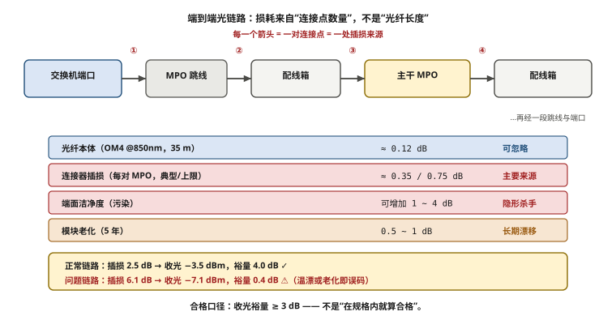
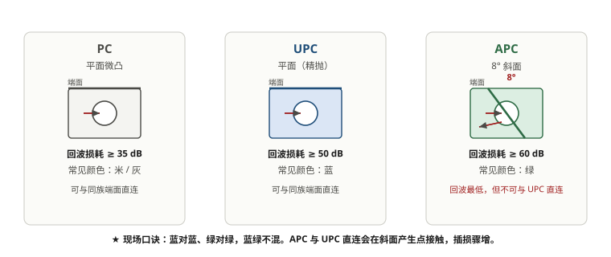
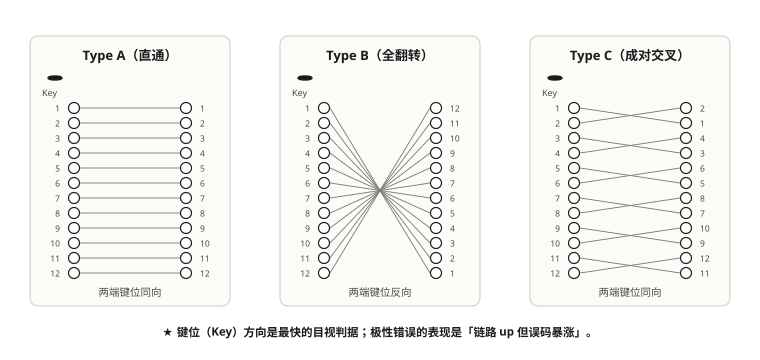
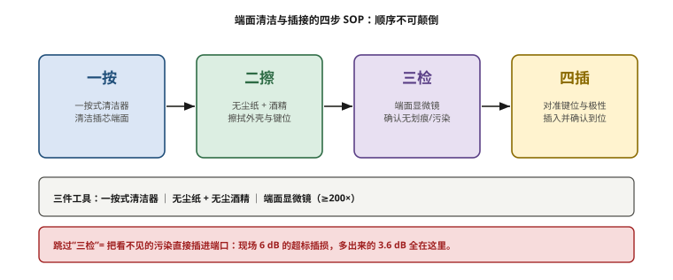

# 第 4 章　光模块与光纤物理层深度剖析

> **本章一句话结论**：这一层没有玄学——所有"链路抖动""时好时坏"的问题，90% 都能在同一份账单里找到原因：端面脏了、极性错了、模块批次不一样。

---

## 4.1　工程问题：一个"测不出问题"的链路

### 现场的样子

二期扩容完成后，某几条链路在压测时表现出一种让人抓狂的行为：

```
ib_write_bw 单口测试：  跑满 360 Gb/s  ✓
连续 5 分钟压测：       吞吐在 340 ~ 362 Gb/s 之间小幅波动
24 小时稳定性测试：     第 7 小时出现一次吞吐掉到 180 Gb/s，持续 12 秒后自愈
```

**所有常规检查都"干净"：**

| 检查项 | 结果 |
|---|---|
| 交换机端口错包计数 | 0 |
| PFC 计数 | 0 |
| ECN 标记计数 | 0 |
| 链路 CRC 错误 | 0 |
| 光功率（收 / 发） | 在规格范围内 |

**问题在于"在规格范围内"这六个字。**

光模块的收光规格是"最小灵敏度 ~ 最大饱和光功率"这样一个区间，比如某 400G SR4 模块的收光范围是 **-7.5 dBm ~ +2.4 dBm**。如果一条链路的收光是 **-7.1 dBm**，它在规格内——但它离下限只有 0.4 dB。

```
正常链路：   发射 -1.0 dBm − 插损 2.5 dB = 接收 -3.5 dBm   （裕量 4.0 dB）✓
问题链路：   发射 -1.0 dBm − 插损 6.1 dB = 接收 -7.1 dBm   （裕量 0.4 dB）⚠
```

**0.4 dB 的裕量意味着什么？** 温度漂移、模块老化、连接器微动、纤芯受力——任何一项带来 0.5 dB 的变化，链路就会进入误码区。而误码在 RoCE 上不会表现为"缓慢降速"，会表现为**重传 → 抖动 → 偶发的流量断崖**。

**这就是"时好时坏"的物理成因。**

### 根因

拆下那几条链路的光缆，用端面检测仪一看：**MPO 端面有纤维碎屑与指纹污染。**

插损从 2.5 dB 涨到 6.1 dB，多出来的 3.6 dB 全在这里。

**一次污染的成本**：现场排障 2 人 × 1.5 天 + 链路复测 + 施工方返工。而清洁一根 MPO 端面的成本：**约 30 秒。**

**这个比例是本章全部内容的价值所在。**

---

## 4.2　最小必要原理

### 4.2.1　形态：模块的封装由设备端口决定

这是采购阶段最容易搞错的一件事。**光模块的封装形态（QSFP-DD / OSFP / QSFP112）不是由"链路速率"决定的，是由设备上的笼子（cage）决定的。**

| 封装 | 电口通道 | 单通道速率 | 400G 实现 | 典型 800G 能力 | 尺寸特点 |
|---|---|---|---|---|---|
| QSFP112 | 4 | 112 Gb/s PAM4 | 4 × 100G | 不支持 | 与 QSFP28/QSFP56 同尺寸，可向下兼容 |
| QSFP-DD | 8 | 50 Gb/s PAM4 | 8 × 50G | 支持 | 比 QSFP 长，双排金手指 |
| **OSFP** | 8 | 50 / 100 Gb/s | 8 × 50G | 支持 | 略大，散热好，面向 800G/1.6T |

**本案例的情况值得单独讲**：

```
服务器侧：OSFP 封装（400G SR4）
交换机侧：QSFP112 封装（400G SR4）
中间：   MPO12-MPO12 OM4 多模光缆
```

**同一根链路的两个端头用了不同封装的模块——这是完全正常的。**

> **关键认知：光缆是"封装无关"的。**
> 光缆只关心"几芯、什么类型（OM4/OM5/OS2）、什么连接器（MPO/LC）、多长"。
> 至于两端插的是 QSFP112 还是 OSFP、是 SR4 还是 DR4，**光缆一个字都不关心**。
>
> **所以采购清单必须分三份：服务器侧模块（跟随服务器）、交换机侧模块（跟随交换机）、光缆（独立）。** 把这三份混成一份，是 BOM 出错的经典起点。

### 4.2.2　调制与光源：为什么是 PAM4

400G 的物理层有三个绕不开的概念：

```
① PAM4（四电平脉冲幅度调制）
   传统 NRZ：一个符号 1 bit（高/低）
   PAM4：   一个符号 2 bit（4 个电平）
   → 同样波特率下，速率翻倍
   → 代价：眼图高度只剩 1/3，对噪声与反射敏感得多

② 400G SR4 的通道构成
   4 通道 × 100 Gb/s PAM4 = 400 Gb/s
   每通道 100G = 53.125 GBd × 2 bit/符号 × 冗余开销

③ 光源
   VCSEL  垂直腔面发射激光器 — 多模短距（SR），850nm，成本最低
   EML    电吸收调制激光器   — 单模中长距（FR/LR），性能最好，最贵
   DML    直接调制激光器     — 单模中距，性价比路线
   SiPh   硅光               — 集成度高，适合量产高密度模块
```

**PAM4 是"反射敏感"的根源。** NRZ 时代 3 dB 的回波损耗恶化可以忽略，PAM4 时代同样的恶化可能直接导致误码。这就是为什么 APC（低反射端面）在高速率场景下越来越重要——见 4.2.4。



**图 4-1　端到端光链路：损耗来自「连接点数量」，不是「光纤长度」**　｜　**读图要点**：从交换机端口到服务器网卡，一条链路要经过 4 个以上连接点。**100 m 内的多模链路，损耗来自连接点而不是光纤长度**：光纤本体只贡献约 0.12 dB，而每个连接点 0.35 dB 起、端面污染可再加 1~4 dB。合格口径是收光裕量 ≥ 3 dB，而不是「在规格内就算合格」。

### 4.2.3　传输距离与类型：SR / DR / FR / LR 怎么选

| 类型 | 波长 | 光纤 | 距离 | 本案例用量 | 单价量级 |
|---|---|---|---|---|---|
| **SR4** | 850 nm | 多模 OM4 | **100 m** | **全部** | 2 400 元 |
| DR4 | 1310 nm | 单模 | 500 m | — | 略高 |
| FR4 | 1310 nm CWDM | 单模 | 2 km | — | 略高 |
| LR4 | 1310 nm LAN-WDM | 单模 | 10 km | — | 更高 |

**选型的第一判据不是"够不够快"，是"机房内最长链路有多长"。**

```
本案例机房的实际情况：
  Leaf 柱分布：A08 / B08 / C08 / D13 / E08 / F08 / G08 / H08
  服务器分布：A / B / C / D / E / F / G / H 列
  最远链路：  A 列端头服务器 → G08 / H08 的 Leaf
```

本案例实际采购的线缆长度分布（一期 32 台）：

| 长度档 | 条数（含 5% 备件） | 用途 |
|---|---|---|
| 15 m | 294 | 同列 / 邻列服务器 ↔ Leaf |
| 20 m | 160 | Leaf ↔ Spine 近距、存储节点线 |
| 25 m | 73 | 跨 1–3 列服务器 ↔ Leaf、主力档 |
| 35 m | 46 | **A/B 列端头 → G08/H08 的最远链路（超 30 m 部分）** |
| **合计** | **573** | 对应一期 512 条算力链路 + 备件 |

**这张表里最有价值的是"35 m 那 46 条"。**

```
SR4 的规格上限是 100 m
本案例最远链路约 35 m
→ 看起来余量巨大，为什么要特别标记？
```

**因为"线缆长度的余量"和"光功率的余量"是两件事。**

```
OM4 光纤的衰减 ≈ 3.5 dB/km @ 850nm
35 m 的光纤衰减 ≈ 0.12 dB        ← 几乎可以忽略

真正吃掉裕量的是：
  连接器插损     每对 MPO 约 0.35 dB（规格上限 0.75 dB）
  跳接点数量     服务器→配线箱→Leaf，可能 2~3 个跳接点
  端面洁净度     污染可增加 1~4 dB
  模块老化       0.5~1 dB（5 年）
```

**一条 5 个跳接点、端面略脏的链路，插损可以轻松到 6 dB——而光纤长度本身只贡献 0.12 dB。**

**结论：在 100 m 以内的数据中心多模链路里，插损几乎全部来自"连接器与端面"，不是来自"光纤长度"。**

这解释了为什么"35 m 也不算什么"，也解释了为什么**端面清洁是这一章最重要的事**。

### 4.2.4　端面：APC 8° 与 UPC 平面

这是本章技术含量最高、也最容易被搞混的一段。

**三种端面研磨方式**：

```
  PC（Physical Contact，物理接触）
    端面轻微球面研磨，直接接触
    回波损耗 ≈ −30 ~ −40 dB
    多模与单模都有，颜色 米色/水绿

  UPC（Ultra Physical Contact）
    端面更平的球面，接触更充分
    回波损耗 ≈ −50 ~ −55 dB
    单模常用，颜色 蓝色

  APC（Angled Physical Contact）
    端面研磨成 8° 斜面
    反射光被折射出纤芯，回波损耗 ≈ −60 dB 以上
    单模用，颜色 绿色
```

**为什么 APC 要做成斜面？**

```
垂直端面：  反射光原路返回 → 回到激光器 → 干扰出射光 → 噪声
8° 斜面：   反射光以 16° 角折射出包层 → 不回激光器 → 噪声大幅降低
```

**混插会发生什么（这是真正的"重灾区"）**：

| 组合 | 后果 |
|---|---|
| APC 插到 UPC 口 | 斜面与平面接触时**中间留空气隙**，且**斜面边缘顶住平面中心** |
| → 光学后果 | 插损剧增（可达 +3~5 dB），回波损耗急剧恶化 |
| → 物理后果 | **端面被压出物理损伤——这是不可逆的** |

**APC 与 UPC 混插最恶劣的地方在于：它不只是"接不通"，它会损伤端面。** 一次误插可能报废两只模块或一根跳线。

**颜色标识速查**：

| 颜色 | 端面 | 光纤类型 |
|---|---|---|
| 蓝色 | UPC | 单模 |
| 绿色 | APC | 单模 |
| 米色 | PC | 多模 OM1 |
| 水绿色（Aqua） | PC | 多模 OM3/OM4 |
| 柠檬绿（Lime） | PC | 多模 OM5 |

**回到本案例**：

```
本案例全部链路 = 多模 OM4 + MPO12 连接器
→ 端面为 PC（平面）
→ 全程不出现 APC
→ 所以本案例**没有**踩 APC/UPC 混插这个坑
```

**但这不是可以跳过这一节的理由。** 只要下一个项目上单模（跨楼、跨机房、园区互联），APC 与 UPC 就会同时出现在同一个机房里——**而现场施工队的默认认知是"接口一样就能插"**。

> **一条铁律**：机房内**只允许存在一种端面标准**。要么全 UPC，要么全 APC。
> 混合存在时，必须用颜色 + 标签 + 物理隔离（不同颜色的法兰盘、不同颜色的跳线）三重区分，并在施工交底时明确交代。



**图 4-2　三种端面（PC / UPC / APC）的剖面对比**　｜　**读图要点**：PC/UPC 是平面接触，APC 是 8° 斜面（把反射光折向包层）。斜面换来更低的回波损耗，代价是**不能再与平面端面直连** —— 点接触会让插损骤增、甚至压坏 APC 一侧。现场只记颜色：蓝对蓝、绿对绿、蓝绿不混。

### 4.2.5　极性：MPO 跳线的 A / B / C 型

MPO 是 12 芯（或 8/16/24 芯）连接器。**"哪一芯对哪一芯"是跳线的极性定义，插错了就是收发光纤对不上。**

```
Type A（直通型）
  1─1  2─2  3─3 ... 12─12
  两端 key 方向相反（key-up 对 key-down）

Type B（交叉型）
  1─12  2─11  3─10 ... 12─1
  两端 key 方向相同（key-up 对 key-up）

Type C（成对交叉）
  1─2  2─1  3─4  4─3 ...
  相邻两芯互换
```

**400G SR4 用 8 芯（4 发 4 收），剩下 4 芯空置。** 用 MPO12 连接器承载，极性管理比 12 芯全用更复杂——因为**空置的芯位也要参与极性计算**。

**现场最高效的避坑方法不是"理解极性"，而是"全程只用一个型"**：

```
原则：同一个机房内，MPO 跳线只用一种极性型号。

本案例做法：全部采用同一极性型号的 MPO12-MPO12 OM4
  → 施工队只有一种线，不可能拿错
  → 配线箱内的耦合顺序按该极性一次性设计
  → 跳线数量从 573 条降到"一个型号"
```

**为什么能这么做？** 因为极性本质上是"路径设计问题"，不是"跳线属性问题"。**只要配线架内部的耦合顺序设计正确，外部跳线可以全部用同一型号。** 这种做法牺牲了一点配线架的通用性，换来的是**现场零误插**。

> **反例**：某项目按"最优化"方式混合使用 A 型和 B 型跳线以省掉配线架的交叉设计。结果施工期有 30% 的现场问题排查在"这根线到底该用 A 还是 B"上。**省下的配线架钱，远低于施工误插的返工成本。**



**图 4-3　MPO 跳线的三种极性（A / B / C）**　｜　**读图要点**：12 芯并排，收发必须成对，于是有 A（直通）、B（全翻转）、C（成对交叉）三型。**最快的目视判据是键位（Key）方向**：同向多为 A/C，反向多为 B。极性错误的表现是“链路 up 但误码暴涨”，比不讲更隐蔽。



**图 4-4　端面清洁与插接的四步 SOP：顺序不可颠倒**　｜　**读图要点**：一按（清洁插芯）→ 二擦（外壳与键位）→ 三检（端面显微镜）→ 四插（对准键位）。**顺序不可颠倒，尤其不能跳过「三检」** —— 跳过它等于把看不见的污染直接插进端口；现场那条 6 dB 的超标插损里，多出来的 3.6 dB 全出在这里。

### 4.2.6　现场检测：三件工具与四步 SOP

**三件必备工具**：

| 工具 | 用途 | 判据 |
|---|---|---|
| **端面检测仪**（200× / 400× 显微镜） | 看端面洁净度与损伤 | 无划痕、无碎屑、无指纹、无凹坑 |
| **光功率计** | 测收光功率 | 在模块规格区间内，**且裕量 ≥ 3 dB** |
| **清洁工具**（一键式清洁笔 + 无尘布 + IPA） | 清洁 | 一按二擦三检四插 |

**四步清洁 SOP**：

```
① 一按（One-Click）
   用匹配 MPO 的一键式清洁笔，插入到底，一次到底，不要反复插拔
   → 反复插拔会把污染物推来推去

② 二擦
   端面若有明显污渍，用无尘布蘸 IPA（异丙醇）轻擦
   → 只擦不磨；禁止用干布用力擦（会划伤端面）

③ 三检（关键步骤，最容易被跳过）
   用端面检测仪逐个检查
   → 200×/400× 下无可见污染物才允许插入
   → 一支 MPO12 有 12 芯，要逐芯看

④ 四插
   插入前保持端面朝下，避免落尘
   插入后听到"咔"声确认到位
```

**"三检"被跳过是现场最常见的违规。** 因为清洁动作看得见（有动作），检测需要仪器且要逐个看（耗时）。**当工期紧时，先被砍掉的一定是检测。**

**管理手段**：把"端面检测记录"作为链路验收的**必备附件**，与 OTDR 曲线一样归档。**没有检测记录的链路，不予验收。**

---

## 4.3　选型对比

### 4.3.1　400G 光模块选型三维度

| 维度 | 选项 | 本案例选择 | 理由 |
|---|---|---|---|
| 封装 | QSFP112 / QSFP-DD / OSFP | **交换机侧 QSFP112；服务器侧 OSFP** | 跟随设备笼子 |
| 距离类型 | SR4 / DR4 / FR4 / LR4 | **SR4（多模）** | 机房内最远 35 m，多模便宜得多 |
| 光源 | VCSEL / DML / EML / 硅光 | **VCSEL（SR4 标配）** | 850 nm 短距多模的最优解 |

**SR4 vs DR4 的成本对比（本案例实测报价）**：

| 类型 | 光纤 | 典型单价 | 100 m 以内可用？ |
|---|---|---|---|
| **SR4（多模）** | OM4 | **2 400 元** | ✓ |
| DR4（单模） | OS2 | 约高 30–60% | ✓（但没必要） |

**这就是"按机房实际距离选型"的经济价值**：整个机房的链路全部在 100 m 以内，用 SR4 就够了——不用为不存在的长距需求付钱。

### 4.3.2　光缆长度档位设计

**错误做法**：所有链路按最长距离统一下单。

```
最远链路 35 m → 全部买 35 m
573 条 × 35 m 的额外成本 + 机房内大量冗余盘绕
→ 盘绕的余长会带来两个问题：弯曲半径不足导致宏弯损耗；理线混乱
```

**正确做法**：按物理分布分档，每档 +5% 备件。

| 长度档 | 条数 | 适配场景 |
|---|---|---|
| 15 m | 294 | 同列 / 邻列 |
| 20 m | 160 | Leaf ↔ Spine 近距、存储节点 |
| 25 m | 73 | 跨 1–3 列 |
| 35 m | 46 | 最远跨列（A/B 列 → G08/H08） |

**分档的价值不只是省钱，更是"理线可控"**：

```
分档前的机柜内：  35 m 的线盘成 3 圈，塞在 1U 空间里
分档后：          15 m 的线正好走一圈，无需盘绕
```

**线缆长度分档应该在**施工图设计阶段**完成，依据是机柜布置图（哪台服务器在哪个柜、Leaf 在哪个柜）。** 到施工阶段再定，就只能"按最长的买"。

### 4.3.3　模块采购的三个包

```
包一：服务器侧模块
  随服务器整机供货方提供
  → 必须在服务器采购合同里明确型号与数量
  → 本案例：8 × 400G OSFP SR4 × 128 台 = 1024 只

包二：交换机侧模块
  随网络设备采购
  → 本案例一期 768 只（Leaf 下联 256 + Leaf 上联 256 + Spine 侧 256）

包三：光缆
  独立采购
  → 本案例一期 573 条（512 条链路 + 5% 备件 + 存储线）
```

**★ 最容易出问题的正是"包一"与"包二"之间的缝隙。**

```
包一（服务器侧）漏了 → 服务器到货发现没模块 → 无法上架
包二（交换机侧）漏了 → 交换机到货发现没模块 → 无法接线

而 Leaf 下联侧的模块最容易两边都不认：
  服务器供货方：我只提供服务器网卡侧
  网络供货方：  我只提供交换机侧……但下联口算不算？
```

**规避方法：BOM 编制时按"链路"逐条推导，每条链路 2 只模块，标明归属方。**

```
链路类型          数量    服务器侧模块    交换机侧模块
服务器 ↔ Leaf     1024    1024（包一）    1024（包二-Leaf下联）
Leaf ↔ Spine      1024    —               2048（包二-上联两侧）
                                              ↓
                                    包二合计 3072 只
                                    模块总计 4096 只
```

> **本案例原规划文件里把交换机侧记作 2048 只（只算上联两侧），漏掉了 Leaf 下联侧的 1024 只。** 这是一期报价单里算对了、规划文件里算错了的同一件事——**说明即使同一个团队，不同文件的算法也会漂移。唯一可靠的办法是每次都用同一个算式重算一遍。**

---

## 4.4　实测与踩坑

### 踩坑一：端面污染导致"隐性问题"

4.1 节已经讲过现象。**这里补三条防复发措施**：

| 措施 | 具体做法 | 成本 |
|---|---|---|
| 清洁常态化 | 每次插拔前必清洁，不只是首次安装 | 约 30 秒/根 |
| 端面检测记录 | 逐芯拍照归档，作为验收附件 | 仪器约数千元，一次性 |
| **光功率裕量门槛** | 收光裕量 **≥ 3 dB** 才算合格（不是"在规格内"） | 0 |

**第三条是本章最有价值的一条规则。**

```
宽松口径（常见）  ：收光在规格区间内 → 合格
严格口径（建议）  ：收光 ≥ 规格下限 + 3 dB → 合格

差别的意义：
  规格内但裕量 0.4 dB 的链路，温漂或老化后就会误码
  规格内且裕量 3 dB 的链路，可以安稳运行数年
```

**这条规则要在施工验收前就写进测试 SOP。** 事后补，就等于把一批"能跑但会出问题"的链路放进生产。

### 踩坑二：MPO 极性"看起来插得进"

```
现象：某几条链路完全不通，交换机和服务器侧模块灯不亮
检查：模块型号正确、长度档位正确、两端插到位
根因：用错了极性型号的跳线（A 型插到了需要 B 型的位置）
```

**MPO 连接器最大的问题是：任何极性的跳线都能"插进"任何 MPO 法兰盘。** 它没有防呆结构，物理上完全兼容。

**防复发**：

```
① 全程只用一种极性型号（本案例做法）→ 从根上消除
② 若无条件统一，则在跳线两端贴极性色标，并在配线箱上标"本箱使用 X 型"
③ 施工交底时明确："MPO 跳线只有一种型号，不要从别的箱子里拿"
```

### 踩坑三：把"线缆采购"做成"估算采购"

```
错误做法：
  "一期 512 条链路，买 520 条线吧"
  → 到了现场发现长度都不对

正确做法：
  按机柜布置图逐条推导长度 → 分档统计 → 每档 +5%
  → 本案例得到 294 / 160 / 73 / 46 四档，合计 573 条
```

**512 条链路 vs 573 条线缆**，差额来自 5% 备件 + 存储线。**这个数字必须在采购前算出来，而不是"差不多就行"。** 少买 50 条线，现场就要等 2 周；多买 200 条线，就是几万块沉在仓库里。

### 待补数据

| 编号 | 缺口 | 为什么重要 |
|---|---|---|
| O-05 | 现场光链路插损分布（P50 / P95 / 异常点） | 无法给出真实的插损基线；第 12、13 章的验收标准缺少本地数据支撑 |

---

## 4.5　现场检查清单

### 采购前

- [ ] 已确认**两端设备的端口封装**（不能按链路速率猜）
- [ ] 已确认机房的**最远链路距离**，据此选定 SR / DR / FR
- [ ] 已确认线缆**长度分档**，每档 +5% 备件（禁止按最长距离统一下单）
- [ ] 已确认机房内**只有一种端面标准**（APC 或 UPC 不混用）
- [ ] 已确认 MPO 跳线**只有一种极性型号**
- [ ] 光模块按"链路逐条推导"核算数量，标明服务器侧 / 交换机侧归属
- [ ] 服务器侧模块已在服务器采购合同中明确

### 到货验收

- [ ] 模块型号、封装、波长逐一核对（抽检 ≥ 10%）
- [ ] 同一批次的模块**批次号记录在案**（批次一致性影响后期排障）
- [ ] 线缆长度实测抽检（误差 ±1 m 内）
- [ ] 端面到货即抽检（运输过程也可能污染）

### 施工阶段

- [ ] 施工队配备：一键清洁笔、无尘布、IPA、端面检测仪、光功率计
- [ ] 已做**施工交底**：清洁 SOP、极性唯一型号、禁止混插
- [ ] 每次插拔前必清洁
- [ ] **逐芯端面检测并拍照归档**
- [ ] 光功率实测，**裕量 ≥ 3 dB 才算合格**
- [ ] 插损记录归档（每链路一条）
- [ ] 弯曲半径符合 OM4 要求（通常 ≥ 20 mm）

### 验收

- [ ] 全部链路有 OTDR 或插损测试记录
- [ ] 全部链路有端面检测记录
- [ ] 光功率裕量不达标的链路已整改并复测
- [ ] 备件模块与线缆已入库登记

---

## 4.6　成本与工期影响

### 这一节的决策值多少钱

| 决策 | 金额/工期影响 |
|---|---|
| 按机房实际距离选 SR4 而非 DR4/FR4 | 全机房模块单价降 30–60% |
| 线缆按长度分档 | 相比统一按最长距离，省下的线材 + 理线工时 |
| 端面清洁 SOP 落地 | **清洁 30 秒 vs 排障 1.5 人天 + 复测** |
| 端面检测仪（数千元） | 一次就能避免一次污染返工 |
| 光功率裕量 ≥ 3 dB 门槛 | 成本为零，避免未来"偶发降速"排障 |
| MPO 极性统一型号 | 消除施工期最大的误插来源 |
| 模块数量算错（漏 1024 只） | **1024 × 2 400 ≈ 246 万元缺口 + 工期延误** |

### 一期光模块与线缆的量级

```
一期（32 台）：
  交换机侧 400G 模块      768 只 × 2 400 元 ≈ 184.3 万元
  MPO 光缆                 573 条 × 450 元  ≈  25.8 万元
  MPO 配线箱                14 套 × 1 800 元 ≈   2.5 万元
  光模块现场工程备件                         ≈  17.0 万元
                                       ─────────────────
                                       合计 ≈ 229.6 万元
```

**占一期计算网（766.3 万元）的约 30%，占一期项目总投资的约 19%。**

**光模块是网络 BOM 里单价最低、数量最大、最容易算错、也最容易在施工现场变成瓶颈的一项。** 一台交换机 32 万元，一只模块 2 400 元——单看模块不起眼，但 4096 只模块的总价是 **983 万元**，相当于 32 台交换机（1 024 万元）的 96%。

**结论：光模块不是"配件"，它是网络投资里与交换机等量齐观的一大块。** 按"配件"的心态管理它，一定会出事。

---

## 本章要点回顾

1. **模块的封装由设备端口决定，不由链路速率决定。** 同一链路两端可以是不同封装。
2. **光缆是封装无关的。** 采购清单必须分成"服务器侧模块 / 交换机侧模块 / 光缆"三个包。
3. **PAM4 是反射敏感的根源**（眼图只有 NRZ 的 1/3 高度），这抬高了端面质量的重要性。
4. **100 m 以内的多模链路，插损几乎全部来自连接器与端面，不是光纤长度。** 35 m 与 15 m 的差别可以忽略。
5. **APC（8° 斜面，绿）与 UPC（平面，蓝）混插会造成不可逆的端面损伤。** 铁律：一个机房只允许一种端面标准。
6. **MPO 极性没有防呆**，任何型号都能插进去。最有效的做法是**全程只用一种极性型号**。
7. **清洁四步 SOP：一按二擦三检四插。** 被跳过的一定是"三检"——所以要用"无检测记录不予验收"来强制。
8. **光功率验收口径：收光裕量 ≥ 3 dB**，不是"在规格区间内"。这条规则零成本，价值极高。
9. **光模块总价已接近交换机总价**（本案例 4096 只 ≈ 983 万元 vs 32 台 ≈ 1 024 万元，达 96%）。按“配件”心态管它必出事。
