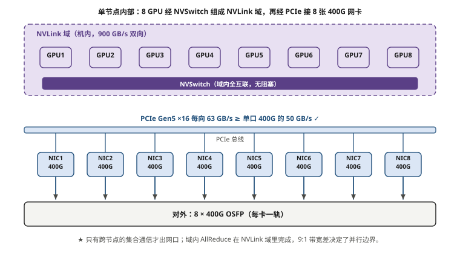
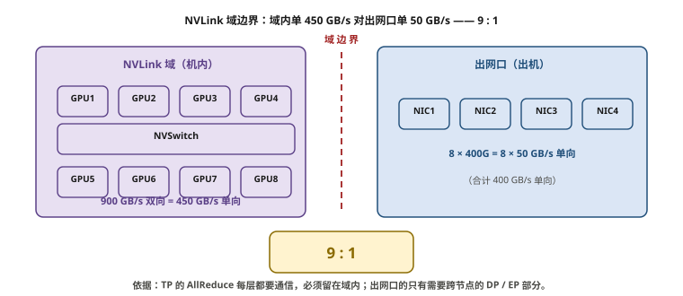
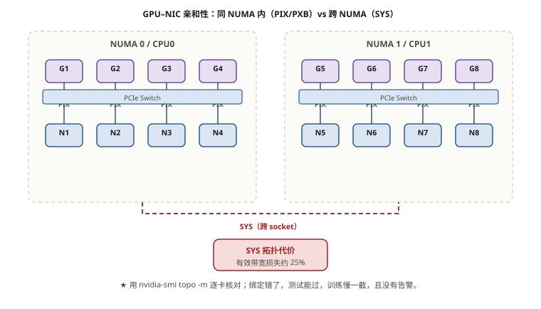

# 第 5 章　服务器、网卡与芯片级互联

> **本章一句话结论**：算力网络的上限，一半写在交换机上，另一半写在服务器机箱里——**PCIe 的宽度、网卡的形态、GPU 与网卡的亲和性，这三样决定了网络到底能不能跑满。**

---

## 5.1　工程问题：一块跑不满的网卡

### 现场的样子

单口压测的结果出现了两种截然不同的表现：

```
服务器 A（某批次 8 台）：ib_write_bw → 362 Gb/s   ✓ 达标（≥360 Gb/s）
服务器 B（另一批次 8 台）：ib_write_bw → 271 Gb/s  ✗ 不达标，但也不报错
```

**两台服务器的网卡型号相同、模块相同、插的交换机端口也相同。** 交换侧一切正常，端口无错包、无 PFC。

排查思路一开始就错了——笔者从网络侧找了三天。

**真正的原因在服务器里**：B 批次那 8 台，网卡插在了 **CPU1 的 PCIe 插槽**上，而与之对应的 GPU 挂在 **CPU0 的 PCIe Root Complex** 下。

```
正常的亲和性（A 批次）
  GPU0 ── PCIe Switch ─┬─ 网卡0        PIX（同一 PCIe Switch）  延迟最低
                       └─ NVLink

错配（B 批次）
  GPU0 ── [CPU0 Root Complex] ═══ UPI 总线 ═══ [CPU1 Root Complex] ── 网卡
         → 流量跨 NUMA 节点
         → 实际带宽掉约 25%
```

**271 / 362 ≈ 75%。** 掉的就是这 25%。

**这个问题的恶劣之处在于：它不报错、不告警、不丢包，只是"慢一点"。** 如果你不做单端口逐口压测，它会一直安静地待在集群里，把 1024 卡的整体训练效率拉低，而你在交换机侧查一辈子也查不到。

**这就是为什么本案例的验收标准里写着"RDMA 链路逐口核验"、"单端口有效吞吐不低于 360 Gb/s"——而且要求逐口，不是抽样。**

---

## 5.2　最小必要原理

### 5.2.1　PCIe：三个最常见的误算

PCIe 的带宽数字有三个版本在流传：GT/s（传输速率）、GB/s（单向可用带宽）、GB/s（双向）。**混用这三个数字，是服务器与网卡配置里最普遍的算术错误。**

**先记住一张表**（每方向可用带宽）：

| 代数 | 线速率 | 编码 | 每 lane 每方向 | **x16 每方向** | x16 双向 |
|---|---|---|---|---|---|
| PCIe 3.0 | 8 GT/s | 128b/130b | 0.985 GB/s | 15.75 GB/s | 31.5 GB/s |
| PCIe 4.0 | 16 GT/s | 128b/130b | 1.969 GB/s | **31.5 GB/s** | 63.0 GB/s |
| PCIe 5.0 | 32 GT/s | 128b/130b | 3.938 GB/s | **63.0 GB/s** | 126.0 GB/s |
| PCIe 6.0 | 64 GT/s | PAM4 + FLIT | 7.563 GB/s | **121.0 GB/s** | 242.0 GB/s |

**三个常见误算**：

```
误算一：把 GT/s 当成 Gb/s
  "PCIe 5.0 是 32 GT/s，x16 就是 512 Gb/s"
  ✗ 忽略 128b/130b 编码开销（约 1.5%）
  ✗ 更严重的是把 GT/s 的"传输"当成了有效数据
  ✓ 正确：32 × 16 × (128/130) ÷ 8 ≈ 63 GB/s = 504 Gb/s（每方向）

误算二：单向 / 双向混用
  厂商宣传常用双向数字（126 GB/s），
  但你在算"网卡够不够"时用的是单向（63 GB/s）
  → 用双向数字会得出"PCIe 很宽裕"的错误结论

误算三：忽略实际链路宽度
  插槽是 x16，但：
    · 网卡本身是 x8 的  → 实际只有 31.5 GB/s
    · 插在了 x8 的物理槽 → 同上
    · 主板 bifuration 配置成 x8/x8 → 同上
  → 必须看 lspci -vv 的实际 Link Width，不能看插槽标称
```

**验证方法（现场必做）**：

```bash
# 看网卡的 PCIe 实际速率与宽度
lspci -vv -s <BDF> | grep -E "LnkCap|LnkSta"

# 关注 LnkSta（当前状态）而不是 LnkCap（能力）
#   LnkCap: Speed 32GT/s, Width x16     ← 能干多少
#   LnkSta: Speed 32GT/s, Width x16     ← 实际干多少
# 若 LnkSta 显示 Width x8 或 Speed 16GT/s → 有问题
```

### 5.2.2　一个决定网卡形态的关键算术

现在把 PCIe 宽度和网卡速率放在一起看。**这一步决定了你该买 8 张单口网卡还是 4 张双口网卡。**

```
方案 A：8 张单口 400G 网卡
  单卡承载 = 1 × 400 Gb/s = 50 GB/s（单向）
  PCIe 5.0 x16 提供 = 63 GB/s
  裕量 = 63 / 50 = 1.26  ✓ 可行

方案 B：4 张双口 400G 网卡
  单卡承载 = 2 × 400 Gb/s = 100 GB/s（单向）
  PCIe 5.0 x16 提供 = 63 GB/s
  裕量 = 63 / 100 = 0.63     ✗ 不够，PCIe 成为瓶颈！
```

**结论非常干脆：8 卡节点用 400G 网络，必须配 8 张单口网卡（或 4 张双口网卡 + PCIe 6.0 x16，但后者在当前平台不现实）。**

| 配置方案 | 单卡带宽需求 | PCIe 5.0 x16（63 GB/s） | 判定 |
|---|---|---|---|
| 8 × 单口 400G | 50 GB/s | 余量 26% | ✓ 采用 |
| 4 × 双口 400G | 100 GB/s | **缺口 37%** | ✗ |
| 4 × 双口 200G | 50 GB/s | 余量 26% | ✓ 但总带宽减半（200G×4 = 800G ≠ 3200G） |

**这就是本案例"每张卡一个专用 400G 口、共 8 张网卡"的最底层原因——不是拓扑偏好的问题，是 PCIe 带宽算得出来。**

> **推论**：如果将来升级到 800G 单卡，PCIe 5.0 x16 就不够了（800G = 100 GB/s > 63 GB/s），必须配合 PCIe 6.0（121 GB/s）或每卡两条 PCIe 5.0 x16。**这是下一个代际的硬约束，值得提前知道。**

### 5.2.3　网卡形态与"架构解耦"

| 类型 | 代表 | 特点 | 适用 |
|---|---|---|---|
| 标准智能网卡 | ConnectX-7 | RDMA + GPUDirect，逻辑跑在主机 CPU | 通用训练集群（本案例） |
| DPU | BlueField-3 | 内置 ARM 核，可卸载网络/存储/安全 | 需要卸载或网络功能下沉 |
| 多口/单口 | 单口 400G / 双口 200G / 双口 100G | 按 PCIe 与 GPU 数量选择 | 见 5.2.2 |
| 封装 | OSFP / QSFP112 | 由服务器端口笼子决定 | 与第 4 章对应 |

**"架构解耦"是智能网卡真正的价值所在，落到工程上是三件事**：

```
① 零拷贝：数据从 GPU 显存直达网卡，不经系统内存
   → 省掉 2 次内存拷贝 + 2 次 CPU 中断
   → 这是 RDMA 延迟能到 1~3 μs 的根本原因

② CPU 卸载：协议栈处理在网卡上完成
   → 训练场景 CPU 占用从"几个核跑满"降到"几乎为零"
   → 释放出的 CPU 核可以供给数据预处理

③ 内存带宽卸载：
   → 如果走内核协议栈，数据要过一遍系统内存
   → 而系统的内存带宽是有限的（与 GPU 抢）
```

**在本案例的规模上，第三点最容易被低估**：

```
128 台 × 8 网卡 × 50 GB/s = 64 TB/s 的潜在网络流量
如果全部经系统内存中转 → 每台服务器的 DDR 要承担 400 GB/s 的额外带宽
                       → 远超 DDR5 的实际可用带宽
                       → 内存带宽会先成为瓶颈
```

**所以 RDMA 不是为了"延迟好看"，它是让这套带宽成立的必要条件。**

### 5.2.4　NVLink / NVSwitch：GPU 域内互联的边界

**这是本书里"最应该被理解、但最容易被跳过"的一段。**

```
单张 H100 的 NVLink 4 带宽：
  18 条链路 × 25 GB/s（每方向）= 450 GB/s（每方向）
  双向合计 = 900 GB/s

对比它的网络出口：
  1 × 400G = 50 GB/s（每方向）

比值 = 450 / 50 = 9 : 1
```

**域内互联比域外网络宽 9 倍。这个 9:1 的比值，决定了整个并行策略与网络设计的分界线。**

```
┌─────────────────── 单节点（NVLink 域） ───────────────────┐
│                                                            │
│   GPU0 ══╦══ GPU1                                          │
│    ║     ║      全互联（NVSwitch）                          │
│   GPU2 ══╬══ GPU3                       带宽 900 GB/s/卡    │
│    ║     ║                                                │
│   GPU4 ══╬══ GPU5                                          │
│    ║     ║                                                │
│   GPU6 ══╩══ GPU7                                          │
│    │                    │                                  │
└────┼────────────────────┼──────────────────────────────────┘
     │ 网卡0 … 网卡7      │
     ▼                    ▼
   400G × 8 = 400 GB/s（节点出口总带宽）
                        ↑ 只有域内带宽的 1/9
```

**边界在哪里？**

```
一个 NVLink 域 = 一台服务器 = 8 张卡
```

**这条线是硬边界，不是软约束。** 因为 NVLink 的物理连接不跨机箱（NVSwitch 在服务器内部）。



**图 5-1　单节点内部：NVLink 域与 PCIe–NIC 通路**　｜　**读图要点**：8 张 GPU 经 NVSwitch 组成机内 NVLink 域（900 GB/s 双向），再经 PCIe Gen5 ×16 接 8 张 400G 网卡。**PCIe 每向 63 GB/s ≥ 单口 400G 的 50 GB/s**，这才是“每卡一口”能成立的前提；换成双口 400G（100 GB/s）就会超过 PCIe，必须换双口网卡或更多网卡。



**图 5-2　NVLink 域边界：域内 450 GB/s 对出网口 50 GB/s**　｜　**读图要点**：域内 NVLink 单向 450 GB/s，出网口单口 400G 只有 50 GB/s，**比值 9 : 1**。这张图是「哪些流量根本不出网口」的数量依据：TP 的 AllReduce 每层都要通信，必须留在域内；只有需要跨节点的 DP / EP 部分才出网口。

### 5.2.5　哪些流量根本不出网口

**这是全章最实用的一张表。** 它直接决定了"网络带宽该按多少算"。

| 通信类型 | 走什么 | 出网口？ | 说明 |
|---|---|---|---|
| **TP（域内）** | NVLink | **否** | TP=8 时全部在域内，网络零负载 |
| TP（跨节点） | 网络 | 是 | 一般不这么做（延迟与带宽都亏） |
| **DP（梯度 AllReduce）** | 网络 | **是** | **网络带宽规划的主要依据** |
| PP（P2P 传递激活） | 网络 | 是 | 低频，但会影响时序 |
| EP（AllToAll） | 网络 | 是 | 突发大流量，对收敛比最敏感 |
| 数据加载（Dataset） | 存储网 | 否 | 不走算力网 |
| Checkpoint 写入 | 存储网 | 否 | 不走算力网 |
| 优化器状态更新 | 无 | 否 | 纯本地计算 |

**这张表带来的最大认知修正**：

```
错误估算方式（"把所有通信量加起来"）：
  TP 通信量 + DP 通信量 + PP 通信量 + 数据加载 → 得到一个巨大的数字
  → 按这个数字设计网络 → 严重过度建设

正确估算方式（只算"出网口"的部分）：
  TP 在域内 → 扣除
  数据加载与 Checkpoint 走存储网 → 扣除
  只剩 DP（+ PP/EP）→ 这才是算力网的负载
```

**以本案例的典型配置为例（TP=8，DP=128）：**

```
方案 1：TP=8（全部在 NVLink 域内）
  → TP 通信 100% 被 NVLink 吸收
  → 算力网只承载 DP 的梯度 AllReduce
  → DP 组大小 = 1024 / 8 = 128，AllReduce 通信量 = 2S

方案 2：TP=16（跨节点）
  → 一半 TP 通信落到网络上
  → 而这部分通信是"高频、小消息"——对网络最不友好
  → 网络负载结构完全改变
```

**所以"这个集群的网络该怎么设计"这个问题的完整答案，必须先回答"TP 用多大"。**

**实操建议：TP 的边界锁在 NVLink 域内。** 这一条在绝大多数模型与框架的参数推荐里都是默认的，**但你需要在方案阶段明确写下来**——因为一旦有人为了显存优化把 TP 调到 16，网络的压力模型会完全变化。

---

## 5.3　选型对比

### 5.3.1　GPU–NIC 亲和性：PCIe 拓扑的五种距离

NVIDIA 的 `nvidia-smi topo -m` 会输出 GPU 与网卡的拓扑关系。**这五种标记代表着五种完全不同的性能等级**：

| 标记 | 含义 | 相对性能 |
|---|---|---|
| **X** | 自环（自己和自己） | — |
| **PIX** | 同一 PCIe Switch 下的不同端口 | **最优** |
| **PXB** | 跨 PCIe Switch，但不超过一个 PCIe Host Bridge | 优 |
| **PHB** | 跨 PCIe Host Bridge（同一 NUMA 内） | 良 |
| **NODE** | 同一 NUMA 节点内，跨 PHB | 中 |
| **SYS** | **跨 NUMA 节点（跨 CPU Socket）** | **差，本案例 B 批次的 25% 损失来自这里** |

**检查命令**：

```bash
# 打印 GPU-NIC 拓扑矩阵
nvidia-smi topo -m

# 期望结果（8 卡 8 网卡，1:1 配对）：
#        GPU0  GPU1  ...  NIC0  NIC1  NIC2 ...
# GPU0    X    NV18  ...  PIX    SYS   SYS
#                        ↑ GPU0 与 NIC0 应尽量是 PIX / PXB
```

**验收时应该做的事**：

```
逐台服务器检查 nvidia-smi topo -m
统计每条 GPU-NIC 对的拓扑等级
若出现 SYS 且不是设计预期 → 该服务器需调整网卡插槽
```

**这个检查只需要几秒钟，却能直接发现 25% 的性能损失。** 它应该是设备上架验收的第一个检查项。



**图 5-3　GPU–NIC 亲和性：PIX/PXB 与 SYS**　｜　**读图要点**：G–N 在同一 PCIe 交换下（PIX/PXB）是短路径；跨 socket（SYS）时数据要过 CPU 互连，有效带宽损失约 25%。**这类错误测试全过、链路全 up，只在训练吞吐上体现，最难发现。**上线前用 `nvidia-smi topo -m` 逐卡核对。

### 5.3.2　三种节点内部架构的对比

| 架构 | GPU 互联 | 域大小 | 典型网卡配置 | 适用 |
|---|---|---|---|---|
| **8 卡整机（SXM + NVSwitch）** | NVLink 全互联 | 8 | 8 × 单口 400G | **本案例** |
| 8 卡整机（PCIe 卡） | 无 NVLink 或仅桥接 | 2~4 | 4 × 双口 400G | 推理、小模型 |
| 多机 NVLink（机架级） | 跨机 NVLink | 16~72 | 大幅减少 | GB200 NVL72 等新架构 |

**第三类值得单独说**：机架级 NVLink（如 NVL72）把 NVLink 域从 8 卡扩到 72 卡，**网络设计逻辑会根本性改变**——因为 TP 可以放大到 72，而网络只需要承载 DP 与 EP。

```
传统 8 卡域：  TP ≤ 8 在域内，DP 走网络
NVL72 类：     TP ≤ 72 在域内，网络只承载 DP/EP
               → 网络规模需求下降
               → 但对机内 NVLink 背板的要求急剧上升
```

**这就是"Scale-up 以太网化"（UALink、NVLink Fusion）想解决的问题**，第 18 章展开。

### 5.3.3　GPU 与网卡配比：1:1 还是 1:2

| 配比 | 每卡可用网络带宽 | 适用 |
|---|---|---|
| **1:1（8 卡 8 口 400G）** | 400 Gb/s | **本案例；训练集群标配** |
| 1:2（8 卡 4 口 400G） | 200 Gb/s | 推理、小规模微调 |
| 2:1（8 卡 16 口 400G） | 800 Gb/s | 极少见；受 PCIe 与交换机端口限制 |

**为什么本案例坚持 1:1？** 三个理由：

```
① 轨道要求：单卡单轨的前提是每卡一口
   → 若 1:2，则两张卡共用一口，轨道归属不再由卡号唯一确定

② NCCL 拓扑探测：1:1 时 NCCL 能建立完全对称的 ring
   → 不对称配比会导致某些 rank 瓶颈

③ 故障域清晰：某卡的网络问题 = 某口的问题
```

---

## 5.4　实测与踩坑

### 踩坑一：网卡插槽错配（5.2 节所述的 25% 损失）

**防复发**：

```
① 服务器到货验收清单里加入："逐台执行 nvidia-smi topo -m，统计 SYS 数量"
② 在本案例服务器采购合同中，把 GPU-NIC 的 PCIe 亲和等级写成技术要求
③ 单端口压测必须逐口做，不能抽样
```

**为什么强调"写进服务器采购合同"？**

因为这件事的责任边界很容易模糊：**网卡是服务器供货方插的，但性能不达标由网络方背锅。** 本案例在交付界面条款里明确写了"算力卡与算力服务器本体及内置网卡由服务器供货方随整机提供"，把物理安装责任划清了；**但性能核验责任必须由网络方在验收时承担——所以验收手段（逐口压测）就变得不可替代。**

### 踩坑二：把"域内带宽"当成"可用网络带宽"

```
错误估算：
  "这张卡有 900 GB/s 的 NVLink，网络也该按接近这个量级设计"
  → 900 GB/s 是域内；网络出口只有 50 GB/s
  → 差 18 倍（双向对单向比）

正确认识：
  域内 900 GB/s 双向 = 450 GB/s 单向
  域外 400 Gb/s = 50 GB/s 单向
  比值 = 9 : 1
```

**这个比值决定了并行策略的分界线：凡是"能放进域内"的通信，都不要放到网络上。**

### 踩坑三：PCIe 降速未检出

```
现象：同一批服务器的单口吞吐普遍比另一批低 5~8%
检查：lspci 显示 LnkSta: Speed 16GT/s（而 LnkCap 是 32GT/s）
根因：主板 bifuration 配置把 x16 拆成了 x8/x8，而网卡插在了其中一半
```

**这类问题不产生任何告警，只体现为"稍微慢一点"。**

**检查 SOP**：

```bash
# 检查所有网卡的 PCIe 实际链路状态
for bdf in $(lspci | grep -i mellanox | awk '{print $1}'); do
  echo "=== $bdf ==="
  lspci -vv -s $bdf | grep -E "LnkCap:|LnkSta:"
done
```

**判据：`LnkSta` 必须与 `LnkCap` 一致。** 不一致就说明存在物理或配置限制。

### 待补数据

本章涉及的现场数据（单端口逐口压测的完整分布、GPU-NIC 亲和性检查结果）在本案例资料中没有留存完整记录。**这也是本案例的第一个检查项就应该纳入验收范围的原因——检查了但不留记录，等于没查。**

---

## 5.5　现场检查清单

### 服务器与网卡配置

- [ ] 每节点网卡数量与 GPU 数量符合配比设计（本案例 1:1，8 卡 8 网卡）
- [ ] 网卡封装与服务器端口一致（本案例 OSFP）
- [ ] 已按 5.2.2 的算术核算：**单卡承载带宽 ≤ PCIe 单方向可用宽度**
- [ ] 已知本平台的 PCIe 代数与 x16 单方向带宽（本案例 PCIe 5.0 = 63 GB/s）

### PCIe 链路核验

- [ ] 逐卡检查 `lspci -vv` 的 `LnkSta`，与 `LnkCap` 一致
- [ ] 无 x16 掉到 x8 / 32GT/s 掉到 16GT/s 的情况
- [ ] 主板 bifuration 配置已确认，不会把 x16 拆错

### GPU–NIC 亲和性（**最高优先级**）

- [ ] 逐台执行 `nvidia-smi topo -m`
- [ ] 统计每条 GPU-NIC 对的拓扑等级（PIX / PXB / PHB / NODE / SYS）
- [ ] **SYS 数量符合设计预期**（本案例要求 0）
- [ ] 发现 SYS 的服务器已调整网卡插槽并复测
- [ ] 亲和性检查结果已归档

### 芯片级互联边界

- [ ] 已确认 NVLink 域大小（本案例 8 卡）
- [ ] 已确认 GPU 是 SXM 还是 PCIe 形态（决定域内带宽量级）
- [ ] **TP 规模已锁定在 NVLink 域内**（本案例 TP ≤ 8）
- [ ] 已按 5.2.5 的表核对：网络只承载"出网口"的流量
- [ ] 若未来可能扩大 TP，已评估网络压力模型的变化

### 验收手段

- [ ] **单端口压测逐口执行**，不抽样（本案例 ≥ 360 Gb/s / 口）
- [ ] 压测结果与服务器-端口映射表一一对应归档
- [ ] 逐台核验 SN、GPU UUID、NIC GUID、磁盘 SN
- [ ] GPU 诊断执行 DCGM（本案例 Level 3 全量 + Level 4 抽取）

---

## 5.6　成本与工期影响

### 这一章的决策值多少钱

| 决策 | 影响 |
|---|---|
| 8 × 单口 400G vs 4 × 双口 400G | **后者 PCIe 缺口 37%，直接不可行**（若强行采用 = 800G 带宽折损） |
| GPU–NIC 错配（SYS） | **单节点网络性能损失约 25%**，且不告警 |
| PCIe 降速未检出 | 损失 5~8%，不告警 |
| TP 跨域 | 把 NVLink 级通信挤到 9 倍窄的网络出口上 |
| 未做逐口压测 | 隐性问题全程不被发现，集群算力利用率长期偏低 |

### 一个关键的成本结论

**服务器侧的"省"和网络侧的"省"往往是同一笔账。**

```
如果为了省钱配置 4 张双口 400G 网卡：
  省下 4 张网卡
  但 PCIe 5.0 x16 只能提供 63 GB/s，而需求是 100 GB/s
  → 实际可用带宽被 PCIe 限制在 63 GB/s × 4 = 252 GB/s
  → 而 8 张单口配置能提供 8 × 50 = 400 GB/s
  → 网络投资（交换机、光模块、线缆）全部按 400 GB/s 建的
  → 结果：网络侧的钱花了，服务器侧跑不出来
```

**这就是"局部最优"在整机系统里的典型失效方式**——服务器采购省了 4 张网卡的钱，让整个网络投资贬值。

**判断方法**：任何服务器侧的配置变更，都要问一句"它会不会成为网络带宽的上限"。PCIe 宽度、网卡数量、GPU-NIC 亲和性，这三项就是答案。

---

## 本章要点回顾

1. **PCIe 三个数字容易混**：GT/s（线速率）、GB/s 单向、GB/s 双向。算网卡够不够用**单向 GB/s**。
2. **PCIe 5.0 x16 = 63 GB/s 单向**。单口 400G（50 GB/s）够；双口 400G（100 GB/s）**不够**。
3. **8 卡节点 + 400G 网络 = 8 张单口网卡**，这不是拓扑偏好，是 PCIe 算术的结论。
4. **NVLink 域内 450 GB/s 单向 vs 网络出口 50 GB/s 单向 = 9 : 1。** 这个比值是并行策略的分界线。
5. **一张表决定网络负载**：TP 在域内不走网络、数据与 Checkpoint 走存储网不走算力网，**算力网只承载 DP（+PP/EP）**。
6. **GPU–NIC 亲和性错配（SYS）损失约 25%，且不告警。** `nvidia-smi topo -m` 检查只需几秒。
7. **PCIe 降速（LnkSta ≠ LnkCap）损失 5~8%，且不告警。** 必须逐卡核验。
8. **单端口压测必须逐口做。** 隐性问题不抽样就 100% 漏。
9. **服务器侧省下的钱，可能是网络投资的贬值。** 任何服务器配置变更都要问："它会不会成为网络带宽的上限？"
