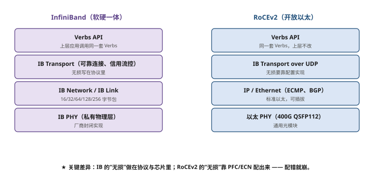
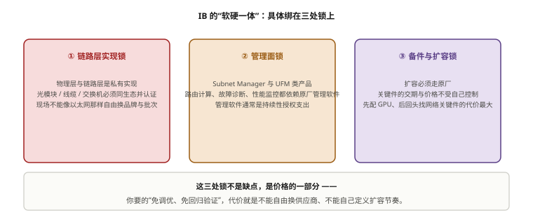

# 第 6 章　InfiniBand（IB）无损网络全景

> **本章一句话结论**：IB 把"无损"做进了芯片和协议本身，代价是你必须接受一个**单供应商、软硬绑定、不能自己改**的封闭体系。

---

## 6.1　工程问题：一条不该出现的备件链

### 一次真实的等待

本案例在方案评审阶段曾准备过一版 IB 方案。技术指标全绿——**唯一卡住的是备件条款**。

```
需要写进合同里的：
  交换机整机冷备件 1 台
  网卡备件按 5% 配
  光模块备件按 5% 配

供应商给出的答复：
  整机冷备件：需单独采购，交期按订单
  网卡：随服务器配套，备件需另行立项
  关键部件（交换芯片、管理模块）：仅供原厂
```

**问题不在于"贵"，在于"没有第二条路"。**

以太网方案里，某台交换机坏了，你可以：

```
① 用同型号备件换（多个渠道可选）
② 用同规格的其他品牌交换机临时顶（虽然不是最优，但能通）
③ 从其他机柜调一台同型号过来（同型号在别的项目也在用）
```

IB 方案里，这三条全部不成立：

```
① 备件渠道唯一
② 没有"同规格的其他品牌"——IB 生态只有一家
③ 其他机柜也是同一批货，同型号备件总量是固定的
```

**这就是本章要讲的核心：IB 的技术优势是真的，但它的代价不在采购单价上，在"体系的可替代性"上。**

### 本案例最终没有选 IB

本案例（128 台 H100）最终采用 RoCEv2。原因在下一章和第 8 章展开，但这里先给一个诚实的小结：

| 维度 | IB | RoCEv2 | 本案例判断 |
|---|---|---|---|
| 性能 | 略优（链路层 credit 流控天生无损） | 极接近 | 差异不构成决定因素 |
| 供应链 | **单供应商** | 多厂商 | **决定性因素** |
| 运维 | 集中式 SM，简单 | 分布式配置，复杂 | 影响人力投入，非决定性 |
| 成本 | 高 | 低 | 重要但非唯一 |

**"单供应商"这一条在运营商类项目里权重极高**——因为它同时影响采购议价、备件保障、长期运维和国产化合规。

---

## 6.2　最小必要原理

### 6.2.1　IB 协议栈：无损是"做进去的"，不是"配出来的"

```
┌──────────────────────────────────────────────┐
│  上层协议（ULP）                              │
│    MPI · NCCL · NVMe-oF · SMB                 │
├──────────────────────────────────────────────┤
│  Verbs 接口层（语义层）                       │
│    ibv_post_send / ibv_poll_cq ...            │
│    ← 这是应用唯一直接面对的东西               │
├──────────────────────────────────────────────┤
│  传输层   队列对（QP）、WQE、CQ               │
├──────────────────────────────────────────────┤
│  网络层   GRH · 16 bit LID 寻址（非 IP）      │
├──────────────────────────────────────────────┤
│  链路层   ★ 基于信用的流控（Credit-Based）    │
│             发送前先确认对端有缓冲区          │
├──────────────────────────────────────────────┤
│  物理层   高速 SerDes · 光/电                  │
└──────────────────────────────────────────────┘
```

**关键在链路层：IB 是"发之前先问对方有没有位置"，而不是"发了再说，堵了就丢"。**

```
IB 的做法（Credit-Based Flow Control）
  发送方维护一个信用计数器 = 对端可用缓冲单元数
  每发一个包，信用减一
  收到对端"已处理"确认，信用加一
  信用为 0 → 不发（而不是发出去被丢）

以太网的做法（802.3x / PFC）
  先发；如果接收端缓冲快满了
  → 接收端发 PAUSE 帧，要求上游暂停
  → 上游停止发送
```

**两者的差别是"预防"与"补救"的差别，而这个差别会体现在三个方面**：

| 方面 | IB（预防） | 以太网 + PFC（补救） |
|---|---|---|
| 死锁风险 | 理论上无（信用机制不会形成循环等待） | **存在（PFC 死锁是经典问题）** |
| 调参需求 | 极少（默认即无损） | **非常多（PFC 阈值、ECN 阈值、DCQCN 参数）** |
| 缓冲区需求 | 由信用决定，可预估 | 需要 headroom 计算，易失配 |

**这就是"IB 天生无损"这句话的真实含义**：不是网络工程做得更好，是协议设计时就没有"丢包"这个选项。



**图 6-1　IB 与 RoCEv2 的协议栈对比**　｜　**读图要点**：两者上层都走同一套 Verbs API，区别在下面几层：IB 把可靠连接、信用流控做进协议与芯片；RoCEv2 把 IB Transport 架在 UDP/IP/以太之上，**“无损”从协议保证变成配置结果**。一句话：IB 的无损是“做进去的”，RoCEv2 的无损是“配出来的”。

### 6.2.2　Subnet Manager（SM）：一个必须理解的中心化组件

**IB 的网络里没有"每台交换机各自学路由"这回事。整张网的转发表由一台 SM 集中计算并下发。**

```
┌──────────────────────┐
│   Subnet Manager      │  ← 软件（OpenSM / UFM）或内嵌在交换机里
│   计算全网路由         │
│   分配 LID             │
│   下发转发表           │
└───────────┬──────────┘
            │ Subnet Management Interface（带内或带外）
     ┌──────┴──────┬──────────┬──────────┐
   [SW1]       [SW2]      [SW3]  ...  [SWn]
```

**SM 做四件事**：

| 职责 | 说明 |
|---|---|
| 拓扑发现 | 扫描子网，建立完整的节点与链路清单 |
| LID 分配 | 给每个端口分配 16 bit 的本地标识（Local ID） |
| 路由计算 | 按算法（如 Fat-Tree、Min-Hop）计算转发路径 |
| 转发表下发 | 把算好的表下推到每台交换机 |

**LID 是 IB 的一个独特设计**：16 bit，最多 65536 个地址，**只在子网内有效**。它不依赖 IP，因此省掉了 IP 层的一切开销——但也意味着 IB 网络与 IP 网络的互通需要网关。

**SM 部署的四条工程规则**：

| 规则 | 原因 |
|---|---|
| **必须部署双 SM（主备）** | SM 是单点。SM 挂掉后现网能继续跑（转发表已在交换机里），但**无法感知拓扑变化**——加一根线都不知道 |
| 主备 SM 设置不同优先级 | 优先级相同会出现"双主"抢管 |
| SM 与被管网络路径分离 | 避免网络故障时 SM 失联 |
| SM 主机本身要可靠 | 建议独立物理机或高可用虚机 |

**"SM 挂掉网络不会立刻挂"这一点非常容易造成麻痹**：

```
第 1 天：SM 进程崩溃 → 现网训练照常 → 没人发现
第 3 天：某条链路故障 → 没有 SM 重算路由 → 流量走不通 → 业务受影响
第 3 天：才发现 SM 已经死了两天
```

**所以 SM 的高可用不只是"部署两台"，还要有"SM 存活监控 + 定时告警"。**

### 6.2.3　生态与软硬一体限制

**IB 生态的核心事实是：它只有一个主要供应商。**

```
芯片（交换 ASIC）  →  NVIDIA（收购 Mellanox 后）
网卡（HCA）        →  NVIDIA（ConnectX 系列同时支持 IB 与以太网）
交换机整机         →  NVIDIA（Quantum 系列）为主
管理软件           →  NVIDIA UFM（闭源）或开源 OpenSM
光纤/模块          →  相对开放（这是 IB 体系里唯一开放的一层）
```

**"软硬一体"的三种具体表现**：

| 表现 | 具体影响 |
|---|---|
| 固件与 SM 版本绑定 | 交换机固件升级必须配套 SM 版本，不能单独升 |
| 管理平台闭源 | UFM 是商业软件，按端口或按交换机授权 |
| 特性受控 | 某些高级特性（SHARP 网内计算等）只在特定型号/许可下可用 |

**公平地说，软硬一体也带来好处**：

```
优点：兼容性风险极低（同一家的东西，出厂就配对好了）
      性能特性可以做到极致（不用为兼容性留余量）
      问题定位路径短（一家负责到底）

缺点：议价能力弱
      技术路线被动（供应商换代你就得跟）
      备件与交期受制于人
      国产化合规难以满足
```

### 6.2.4　成本结构与供应链

**IB 的成本结构有三个特点**：

```
① 单价高
   同端口速率的 IB 交换机，单价通常显著高于以太网交换机。
   网卡侧溢价相对小（因为 ConnectX 同时支持两种模式）。

② 隐性成本在"许可与管理"
   UFM 等管理软件按端口/交换机授权，属于持续性支出（OPEX）。
   以太网侧对应功能通常可以自建或用开源方案。

③ 备件成本刚性
   备件只能从原厂体系获取，折扣空间小，交期受订单排产影响。
```

**供应链风险清单**（写进方案评审材料）：

| 风险 | 表现 | 缓解手段 |
|---|---|---|
| 单一供应商 | 无第二货源 | 合同里约定备件供应条款与响应时效 |
| 交期波动 | 换芯片代次或产能紧张时交期拉长 | 关键设备提前下单、分批到货 |
| 出口管制 | 高端型号可能受限 | **这是国内项目必须评估的一条** |
| 固件升级受控 | 不能自主决定升级节奏 | 合同中约定固件版本稳定性要求 |
| 备件停产 | 型号换代后老型号备件难寻 | 采购时约定备件供应年限 |

**最后一条"备件停产"最容易被忽略，又在集群生命周期里必然出现。**

```
集群设计寿命 5 年
交换机型号换代周期 2~3 年
→ 第 4 年需要备件时，该型号可能已停产
→ 只能在采购时就把"备件供应年限"写进合同
```

**建议条款**：设备安装验收后 **5 年内**，供应商应保证同型号或兼容型号备件的可获取性。

---

### 6.2.5　信用流控 vs PFC：一条决定"要不要算缓冲"的分界线

IB 的无损不是靠反压，是靠**信用（Credit）**：

- 发送端在发出数据之前，必须先确认接收端有可用缓冲（信用额度）；
- 没有信用就不发 —— 于是**根本不存在"反压到达之前缓冲已被灌满"这件事**；
- 因此 IB **不需要 headroom 计算**，也不需要 ECN / DCQCN 那一整套参数调优。

RoCEv2 的无损是**反压式**的：先按线速发，拥塞了再刹车（PFC），所以必须预留 headroom
（第 7 章算过：400G 端口约 160 KB）。这一个差别，把两者的运维形状彻底分开了。

| 维度 | IB（信用流控） | RoCEv2（PFC） |
|---|---|---|
| 无损手段 | 发送前申请信用 | 拥塞后反压 |
| 是否需要 headroom | **不需要** | **必须计算**（400G ≈ 160 KB） |
| 是否需要调 ECN / DCQCN | 不需要 | 必须调 |
| 丢包的主要根因 | 硬件与链路故障 | 配置错误为主 |
| 复杂度落在哪 | 落在 SM 与厂商实现 | 落在你的运维团队 |
| 扩容时要不要回归验证 | 路由由 SM 自动重算 | **必须重跑无损验证** |

**一句话**：IB 把"无损"的成本，从"每次上线都要调参、每次扩容都要回归"，
换成了"向一个供应商长期付费"。



**图 6-2　IB 的「软硬一体」：具体绑在三处锁上**　｜　**读图要点**：三处锁分别是：链路层实现锁（模块与线缆必须同生态并认证）、管理面锁（SM 与 UFM 类软件，通常是持续性授权支出）、备件与扩容锁（扩容必须走原厂，关键件的交期与价格不受自己控制）。**这三处不是缺点，是价格的一部分** —— 换来的「免调优、免回归验证」，代价就是这三处自由度的让渡。

### 6.2.6　"软硬一体"具体绑在哪三处

供应商说 IB 是"一体化方案"，这句话要拆成三个具体的锁：

```
① 链路层实现锁：IB 的物理层、链路层是私有实现
   → 光模块、线缆、交换机必须来自同一生态并通过认证
   → 现场不能像以太网那样自由换品牌/换批次

② 管理面锁：Subnet Manager 与 UFM 类产品
   → 路由计算、故障诊断、性能监控都依赖原厂管理软件
   → 管理软件通常是**持续性授权支出**（第 8 章会把它算进 TCO）

③ 备件与扩容锁：扩容必须走原厂
   → 第 6.1 节的"备件链问题"就出在这里：先配了 GPU，
      再回头发现网络侧某个关键件的交期与价格都不受自己控制
```

**这三处锁不是缺点，是价格的一部分。** 你要的"免调优、免回归验证"，代价就是
不能自由换供应商、不能自己定义扩容节奏。**只有在项目明确接受这三处锁时，选 IB 才是划算的。**

## 6.3　选型对比

### 6.3.1　IB 网络的三档典型规模

| 规模 | 典型拓扑 | 交换机（以 400G NDR 代举例） | 说明 |
|---|---|---|---|
| 中小（≤128 节点） | 两层 Fat-Tree | 几十台 | 单 SM 可管，通常不做 SHARP |
| 大（数百节点） | 两层 / 三层 | 上百台 | 需要 SM 调优、考虑 SHARP |
| 超大（数千节点） | 三层 Fat-Tree / Dragonfly+ | 数百台 | SM 计算量成为瓶颈，需要分区 |

**端口速率代际（供采购时核对当前型号）**：

| 代际 | 端口速率 | 说明 |
|---|---|---|
| HDR | 200 Gb/s | 已过主力期 |
| **NDR** | **400 Gb/s** | 当前主流，与以太网 400G 同代 |
| XDR | 800 Gb/s | 新一代，与以太网 800G 同代 |

> **具体型号的端口数与交换容量请以供应商最新规格书为准** —— 这一层的参数换代很快，本书不给精确数字，避免你在评审会上引用一个过期的数据。

### 6.3.2　三种场景下 IB 与 RoCEv2 的取舍

| 场景 | 倾向 | 原因 |
|---|---|---|
| 超大规模训练集群（>2000 卡）、追求极致性能、预算充足 | **IB** | 无损性最稳，运维最省心，规模越大越明显 |
| 千卡级、多厂商要求、需国产化 | **RoCEv2** | 供应链与合规，本案例选择 |
| 中小规模、预算敏感 | **RoCEv2** | 成本优势明显，规模小则调优复杂度可控 |
| 存算分离、需要统一网络 | **RoCEv2** | 存储侧天然是以太网生态 |

**判断的关键分界线：规模。**

```
小规模：RoCEv2 的调优工作量可控，成本优势明显 → 选 RoCEv2
大规模：RoCEv2 的调优工作量随规模超线性增长（每台交换机都要配）
        → IB 的"开箱即无损"价值上升 → 选 IB 的合理性增强
```

**但这条分界线不是绝对的。** 本案例的规模（128 台 / 1024 卡）落在中间地带，最终决定因素是供应链与合规，而不是性能。

---

## 6.4　实测与踩坑

### 踩坑一：把"SM 可用"当成"SM 在正常工作"

**现象**：验收时检查"SM 进程在运行"，结果是正常的。半年后扩容时发现路由表没有按新拓扑重算。

**根因**：SM 进程活着，但它已经**失去了与部分交换机的管理连接**（管理路径本身走了业务网络，业务网络的一次故障把它切断了）。进程在跑，拓扑是旧的。

**防复发**：

```
① 监控的不只是"进程存活"，而是"拓扑新鲜度"
   → UFM/OpenSM 会记录上次发现拓扑的时间
   → 若该时间超过阈值（如 5 分钟）无更新，告警

② SM 管理路径必须独立或被保护
   → 专用管理 VLAN，不与业务流量共享拥塞路径

③ 扩容后必须主动触发一次拓扑重发现，并核对结果
   → 不能依赖"SM 会自动发现"
```

### 踩坑二：备件按"百分比"配，没有按"关键件"配

```
错误做法：
  "网卡备件按 5%，交换机备件按 5%"

正确做法：
  按"单点故障影响"分级：
    交换机（影响整条轨）      → 至少 1 台整机冷备
    交换机电源/风扇模块        → 按机框数配
    网卡（影响单台服务器）    → 按 5%
    光模块（影响单条链路）    → 按 5%
    管理模块（影响全网可视）  → 至少 1 套
```

**"整机冷备件"和"按百分比"是两个不同维度。**

```
按百分比：5% × 32 台交换机 = 1.6 台 → 买 2 台？
按影响：  1 台交换机故障影响整条轨（40 台服务器 × 8 卡 = 320 卡都要停）
          → 必须保证"随时能换上一台"
          → 1 台整机冷备是底线，不看百分比
```

### 待补数据

本章讨论的是 IB 方案的评估过程，不是本案例的实施结果。**本案例未部署 IB，因此本书不提供 IB 相关的现场实测数据。** 涉及 IB 的性能结论，请以第 8 章的对比表和业界公开资料为准，不要引用本书未标注来源的数字。

---

### 6.4.4　踩坑三：把"免调优"误读成"零运维"

**现象**：某项目选 IB 的理由是"不用调 PFC，省运维"。上线后半年，一次 SM 主备切换
没有被及时发现，业务侧表现为"训练任务偶发卡住"。

**根因**：IB 免掉的是**拥塞控制类**的调优（PFC/ECN/DCQCN），但**不是**运维。IB 的运维
重点换成了另外三件事：

```
① SM 的高可用与主备健康（6.2.2）
② 端口计数器与符号错误的例行巡检（perfquery / UFM）
③ 备件链的可用性（6.1）
```

**处置与复盘**：把 SM 主备健康、端口错误计数器、关键备件库存三项纳入例行巡检，
与 RoCEv2 项目把 PFC 计数器纳入巡检是同一件事 —— **"无损"永远不等于"免巡检"。**

> **对照记法**：RoCEv2 的运维关键词是 PFC/ECN/headroom；IB 的运维关键词是
> SM/端口计数/备件。**两者都不轻松，只是难点不同。**

## 6.5　现场检查清单

### 方案评估阶段

- [ ] 已列出供应商唯一性风险，并评估可接受程度
- [ ] 已确认目标型号的**备件供应年限**条款（建议 ≥ 5 年）
- [ ] 已确认管理软件（UFM 等）的**授权方式与费用**（按端口？按台？）
- [ ] 已确认固件升级策略（能否自主决定升级窗口）
- [ ] 已评估出口管制 / 国产化合规要求对选型的影响
- [ ] 已确认备件渠道与交期承诺（写入合同）

### 部署阶段（若选 IB）

- [ ] SM 部署为**双机主备**，优先级不同
- [ ] SM 管理路径独立于业务路径
- [ ] SM 主机本身高可用
- [ ] 已配置 **SM 拓扑新鲜度监控**（不只是进程存活）
- [ ] 已配置 SM 故障告警
- [ ] LID 分配方案与 IP 规划一样形成文档（不要只存在于 SM 里）

### 运维阶段

- [ ] 有定期核对"拓扑与实际链路"的一致性流程
- [ ] 扩容后主动触发拓扑重发现并核对
- [ ] 备件按"单点故障影响"分级配置，不是简单按百分比
- [ ] 整机冷备件至少 1 台（不论规模）
- [ ] 固件与 SM 版本升级有配套验证流程

---

## 6.6　成本与工期影响

### IB 与以太网的成本结构差异

| 成本项 | IB | 以太网（RoCEv2） | 说明 |
|---|---|---|---|
| 交换机单价 | 高 | 低 | 同端口速率下 IB 显著高 |
| 网卡单价 | 中等 | 中等 | ConnectX 同时支持两者，差异小 |
| 光模块 | 相当 | 相当 | **这是 IB 体系里最开放的一层** |
| 管理软件 | **按端口/台授权（OPEX）** | 通常可自建 | 长期成本项 |
| 调优人力 | 少 | **多** | RoCEv2 需要 PFC/ECN/DCQCN 调参 |
| 备件成本 | **刚性高** | 有议价空间 | 单一货源 |
| 培训成本 | 较高（生态小众） | 较低（以太网人才多） | 一次性 |

**一个必须算清楚但常被忽略的对比项：调优人力。**

```
RoCEv2 的调优工作量：
  本案例一期 32 台 → 联调 10 人天 = 3.5 万元
  128 台满配 → 工作量不是线性 5 倍，因为参数模板可复用
             但每次扩容都需要回归验证

IB 的调优工作量：
  SM 侧重（拓扑与路由），配置项少；但 SM 出问题排查难度大
```

**RoCEv2 的人力成本是可以估算和规划的，而 IB 的"省心"是买来的。** 两者都不算错，只要在方案阶段就把这笔账摆出来——**不要出现"选了 IB 但预算里没算管理软件授权"，或"选了 RoCEv2 但没算调优人天"这类结构性漏项。**

### 时间维度上的差异

| 阶段 | IB | RoCEv2 |
|---|---|---|
| 到货 | 受排产影响，交期波动大 | 多厂商，交期相对可控 |
| 上架接线 | 相同 | 相同 |
| 网络调通（可用） | **快**（默认即无损） | 较慢（PFC/ECN/DCQCN 需调参） |
| 性能调到最优 | 快 | **慢**（需要压测迭代） |
| 扩容 | 需 SM 重算与验证 | 需参数回归 |
| 故障恢复 | 依赖原厂 | 自主性强 |

---

## 本章要点回顾

1. **IB 的"无损"是做进协议的**：链路层基于信用的流控是"发之前先问"，以太网的 PFC 是"发了再补救"。这决定了 PFC 死锁这类问题在 IB 里不存在。
2. **SM 是中心化组件，是单点**。必须双机主备，且**监控"拓扑新鲜度"而不只是"进程存活"**。
3. **SM 挂掉不会立刻断网**（转发表还在芯片里），这种"延迟显现"极易造成麻痹。
4. **IB 生态只有一个主要供应商**。软硬一体带来兼容性优势，代价是议价能力、技术路线自主权、备件保障、国产化合规。
5. **成本要算三项隐性支出**：管理软件授权（OPEX）、备件刚性成本、小众生态的人才成本。
6. **备件按"单点故障影响"分级配置**，不是简单按百分比。整机冷备件至少 1 台。
7. **备件供应年限必须写进合同**（建议 ≥ 5 年）——设备寿命 5 年、换代周期 2~3 年，"停产买不到备件"是必然会发生的事。
8. **规模是 IB 与 RoCEv2 之间的关键分界线**，但本案例证明：供应链与合规的权重可以高于性能。
