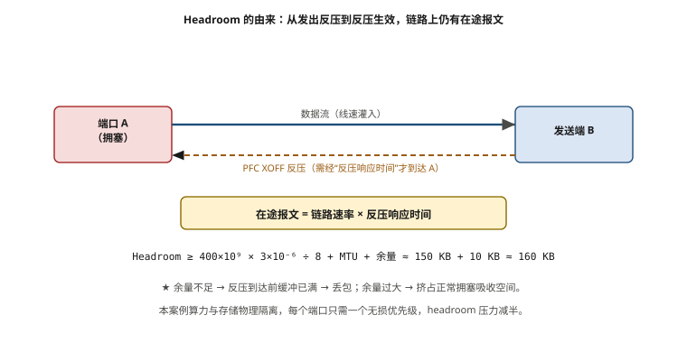
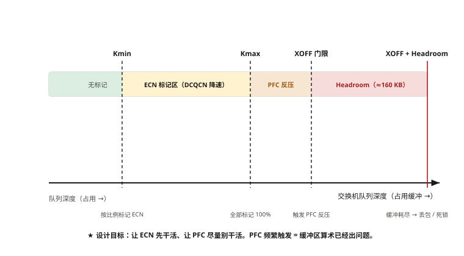
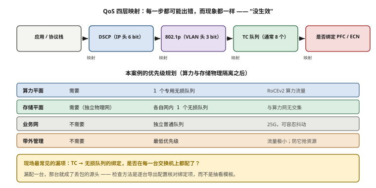

# 第 7 章　超大规模无损以太网（RoCEv2）组网实战

> **本章一句话结论**：RoCEv2 的无损不是"配一个开关"，而是**让 ECN 先干活、让 PFC 尽量别干活**——PFC 一旦频繁触发，说明你的缓冲区算术已经出问题了。

---

## 7.1　工程问题：一次被否掉的"融合组网"

### 一份看起来省钱的方案

本案例在方案初期曾准备过一版"算存融合"方案：存储交换机上联算力网的 Spine 层，两个平面共用上联带宽，靠 **TC 队列 + PFC/ECN 逐跳隔离** 来区分。

账面数字很漂亮：

```
省掉：每台服务器 2 块 100G 存储网卡 × 128 台
省掉：独立存储布线
省掉：存储平面的独立核心
保留：存储交换机（仍需接入）
```

**评审会上，甲方一句话否掉：**

> "存储和算力会互相抢带宽，而且**难以控制**。"

### "难以控制"这四个字，具体指什么

不是"偶尔会抢"，而是**PFC 这个机制本身，无法约束自己的传播范围**。

```
【共享 Spine 的故障链】

① 某台存储节点开始写 Checkpoint（突发大流量）
   → 存储方向的队列在 Spine 上开始堆积

② Spine 的存储队列接近 XOFF 阈值
   → Spine 向 Leaf 侧发 PFC PAUSE（针对存储优先级）

③ 但这个 PAUSE 帧走的是物理链路
   → 它不会被"优先级隔离"限制在存储平面内
   → 它作用在 Leaf 的**物理端口**上

④ Leaf 停止向 Spine 发送该优先级的所有流量
   → Leaf 的上行缓冲开始堆积
   → 包括算力方向的流量（如果它们共用端口队列）

⑤ Leaf 的上行缓冲接近阈值
   → Leaf 向服务器侧发 PAUSE
   → **算力侧的 AllReduce 被暂停了**
```

**关键在第 ③ 步：PFC 的反压对象是"物理端口 + 优先级"，不是"业务平面"。**

即使把存储和算力放在不同 TC 队列里，只要它们**共享同一个物理端口的缓冲区**，一方的缓冲压力就会通过共享的缓冲资源，传导到另一方。

**更麻烦的是：一旦开始传导，它就无法被"局部化"。**

| 隔离手段 | 能不能阻止这种传导 |
|---|---|
| 不同 TC 队列 | ✗ 只能减轻，不能阻止（缓冲区共享） |
| 不同 DSCP / 优先级 | ✗ 同上 |
| 不同 VLAN | ✗ VLAN 是二层的逻辑隔离，不影响缓冲 |
| 不同物理端口 | ✓ 但这就等于物理隔离了 |

**所以"难以控制"的准确含义是：只要共享物理端口，失效域就是共享的，QoS 只能调整概率，不能切断关联。**

**最终方案：物理隔离。** 服务器增配 2×100G 专用存储网卡，存储交换机独立，两网之间无任何物理连接——如第 2 章所述。

---

## 7.2　最小必要原理

### 7.2.1　RoCEv2 的报文结构：为什么它能"可路由"

```
RoCEv1（已淘汰）
  ┌──────────┬──────┬─────────────┐
  │ Ethernet │ IB GRH │ IB BTH │ 数据 │
  └──────────┴──────┴─────────────┘
  → 二层，不能跨 IP 路由

RoCEv2（现行）
  ┌──────────┬──────┬──────┬──────┬─────────┬──────┐
  │ Ethernet │ IP   │ UDP  │ BTH  │ 数据     │ ICRC │
  │          │      │ 4791 │      │          │      │
  └──────────┴──────┴──────┴──────┴─────────┴──────┘
  → 三层，可以跨网段路由
  → UDP 目的端口固定 4791
```

**RoCEv2 的三个设计取舍**：

| 取舍 | 好处 | 代价 |
|---|---|---|
| 基于 UDP（无连接） | 无握手开销，延迟低 | 拥塞控制完全依赖 ECN + DCQCN，没有 TCP 兜底 |
| 保留 ICRC 校验 | 端到端完整性校验，比以太网 FCS 更强 | 额外开销（很小） |
| 保留 IB 的 Verbs 语义 | 应用层无需改动即可用 RDMA | 与 IB 共享一套 API，但底层机制完全不同 |

**最后一个取舍最关键**：

```
上层（Verbs / NCCL / MPI）：完全一样
底层（流控 / 拥塞控制）：完全不同

  IB：     链路层信用流控（硬件保证无损）
  RoCEv2： 依赖 PFC 反压 + ECN 标记（软件配置保证无损）
```

**"同一套 API，两个不同的底层"这件事，是 RoCEv2 运维复杂度的根源。** 应用层看到的几乎一样，所以很容易产生"以为配好就行"的错觉。

### 7.2.2　PFC：原理与它的物理极限

**PFC（Priority Flow Control，IEEE 802.1Qbb）** 在传统 PAUSE 帧的基础上，加了一个 8 bit 的优先级位图，可以只暂停某一个优先级。

```
传统 PAUSE（802.3x）：暂停整个端口
PFC（802.1Qbb）：     只暂停指定优先级

PFC PAUSE 帧里的优先级位图：0~7 共 8 个队列
  → 可针对队列 3 单独发暂停
  → 队列 0/1/2 继续正常转发
```

**PFC 的触发逻辑**：

```
每个端口、每个优先级有一对阈值：
  XOFF（高水位）：队列长度超过 → 发 PAUSE
  XON （低水位）：队列长度低于 → 发 RESUME（或 PAUSE 定时器到期）

  ┌─ 队列长度
  │
  │ ─────────────  XOFF 阈值 ────── 触发暂停
  │
  │ ─────────────  XON  阈值 ────── 恢复发送
  │
  └──────────────────────────────
```

#### ★ Headroom 计算：本章最该记住的一个算式

**这是 PFC 配置里唯一"必须算"的数字。**

问题在于：**当接收端发出 PAUSE 时，上游不可能立刻停下。** 在"发送方收到 PAUSE 并停下"这段时间里，链路上和发送方的发送队列中仍有数据正在到达。**接收端必须预留足够的缓冲来装下这些数据，否则缓冲区溢出 = 丢包 = PFC 失效。**

```
Headroom（每端口最小缓冲） ≥ 链路速率 × 反压响应时间 ÷ 8 + MTU + 余量

其中"反压响应时间"包含：
  · 光纤传播延迟（往返）
  · PHY / SerDes 处理延迟
  · 交换机内部流水线延迟
  · 对端停止发送的响应延迟
```

**以 400G 端口代入**：

```
链路速率 = 400 Gb/s = 400 × 10⁹ bit/s
反压响应时间取 3 μs（工程经验值，实际以设备规格为准）

400 × 10⁹ × 3 × 10⁻⁶ ÷ 8 = 150 000 B = 150 KB
加 MTU（按 4 KB）+ 余量 ≈ 160 KB 量级
```

**这个数字的工程含义**：

| 情形 | 后果 |
|---|---|
| 缓冲 ≥ headroom 需求 | PFC 可以正常工作，缓冲区不会溢出 |
| 缓冲 < headroom 需求 | **发出 PAUSE 后，剩余在途数据仍会溢出 → 丢包** |
| 缓冲够但 XOFF 阈值设得太高 | 触发太晚，来不及，同样溢出 |
| 缓冲够但 XOFF 阈值设得太低 | 频繁触发，链路利用率低 |

**三条推论（直接决定选型）**：

```
① 交换机选型必须看"每端口可用缓冲深度"，不能只看交换容量
   → 400G 端口需要 160 KB 量级的 headroom
   → 缓冲不足的交换机，无论参数怎么调都不可能做到无损

② 无损优先级不能开太多
   → 每个无损优先级都要占用独立的缓冲与 headroom
   → 开 3 个无损优先级，就等于要 3 倍的缓冲
   → 实践中通常只开 1~2 个无损队列

③ XOFF 阈值必须留出 headroom
   XOFF 阈值（字节） ≤ 端口总缓冲 − headroom × 该端口无损队列数
```

**本案例的做法**：算力平面与存储平面**物理隔离**，各自只需要一个无损优先级。**这个架构决策顺便把 headroom 的压力减半了** —— 这是"物理隔离"除了失效域隔离之外的第二个收益，很少被人提到。



**图 7-1　Headroom 的由来与计算**　｜　**读图要点**：从 A 发出反压到 B 收到反压，需要“反压响应时间”，这段时间链路上仍有在途报文，缓冲必须能装下它们，这就是 headroom。**400G 端口约需 160 KB 量级**（150 KB 在途 + MTU + 余量）。缓冲不足，无损就做不到，而且无法事后补救。

### 7.2.3　PFC 的两个经典故障

#### 故障一：PFC 死锁

```
【死锁的形成】

   ┌──────────┐                    ┌──────────┐
   │   SW-A   │──── 端口1 ────────►│   SW-B   │
   │          │◄─── 端口2 ─────────│          │
   └──────────┘                    └──────────┘

① SW-A 要发往 SW-B 的流量，占满了 SW-A 端口1 的出方向缓冲
② SW-A 端口1 发 PAUSE 给 SW-B  → SW-B 停止向 SW-A 发送（端口2 方向）
③ 但 SW-B 端口2 的缓冲里，还有要发给 SW-A 的流量在等
④ SW-B 端口2 的缓冲被占满 → 也发 PAUSE 给 SW-A
⑤ SW-A 停止向 SW-B 发送 → 它端口1 的缓冲永远清不掉
⑥ 互相等待 → 死锁
```

**死锁的本质是"缓冲资源形成循环依赖"。** 这和操作系统里的死锁是同一个模型。

**形成的三个必要条件**（缺一不可）：

| 条件 | 说明 | 怎么破坏 |
|---|---|---|
| 互斥 | 缓冲是独占资源 | 无法破坏 |
| 持有并等待 | 报文占着缓冲等对端 | 无法破坏（转发机制决定） |
| **循环等待** | 路径形成环 | **靠路由设计破坏** |

**实践中的五条防死锁措施**：

```
① 拓扑无环（CLOS 本身无环，但要防止误配生成环）
② 路由算法保证无环（BGP / ECMP 的下一跳必须收敛）
③ 足够的缓冲与 headroom（减少"占满"的概率）
④ 每个无损队列独立占用缓冲（避免不同优先级互相挤占）
⑤ ★ 开启 PFC Watchdog（关键！）
```

**PFC Watchdog 是交换机的一个必备功能**：

```
机制：某个优先级持续处于"暂停"状态超过阈值（如 100 ms）而无实际转发
     → 判定为死锁或风暴
     → 自动恢复该优先级的转发（临时丢弃该优先级流量）
     → 上报告警

代价：会丢包
收益：整张网不会因为一个死锁而完全停摆

没有 Watchdog 的后果：
  一次死锁 → 相关端口全部停摆 → 触发上层重传 → 全网抖动
  且现场往往"看不出问题在哪"，因为所有设备都显示"正常"
```

> **选型硬要求：交换机必须支持 PFC Watchdog。** 这一条比"支持 PFC"重要得多——**几乎所有交换机都支持 PFC，但支持 Watchdog 并配好阈值的要少得多。**

#### 故障二：PFC 风暴

```
【风暴的传播】

① 某个 Leaf 的上行端口缓冲堆积 → 发 PAUSE 给 Spine
② Spine 收到 PAUSE 后停止发送 → Spine 自己的缓冲开始堆积
③ Spine 的缓冲堆积 → Spine 向其他 Leaf 发 PAUSE
④ 其他 Leaf 的缓冲堆积 → 继续向服务器侧发 PAUSE
⑤ 逐跳传播 → 全网相关优先级停摆

现象：全网吞吐在几毫秒内骤降，然后又恢复，反复震荡
```

**PFC 风暴与死锁的差别**：

| | 死锁 | 风暴 |
|---|---|---|
| 持续时间 | 持续（不人工干预不恢复） | 震荡（反复出现与恢复） |
| 范围 | 局部（形成环的几个端口） | 全网（相关优先级） |
| 典型原因 | 缓冲循环依赖 | 某一处持续拥塞 |
| 处置 | PFC Watchdog 自动恢复 | **治本：解决源头拥塞 + 让 ECN 提前介入** |

**风暴的正确处置不是"关掉 PFC"，而是"让 ECN 尽早介入，减少 PFC 触发次数"。** 见下一节。

### 7.2.4　ECN + DCQCN：让网络"提前降速"而不是"硬刹"

**ECN（Explicit Congestion Notification）** 的核心思想：**不要等缓冲满了才反压（PFC），而是在缓冲开始堆积时就通知发送端减速。**

```
ECN 的工作过程（RoCEv2 场景）

  发送端 A ────────► 交换机 ────────► 接收端 B
                      │
                      │ 出队时判断队列长度：
                      │   队列 < Kmin        → 正常转发
                      │   Kmin < 队列 < Kmax → 按概率标记 CE
                      │   队列 > Kmax        → 全标记 CE
                      │
                      ▼
                    标记 CE 的报文继续转发（不丢）
                      │
                      ▼
                    接收端 B 收到 CE 标记
                      → 生成 CNP 报文回发给 A
                      │
                      ▼
                    发送端 A 收到 CNP
                      → DCQCN 算法降低发送速率
```

**三个关键参数（阈值区间）**：

| 参数 | 含义 | 典型值（需按实际调） |
|---|---|---|
| **Kmin** | 开始标记的下界 | 150 KB 量级 |
| **Kmax** | 全量标记的上界 | 1 500 KB 量级 |
| **Pmax** | 在 Kmax 处的标记概率 | 1% ~ 10% |

**★ 这两个阈值必须与 PFC 的 XOFF 阈值形成"三级台阶"**：

（三级台阶见图 7-2。）

**调优的核心目标只有一句话：让流量稳定工作在"ECN 标记区"，而不是涨到 XOFF。**

三个指标可以判断是否达到这个状态：

| 指标 | 健康状态 | 异常状态 |
|---|---|---|
| **PFC 触发次数** | 稳态下接近 0 | 持续有计数 → 阈值设置有问题或缓冲不足 |
| ECN 标记率 | 低但非零（说明 ECN 在起作用） | 持续为 0 → Kmin 太高，ECN 没介入 |
| 端口吞吐 | 稳定在预期值 | 震荡 → 两级机制在互相干扰 |

> **"ECN 计数为 0"看起来是"网络很健康"，实际上可能是"ECN 阈值设得太高，根本没起作用，全靠 PFC 硬撑"。**
> **正确读法：ECN 有低比例的标记 + PFC 接近 0 = 健康。**



**图 7-2　ECN + DCQCN 的三段阈值与 PFC 门限**　｜　**读图要点**：自左向右：低于 Kmin 不标记；Kmin→Kmax 按比例标记 ECN，DCQCN 据此降速；超过 XOFF 门限才触发 PFC 反压；XOFF 之上还须留出 headroom，否则反压到达前缓冲已满。**设计目标是让 ECN 先干活、让 PFC 尽量别干活。**

### 7.2.5　QoS / DSCP / 优先级映射

数据包从应用层到物理队列，要经过四层映射：

```
应用 / 协议栈
    │ 设置 DSCP（IP 头 6 bit）
    ▼
DSCP ──映射──► 802.1p 优先级（VLAN 头 3 bit，0~7）
    │
    ▼
802.1p ──映射──► 交换机内部队列（TC，通常 8 个）
    │
    ▼
TC ──绑定──► 是否启用 PFC / ECN
```

**每一步都可能出错，而且出错后现象一样（都是"没生效"）。**

**RoCEv2 的常用 DSCP 取值**（业界常见实践，具体以本厂方案为准）：

| 用途 | 常见 DSCP | 说明 |
|---|---|---|
| RoCEv2 无损流量 | 26（AF31）或 48（CS6） | 不同厂商默认不同，**必须在两端统一** |
| 普通业务 | 0（Default） | |
| 网络控制 | 48（CS6）/ 56 | BGP、BFD 等 |

**本案例的优先级规划**（算力与存储物理隔离后的情况）：

| 平面 | 无损要求 | 无损队列 | 说明 |
|---|---|---|---|
| 算力平面 | 需要 | 1 个专用无损队列 | RoCEv2 算力流量 |
| 存储平面 | 需要（独立物理网） | 各自网内 1 个无损队列 | 与算力网无交集 |
| 业务网 | 不需要 | 独立普通队列 | 25G，可容忍抖动 |
| 带外管理 | 不需要 | 最低优先级 | 千兆，流量极小 |

**注意最后一行"带外管理用最低优先级"**：这是反直觉但正确的做法——带外流量极小，给它最高优先级没有必要；**反而要防止它被误配成高优先级，在拥塞时抢占资源。**

**配置一致性检查（现场必做）**：

```
① 服务器网卡侧：DSCP 设置是否与交换机入方向信任模式一致？
   → 若交换机配的是"trust DSCP"，网卡必须正确打标
   → 若交换机配的是"trust 802.1p"，则要看 VLAN 标签

② 交换机之间：DSCP → TC 的映射表是否全网一致？
   → 不一致会导致同一个包在不同设备上进入不同队列

③ TC → 无损队列绑定：是否在**每一台**交换机上都配了？
   → 漏配一台，那台就变成丢包的源头
```

**第 ③ 条是现场最常见的漏项。** 因为配置往往是"模板下发"，而新加入的设备容易被遗漏。**检查方法：逐台导出配置，核对无损队列的绑定项。**

---



**图 7-3　QoS 四层映射与优先级规划：每一步都可能「没生效」**　｜　**读图要点**：数据包要经过 DSCP → 802.1p → TC 队列 → 无损绑定四层映射，**每一步都可能出错，而现象完全一样：都是「没生效」**。本案例只给算力平面配 1 个专用无损队列；带外管理反而给最低优先级——它流量极小，给高优先级只会在拥塞时抢占资源。

## 7.3　选型对比

### 7.3.1　RoCEv2 交换机选型的五项硬指标

| 指标 | 判据 | 为什么重要 |
|---|---|---|
| **PFC 是否线速** | 开启 PFC 后吞吐不下降 | 部分低端芯片开 PFC 后转发能力下降 |
| **PFC Watchdog** | 必须支持且可配阈值 | 死锁的唯一自动恢复手段 |
| **每端口缓冲深度** | ≥ headroom 需求（400G 需 160 KB 量级） | 缓冲不足则无损做不到 |
| **ECN 标记能力** | 支持基于队列长度的概率标记（WRED/ECN） | 没有 ECN 就只能全依赖 PFC |
| **Telemetry 能力** | 端口级 PFC/ECN 计数、流级可见性 | 没有计数就无法判断健康状态 |

**"每端口缓冲深度"是这五项里最容易被忽略、也最难事后补救的一项。** 交换机一旦到货，缓冲深度就定死了。

### 7.3.2　四个可选阵营

| 厂商 | 代表系列 | 特点 | 适用 |
|---|---|---|---|
| **华为** | CloudEngine 系列（本案例采用） | 国内交付能力强、信创友好、与国产 GPU 生态配套 | **本案例选择** |
| 新华三 | S 系列数据中心交换机 | 国内方案完整，RoCE 支持成熟 | 国产替代常见选项 |
| Arista | 7000 系列 | 软件（EOS）成熟，telemetry 能力突出 | 对可观测性要求极高的场景 |
| 锐捷 | RG-S 系列 | 性价比路线 | 预算敏感场景 |

**本案例选择的实际理由（比技术指标更重要）**：

```
① 交付与响应：本地有交付团队，故障响应快
② 信创合规：运营商类项目的硬约束
③ 生态配套：与国产 GPU 方案的兼容性
④ 端口匹配：128 × 400G QSFP112 正好满足终态与四期
⑤ 成本：约 320 000 元/台（市场参考价），在同类中可接受
```

**"选谁"这个问题的答案，往往不由技术指标决定。** 第 8 章会给出完整的决策框架。

### 7.3.3　三档规模下的 RoCEv2 部署复杂度

| 规模 | 交换机数量 | 配置工作量 | 关键风险 |
|---|---|---|---|
| 32 台 / 8+8 | 16 | 模板化下发，人工核对可行 | 配置一致性 |
| 96 台 / 16+8 | 24 | 必须用自动化工具下发 | 漏配单台 |
| 128 台 / 24+16 | 40 | 必须用自动化 + 配置比对 | 版本漂移、参数不一致 |

**分界线在"能不能靠人工核对"上。**

```
≤ 20 台：人工逐台核对可行
> 20 台：必须有一条"配置导出 → 与基线比对 → 报告差异"的流水线
```

**这条流水线的成本很低（一个脚本 + 一台跳板机），但没有它，网络规模一上来就必然出现"某台交换机的某个无损队列忘了配"这类问题。**

---

## 7.4　实测与踩坑

### 踩坑一：把"PFC 计数为 0"当成健康

```
误判：
  验收时看到 "PFC 计数 = 0" → 判定"无损配置正确" → 通过

实际情况：
  PFC 计数为 0 有三种可能：
    ① 真的没有拥塞（最好）
    ② ECN 提前把速率降下来了，PFC 没机会触发（好）
    ③ **PFC 根本没配对（最危险）—— 该触发时也不会触发**
```

**区分 ② 和 ③ 的方法：看 ECN 标记计数。**

| ECN 计数 | PFC 计数 | 判定 |
|---|---|---|
| 低比例非零 | 接近 0 | ✓ 健康：ECN 在工作，PFC 不需要 |
| 0 | 0 | ⚠ **可疑**：可能是 ECN 阈值太高，也可能是 PFC 没配 |
| 持续增长 | 持续增长 | ⚠ 阈值设置有问题或缓冲不足 |

**验证方法（主动造拥塞）**：

```
做一次"故意拥塞"的对照测试：
  用多对多并发压测（如 8 对 8 同时打满），持续 5 分钟
  观察：
    ECN 标记计数应明显上升
    PFC 计数应小幅上升但远低于 ECN
    #wrong 应为 0（数据正确）
    throughput 应稳定，不应震荡

若此测试中 PFC 计数完全为 0 且吞吐出现下降 → PFC 很可能没生效
```

**★ 这项"主动造拥塞"的测试，应该成为无损网络验收的必备项。** 常规的单流带宽测试根本造不出拥塞，**不造拥塞就无法验证无损配置是否真的在工作。**

### 踩坑二：headroom 未计算，靠经验设阈值

```
错误做法：
  按厂商默认值或"照抄别人的配置"设 XOFF 阈值

后果：
  缓冲不足时，PAUSE 发出后仍有在途数据溢出 → 丢包
  丢包 → 上层重传 → 抖动 → 而且交换机计数器上可能"看不出明显异常"
```

**正确做法**：

```
① 从厂商规格书拿到：每端口可用缓冲、每端口每优先级可用缓冲
② 按 7.2.2 的算式算出 headroom 需求（400G 约 160 KB 量级）
③ XOFF 阈值 ≤ 端口可用缓冲 − headroom
④ 写入配置基线，并在扩容后重新校核（端口数变化可能改变共享缓冲分配）
```

### 踩坑三：无损队列开了多个

```
现象：某项目开了 3 个无损优先级（算力 1 个、存储 1 个、管理 1 个）
     每个都要独立的 headroom
     → 缓冲压力变成 3 倍
     → 频繁触发 PFC，吞吐震荡
```

**本案例通过物理隔离，把无损队列需求从 3 个降到 1 个（各自网内）。**

**这就是"架构决策简化工程配置"的典型例子**：**物理隔离不只是"隔离失效域"，它还直接降低了调参复杂度。**

### 待补数据

| 编号 | 缺口 | 为什么重要 |
|---|---|---|
| O-04 | PFC / ECN / DCQCN 的具体参数值与调优过程 | 本章给出的都是方法与量级，没有本案例的实际参数值；调优过程也没有留存记录 |

> **这一项缺失值得单独提醒**：无损网络的参数配置是**项目最有价值的运维知识**——它是在具体硬件、具体流量模型下调出来的。如果没有文档化，**下次扩容或换人时，这套知识就归零了**。
> 建议：从下一个项目开始，把无损参数配置与调优记录纳入交付文档（详见第 14 章的可观测性体系）。

---

## 7.5　现场检查清单

### 设计阶段

- [ ] 已确认无损流量的**数量**（本案例通过物理隔离降到最少）
- [ ] 已从规格书确认：每端口可用缓冲深度
- [ ] 已完成 **headroom 计算**（400G 约 160 KB 量级）
- [ ] 已规划 **DSCP → 802.1p → TC → 无损队列** 的完整映射链
- [ ] 已确认 DSCP 取值，并约定全网统一
- [ ] 已确认交换机支持 **PFC Watchdog**
- [ ] 已确认交换机支持基于队列长度的 **ECN 概率标记**

### 配置阶段

- [ ] 算力无损队列已配置并绑定到正确 TC
- [ ] **每一台**交换机都配了（不是只配模板里的）
- [ ] XOFF 阈值 ≤ 端口缓冲 − headroom
- [ ] ECN 的 Kmin < Kmax < XOFF，形成三级台阶
- [ ] DCQCN 参数（速率恢复曲线等）已配置
- [ ] PFC Watchdog 已开启，阈值已设置
- [ ] 服务器网卡侧 DSCP 打标与交换机信任模式一致
- [ ] 全设备配置导出，与基线比对无差异

### 验证阶段

- [ ] 单流带宽测试通过（本案例 ≥ 360 Gb/s / 口）
- [ ] **多对多并发压测（主动造拥塞）** 已执行
- [ ] 造拥塞期间：ECN 计数上升、PFC 计数小幅、`#wrong = 0`、吞吐稳定
- [ ] 记录稳态下的 PFC / ECN 计数基线（作为后续运维的参照）
- [ ] 无损参数配置与调优过程已文档化归档

### 运维阶段

- [ ] PFC / ECN 计数已纳入监控与告警
- [ ] PFC Watchdog 触发有告警
- [ ] 有配置基线与定期比对机制
- [ ] 扩容后有参数回归验证流程

---

## 7.6　成本与工期影响

### 这一章的决策值多少钱

| 决策 | 影响 |
|---|---|
| 算存融合（共用 Spine） | 省网卡与布线，但**失效域共享、无法分级响应** → 本案例被否 |
| 物理隔离 | 增量成本，换来独立失效域 + **无损队列从 3 个降到 1 个** |
| 交换机缓冲不足 | **无法事后补救**，只能换设备 |
| 未配 PFC Watchdog | 一次死锁 → 全网停摆 + 排障时间不可控 |
| 未做主动造拥塞测试 | 无损配置可能从未真正生效，直到生产环境暴露 |
| 参数未文档化 | 扩容/换人时知识归零 |

### 无损联调的人力成本

本案例的报价单里，无损联调是一项独立计费的工作：

```
RoCEv2（PFC + ECN）无损联调
  一期：10 人天 × 3 500 元/人天 = 3.5 万元
  二期扩容回归：10 人天 = 3.5 万元
```

**3.5 万元听起来不多，但它代表的是"必须专门安排这个工作，不能靠上架顺带做完"。**

**三类项目在这一项上的差异**：

| 项目类型 | 无损联调人力 | 说明 |
|---|---|---|
| 单流能让通就行 | 1~2 人天 | 风险全部留给生产 |
| **跑够压测（本案例）** | **10 人天** | 含多对多造拥塞、参数迭代 |
| 深度调优（超大集群） | 数十人天 | 含 DCQCN 参数寻优、SHARP 调优 |

**这一项的投入与后期返工成本是强相关的。** 本案例一期 10 人天的联调，换来的是"验收时 24 小时稳定性测试一次通过"的确定性——**如果省掉这 10 人天，返工一次的成本远不止 10 人天。**

### 与 IB 的对比

| 成本项 | IB | RoCEv2（本案例） |
|---|---|---|
| 交换机单价 | 显著更高 | 约 320 000 元/台（市场参考） |
| 调优人力 | 少（默认即无损） | **多（需 PFC/ECN/DCQCN 调参）** |
| 管理软件 | 按端口授权（OPEX） | 可自建 |
| 备件 | 刚性 | 有议价空间 |
| 供应链 | 单一 | 多厂商 |

**选 RoCEv2 是把成本从"设备采购"转移到了"工程人力与运维复杂度"上。** 这个转移是否划算，取决于团队能力与项目周期——见第 8 章的决策框架。

---

## 本章要点回顾

1. **PFC 的反压对象是"物理端口 + 优先级"，不是"业务平面"。** 只要共享物理端口，失效域就共享，QoS 无法切断关联。这就是"算存融合被否"的技术根因。
2. **RoCEv2 与 IB 上层 API 相同、底层机制完全不同。** 这造成了"以为配好就行"的错觉。
3. **Headroom 是 PFC 唯一必须算的数字**：400G 端口约需 160 KB 量级。缓冲不足 → 无损做不到，且无法事后补救。
4. **PFC 死锁的三个必要条件里，只有"循环等待"可以被设计破坏**（无环路由）；其他只能靠 PFC Watchdog 兜底。
5. **PFC Watchdog 是选型硬要求**，比"支持 PFC"重要得多。
6. **ECN 的作用是"提前降速"，PFC 是"最后防线"。** 三级台阶：Kmin → Kmax → XOFF。
7. **健康状态判据：ECN 低比例标记 + PFC 接近 0。** "ECN 为 0 且 PFC 为 0"是可疑状态，不是健康状态。
8. **主动造拥塞测试是无损验收的必备项。** 单流带宽测试永远造不出拥塞，也就永远验证不了无损配置。
9. **物理隔离的第二个收益：把无损队列从多个降到 1 个**，直接降低调参复杂度——这一点很少被提到。
