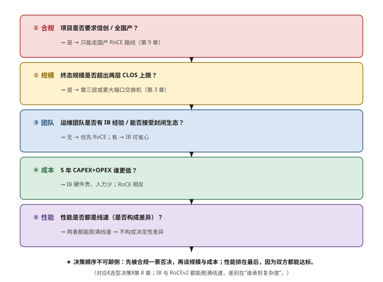
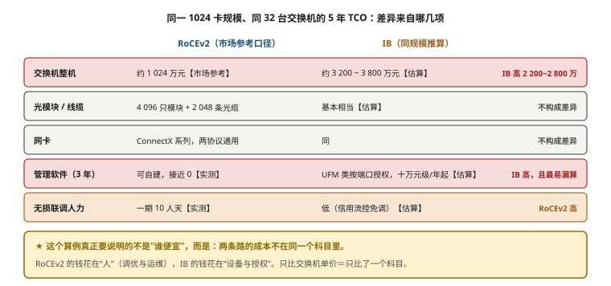

# 第 8 章　IB vs. RoCEv2 多维对比与选型决策

> **本章一句话结论**：这不是一个技术优劣问题——**IB 与 RoCEv2 都能跑满线速**，真正的差别在于「谁承担复杂度」以及「你能不能承受单一供应商」。

---

## 8.1　工程问题：两份都能达标的方案

### 提案对比

本案例在方案评审阶段同时准备了两版方案，都基于同一套服务器（128 台 / 1024 卡）和同一套拓扑（两层 CLOS、单卡单轨），只是协议阵营不同。

| 维度 | 方案 A（IB） | 方案 B（RoCEv2） |
|---|---|---|
| 拓扑 | 两层 CLOS，单卡单轨 | 两层 CLOS，单卡单轨 |
| 交换机数量 | 相同 | 相同 |
| 收敛比 | 1:1 | 1:1 |
| 单端口吞吐 | 可达线速 90%+ | 可达线速 90%+ |
| 无损达成方式 | 协议内置 | PFC + ECN + DCQCN 配置 |

**两个方案在技术指标上都达标。** 评审会上没有出现"某个方案性能不行"这样的结论。

**那最终怎么选的？**

```
决策权重排序（本案例实际情况）
  ① 供应链与合规  ← 权重最高
  ② 交付与运维能力
  ③ 全周期成本
  ④ 性能（差异最小，权重最低）
```

**这个排序是关键。** 多数技术讨论把"性能"放在第一位，但在实际项目里，**当两个方案性能都够用时，决定性的往往不是性能。**

**本章的目的不是告诉你"选哪个"，而是给你一套把这件事想清楚的方法。**

---

## 8.2　最小必要原理

### 8.2.1　性能差异到底有多大

先给结论：**在千卡规模、单卡 400G 的配置下，两者的实测性能差异不足以成为决策依据。**

| 性能维度 | IB | RoCEv2 | 差异来源 |
|---|---|---|---|
| 单端口吞吐 | 接近线速 | 接近线速 | 无本质差异 |
| 小消息延迟 | 略优 | 略高 | IB 链路层更精简（无 IP/UDP 封装） |
| 大消息带宽 | 接近线速 | 接近线速 | 调优到位后差异很小 |
| 无损性 | 协议内置，稳定 | **依赖配置正确性** | **这是真正的差别** |
| 性能稳定性 | 波动小 | 调参不当则波动大 | 取决于工程能力 |

**真正的差别不在"能跑多快"，在"能跑多稳"。**

```
IB 的表现：
  开箱即用 → 无损 → 性能稳定
  
RoCEv2 的表现：
  开箱可用 → 但无损需要正确配置
  → 配得好：性能与 IB 相当
  → 配得差：PFC 频繁触发、吞吐震荡、排障困难
  → 而且"配得差的网络"从外观上完全正常
```

**这就引出了一个关键认知：**

> **RoCEv2 的性能不是选出来的，是配出来的。**
> 因此选 RoCEv2 的前提不是"我的交换机支持 PFC"，而是"**我有人能把它调对，并且能持续维护它**"。

### 8.2.2　运维复杂度：把复杂度放在哪里

| 运维环节 | IB | RoCEv2 |
|---|---|---|
| 初始配置 | 少（SM 集中管理） | **多（每台交换机都要配 QoS/PFC/ECN）** |
| 配置一致性 | SM 统一下发，天然一致 | **需自行保证（易漂移）** |
| 无损调参 | 几乎不需要 | **需要（headroom、Kmin/Kmax、DCQCN）** |
| 故障排查 | 中心化，路径清晰 | 分布式，需逐跳核对 |
| 扩容 | SM 重算路由 | 参数模板复用 + 回归验证 |
| 故障自动恢复 | 协议保证 | **依赖 PFC Watchdog（必须配）** |
| 人才供给 | 少（生态小众） | 多（以太网人才普遍） |
| 监控体系 | UFM（闭源商业） | **可自建（开源工具 + telemetry）** |

**一个关键对比：配置一致性的风险反向。**

```
IB：
  配置一致性由 SM 保证 → 一致性问题少
  但 SM 本身是单点 → SM 出问题影响面大

RoCEv2：
  没有中心配置权威 → 每台设备独立配置
  → 一致性风险高（漏配、漂移）
  → 但出了问题是"局部影响"，不会全网扩散
```

**所以 RoCEv2 的运维难点是"一致性维护"，IB 的运维难点是"中心组件可靠性"。** 这两个难点的应对手段完全不同：

| | 应对手段 | 成本 |
|---|---|---|
| RoCEv2 一致性 | 配置导出 → 与基线比对 → 差异告警（自动化流水线） | 低（一个脚本 + 定期执行） |
| IB SM 可靠性 | 双机主备 + 拓扑新鲜度监控 | 中（多一台管理主机 + 监控） |

**两者都不难，但都必须"专门去做"。** 最坏的情况是：选了 RoCEv2 但没有配置比对机制（一致性必然漂移），或者选了 IB 但没做 SM 高可用（单点必然出事）。

### 8.2.3　供应链与合规：决定性的一票

**这是本案例真正的决策依据。**

| 风险维度 | IB | RoCEv2 |
|---|---|---|
| 供应商数量 | **1 家主要供应商** | 多家（华为、新华三、Arista、锐捷等） |
| 议价能力 | 弱 | **强** |
| 备件保障 | 依赖原厂 | 多渠道 |
| 交期 | 受原厂排产影响 | 相对可控 |
| 出口管制风险 | **高（高端型号）** | 低（国产设备可选） |
| 信创合规 | **难以满足** | **可满足（国产交换机）** |
| 技术路线自主 | 被动跟随 | 相对自主 |

**在运营商类项目里，"合规"不是可选项。**

```
信创要求的具体形式可能包括：
  · 设备国产化率要求
  · 政府采购目录要求
  · 等保测评要求
  · 密码应用合规要求
  · 供应链安全审查
```

**只要项目带有任何一项这类要求，IB 方案的可行性就会受到根本性质疑** —— 不是"技术上不行"，是"程序上过不去"。

> **这一点必须放在方案评审的最前面。** 笔者见过的最浪费时间的评审，是先花三周对比两者的 PFC 与 credit 机制，最后才发现项目有国产化硬约束。

### 8.2.4　CAPEX / OPEX 全周期对比模型

**这个模型的价值不在具体数字，在于把"看不见的成本"显性化。**

```
全周期成本 = CAPEX + OPEX × 年限

CAPEX（一次性）
  · 交换机整机
  · 网卡
  · 光模块（数量巨大，占比高）
  · 线缆与配线
  · 冷备件
  · 施工与集成

OPEX（持续性）
  · 管理软件授权        ← IB 侧显著（UFM 等按端口/台授权）
  · 调优与联调人力      ← RoCEv2 侧显著
  · 日常运维人力
  · 备件补充
  · 培训与技能建设
  · 能耗
```

**两个方向相反的项，必须放在同一张表里看**：

| 成本类别 | IB | RoCEv2 | 说明 |
|---|---|---|---|
| 交换机 CAPEX | 高 | 低 | IB 单价显著更高 |
| 光模块 CAPEX | 相当 | 相当 | **这一层是开放的，两边接近** |
| 网卡 CAPEX | 相当 | 相当 | ConnectX 同时支持两种 |
| 管理软件 OPEX | **高** | 低（可自建） | IB 侧易漏算 |
| 调优人力 OPEX | 低 | **高** | RoCEv2 侧易漏算 |
| 运维人力 OPEX | 低 | 中 | 需要以太网专家 |
| 培训成本 | 中 | 低 | 人才市场差异 |

**★ 最容易出现的两类结构性漏项**：

```
漏项一：选了 IB，预算里没算管理软件授权
  → UFM 类产品的授权是持续性支出
  → 三年期的授权总额可能相当可观
  → 必须在方案阶段向供应商索取报价

漏项二：选了 RoCEv2，预算里没算调优人力
  → 无损联调是独立工作量（本案例一期 10 人天）
  → 每次扩容都要回归验证
  → 这项在项目预算里往往被归入"施工费"而低估
```

**做全周期对比时的四条规则**：

```
① 年限必须明确（建议按 5 年，与设备寿命一致）
② 所有 OPEX 项按年计，不要漏掉"每年都会发生"的项
③ 人力成本按人天单价 × 人天数，不要用"内部消化"搪塞
④ 把"因为技术路线受限而丧失的议价空间"记为一个定性风险项
   → 它不进入数字计算，但必须在决策记录里出现
```

### 8.2.5　选型决策树



**图 8-1　IB vs. RoCEv2 选型决策树**　｜　**读图要点**：决策有固定顺序：**合规一票否决 → 规模决定上限 → 团队能力 → 5 年成本 → 性能**。性能排在最后，因为 IB 与 RoCEv2 都能跑满线速，它不构成决定性差异；真正的差别是“谁承担复杂度”。顺序颠倒（先比性能）是本案例踩过的坑。

（下面只保留它的四条判断顺序。）

**这张树的四条判断顺序，和多数人的直觉相反**：

```
第一问：合规与供应链（不是性能）
第二问：规模（规模越大，IB 的"免调优"价值越高）
第三问：团队能力（RoCEv2 的前提是"有人能调对并维护"）
第四问：成本（在前三问筛完后比较）
```

**本案例的路径**：

```
第一问 → 有信创与合规要求 → 直接进入 RoCEv2
（后面的问题都不用问了）
```

---

### 8.2.6　一个 5 年 TCO 算例：同一 1024 卡规模，钱差在哪



**图 8-2　同一 1024 卡规模的 5 年 TCO：差异来自哪几项**　｜　**读图要点**：同一规模、同样 40 台交换机：IB 侧贵在交换机整机（约高出 1 900~2 500 万元）与管理软件授权，RoCEv2 侧贵在无损联调与长期运维人力。**两条路的成本不在同一个科目里** —— 只比交换机单价，等于只比了其中一个科目。

8.4 节的模型给的是"结构"，这里给一个"数量级"。以本案例终态 **128 台 / 1024 卡、8 轨** 为例
（RoCEv2 侧为真实报价口径，IB 侧为按同规模推算，均标注来源）。

**网络侧设备数量的共同前提**（两条路都要这么多台）：

```
每轨下联 128 口 ÷ 64 口/台 = 2 → 2 台/轨 × 8 轨 = 16 台 Leaf
上联 1024 条 ÷ (64 × 0.75) ≈ 22 台 Spine → 按 r 整数约束取 16
合计 = 24 + 16 = 40 台交换机
```

| 成本项 | RoCEv2（本案例口径） | IB（同规模推算） | 说明 |
|---|---|---|---|
| 交换机整机 | 约 32 万元/台【市场参考】→ 约 **1 280 万元** | 约 2.5–3 倍，约 **3 200–3 800 万元**【估算】 | 40 台 × 单价 |
| 光模块 / 线缆 | 约 5 632 只模块 + 2 816 条光缆【推算】 | 与 RoCEv2 **基本相当**【估算】 | 这一层开放，两边接近 |
| 网卡 | ConnectX 系列，两种协议通用【原厂】 | 同 | **不构成差异** |
| 管理软件（3 年） | 可自建，接近 0【实测】 | UFM 类按端口授权，**十万元级/年起**【估算】 | IB 侧最易漏算 |
| 无损联调人力 | 一期 10 人天【实测】 | 低（信用流控免调）【估算】 | RoCEv2 侧最易漏算 |
| 运维人力（长期） | 需以太网 + PFC 专家 | 需 IB 认证工程师 | 人才市场供给不同 |

**把上表折算成"5 年 TCO 的差异来源"**：

```
IB 更贵的部分：交换机整机（约 +1 900～2 500 万元）+ 管理软件授权
IB 更省的部分：无损联调与回归验证的人力（几十人天量级）

结论【推算】：在本案例这个规模上，IB 的 5 年 TCO 明显高于 RoCEv2，
              差异主要由"交换机整机单价"与"管理软件授权"两项构成，
              而 RoCEv2 省下的是"钱"，付出的是"人力与调优能力"。
```

**★ 这个算例真正要说明的不是"谁便宜"**，而是：

> **两条路的成本不在同一个科目里。** RoCEv2 的钱花在"人"（调优与运维），
> IB 的钱花在"设备与授权"。
> 做决策时如果只比"交换机单价"，等于只比了其中一个科目 —— 这正是本案例
> 第 8.4 节"用性能更好作为结论"那个坑的另一面。

**算例的三条适用边界**（必须写进决策记录）：

```
① 数量级随规模变化：规模越大，IB"免调优"的相对价值越高，差价占比会被摊薄
② 报价随时间变化：本算例是 2026 年三季度的样本，读者应替换为自己项目的询价
③ 合规一票否决优先：任何信创/供应链硬约束下，这个算例不参与决策（8.2.3）
```

## 8.3　选型对比

### 8.3.1　完整多维对比总表

> 这是全书被引用最多的一张表。**所有结论都标注了依据类型**，请勿脱离前提引用。

| 维度 | InfiniBand | RoCEv2 | 谁更优 | 依据 |
|---|---|---|---|---|
| **性能** | | | | |
| 单端口吞吐峰值 | 接近线速 | 接近线速 | 相当 | 项目验收标准：≥ 360 Gb/s |
| 小消息延迟 | 略低 | 略高 | IB | 协议栈层数差异 |
| 大消息带宽 | 接近线速 | 调优后接近线速 | 相当 | — |
| 性能稳定性 | 高（无调参依赖） | 依赖调参质量 | IB | 一阶结论 |
| **无损机制** | | | | |
| 实现方式 | 链路层信用流控 | PFC + ECN + DCQCN | IB（更简单） | 协议设计 |
| 死锁风险 | 理论无 | 存在（需 Watchdog） | IB | 机制差异 |
| 调参量 | 极少 | 多 | IB | 见第 7 章 |
| **运维** | | | | |
| 配置一致性 | SM 统一下发 | 需自行保证 | IB | 架构差异 |
| 中心组件风险 | SM 单点 | 无中心组件 | RoCEv2 | 架构差异 |
| 故障排查 | 中心化，路径清晰 | 分布式，需逐跳核对 | IB | — |
| 人才供给 | 少 | 多 | RoCEv2 | 市场情况 |
| 监控体系 | UFM（闭源商业） | 可自建开源 | RoCEv2 | — |
| **供应链** | | | | |
| 供应商数量 | 1 家为主 | 多家 | **RoCEv2** | **决定性** |
| 议价能力 | 弱 | 强 | **RoCEv2** | — |
| 备件保障 | 依赖原厂 | 多渠道 | **RoCEv2** | — |
| 交期可控性 | 受排产影响 | 相对可控 | **RoCEv2** | — |
| 出口管制风险 | 高 | 低 | **RoCEv2** | — |
| 备件停产风险 | 高 | 低 | **RoCEv2** | 换代周期 2~3 年 |
| **合规** | | | | |
| 信创/国产化 | 难满足 | 可满足 | **RoCEv2** | **决定性** |
| 等保 / 密码合规 | 受限 | 可满足 | **RoCEv2** | — |
| **成本** | | | | |
| 交换机单价 | 高 | 低 | RoCEv2 | 本案例约 320 000 元/台 |
| 光模块 | 相当 | 相当 | 相当 | 开放层 |
| 管理软件 | 按端口授权 | 可自建 | RoCEv2 | OPEX |
| 调优人力 | 低 | 高 | IB | 本案例一期 10 人天 |
| 培训成本 | 中 | 低 | RoCEv2 | — |

### 8.3.2　三档规模下的推荐组合

| 规模 | 推荐 | 理由 | 关键前提 |
|---|---|---|---|
| 小（≤ 500 卡） | **RoCEv2** | 调优工作量可控，成本优势明显 | 有基本的无损配置能力 |
| 中（500 ~ 2000 卡） | **两者都可行** | 需按合规、成本、团队能力综合判断 | — |
| 大（> 2000 卡） | 倾向 **IB** | 调优工作量超线性增长，IB 的免调优价值放大 | 无国产化硬约束 |
| **任何规模，有信创要求** | **RoCEv2** | 合规一票否决 | 选用国产交换机 |

**本案例落在"中"档（1024 卡）**，最终由合规决定选择 RoCEv2。

---

## 8.4　实测与踩坑

### 踩坑一：把技术对比做在合规判断之前

这是本章最想避免的一种时间浪费。

```
错误的评审顺序：
  Week 1-3：对比 IB 与 RoCEv2 的协议机制、延迟、带宽
  Week 4：  询问商务与合规 → 发现项目有国产化硬约束
  Week 5：  重新按 RoCEv2 出方案
  → 前三周的深度技术对比，对决策零贡献
```

```
正确的评审顺序：
  Step 1（半天）：确认合规与供应链约束 → 若已锁定，直接进入方案设计
  Step 2（1 天）：确认规模与团队能力
  Step 3（按需）：在未被排除的选项中做深度技术对比
```

**"先问约束，再做对比"这条原则，适用于所有技术选型。** 约束的分辨成本极低（一次问清），而对比的成本极高（数周）。

### 踩坑二：用"性能更好"作为结论

```
失败的论证方式：
  "IB 的小消息延迟更低，所以选 IB"
  → 反驳：低多少？对训练效率的实际影响是多少？值得多花多少成本？

可站得住的论证方式：
  "IB 小消息延迟低约 X μs，但本案例的 TP 锁在 NVLink 域内，
   网络上的小消息占比很低，因此该优势在本案例场景下不可用；
   而 RoCEv2 的合规优势是硬性的。"
```

**技术对比必须落到"这个优势在本案例的场景下能不能用上"。** 否则就会陷入"参数军备竞赛"——比了一堆数字，但每个数字都与你的实际负载无关。

### 踩坑三：忽略"扩容期"的成本

```
常见的成本对比方式：
  "按终态规模算一次全周期成本"

遗漏的部分：
  · 扩容期的调优回归（RoCEv2 侧）
  · 扩容期的工程变更窗口（两边都有）
  · 前期设备的空置成本（本案例一期 Spine 一次到位）
  · 中间代次设备的停产风险
```

**本案例是分三期建设的，成本对比必须按分期的实际节奏算，不能按"一次性建成终态"算。**

---

## 8.5　现场检查清单

### 决策前

- [ ] **已确认合规与供应链约束**（信创 / 等保 / 密码 / 政府采购目录）
- [ ] 已确认项目是否有国产化率要求
- [ ] 已确认终态规模，并据此判断是否需要考虑三层拓扑
- [ ] 已确认团队的无损网络配置与调优能力现状
- [ ] 已确认是否具备自动化配置比对的手段

### 对比过程

- [ ] 对比维度覆盖：性能 / 无损机制 / 运维 / 供应链 / 合规 / 成本
- [ ] 每个"更优"结论都标注了依据类型（公开资料 / 项目实测 / 推算）
- [ ] 性能优势已核对"在本案例负载下是否可用"
- [ ] 全周期成本按 **5 年**计算，OPEX 项无遗漏
- [ ] IB 侧已获取**管理软件授权的正式报价**
- [ ] RoCEv2 侧已估算**调优与回归的人力成本**
- [ ] 已把"技术路线受限导致的议价空间损失"记为定性风险

### 决策记录

- [ ] 决策依据按优先级记录（合规 → 规模 → 团队 → 成本 → 性能）
- [ ] 已记录"被排除选项"及其排除原因
- [ ] 已记录"若前提变化（合规要求解除）时的替代方案"
- [ ] 决策记录归档，供后续扩容与同类项目参考

---

## 8.6　成本与工期影响

### 选错阵营的代价

| 错误类型 | 代价 |
|---|---|
| 有信创要求却选 IB | **项目无法通过合规审查**，可能推翻重来 |
| 无调优能力却选 RoCEv2 | PFC 频繁触发、吞吐震荡，而且**"看起来正常"** → 排障周期以月计 |
| 选了 IB 但预算漏算管理软件 | 追加授权费用，或在无授权状态下运行 |
| 选了 RoCEv2 但预算漏算调优人力 | 联调被压缩，风险转移给生产环境 |
| 忽略备件停产风险 | 第 4 年找不到备件，集群无法扩容或维修 |

### 一条重要的成本观念

```
IB 与 RoCEv2 的成本差异，不是"贵与便宜"的差异，
而是「成本放在 CAPEX 还是 OPEX」的差异。

  IB：      成本前置（设备贵） + 管理软件持续支出（OPEX）
            换来：运维简单、调优少

  RoCEv2：  设备便宜（CAPEX 低）
            但需要持续投入调优与运维人力（OPEX）
            换来：供应链自主、合规可行
```

**做预算时的实用判断**：

```
如果项目是"一次性投资、后续运维人力有限" → 倾向 IB
如果项目是"持续运营、有人力投入、有合规要求" → 倾向 RoCEv2

本案例属于后者：运营商自用智算中心，长期运营，有信创要求。
```

### 时间维度

| 阶段 | IB | RoCEv2 |
|---|---|---|
| 方案设计 | 简单（拓扑 + SM） | 复杂（含 QoS/PFC/ECN 设计） |
| 到货 | 受原厂排产影响 | 相对可控 |
| 上架接线 | 相同 | 相同 |
| 网络可用 | **快** | 慢（需调参） |
| 性能达优 | 快 | **慢（需压测迭代）** |
| 扩容 | SM 重算 | 参数回归 |
| 故障恢复 | 依赖原厂 | 自主性强 |

**RoCEv2 的"慢"集中在前 20%，IB 的风险集中在后期（备件、升级、合规）。** 评估工期时，要看的是**全周期的确定性**，不是首次上线速度。

---

## 本章要点回顾

1. **IB 与 RoCEv2 性能都够用。** 真正的差别是"谁承担复杂度"和"你能不能承受单一供应商"。
2. **RoCEv2 的性能不是选出来的，是配出来的。** 选它的前提是"有人能调对并持续维护"。
3. **配置一致性的风险方向相反**：RoCEv2 怕漏配漂移（可用自动化解决），IB 怕 SM 单点（可用双机 + 监控解决）。
4. **合规与供应链往往是一票否决项，必须最先确认。** 把技术对比做在合规判断之前，是最典型的时间浪费。
5. **全周期成本按 5 年算，两类漏项最致命**：IB 漏算管理软件授权，RoCEv2 漏算调优人力。
6. **技术对比要落到"在本案例负载下是否可用"**。TP 锁在 NVLink 域内时，小消息延迟优势在网络上看不见。
7. **成本差异的本质是 CAPEX 与 OPEX 的分配**：IB 成本前置，RoCEv2 成本后置。
8. **评估工期要看全周期确定性，不是首次上线速度。** RoCEv2 的慢在前期，IB 的风险在后期。
