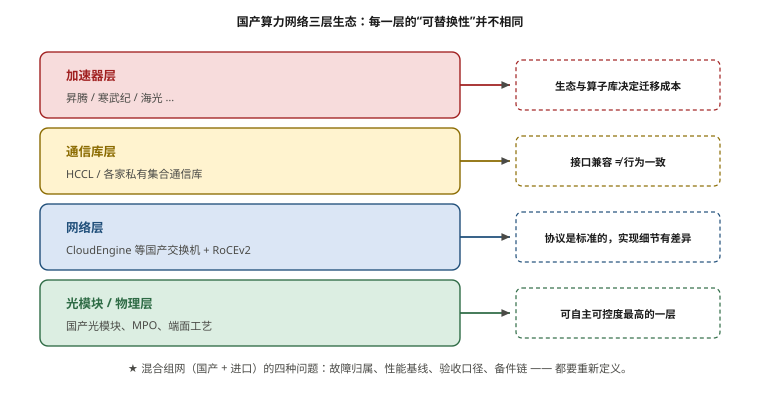
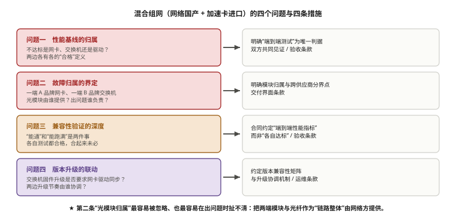

# 第 9 章　国产算力网络与信创生态

> **本章一句话结论**：国产化的难点不在"能不能用"，而在**同一张网里混着两套生态时，故障归属、性能基线和验收口径全都要重新定义**。

---

## 9.1　工程问题：一台"没问题"的国产交换机

### 现场的样子

本案例采用国产交换机（华为 CloudEngine 系列）组建算力网，服务器侧是进口 GPU 与进口网卡。这个组合本身没问题——**问题出现在第一次性能对照时。**

```
测试对象：同一批服务器、同一批光模块、同一套拓扑
测试方法：nccl-tests，all_reduce_perf，同参数

结果：
  用型号 X 的国产交换机 → busbw 约为 A
  用型号 Y 的进口交换机 → busbw 约为 A × 1.05

差异 5%，不大，但稳定复现。
```

**这 5% 从哪来？**

排查发现差异不在转发性能，而在**拥塞控制行为的默认参数不同**：

```
问题不在于"谁快谁慢"，
而在于：两台交换机的 ECN 默认阈值不同
→ 一台更早开始标记（更保守，PFC 用得少，但吞吐略低）
→ 另一台更晚标记（更激进，吞吐略高，但 PFC 触发更多）
```

**这不是"国产 vs 进口"的问题，是"没有统一基线"的问题。** 但它暴露了一个真实困境：

> **当网络设备来自不同供应商（无论是否国产）时，"默认参数"这种隐含假设就不再成立。**
> 而多数团队的调优经验，都是围绕某一个供应商的默认值积累起来的。

**本章要解决的就是这一类问题：国产化不只是"换设备"，它要求你重建一整套基线、口径与故障归属规则。**

---

## 9.2　最小必要原理

### 9.2.1　国产算力网络的三层构成

国产化的讨论很容易停留在"GPU 是不是国产"，但算力网络的国产化其实是三层：

```
┌─────────────────────────────────────────────────────────┐
│  第三层：软件栈                                          │
│    集合通信库（HCCL / 兼容 NCCL 的接口）                 │
│    调度平台（适配国产加速卡的 K8s / Slurm 插件）         │
│    驱动与固件                                            │
├─────────────────────────────────────────────────────────┤
│  第二层：网络设备                                        │
│    交换机（华为 CE 系列 / 新华三 S 系列 / 锐捷 RG-S）     │
│    网卡（国产厂商的 25G/100G/200G/400G 网卡）            │
│    光模块与线缆                                          │
├─────────────────────────────────────────────────────────┤
│  第一层：加速卡与芯片互联                                 │
│    加速卡（昇腾等国产 GPU/NPU）                          │
│    卡间互联（如昇腾的 HCCS）                             │
└─────────────────────────────────────────────────────────┘
```

**★ 国产化程度的三种常见组合：**

| 组合 | 加速卡 | 网络设备 | 软件栈 | 常见场景 |
|---|---|---|---|---|
| **全栈国产** | 国产 | 国产 | 国产 | 强信创要求 |
| **网络国产 + 进口卡**（本案例） | 进口（H100） | **国产** | 混用 | **多数现阶段的实际情况** |
| 全栈进口 | 进口 | 进口 | 进口 | 无信创要求 |

**本案例属于第二种。** 这个组合的复杂度被严重低估——因为它同时继承了"进口卡生态的调优经验"和"国产网络设备的参数体系"，**两边的知识不能直接叠加。**



**图 9-1　国产算力网络的三层生态与可替换性差异**　｜　**读图要点**：自上而下四层：加速器、通信库、网络、光模块。**越往下越标准化、可自主可控度越高；越往上越被生态锁定。** 通信库层的“接口兼容 ≠ 行为一致”是混合组网最隐蔽的问题，性能偏移约 5%（第 9.4 节踩坑一）。

### 9.2.2　加速卡侧的互联：芯片级边界决定网络需求

不同厂商的加速卡，卡间互联的带宽与域大小不同，**这直接决定网络要承载多少流量**（对应第 5 章的 9:1 分析）。

| 维度 | 需要确认什么 | 为什么重要 |
|---|---|---|
| 卡间互联带宽 | 单向 GB/s 量级 | 决定"域内/域外"的分界线 |
| 互联域大小 | 单机内几卡全互联 | 决定 TP 能放多大 |
| 互联拓扑 | 全互联 / 环形 / 交换芯片 | 决定 TP 的实际效率 |
| 是否支持跨机互联 | 有无机架级方案 | 决定网络压力模型 |

**这三条信息必须从加速卡厂商处获取一手规格**，不能靠类比推理。原因很简单：

```
如果在域内带宽上按"进口卡的经验"做假设，可能有两种后果：
  假设偏高 → 低估网络负载 → 网络成为瓶颈
  假设偏低 → 高估网络负载 → 过度建设
```

**实操建议：把"加速卡互联带宽与域大小"作为网络方案设计的第 0 号输入。** 没有这个数字，后面所有带宽规划都是估算。

### 9.2.3　集合通信库：接口兼容 ≠ 行为一致

国产加速卡生态通常提供**兼容 NCCL 接口**的集合通信库（如昇腾的 HCCL）。

**接口兼容带来一个危险的错觉：**

```
应用层看到的：
  ncclAllReduce(...) 还是那个调用
  → 代码不用改，编译就过
  → 看起来迁移成本极低

底层实际发生的：
  不同的 ring/tree 算法选择策略
  不同的拓扑探测逻辑
  不同的通道数与并发策略
  不同的环境变量与调优参数
  → nccl-tests 能跑通，但性能未必达到预期
```

**★ 验收口径必须重新定义的三件事：**

| 项目 | 进口卡生态 | 国产卡生态（需重新确认） |
|---|---|---|
| 测试工具 | nccl-tests | 是否有对应工具？参数是否一致？ |
| busbw 校正系数 | 按 AllReduce 的 2(N−1)/N | 是否相同？ |
| 消息范围 | 8 B ~ 8 GiB | 是否支持相同范围？ |
| 环境变量 | NCCL_* 系列 | 是否有对应变量？语义是否一致？ |

**这一条是国产化项目里最容易出现"验收时才发现口径对不上"的地方。**

```
典型场景：
  合同沿用进口卡项目的验收条款
  → "AllReduce busbw ≥ 300 Gb/s，消息范围 8 B ~ 8 GiB"
  → 实施时发现国产通信库对某些消息段有不同行为
  → 口径无法对齐，争议产生
```

**规避方法：在方案阶段就把"用哪套工具、什么参数、什么口径"写清楚，并让双方书面确认。**

### 9.2.4　信创项目的合规约束

信创要求的具体形式因项目而异，但通常落在以下几类：

| 约束类型 | 典型要求 | 对网络方案的影响 |
|---|---|---|
| 国产化率 | 整机/部件国产化比例 | 决定能否选进口交换机 |
| 政府采购目录 | 需在目录内 | 决定可选品牌范围 |
| 等保测评 | 分级保护要求 | 影响管理平面隔离、审计、访问控制设计 |
| 密码应用合规 | 需使用合规密码产品 | 影响管理通道加密方式 |
| 供应链安全审查 | 关键设备来源可追溯 | 影响品牌与型号选择 |
| 数据本地化 | 数据不出境 | 影响监控/管理平台选型 |

**三条实践建议**：

```
① 合规判断必须前置到方案设计之前
   → 一次问清，成本极低；事后发现，代价极高

② 合规是"程序性"要求，不要试图用技术理由绕过
   → "我们的进口设备性能更好"不是合规审查的讨论范围

③ 把合规要求转化为具体的技术条款
   ✗ "符合信创要求"（无法验收）
   ✓ "交换机须为国产厂商产品，且具备【某认证】"
```

**第 ③ 条特别重要**：合规条款如果不转化为可验证的技术条款，**验收时会变成双方各说各话。**



**图 9-2　混合组网的四个问题与四条措施**　｜　**读图要点**：四个问题依次是：性能基线的归属、故障归属的界定、兼容性验证的深度、版本升级的联动，分别对应「端到端测试为唯一判据」「明确模块归属与分界点」「约定端到端性能指标」「约定版本兼容性矩阵」四条措施。**最容易被忽略的是第二条——光模块归属**：本案例把两端模块与光纤作为「链路整体」由网络方提供，责任边界落在「性能」而不是「部件」上。

### 9.2.5　混合组网的四个具体问题

"网络国产 + 加速卡进口"（或反之）的混合组网，会带来四个具体问题：

```
问题一：性能基线的归属
  某条链路性能不达标 → 是网卡的问题？交换机的问题？还是驱动/固件？
  两边各有各的测试方法和"合格"定义

问题二：故障归属的界定
  跨供应商的链路，一端是 A 品牌网卡，一端是 B 品牌交换机
  → AOC/光模块由谁提供？出问题谁负责？

问题三：兼容性验证的深度
  "能通"和"能跑满"是两件事
  → 双方各自测试都合格，合在一起未必

问题四：版本升级的联动
  交换机固件升级 → 是否需要网卡驱动同步升级？
  两边的升级节奏由谁协调？
```

**对应四条解决措施**：

| 问题 | 措施 | 写在哪里 |
|---|---|---|
| 性能基线 | 明确"端到端测试"为唯一判据，双方共同见证 | 验收条款 |
| 故障归属 | 明确光模块由哪一方提供；跨供应商链路的分界点 | 交付界面条款 |
| 兼容性 | 合同约定"端到端性能指标"，而非"各自达标" | 验收条款 |
| 版本升级 | 约定版本兼容性矩阵与升级协调机制 | 运维条款 |

**★ 第二条"光模块归属"是混合组网里最容易被忽略、又最容易在出问题时扯不清的一项。**

```
跨供应商链路：  [网卡 A] ──光模块──光纤──光模块── [交换机 B]

问题的关键：服务器侧的模块跟服务器供货方，交换机侧的跟网络供货方？
          如果这样分，那么"链路不通"时，双方都说自己的模块没问题

更清晰的做法：把两端模块与光纤作为"链路整体"由网络方提供
            → 网络方对整条链路的性能负责
            → 代价是服务器侧模块的采购需要提前协调
```

**本案例采用后一种方式**：服务器侧网卡模块由服务器供货方随整机提供（在合同里明确型号与数量），但**网络方负责链路调通与性能验证**——责任边界在"性能"上，不在"部件"上。

---

### 9.2.6　国产光模块的选型与验证

光模块是"可自主可控度最高"的一层（图 9-1），也是最容易被当作"通用耗材"随手采购的一层。
现场经验是：**国产模块完全可以用，但必须把"验证"做成流程，而不是靠"插上去能亮"。**

**四类常见问题**：

```
① 批次一致性：同一型号不同批次的发射光功率、消光比有离散
   → 同一链路两端尽量不要跨批次；同一轨尽量同批
② 兼容性：模块与交换机固件的兼容清单（兼容列表 ≠ 都能跑 400G）
   → 采购前索取与目标交换机型号/固件版本的兼容性声明
③ 编码与告警：DDM 字段的解析、告警门限与整机侧口径可能不一致
   → 监控系统要按实际字段对接，不要假设"各家都一样"
④ 伪码与翻新：来源不明的"原装"模块
   → 走可追溯渠道，保留批次号与 SN
```

**到货与上线验证的最小动作**（可直接并入第 12、13 章的 SOP）：

| 环节 | 动作 | 判据 |
|---|---|---|
| 到货 | 抽检发射/接收光功率、核对 SN 与批次 | 落在规格窗口内 |
| 上架前 | 端面显微镜检测 | 无划痕 / 污渍 / 裂纹 |
| 链路建立 | 光功率 + `rx_uncorrectable` | 余量 ≥ 3 dB；**`rx_uncorrectable = 0`** |
| 批量 | 记录插损分布 P50 / P95（对应参数卡 O-05） | 异常点单独复测 |
| 例行 | FEC 计数器纳入巡检 | 出现增长即查 |

**为什么这一节要写这么细**：光模块的数量在本书规模下是**千只量级**（本案例 5 632 只），
单只的差异会被数量放大。**"省下每只几十元"与"因为批次离散导致反复排障"相比，
后者贵得多。** 模块这类"高数量 × 低单价"的物资，质量策略比价格策略重要。

### 9.2.7　混合组网时的备件与固件策略

当同一张网里既有国产设备又有进口设备时（9.2.5 的四个问题之外），还有两条
"到了运维期才会痛"的策略问题：

```
① 备件策略：把"关键件"定义为"停机后无法用同类件顶替的件"
   → 混合组网下，一个国产交换机柜位与一个进口交换机柜位，备件不能互换
   → 备件清单要按"最小不可替代单元"列，而不是按"整机百分比"配（第 6.4 节踩坑二）
② 固件策略：两套设备族的固件升级窗口不能互相绑架
   → 升级一个设备族的固件，可能改变 BGP/BFD/PFC 的默认行为（9.4 踩坑一）
   → 因此升级必须分批、必须灰度、必须保留回滚镜像（第 14 章）
```

**一条落地约定**：混合组网的验收标准里，必须为**每一套设备族分别**写明
"验收时的固件版本号"，而不是只写设备型号。**版本是行为的一部分**，
不写版本，等于验收的是一个随时会变的系统。

## 9.3　选型对比

### 9.3.1　国产交换机的主要阵营

| 厂商 | 系列 | 相对特点 | 适用场景 |
|---|---|---|---|
| **华为** | CloudEngine（本案例采用） | 交付能力强，与国产算力生态配套完整 | 大规模、强信创 |
| 新华三 | S 系列数据中心交换机 | 方案完整，RoCE 支持成熟 | 通用国产替代 |
| 锐捷 | RG-S 系列 | 性价比路线 | 预算敏感、中小规模 |
| 中兴 | 数据中心交换机系列 | 运营商体系内配套 | 运营商项目 |

**选型时的五项核对（与第 7 章呼应）**：

```
① PFC 是否线速转发（开启后吞吐不下降）
② 是否支持 PFC Watchdog
③ 每端口可用缓冲深度（能否满足 headroom 计算）
④ ECN 概率标记能力
⑤ Telemetry 与计数器完整度（能否支撑无损网络运维）
```

**其中 ③ 是最难补救的一项** —— 设备到货后缓冲深度就定死了。

### 9.3.2　三档规模的国产化路径

| 规模 | 建议路径 | 关键动作 |
|---|---|---|
| ≤ 500 卡 | 国产交换机直接替代 | 完成一次端到端压测基线 |
| 500 ~ 2000 卡（本案例） | 国产交换机 + 进口卡混合 | **建立统一性能基线 + 明确故障归属** |
| > 2000 卡 | 需全栈评估 | 通信库调优能力成为关键瓶颈 |

**"建立统一性能基线"这件事，在任何规模下都要做，只是规模越大成本越高。** 具体做法：

```
① 固定一套测试工具与参数（nccl-tests，明确版本）
② 固定消息范围（如 8 B ~ 8 GiB）
③ 在"单一供应商环境"下先建立基线
④ 再在"混合环境"下重测，记录差异
⑤ 差异作为项目的"已知偏移"，写进验收条款
```

**第 ⑤ 步是关键**：把差异显性化，而不是假装不存在。

---

## 9.4　实测与踩坑

### 踩坑一：默认参数不一致导致的性能偏移（9.2 节所述 5%）

**问题的本质不是"谁好谁坏"，是"隐含假设失效"。**

```
调优经验通常是这样积累的：
  "在我们用的这款交换机上，把 ECN 的 Kmin 设成 150 KB 效果最好"
  → 这条经验的隐含前提是"这款交换机的默认行为是这样"
  → 换了供应商，默认行为变了，经验就不成立了
```

**防复发**：

```
① 把"默认参数"显性化：在配置基线里显式写出所有关键参数值，
   不依赖任何厂商默认值
② 建立跨供应商的参数对照表：同一语义的参数在不同品牌上的名称与取值范围
③ 每次引入新品牌/新固件版本，重做一次对照压测
```

**第 ① 条最有效**：**只要所有参数都是显式配置的，"默认值差异"这个问题就消失了。**

### 踩坑二：故障归属的"三不管地带"

```
现象：某几条跨供应商链路性能不达标
     网卡方测：网卡侧所有口都达标
     交换机方测：交换机侧所有口都达标
     端到端测：不达标

根因：两边的"达标"用了不同的测试方法和不同的消息大小
     → 各自在有利条件下都是"合格"的
```

**解决**：

```
★ 验收判据必须是"端到端"，且测试方法由双方书面确认

  ✗ "网卡侧单口吞吐 ≥ X" + "交换机侧单口吞吐 ≥ X"
  ✓ "端到端（服务器到服务器）单口吞吐 ≥ X，测试方法见附录 Y"
```

**"端到端"这三个字看似理所当然，但在多方交付的项目里，它是最容易被拆解掉的东西。**

### 踩坑三：把合规当技术问题讨论

```
错误做法：
  技术会上花时间论证"进口设备性能更优、更成熟"
  → 这不在合规审查的讨论范围

正确做法：
  确认合规要求 → 转化为技术条款 → 在设计约束内做最优选型
```

**合规是"约束"，不是"变量"。** 把约束当变量讨论，是工程管理上最常见的时间浪费之一。

### 待补数据

| 编号 | 缺口 | 为什么重要 |
|---|---|---|
| O-15 | 国产交换机与进口方案的同场景对比数据 | 本章给出的"5% 偏移"是现场观察，但缺少系统性对比数据；无法给出可引用的量化结论 |

> **这一项缺失是本书的一个明确边界。** 国产化选型目前最缺的就是"同场景、同方法、同口径"的公开对比数据。**谁做了这件事并记录下来，谁就掌握了这个领域最有价值的一手材料。**

---

## 9.5　现场检查清单

### 合规前置

- [ ] 已确认项目的国产化率要求与计算口径
- [ ] 已确认是否需在政府采购目录内
- [ ] 已确认等保级别与对应技术要求
- [ ] 已确认密码应用合规要求
- [ ] 已确认是否有供应链安全审查
- [ ] **合规要求已转化为可验证的技术条款**（不是"符合信创要求"这种无法验收的表述）

### 技术基线

- [ ] 已获取加速卡的**卡间互联带宽与域大小**一手规格
- [ ] 已确认 TP 的规模边界（对应域大小）
- [ ] 已确认集合通信库与测试工具的对应关系（nccl-tests 是否适用）
- [ ] 已确认 busbw 等指标的口径与校正系数
- [ ] 已确认各品牌交换机的关键默认参数，并**显式写入配置基线**
- [ ] 已建立跨供应商的参数对照表

### 混合组网

- [ ] 已明确光模块的**提供方归属**（服务器侧 / 交换机侧）
- [ ] 已明确跨供应商链路的**故障分界点**
- [ ] 验收判据为**端到端指标**，且测试方法已书面确认
- [ ] 已完成"单一供应商基线 → 混合环境重测"的对照
- [ ] 差异已作为"已知偏移"写入验收条款
- [ ] 已约定版本兼容性矩阵与升级协调机制

### 交付界面

- [ ] 通信库与驱动由谁提供、谁安装、谁调试，已明确
- [ ] 调度平台是否纳入交付范围，已明确（**常被误以为包含在网络交付内**）
- [ ] 监控与纳管平台的边界已明确
- [ ] 出问题时的一线对接人与响应时效已约定

---

## 9.6　成本与工期影响

### 这一章的决策值多少钱

| 决策 | 影响 |
|---|---|
| 合规判断前置 | 省下数周无效技术对比 |
| 未建立统一基线 | 验收时口径争议，可能返工 |
| 未明确光模块归属 | 出问题时多方扯皮，排障周期不可控 |
| 未确认通信库口径 | 验收条款无法执行，需重新洽商 |
| 隐含依赖厂商默认参数 | 引入新品牌/新固件时性能偏移，且难定位 |
| 调度平台边界未明确 | 交付时范围争议（本案例真实发生） |

### 国产化的成本结构特点

```
本案例实际组合：网络设备国产 + 加速卡进口

  · 网络侧（国产）：可自主选择、议价空间大、交期可控
  · 加速卡侧（进口）：交期与价格受外部影响
  · 软件栈：混合，需要额外的兼容性验证工作量
```

**"部分国产化"的隐性成本在于验证工作量。**

```
全栈进口：
  供应商 A 的一套方案，兼容性由 A 保证
  → 验证工作量：中

全栈国产：
  供应商 B 的一套方案，兼容性由 B 保证
  → 验证工作量：中

混合（本案例）：
  网络由承建方集成，加速卡来自另一供货方
  → 兼容性无人天然负责
  → 验证工作量：高（且责任边界必须先划清）
```

**这就是"混合组网"的真实代价：它把一个技术问题变成了一个管理问题。**

### 工期影响

| 阶段 | 全栈单供应商 | 混合组网 |
|---|---|---|
| 方案设计 | 简单 | 需协调多方规格与参数 |
| 到货 | 单一交期 | 两条交期，需对齐 |
| 上架接线 | 相同 | 相同 |
| 联调 | 直接调 | **需先建立基线再对照** |
| 验收 | 单一判据 | **需统一口径** |
| 故障处理 | 一家负责 | **需先界定归属** |

**混合组网的工期增量主要来自"协调"，不是"施工"。** 因此，**所有可以提前书面确认的事情（口径、归属、边界）都应在方案阶段完成**，不要留到施工阶段——施工阶段的每一天都有成本。

---

## 本章要点回顾

1. **国产化是三层问题**：加速卡与芯片互联 / 网络设备 / 软件栈。三层可以独立选择国产或进口。
2. **"网络国产 + 加速卡进口"是最常见的组合，也是复杂度最高的组合**——两边的调优经验不能直接叠加。
3. **加速卡的卡间互联带宽与域大小，是网络方案设计的第 0 号输入。** 没有它，所有带宽规划都是估算。
4. **集合通信库"接口兼容 ≠ 行为一致"。** 验收口径（工具、参数、消息范围、busbw 系数）必须重新定义并书面确认。
5. **合规是约束不是变量。** 必须前置判断，并转化为可验证的技术条款。
6. **混合组网的四个具体问题**：性能基线归属、故障归属、兼容性验证深度、版本升级联动。
7. **光模块的提供方归属必须在合同里写清**——这是混合组网里最容易扯不清的一项。
8. **验收判据必须是端到端指标**，不能拆解为"各自达标"。
9. **把所有关键参数显式配置，不依赖任何厂商默认值**——这一条能直接消除"换品牌就偏移"的问题。
