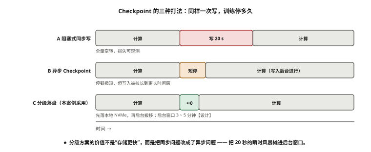
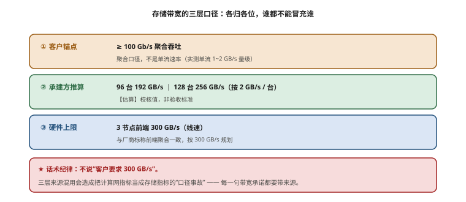
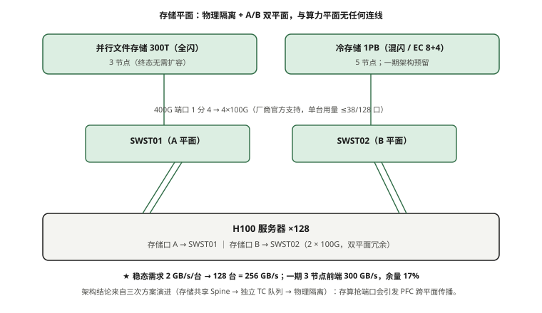

# 第 10 章　高性能智算存储网络

> **本章一句话结论**：存储这件事，容量和吞吐是两笔账；把它们混着算，买回来的大盘一定跑不满。

## 10.1　训练的 I/O 特征：三种流量，三种脾气

先讲一个本案例在方案评审时用算术推演过的场景，它比任何故障都更能说明存储为什么要单独拿出来讲。

96 台 / 768 卡的集群，训练一个大模型，每 200 步存一次全局 Checkpoint。单次全量 Checkpoint 的落盘规模按模型与优化器状态折算，约 1.4 TB【估算】。如果 96 台节点在 20 秒的窗口内**同时**开始写，那么瞬时写入需求是：

```
瞬时写入 = 1.4 TB ÷ 20 s
        = 1,400 GB ÷ 20 s
        = 70 GB/s
        = 560 Gb/s
```

而笔者在二期确定的冷存储聚合吞吐设计值是 137 Gb/s【设计】（见 10.2 的完整推导），并行文件存储前端聚合约 300 GB/s【设计】。也就是说，一次 Checkpoint 风暴，瞬时就能把一个平面顶到墙上去。这不是"存储慢一点"，而是**768 张卡全都在等这一个写动作完成**——因为 Checkpoint 是同步屏障。

这一层出问题的代价可以直接换算。假设因 Checkpoint 排队导致每个训练 step 多花 1.2 秒，按每步有效计算 0.8 秒、一天跑 43,000 步计，一天白等约 14 小时【推算】。以存储整机含配套约 255 万元量级、电费与折旧摊算，每小时停机成本约数千元量级【估算】。一年下来，这是六位数的纯浪费——而且它不产生任何告警，只在监控曲线上表现为一条"偶尔掉下来的利用率"。

所以本章的第一步，是把"存储流量"拆成三种，因为它们的脾气完全不同。

| 流量类型 | 方向 | 典型块大小 | 时间特征 | 对训练的阻塞性 | 关键指标 |
|---|---|---|---|---|---|
| **数据集加载** | 读为主 | 大块顺序（1 MB~64 MB） | 持续、可 prefetch | 低（能被 cache 与流水线隐藏） | 持续读吞吐 |
| **Checkpoint 写入** | 写为主 | 大块顺序 | 周期性突发 | 高（同步屏障） | 突发写吞吐、单流时延 |
| **Checkpoint 风暴** | 写为主 | 大块 + 元数据密集 | 集群级同时突发 | **极高**（incast 冲击存储节点） | 多打一收敛能力、PFC/ECN |

### 10.1.1 数据集加载：能吃满带宽，但吃得"温和"

数据集加载是顺序大块读。它的特点是量大但可预测：DataLoader 有 prefetch，只要下游持续供数，它就能一直挂在链路上。真正会出事的是两种：一是**小文件海量读取**（图像数据集切成几 KB 的碎片），把带宽问题变成 IOPS 与元数据问题；二是**训练刚启动时全集群同时拉数据**——这本质上是一次读方向的 incast，只是它发生在训练最开始，很多项目把它当作"热身慢"而忽略了。

工程动作很简单：数据集预热到本地 NVMe 缓存或近端全闪，把顺序读打散到时间窗口里。这件事在第 10.3 节的分层设计里解决。

### 10.1.2 Checkpoint 写入：一次同步屏障的代价

Checkpoint 是按训练步数周期性触发的。它的关键特征是**"停止-写入-继续"**：训练框架通常会先暂停计算，把各 rank 的 optimizer state 与模型参数落到存储，再恢复训练。这就意味着存储写入的这段时间，**GPU 在空转**。

有三种写法，差别很大：

| 写法 | 机制 | GPU 空转 | 存储瞬时压力 |
|---|---|---|---|
| 阻塞式同步写 | 停算 → 写 → 继续 | 全量空转 | 高 |
| 异步 Checkpoint | 写落到后台线程，计算继续 | 接近 0 | 高（但被拉长到更长时间窗） |
| 分级落盘 | 先写本地 NVMe，再后台搬存储 | 接近 0 | 低（削峰） |

笔者最终采用的是"本地 NVMe 先落 + 后台异步搬移"的分级方案，把 20 秒的瞬时风暴摊到 3~5 分钟的后台窗口【设计】。这不是存储设备的胜利，是**把同步问题改成异步问题**的胜利。

### 10.1.3 Checkpoint 风暴：多打一收敛的极端情况

当 768 个 rank 同时向同一个存储节点组写数据时，就构成一次典型的**多打一（incast）**。它跟前几章讲的集合通信 incast 是同一类物理现象，但在存储侧更难看：集合通信的 incast 是几微秒级、靠 PFC/ECN 兜底；存储的 incast 是几百毫秒甚至秒级，队列在存储节点的入口堆积，PFC 反压会一层层往回传，最后传导到计算网。

这里有个笔者在评审阶段**漏掉、后来才补上**的致命项：**存储 incast 与 NCCL 的 PFC 优先级如果相同，会互相暂停**。原因在 10.4 节讲。这里先记住结论：存储和算力只要是同一套交换机的同一组 PFC 优先级，二者就会在拥塞时互相"拉闸"。



**图 10-1　Checkpoint 的三种打法：同样一次写，训练停多久**　｜　**读图要点**：三种打法的差别只在「训练停多久」：阻塞式同步写要停满整个写入过程；异步 Checkpoint 停顿很短，但写入被拉长；**分级落盘（本案例采用）先落本地 NVMe、再后台异步搬移，把 20 秒的瞬时风暴摊进 3~5 分钟的后台窗口**。这不是存储设备的胜利，是把同步问题改成异步问题的胜利。

### 10.1.4 Checkpoint 的两个参数：规模与频率

Checkpoint 对训练的伤害，由两个参数共同决定：**单次规模**（决定瞬时压力）与**触发频率**（决定一天被打断几次）。二者之间有一个直接的取舍。

按每步有效计算 0.8 秒、单日有效训练 24 小时（无其他中断）计，一天约 43,200 步；单次 Checkpoint 阻塞按 20 秒计【估算】：

| 触发间隔 | 单日次数 | 单日阻塞时长 | 故障回退窗口 | 评价 |
|---|---|---|---|---|
| 每 100 步 | 432 | 432 × 20 s = 2.4 h | 100 步（约 80 s 计算） | 中断过多 |
| 每 200 步 | 216 | 216 × 20 s = 1.2 h | 200 步 | 本案例起点 |
| 每 500 步 | 86 | 86 × 20 s = 0.5 h | 500 步 | 折中 |
| 每 1000 步 | 43 | 43 × 20 s = 0.24 h | 1000 步（约 13 min 计算） | 中断最少，回退最痛 |

这张表的读法是：

- **频率越高，训练越"碎"**——每一次 Checkpoint 都是一次同步屏障，GPU 空转。
- **频率越低，故障时损失越大**——一旦宕机，要从上一个 Checkpoint 重跑。
- **异步 + 分级落盘的作用，就是把这 20 秒从"阻塞"变成"不阻塞"**，从而允许你提高频率而不付出中断代价。**它不是让你少存，是让你敢多存。**

工程上的结论是：**先把 Checkpoint 做成异步，再谈频率。** 顺序反了，只会让训练一直卡在存储上。

## 10.2　最小必要原理：吞吐与容量解耦

这一节是整章的骨架，也是本案例在存储层面**唯一一条真正反直觉的规律**。



**图 10-2　存储带宽的三层口径：各归各位，谁都不能冒充谁**　｜　**读图要点**：三层来源分别是：客户锚点（≥100 Gb/s 聚合吞吐）、承建方推算（96 台 192 GB/s、128 台 256 GB/s）、硬件上限（3 节点线速 300 GB/s）。**话术纪律：不说「客户要求 300 GB/s」** —— 三层混用正是「把计算网指标当成存储指标」那类口径事故的成因。

### 10.2.1 三个公式，先把账分清楚

存储系统的"能用多少"和"能跑多快"是两个独立量：

```
可用容量 = 盘数 × 单盘容量 × k/(k+m)          （EC k+m 纠删码）
可用吞吐 = 盘数 × 单盘顺序带宽 × k/(k+m)
           （假设无损条带、无热点，取顺序读的理论上限）

其中：
  EC 8+4 ⇒ k/(k+m) = 8/12 = 2/3
  单盘容量用 TB（十进制），单盘带宽用 MB/s
```

注意这两个式子里的自变量是**同一个"盘数"**，但一个乘的是容量，一个乘的是带宽。这就是问题的全部：

- **容量**想要达标，可以用"少而大"的盘——几块大盘就够了；
- **吞吐**想要达标，必须"多而小"的盘——因为单块机械盘的顺序带宽基本被物理锁死在 200~250 MB/s，跟容量大小没关系。

**所以：当容量已经封顶（客户只说"要 1 PB"）时，把大盘换成小盘，容量还能达标，盘数和吞吐却翻倍——这就是"用小盘换吞吐"的由来。**

### 10.2.2 一次真实的选型推演

客户的需求是：**1 PB 裸容量 + 100 Gb/s 聚合吞吐**【实测】。冷存储用 EC 8+4（即每 12 块盘有 4 块是校验），SATA CMR 单盘顺序带宽按 200~250 MB/s 取【原厂】。

笔者算了三轮：

```
方案甲：16 TB × 62 盘（大盘）
  裸容量 = 62 × 16 TB = 992 TB ≈ 1 PB   ✓
  吞吐   = 62 × 220 MB/s × 8/12
         = 9,093 MB/s = 9.09 GB/s = 72.7 Gb/s   ✗ 达不到 100 Gb/s

方案乙：12 TB × 96 盘（中盘）
  裸容量 = 96 × 12 TB = 1,152 TB = 1.15 PB   ✓
  吞吐   = 96 × 210 MB/s × 8/12
         = 13,440 MB/s = 13.44 GB/s = 107.5 Gb/s   （余量仅 7%，勉强）

方案丙：8 TB × 128 盘（小盘）
  裸容量 = 128 × 8 TB = 1,024 TB = 1.02 PB   ✓
  吞吐   = 128 × 200 MB/s × 8/12
         = 17,067 MB/s = 17.07 GB/s = 136.5 Gb/s   （余量 37%）✓
```

| 方案 | 盘型 | 盘数 | 裸容量 | 聚合吞吐 | 余量 | 结论 |
|---|---|---|---|---|---|---|
| 甲 | 16 TB | 62 | 992 TB | 72.7 Gb/s | −27% | 不达标 |
| 乙 | 12 TB | 96 | 1,152 TB | 107.5 Gb/s | 7% | 勉强，扛不住退化 |
| **丙** | **8 TB** | **128** | **1,024 TB** | **136.5 Gb/s** | **37%** | **采用** |

方案丙达标了，但它是"小盘换盘数"换来的，代价必须一起说清楚：

- **每 TB 成本上升 20%~35%**【估算】——因为同样的机箱、背板、控制器、盘位成本被摊到更少的每盘容量上；
- **盘数从 62 翻到 128**，几乎翻倍，机箱数量与背板需求随之上升；
- **功耗上升**——每块盘有固定的待机与寻道功耗，盘数翻倍，功耗接近翻倍区间。

于是定稿是：**冷存对象存储，1 PB 裸容量，128 × 8 TB CMR，EC 8+4，5 节点**【设计】，聚合吞吐约 137 Gb/s，余量 37%。

> **一句话记住**：客户要 1 PB 裸容量 + 100 Gb/s 时，如果你按"1 PB ÷ 16 TB ≈ 62 块"去配，你买回来的是一台跑不满的库。**裸容量封顶时，用小盘换盘数。**

### 10.2.3 盘型红线：CMR 可以，SMR 不行

这里有一条必须写进采购文档的硬约束：**指定 CMR（Conventional Magnetic Recording，垂直/常规磁记录），禁止 SMR（Shingled Magnetic Recording，叠瓦式磁记录）**。

原因很直接：SMR 通过叠瓦式写入把单盘容量做大了约 20%，但代价是**随机写入和重写必须整条带重写**，顺序带宽在持续写入下会崩塌。冷存储虽然叫"冷"，但 Checkpoint 与对象存储的元数据操作会让它并不总是顺序写。更麻烦的是，同一型号的盘可能有 CMR 与 SMR 两个版本，供应商报价时给你的是便宜的那个。【原厂】

**工程动作**：采购清单里的盘型要写到具体型号与记录方式，不能只写"8 TB SATA 企业级"。

### 10.2.4 为什么单盘带宽锁死在 200~250 MB/s

有人会问：盘容量能从 8 TB 做到 16 TB、20 TB 甚至更大，为什么带宽不能同步翻倍？

因为机械盘的顺序带宽由三个物理量决定，而这三个量之间存在**互相压制**的关系：

```
顺序带宽 ≈ 面密度 × 每圈扇区 × 转速 × 磁头读写效率

转速     ：主流 7200 rpm，提到 10000 rpm 会带来功耗、噪音、可靠性问题
面密度   ：越大容量越高，但每 bit 越小、信噪比越低，读错误率上升
磁头效率 ：受限于材料与信号处理，多年提升缓慢
```

结果是：**同样的转速下，把容量翻倍（面密度翻倍），单盘顺序带宽基本原地踏步**——因为线性密度提高的同时，盘片上的磁道间距缩小，寻道与信号处理的开销抵消了大部分增益。这解释了为什么 8 TB 盘和 16 TB 盘的顺序带宽都在 200~250 MB/s 这个量级。【原厂】

这条物理事实直接决定了 10.2.2 的结论：**吞吐只能靠"多盘并行"堆出来，不能靠"单盘更大"堆出来**。

## 10.3　选型对比：三层存储的分工

到这里，"存储"不该是一个平面，而应该是三层。三层的分工依据就一个变量：**谁能被训练直接读，谁只能被后台搬。**

| 层级 | 介质 | 一期规格 | 吞吐特征 | 定位 | 训练可见性 |
|---|---|---|---|---|---|
| **本地 NVMe 缓存** | 服务器本地 NVMe | 每节点若干 TB【设计】 | 单节点 GB/s 级 | 数据集预热、Checkpoint 先落、削峰 | 直接可见（mmap/直接读） |
| **并行文件存储** | 全闪 | 300 TB 可用全闪（3 节点，无需扩容） | 前端聚合约 300 GB/s | 热数据、训练数据、供数主力 | 直接可见（POSIX 挂载） |
| **冷存对象存储** | SATA CMR HDD | 1 PB 裸容量（128 × 8 TB，5 节点） | 聚合约 137 Gb/s | Checkpoint 归档、数据集冷副本 | 不直接可见（S3 接口，需拉取） |

三层的关系不是"谁替代谁"，而是**流量分层**：

1. **热数据放全闪并行文件存储**。POSIX 语义，训练进程直接挂载读写，这是供数主力。
2. **Checkpoint 先落本地 NVMe，再后台搬到对象存储**。把同步问题变成异步问题（10.1.2）。
3. **冷数据集放对象存储**，训练前拉到全闪或本地 NVMe 预热。

### 10.3.1 并行文件存储 vs 对象存储，怎么选

| 维度 | 并行文件存储（Lustre / GPFS 类） | 对象存储（S3 类） |
|---|---|---|
| 访问语义 | POSIX，`read/write` 直接挂载 | REST API，PUT/GET 整个对象 |
| 元数据 | MDS 集群，支持海量小文件 | 扁平 key，无目录树 |
| 延迟 | 低（直接读写） | 较高（HTTP 语义 + 客户端 SDK） |
| 扩展性 | 好，但 MDS 是热点 | 极好，天然分布式 |
| 成本 / TB | 高（全闪） | 低（HDD） |
| 适合 | 训练热数据、供数 | Checkpoint 归档、冷数据集 |
| **本案例的 OST / MDS 配比** | OST 数与 MDS 数按客户端并发与元数据密度定，**本案例按全闪可用 300 TB、3 节点配置**【设计】 | 5 节点对象集群，EC 8+4 |

> **MDS / OST 配比的一条经验**：元数据密集（海量小文件）时，瓶颈在 MDS 不在 OST；大块顺序读写时，瓶颈在 OST 与前端网络。**先判断你的数据集是小文件还是大文件，再决定把预算压在哪一侧。** 本案例以 Checkpoint 大块写与小样本量为主，因此预算重心放在了 OST 与前端网络。【估算】

### 10.3.2 为什么要本地 NVMe 缓存

本地 NVMe 缓存不是一个"更快的存储"，它是一个**削峰器**。它承担三件事：

1. **数据集预热**：训练启动时，全集群同时读数据会形成读 incast。先在本地缓存预热，把启动风暴摊平。
2. **Checkpoint 先落**：同步屏障的那一段只写本地 NVMe（微秒级），存储侧的后台搬移不再阻塞训练。
3. **小文件聚合**：把海量小文件在本地聚合成大块再回写，减少存储侧的元数据压力。

代价是：本地 NVMe 有掉电丢失风险，所以要配合掉电保护（PLP）的盘型与"先落再搬"的确认机制——**后台搬移成功之前，那份 Checkpoint 不算数**。

### 10.3.3 三个规模的横向对比

同一套存储设计，规模不同，瓶颈位置完全不同。这是全书反复使用的对照框架，在存储侧同样成立：

| 对比维度 | 32 台 / 256 卡（一期） | 96 台 / 768 卡（主线） | 128 台 / 1024 卡（三期） |
|---|---|---|---|
| 算力下行带宽 | 102.4 Tb/s | 307.2 Tb/s | 409.6 Tb/s |
| 存储前端聚合 | 约 300 GB/s（3 节点全闪） | 约 300 GB/s + 冷存 137 Gb/s | 需 256 GB/s（3 节点已覆盖） |
| 每节点存储 NIC | 2 × 100G | 2 × 100G（双口全接） | 2 × 100G（同） |
| Checkpoint 规模 | 小，单平面可承载 | **风暴出现，需异步削峰** | 风暴更猛，需分级 + 限流 |
| 主要瓶颈 | **数据集首次加载**（读 incast） | **Checkpoint 风暴**（写 incast） | **元数据与限流**（MDS / 租户隔离） |
| 典型翻车点 | 小文件海量读拖垮元数据 | 存储与算力 PFC 互相暂停 | 存储带宽与算力带宽争抢机柜电力 |

三条可直接使用的结论：

1. **32 台阶段，存储几乎不出事**——算力下行才 102.4 Tb/s，全闪前端绰绰有余，坑主要在数据集加载。
2. **96 台是一次质变**：Checkpoint 风暴第一次真正顶到存储前端，异步削峰从"优化项"变成"必需项"。
3. **128 台之后，瓶颈转移到元数据与机柜资源**：存储设备的绝对带宽反而不是最紧的那一环。

## 10.4　实测与踩坑：存储接入形态的完整演进

这一节写本案例最曲折的一段。它比任何设备故障都值得写，因为**它是一连串认知错误的连锁**，而每一步的错误都有一句听起来很专业的话作为掩护。

### 10.4.1 起点：融合组网

最初的设计是**融合组网**：存储流量走计算网，存储交换机（存交）作为计算网的一部分，上联 Spine **16 条**（两台存交，每台 8 条 400G）【设计】。当时的理由很朴素——存储和算力共用一套交换机，省设备、省端口、省运维。

### 10.4.2 评审质疑：一句话里有对有错

评审时，外部意见提出"融合组网不专业"，并给了两条理由：

1. **"应给计算服务器加存储网卡，做物理隔离。"**
2. **"存储应上联 Spine，而不是 Leaf。"**

笔者逐条核对，结论是——**两条的理由层次完全不同：第一条的前提不准确，第二条评审是对的。**

**先说第一条为什么前提不准确。** "融合组网不专业"这个说法，混淆了两件事：

- **RoCE 的 C 就是 Converged（融合）**。RoCEv2 从诞生那天起，设计目标就是"在同一张以太网上承载 RDMA 与存储/业务流量"。说"融合组网不专业"，等于说"RoCE 不专业"，这与整个技术路线自相矛盾。
- **存储后端本来就是隔离的**。存储后端的 **VLAN 41 集群互联在存交内部**完成，天然不经过计算网。前端挂载流量走计算网（那是融合的部分），后端互联从未融合。

所以第一条指控**论据不成立**——但它的**结论方向**（物理隔离更干净）在 10.4.5 被甲方以工程偏好采纳了，这是后话。

**再说第二条为什么是对的。** "存储应上联 Spine 而非 Leaf"——这条一开始没有被重视，量化之后才发现是**差 8 倍**的问题。

### 10.4.3 量化：差 8 倍，8 正好是轨数

```
情形一：存交挂 Leaf
  存储端口分别下挂到各轨的 Leaf
  同轨 32 台服务器共享 1 条 400G 上联
  单节点上限 = 400 Gb/s ÷ 32 = 12.5 Gb/s

情形二：存交挂 Spine
  每台存交上联 8 × 400G = 3,200 Gb/s
  经 ECMP 分摊到同轨 32 台服务器
  单节点上限 = 3,200 Gb/s ÷ 32 = 100 Gb/s

比值 = 100 Gb/s ÷ 12.5 Gb/s = 8
```

**8 正好等于轨数。** 这不是巧合：存交挂 Leaf 时，8 个存储口分别落在 8 条轨上，每个口只能服务它所连的那条轨；存交挂 Spine 时，8 个口经 Spine 打散，**任意一个口都能到任意一条轨**。

> 端口效率同理：**8 个存储口接 Leaf，只覆盖各自的轨；接 Spine，覆盖全部 8 轨。** 同样是 8 个口，服务范围差了一个轨数。

这就是"挂 Spine"那条评审意见的价值：它不是风格问题，是**20 倍的端口覆盖差、8 倍的单节点带宽差**。

### 10.4.4 纠正一处措辞：调度不创造带宽

在讨论"要不要给存储更高的 QoS 优先级"时，团队里出现过一句话，笔者把它记下来当反面教材：

> "把存储的 PFC 优先级调高，就能保证存储不被算力挤占。"

**这句话是错的。** 优先级只解决**排队顺序**与**PFC 暂停的传导顺序**，它**解决不了同一条链路上的带宽竞争**。一条 400G 链路，无论你怎么排优先级，物理上就只有 400G；存储和 NCCL 抢的就是这 400G，谁先谁后只是排队，不是变多。

**调度不创造带宽。** 这是本章要纠正的第二个认知。

那么融合组网到底占了多少？算一下：

```
存储侧峰值 = 约 10.3 Tb/s（96 台 × 约 107 Gb/s）【估算】
Leaf 上联总容量 = 307.2 Tb/s（768 × 400 Gb/s，下行口径）
占比 = 10.3 ÷ 307.2 ≈ 3.4%
```

**代价约 3%，可接受**。但要说清楚：这 3% 是在**存储不爆发**的前提下。一旦 Checkpoint 风暴上来，瞬时占比会远高于 3%。**要把它压到 0，只有一条路——物理分离。**

### 10.4.5 收敛：物理隔离，存储成为独立第五平面

甲方最终基于运维与责任边界偏好，明确要求**物理隔离**。于是服务器侧加装 **2 × 100G 双口存储网卡**（ConnectX-6 Dx **MCX623106AN-CDAT**，QSFP56 笼位，双口全接），分别上联两台存交的 A/B 平面。存储沟通彻底脱离 Spine，成为独立的**第五平面**：

| 平面 | 网段 | 网关 | 承载 |
|---|---|---|---|
| 存储平面 A | 10.0.42.0/24 | SWST01 | 存储前端挂载、Checkpoint |
| 存储平面 B | 10.0.43.0/24 | SWST02 | 同上，双平面冗余 |

至此，五平面（带外 / 带内 / 业务 / 存储 / 计算）全部独立落位。前几章反复提到的"五平面"，在存储这里第一次被真正打通。

### 10.4.6 连带发现：QoS/PFC/ECN 分层完全缺失

这是这次评审**漏掉的最致命项**，笔者在做物理隔离方案时才回头看。融合组网阶段，存储 incast 与 NCCL 用的是**同一组 PFC 优先级**。后果是：

```
存储节点入口拥塞 → 触发 PFC 暂停 → 暂停信号沿链路反向传导
→ 传导到与计算网共用的链路 → NCCL 流量被一并暂停
→ 768 卡集合通信卡住
```

**存储的闪断会暂停算力，算力的拥塞也会暂停存储。** 这就是 10.1.3 埋的坑。物理隔离解决了"互相暂停"的一半（不再同链路），但 PFC/ECN 的**分层设计**仍然是独立课题——这是第 14 章（可观测性）与第 7 章（RoCEv2）的引子，本章先把结论钉在这里：**存储 incast 与 NCCL 若同 PFC 优先级，会互相暂停；隔离是手段，分层是纪律。**

### 10.4.7 定稿：华为 1 分 4 方案

物理隔离落地时，设备与线缆的定稿如下：

| 项目 | 定稿口径 |
|---|---|
| 存储交换机 | 华为 **CE9866-128DQ × 2 台**（双平面 A / B） |
| 服务器侧网卡 | 2 × 100G 双口 **MCX623106AN-CDAT**，双口全接 |
| 服务器 ↔ 存交 | **48 条 1 分 4 分支**（96 台 × 2 口 = 192 腿 ÷ 4） |
| 供货形态 | **主缆 48 根 + 分线盒 24 只（1U）+ 分线模块 48 套 + 子线 192 条** |
| 存交 ↔ 存储节点 | **12 条 200G-SR4**（3 节点 × 2 平面 × 2 条），24 只 200G 模块 |
| 节点侧网卡 | 2 × 双口 200G = 4 × 200G = **800 Gb/s/节点** |
| 后端 | VLAN 41 集群互联，在存交内部，天然隔离 |

**主缆与分线盒的算术**：96 台 × 2 口 = 192 个 100G 端口，每 4 个口合成 1 条 1 分 4 主缆，正好 48 条（48 × 4 = 192，整除无余量，备件按 5% 另行采购）；两条主缆共用一个分线盒，48 ÷ 2 = 24 只。

```
192 腿 ÷ 4 = 48 条 → 主缆 48 条（备件按 5% 另计）
48 条主缆 → 24 只 1U 分线盒（每盒 2 条）
子线 = 192 条（每腿 1 条，接服务器网卡）
```

### 10.4.8 供货形态的二次调整：供应商做不了"定制成品"

方案定稿时，笔者原本的采购设想是**定制成品分支缆**：每一根主干 + 4 条子线，按实际的柜位与缆长**各自定制长度**，一根到货，直接布放。

**供应商回复做不了。** 原因很现实：定制分支缆是单件小批，主干与子线长度组合五花八门，工厂要开专线、逐根测试，交期与成本都不可控。

于是改为**标准件分开供货**：

```
主缆（48 根，标准长度）
  + 分线盒（24 只 1U，标准件）
  + 分线模块（48 套）
  + 子线（192 条，标准长度档）
```

这是本案例一个反复出现的模式：**"按现场定制"听起来最优，但供应链给不了；能落地的方案一定是"标准件组合 + 现场适配"。** 这条经验在第 12 章的缆长分档里会再出现一次。

### 10.4.9 这段演进的复盘：三条可迁移的方法论

把这段"融合组网 → 挂 Spine → 物理隔离"的演进抽象出来，有三条方法论，换任何一个项目都能用：

1. **面对评审意见，先把"前提"和"结论"拆开。** 评审给了两条理由，一条前提不准确（"融合组网不专业"混淆了 RoCE 的 Converged 本义）、一条结论正确（上联 Spine）。如果因为第一条错就否定全部，会漏掉第二条真正值钱的 8 倍带宽；如果因为第二条对就接受全部，会给服务器多配一块本不需要的网卡。**逐条核对，永远比"整体接受 / 整体否定"更省事。**
2. **把"专业不专业"翻译成数字，再决定听不听。** "挂 Leaf 还是 Spine"听起来是品味之争，翻译成"12.5 Gb/s 还是 100 Gb/s"就是事实之争。**凡是能被量化的争议，都要先量化再讨论。** 量不出来的，才退回经验判断。
3. **区分"调度"与"容量"。** 优先级、QoS、限速都是调度手段，它们改变分蛋糕的方式，不改变蛋糕大小。**任何"用调度解决问题"的方案，都要追问一句：物理带宽够不够？** 不够，就只能加物理平面。

## 10.5　最小必要原理：NVMe-oF over RoCEv2 设计要点

前四节讲的是"流量怎么走"，这一节讲"协议怎么接"。全闪并行文件存储的底层，越来越多地采用 **NVMe-oF（NVMe over Fabrics）**——把 NVMe 命令本身通过 RDMA 承载到远端盘。

### 10.5.1 一次读操作的路径

```
训练进程 read()
  → NVMe-oF initiator（服务器侧驱动）封装 NVMe 命令
  → 放进 RoCEv2 报文（RDMA 传输）
  → 存交转发（无损网络，PFC/ECN 保障）
  → NVMe-oF target（存储节点）解封装
  → 落到本地 NVMe
  → 返回路径同理
```

关键点：**NVMe-oF 把"存储协议"变成了"网络协议"**。这意味着存储的性能上限不再由磁盘控制器决定，而由**网络的时延、丢包、拥塞**决定。这就是为什么存储必须走无损网络：一次丢包，重传的是整条 NVMe 命令，延迟直接翻倍。

### 10.5.2 设计要点（本案例采用）

| 要点 | 设计口径 | 原因 |
|---|---|---|
| 传输层 | RoCEv2（UDP/IP） | 可路由、可 ECMP，跨平面可控 |
| 队列 | 每连接独立 Queue Pair | 隔离不同客户端的时延 |
| MTU | 端到端一致（含存储节点、存交、服务器） | 不一致会分片，分片在无损网里是灾难 |
| PFC 优先级 | 存储单独一组优先级 | 避免与 NCCL 互相暂停（10.4.6） |
| ECN 门限 | 存储与算力分别标定 | 两者突发特征不同，一套门限必偏袒一方 |
| 多路径 | 双平面 A/B + multipath | 单平面故障不中断 |
| Namespace | 按租户/任务划分 | 避免元数据热点与误写 |
| 端面 | 100G 用 PC/UPC，400G/200G 用 APC | 见第 4 章，混插物理无法对插 |

### 10.5.3 一个容易被忽略的参数：MTU 一致性

NVMe-oF over RoCEv2 里，MTU 不一致是最隐蔽的坑之一。如果存储节点按 9000（jumbo）、服务器侧按 1500，那么同一帧在两个方向上的分片行为不同，丢包率与重传行为完全不同。表现是"大块读写时快时慢、小粒度正常"。

**工程动作**：MTU 在**整条路径**上一致，并且在链路测试 SOP（第 12 章）里逐段核对，不能只查两端。

### 10.5.4 存储与算力的 PFC/ECN 分层

回到 10.4.6 的结论。分层设计的原则是：

```
算力平面：PFC 优先级 P3（例），ECN 门限偏低（早标记、早降速）
存储平面：PFC 优先级 P4（例），ECN 门限偏高（容忍突发）
二者不得共用同一优先级
```

具体数值不在此展开（第 7 章），但**"不得共用"这条纪律**是本章要交出去的。

### 10.5.5 NVMe-oF 与三种传统存储访问方式的对比

为什么全闪存储要上 NVMe-oF，而不是继续用 NFS / iSCSI？把四条路放在一起，差别一眼可见：

| 方式 | 承载协议 | 典型单口带宽 | 时延量级 | 协议栈开销 | 适合 |
|---|---|---|---|---|---|
| 本地 NVMe | PCIe 直连 | GB/s 级 | 数十 μs | 无网络栈 | 缓存、先落 |
| **NVMe-oF over RoCEv2** | RDMA (UDP/IP) | 100G/200G/400G | 10~30 μs | 低（内核旁路） | **全闪并行存储** |
| iSCSI | TCP/IP | 10G/25G | 100 μs~ms | 高（SCSI + TCP 栈） | 传统块存储 |
| NFS / SMB | TCP/IP | 10G/25G | 100 μs~ms | 高（文件语义 + 栈） | 通用文件共享 |

两条结论：

1. **NVMe-oF 把时延从"毫秒级"拉进"十微秒级"**，接近本地盘一个数量级。对 Checkpoint 这种大块写意义不大，但对小粒度随机读写（数据集里的小样本）意义巨大。
2. **NVMe-oF 的性能上限由网络决定**。这既是它的优点（可以横向扩展），也是它的风险（网络一抖，存储全抖）。**这就是"存储必须走无损网"的最后一块拼图。**

## 10.6　存储平面与算力平面的带宽配比与隔离

### 10.6.1 三层带宽数字，必须分清来源

存储带宽这件事在项目里出过一次**口径事故**（第 13 章的引子）：客户曾把一个 NCCL 的计算网指标（300 GB/s 量级）误当成存储指标写进需求。为避免重演，笔者把存储带宽的数字按**来源**分成三层，各归各位，**谁都不能冒充谁**：

```
① 客户验收锚点（书面，最高约束）
   冷存储聚合吞吐 ≥ 100 Gb/s

② 承建方推算（校核值，非验收标准）
   按每 GPU 约 250 MB/s 训练 I/O 经验值【估算】× 8 GPU/台：
   96 台  ⇒ 96  × 8 × 250 MB/s = 192 GB/s
   128 台 ⇒ 128 × 8 × 250 MB/s = 256 GB/s

③ 硬件物理上限（理论值 + 厂商标称）
   节点前端 4 × 200G = 800 Gb/s/节点
   3 节点 = 2.4 Tb/s = 300 GB/s 聚合（线速）
   厂商标称的前端聚合吞吐亦为约 300 GB/s，两者一致
   → 本案例按 300 GB/s 作为可规划上限【设计】
```

### 10.6.2 话术纪律：不要替客户"加码"

因为第 13 章那次事故，笔者定了一条对外话术纪律：

> **对外不说"客户要求存储 300 GB/s"。**
> （300 GB/s 是计算网 NCCL 的指标，曾被误归因到存储头上。）

正确的说法是：

```
"训练 I/O 推算 96 台 192 GB/s，
 节点前端提供 300 GB/s 上限，
 余量 (300 − 192) ÷ 192 = 56%。"
```

这句话里有推算口径、有硬件上限、有余量，**每一段都标了来源**。它不能保证客户不误解，但能保证**误解发生时，说话的一方有据可查**。

### 10.6.3 存储与算力的配比经验值

| 规模 | 存储前端聚合 | 算力下行带宽 | 配比 | 说明 |
|---|---|---|---|---|
| 96 台 | 约 300 GB/s | 307.2 Tb/s | 约 1:12（按 GB/s 折算） | 存储约为算力的 1/8~1/12【估算】 |
| 128 台 | 需 256 GB/s | 409.6 Tb/s | 同上 | 存储随规模线性增长，算力更快 |

> **配比经验值**：存储前端聚合带宽约为算力下行带宽的 **1/8~1/12**【估算】，并以"每 GPU 约 250 MB/s 训练 I/O"作为下限校验。这两个口径互为交叉验证。

### 10.6.4 隔离：逻辑隔离不够，物理分离才干净

| 隔离方式 | 成本 | 是否解决带宽竞争 | 是否解决 PFC 互相暂停 | 本案例 |
|---|---|---|---|---|
| 同网不同 VLAN | 最低 | 否（同链路竞争） | 否（同优先级） | 弃用 |
| 同网不同 QoS 优先级 | 低 | **否**（调度不创造带宽） | 部分（可分层） | 仅作过渡 |
| **独立物理平面** | 高（加网卡 + 存交） | **是** | **是** | **采用** |

**容量配比 vs 隔离，是两件事**：配比决定"够不够用"，隔离决定"会不会互相干扰"。本案例结论是：**要压到零干扰，只能物理分离；而物理分离的代价（两块 100G 网卡 + 两台存交）在一期就一次到位，比二期返工便宜得多。**

### 10.6.5 容量与带宽的配比公式

把 10.2 与 10.6 的结论合成一条可复用的规划式，交给下一个项目直接套：

```
① 容量侧（先满足客户锚点）
   裸容量 = 盘数 × 单盘容量
   可用容量 = 裸容量 × k/(k+m)

② 带宽侧（再校验是否达标）
   可用吞吐 = 盘数 × 单盘带宽 × k/(k+m)
   要求：可用吞吐 ≥ max(客户锚点, 每 GPU 250 MB/s × 卡数)

③ 反推盘型
   若 ② 不达标且 ① 已封顶 ⇒ 减小单盘容量、增加盘数
   若 ② 达标且 ① 有余 ⇒ 可增大单盘容量、减少盘数（降本）
```

用一个 128 台的例子收尾：客户要 1.6 PB 裸容量。若按 16 TB 大盘算，需 100 块，吞吐 = 100 × 220 × 8/12 = 14.7 GB/s = 117 Gb/s【推算】——如果客户锚点是 150 Gb/s，这就不达标，必须换小盘增盘数。**先算带宽，再定盘型，最后验容量**，顺序不能倒。



**图 10-3　存储平面：物理隔离 + A/B 双平面**　｜　**读图要点**：存储侧每台服务器有 A/B 两个 100G 口，分别上到 SWST01/SWST02 两台存储交换机，**与算力平面的 Leaf/Spine 之间没有任何连线**。一期 3 节点前端 300 GB/s，对上 128 台 × 2 GB/s = 256 GB/s 的需求留 17% 余量。

## 10.7　现场检查清单

> 本章清单聚焦"存储是否会成为训练阻塞点"。可直接打印带到机房。

**A. 需求与容量规划（设计阶段）**

- [ ] 客户需求是否区分了**裸容量**与**可用容量**（EC 后）？1 PB 是裸还是可用，必须书面锁定
- [ ] 是否按"**盘数决定吞吐、单盘容量决定容量**"两条线分别核算，而不是用总容量反推
- [ ] 冷存盘型是否**明确写为 CMR**，并在采购清单里写到具体型号
- [ ] 是否做过"大盘 / 中盘 / 小盘"三方案吞吐对比（10.2.2 的算式）
- [ ] 并行文件存储的 **OST / MDS 配比**是否按数据集的小文件/大文件特征定过

**B. 网络接入（拓扑阶段）**

- [ ] 存储流量是**融合组网**还是**独立平面**？若融合，是否算过单节点上限（挂 Leaf 12.5 Gb/s vs 挂 Spine 100 Gb/s）
- [ ] 存储交换机上联**是否打散到 Spine**（若仍融合）或**已独立于算力网**
- [ ] 服务器是否**双口全接**（双平面 A/B），单链故障是否能切
- [ ] 存储 PFC 优先级是否与 **NCCL 分开**（10.4.6 的分层纪律）
- [ ] 端到端 **MTU 一致**（含存储节点、存交、服务器三处）

**C. 施工与验收（现场）**

- [ ] 1 分 4 分支的**主缆 / 分线盒 / 分线模块 / 子线**数量逐项核对（46 / 23 / 46 / 180）
- [ ] 每条子线两端做**标签**，与端口对应表一致
- [ ] 100G 用 **PC/UPC（水蓝壳）**、400G/200G 用 **APC（绿壳）**，严禁混插
- [ ] 光链路**插损与光功率**逐条记录，形成台账
- [ ] Checkpoint 路径实测：**先落本地 NVMe 是否生效**，后台搬移是否不阻塞训练

**D. 性能验收（【待实测】项）**

- [ ] 冷存储聚合吞吐实测是否 ≥ 100 Gb/s（客户锚点）
- [ ] 全闪并行文件存储**顺序读**能否达到前端上限约 300 GB/s
- [ ] 存储 incast 压测：多打一场景下 PFC/ECN 计数器是否异常
- [ ] Checkpoint 风暴压测：768 卡同时写时，训练 step 时间是否被拉长

## 10.8　成本与工期影响

本章决策对 BOM 与工期的影响，集中在"选型"与"隔离"两处。

| 决策 | 成本影响 | 工期影响 |
|---|---|---|
| 融合组网 → 物理隔离 | 服务器侧 2 × 100G 网卡 + 2 台存交 + 分支缆材，**一次性增项**（第 16 章细化） | 增加存交上架与打缆工作量约数人日 |
| 大盘 → 小盘（8 TB × 128） | 每 TB 成本 ↑20%~35%，盘数翻倍，功耗上升 | 无额外工期 |
| 冷盘指定 CMR 拒绝 SMR | 单价略高 | 避免后期性能不达标的返工 |
| 本地 NVMe 缓存 | 每节点 NVMe 成本 | 削峰，避免训练阻塞 |
| 1 分 4 分支缆标准件分开供货 | 略高于定制成品（需现场适配） | **交期可控**——定制成品交期不可控，这是主因 |
| 存储 PFC/ECN 分层 | 零新增硬件 | 配置工作量 +1~2 人日 |

两条最值得记住的：

1. **物理隔离越早做越便宜。** 若二期才加网卡与存交，服务器已经上架、线缆已经布好，返工的是**整批服务器侧线缆与标签**。一期一次到位，多花的是材料，省下的是返工。
2. **供货形态要服从供应链，不要服从理想。** 定制成品分支缆在草图上是完美的，在工厂里是做不出来的。**能落地的方案，是标准件组合 + 现场适配。**

## 本章要点回顾

- 训练的存储流量分三种：数据集加载（温和、可隐藏）、Checkpoint 写入（同步屏障、高阻塞）、Checkpoint 风暴（集群级 incast、极高阻塞）。**Checkpoint 的关键不是存储快，是把同步改成异步。**
- **吞吐与容量解耦**：可用容量 = 盘数 × 单盘容量 × EC 比；可用吞吐 = 盘数 × 单盘带宽 × EC 比。**裸容量封顶时，用小盘换盘数。** 1 PB 用 16 TB × 62 盘只能跑 72.7 Gb/s，用 8 TB × 128 盘能跑 136.5 Gb/s。盘型必须 CMR，禁 SMR。
- 三层存储：本地 NVMe（削峰）、全闪并行文件（供数主力）、对象存储（冷数据与归档）。
- **存储接入形态的演进**是本案例最有教育意义的一段：融合组网（前提不准确）→ 上联 Leaf 还是 Spine（差 8 倍 = 轨数）→ 物理隔离（独立第五平面）→ 连带发现 PFC/ECN 分层缺失。**调度不创造带宽**，优先级只解决排队，解决不了同链路竞争。
- 存储带宽数字有三层来源，必须分清：客户锚点（≥100 Gb/s）、承建方推算（96 台 192 GB/s）、硬件上限（3 节点线速 300 GB/s）。**话术纪律：不说"客户要求 300 GB/s"。**
- 供货形态教训：定制成品分支缆做不出来，改主缆 / 分线盒 / 子线标准件分开供货。
