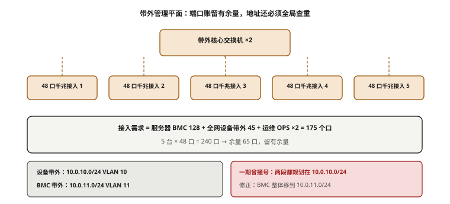
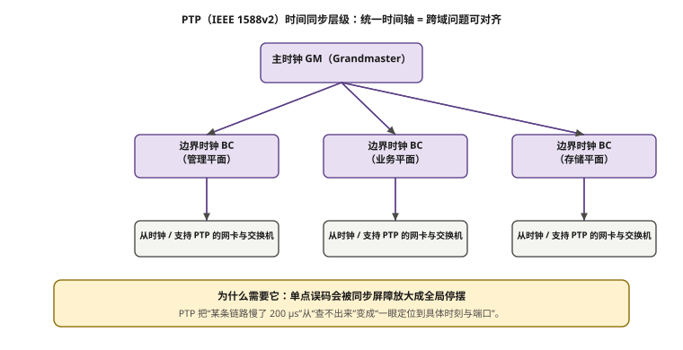

# 第 11 章　带外管理、带内调度与高精度时间同步

> **本章一句话结论**：算力平面决定集群跑多快，辅助平面决定它能不能被治好。

## 11.1　BMC/IPMI 组网与带外安全隔离

### 11.1.1 工程问题：一张 IP 表里，两个地址撞了

一期 IP 规划表刚做完，本案例在自查时发现了一段要命的重复：

```
最初的表（错误）：
  设备带外（交换机管理口）  10.0.10.0/24
      LF01–LF08 管理口 = 10.0.10.11 – 10.0.10.18
  服务器 BMC               10.0.10.0/24     ← 与上面同一段
      S01–S08 BMC     = 10.0.10.11 – 10.0.10.42
```

两段用了**同一个 10.0.10.0/24**。后果是：**Leaf 交换机的 .11–.18 与 S01–S08 服务器的 BMC .11–.42 直接撞号**。也就是说，10.0.10.11 这个地址，同时属于一台 Leaf 的管理口和一台服务器的 BMC。

这件事如果没有在规划期发现，会发生什么？可以算：

- 128 台服务器的 BMC 分布在 .11–.138 区间，其中 **.11–.42 这 32 个地址与 Leaf 管理口重叠**——只要 Leaf 数量覆盖到这些位，重叠面就成立；
- 一旦实施后才发现，需要：**逐台登录 128 台服务器 BMC 改 IP + 重打标签 + 更新 IP 表与三个台账（IP 表 / 端口对应表 / 布防图）**；
- 按每台 0.3 人天（含确认、改址、复验、台账）计，128 台约 **38 人天**；加上 Leaf 管理口重排与全表校验，整体约 **30~40 人天**【估算】；
- 更贵的是**风险**：改 IP 期间部分设备失联，若正好赶上交付节点，直接卡工期。

而笔者在规划期发现它，代价是——**改一张 Excel**，零返工。

> **方法论（本章最重要的一句）**：**规划期发现就是零成本，实施后发现就是全量返工。** IP 段的冲突、端口号的重复、缆长的错算，本质都是同一类问题——**它们全部可以在纸上被发现，而且纸上发现的成本恒为零。** 现场发现，成本与规模成正比。

修正后的定稿：

```
设备带外：10.0.10.0/24（重排）
服务器 BMC：10.0.11.0/24
  服务器 = 10.0.11.11 – 10.0.11.138（128 台 + 预留）
  备件   = 10.0.11.200
```

### 11.1.2 最小必要原理：BMC、IPMI、Redfish 各是什么

| 名词 | 全称 | 是什么 | 边界 |
|---|---|---|---|
| **BMC** | Baseboard Management Controller | 主板上一颗独立小控制器，只要通电（甚至主系统关机）就工作 | 与 OS 完全独立，**它的网络是"带外"的** |
| **IPMI** | Intelligent Platform Management Interface | 传统带外管理协议，UDP 623 端口 | 老、简单、厂商差异大，安全性弱 |
| **Redfish** | DMTF Redfish | 基于 HTTPS/REST 的现代带外管理接口 | 新、可编程、适合自动化 |

**BMC 的权限极大**：可以远程开关机、重置、挂载虚拟光驱/ISO、看 KVM 屏幕、改 BIOS。**它本质上是一台挂在主板上的独立小电脑。** 这就解释了为什么带外必须严格隔离——它不是"多一个网口"，它是**多一扇全权限的门**。

所以本案例的硬约束是：

```
带外平面（设备 10.0.10.0/24 + 服务器 BMC 10.0.11.0/24）
  ├─ 与全网物理隔离（独立交换机、独立布线）
  ├─ 仅跳板机可达（ACL 白名单）
  └─ 不与业务网、带内网、存储网、算力网互通
```



**图 11-1　带外管理平面：端口账贴着边，地址还必须全局查重**　｜　**读图要点**：带外接入需求 = 服务器 BMC 128 + 全网设备带外 45 + 运维 OPS 2 = 175 口，而 5 台 48 口交换机有 240 口 —— **余 65 口，留有余量**。同一张规划表还必须做全局地址查重：本案例一期把 BMC 段与设备段都规划在 10.0.10.0/24，后来把 BMC 整体移到 10.0.11.0/24 才修正。

### 11.1.3 带外交换机覆盖设计：一次规划到位的好例子

带外网流量极小（心跳 + 偶尔的重置操作），所以不需要 400G，**千兆交换机就够**。关键是**覆盖**——要保证每一台设备的 BMC / 管理口都能就近接入。

一期按列布点 **5 台千兆管理交换机**，覆盖全部 8 列（A–H）：

| 交换机 | 柜位 | 覆盖列 | 一期占用（约） |
|---|---|---|---|
| SW-MGMT-1 | A08 柜顶 | A、B 列 | — |
| SW-MGMT-2 | C08 柜顶 | C、D 列 | — |
| SW-MGMT-3 | F08 柜顶 | E、F 列 | 约 32 / 48 口 |
| SW-MGMT-4 | H08 柜顶 | G、H 列 | 约 30 / 48 口 |
| SW-MGMT-5 | D15 柜顶 | 带外汇聚 / 核心 | 上联跳板机 |

这里的关键设计是：**端口容量在一期就为二期预留了。**

一期只有 32 台服务器，F08 / H08 分别只用了约 32 口和 30 口（48 口规格），**余量充足**。于是二期新增的 64 台服务器 BMC 上线时——

```
二期 BMC 接入 = 64 台
  ├─ 不需要新增任何带外交换机
  ├─ 只需要补 CAT6 跳线 74 根
  └─ 且必须是 15 m 档（跨列接入；一期买的 10 m 档跨列不够长）
```

**这是一次"一次规划到位"的胜利**：一期多留的那点端口余量，二期直接省掉了一台交换机和整轮带外布线设计。

**但也留了一个教训**：一期买 CAT6 跳线时按 10 m 档采购，因为一期服务器都在近柜；二期服务器跨列接入时，10 m 不够，必须补 15 m 档。**跳线的长度档，也要按"终态规模"而不是"本期规模"来定。** 这一点在第 12 章的缆长模型里会以更系统的方式再现。

### 11.1.4 带外安全隔离的落地细节

```
物理层：带外交换机独立，不与任何其他平面共机柜上联
地址层：设备 10.0.10.0/24、服务器 BMC 10.0.11.0/24，独立段
访问层：仅跳板机（Bastion）可达，ACL 白名单 + 双因子
协议层：关 IPMI 明文，优先 Redfish over HTTPS
审计层：所有带外操作留日志，重置类操作告警
```

两条容易漏的：

1. **带外网不能"顺手"接上业务网去方便运维。** 一旦互通，带外就是绕过所有安全边界的后门。
2. **Redfish 要统一。** 混合厂商（一期华硕、二期超威）的 BMC 实现不同，自动化脚本要按厂商适配，否则"一键巡检"在一半机器上跑不起来。

### 11.1.5 BMC 的攻击面：它比你想的更"值钱"

为什么带外隔离要被写成本章的硬约束，值得单独说清。BMC 的攻击面比"一个管理网口"大得多：

```
攻击者拿到 BMC 权限后可以：
  ├─ 直接强制重启 / 关机（制造集群级故障）
  ├─ 挂载任意 ISO，从虚拟光驱引导（绕过 OS 层所有防护）
  ├─ 通过 KVM 看屏幕、模拟键鼠（等于坐在机房）
  ├─ 读改 BIOS/固件（可植入持久化后门）
  └─ 部分实现下可读写主机内存（越过 OS 直接抓数据）
```

**BMC 是一台"永远在线、权限最大、通常补丁最旧"的独立小电脑。** 历史上多个著名的服务器固件漏洞都出在 BMC 上。【行业公开】

所以本案例的等级划分是：

| 平面 | 可达范围 | 理由 |
|---|---|---|
| 带外 | 仅跳板机 | BMC 权限过高，绝不对外开放 |
| 带内 | 运维网段 | 纳管与监控，可控 |
| 业务 | 授权用户 | 北向业务 |
| 存储 | 计算节点 | 数据面 |
| 算力 | 计算节点 | 数据面 |

**一句话：带外是这个集群里唯一一个"拿到它就能关掉整个集群"的入口。** 它必须是最难进的那扇门。

### 11.1.6 带外网段的容量规划

带外网段常被当成"随便划一段就行"，但它也要按终态规模规划地址：

```
服务器 BMC：10.0.11.0/24（254 个可用地址）
  128 台服务器取 .11 – .138（一期 .11 起，逐期顺排）
  备件预留 .200
  /24 容量 254 台，覆盖终态 256 台需注意边界【设计】

设备带外：10.0.10.0/24
  交换机管理口（Leaf 16 + Spine 8 + 存交 2 + 带外 5 + 核心）
  ≈ 30 余台，余量充足

经验值：带外网段按"终态设备数 × 1.5"预留地址，
       避免扩容时又要动 IP 表。
```

**注意 256 台终态这个数字**：终态设计规模是 256 台服务器（见参数卡 §1），而一个 /24 是 254 个可用地址，**卡在边界上**。若真到 256 台，BMC 段要么扩成 /23，要么在规划时就把备件地址与正式地址分区。**这就是"按终态规模规划"的另一层含义——不是留点余量，而是要算到地址耗尽的那一天。**

## 11.2　带内节点管理网：K8s / Slurm 控制面设计

带外管 BMC，带内管操作系统与调度。这是两条完全不同的路径，不能合并。

| 维度 | 带外管理 | 带内节点管理 |
|---|---|---|
| 网段 | 设备 10.0.10.0/24；BMC 10.0.11.0/24 | 10.0.20.0/24 |
| 接入对象 | BMC、交换机管理口 | OS 管理口 |
| 承载 | BMC / IPMI / Redfish | 节点纳管、监控采集、调度控制面 |
| 隔离方式 | **物理隔离** | 与业务网 **VLAN 隔离**，同一交换机承载 |
| 规格 | 2 × 1G/节点 | 2 × 25G/节点（板载 CX-4 Lx） |

### 11.2.1 为什么控制面要独立于数据面

控制面流量的特点是：**量极小，但延迟与抖动极敏感。**

以 K8s 为例，控制面里最脆弱的是 **etcd**。它的心跳与选举有明确的时间参数：

```
etcd heartbeat interval   = 100 ms（默认）
etcd election timeout     = 1000 ms（默认，为心跳的 10 倍）
```

如果数据面（NCCL 训练流量）与控制面跑在同一条链路上，NCCL 的突发会把控制心跳的时延抖动从几百微秒推到几十毫秒。**一旦某次心跳超过了 election timeout，etcd 就认为 leader 失联，触发重新选举。** 集群越大，触发概率越高，表现是"调度器偶尔卡一下"——很难定位，因为它不报错，只是变慢。

Slurm 同理：`slurmctld` 与 96 个 `slurmd` 保持心跳，控制面被数据面挤占时，节点会被误判为 DOWN（`Not responding`），触发作业重排。

**结论**：**控制面必须与数据面隔离。** 本案例的做法是——控制面与监控采集走 10.0.20.0/24 带内网，与业务网 VLAN 隔离，同一交换机承载；数据面（算力 / 存储）走各自的物理平面。**控制面流量占比极小，但它决定了整个集群"听不听话"。**

### 11.2.2 三个规模的控制面横向对比

| 对比维度 | 32 台 / 256 卡（一期） | 96 台 / 768 卡（主线） | 128 台 / 1024 卡（三期） |
|---|---|---|---|
| 带内网 | 1 × 25G 单平面 | 2 × 25G/节点 | 2 × 25G/节点 |
| 控制面组件 | K8s 单控制节点 / Slurm 单控制器 | K8s 3 节点 etcd / Slurm 主备 | K8s 5 节点 etcd / Slurm 主备 |
| 监控采集点 | 32 | 96 | 128 |
| 主要风险 | 单点故障 | 控制面被数据面挤占 | etcd 选举抖动、采集风暴 |
| 典型翻车点 | 控制节点与计算节点混布 | 心跳丢失导致误判 DOWN | 采集频率过高打满带内网 |

三条结论：

1. **32 台阶段控制面几乎不会成为问题**——规模小，心跳少，单控制器也扛得住。
2. **96 台是一次质变**：节点数上来了，**心跳的次数与时延抖动的方差同时上来了**，控制面与数据面必须分离，etcd 必须从单节点升到 3 节点（容忍 1 节点故障）。
3. **128 台之后，监控采集本身成为负载**：96 台按 15 秒一次采集还能接受，128 台如果采集频率不变，带内网的 pull 流量会明显上升，需要错峰或分级。

### 11.2.3 监控采集：小流量，但会"合流成河"

单次采集的数据量很小：

```
单个节点单次采集（DCGM + 系统指标）≈ 数十 KB【估算】
96 台 × 每 15 s 一次 ⇒ 平均速率 ≈ 数十 KB × 96 ÷ 15 s
                     ≈ 数百 KB/s = 数 Mb/s 量级
```

**平均速率很低，但这是平均值。** 如果所有节点的采集器在同一秒被拉起（例如统一时钟对齐、统一 cron），就会形成一次**采集风暴**：96 个节点同时 push/pull，瞬时流量是平均值的几十倍。

**工程动作**：采集周期**加抖动（jitter）**，避免全集群同一秒采集；关键指标（GPU 温度、XID、链路计数）走高频，普通指标走低频。

### 11.2.4 K8s 还是 Slurm：控制面的选型

训练集群的调度控制面，主流有两条路。选错不会立刻出问题，但会在后期反复找麻烦。

| 维度 | K8s（+ Volcano / Kubeflow） | Slurm |
|---|---|---|
| 定位 | 通用容器编排 | HPC 作业调度 |
| 调度粒度 | Pod / 容器 | 作业 / 作业步 |
| 拓扑感知 | 需插件（拓扑感知调度） | 原生支持 |
| 与训练框架契合 | 好（容器化） | 好（直接跑进程） |
| 控制面复杂度 | 高（etcd + apiserver + controller） | 低（slurmctld + slurmd） |
| 故障面 | 大（组件多） | 小 |
| 适合 | 多租户、弹性、平台化 | 独占式大训练、追求稳定 |

**本案例的选择逻辑**：训练任务以"长时间独占整机、追求稳定"为主，控制面越简单越好 → 偏向 Slurm 类；但平台侧需要多租户与弹性 → 保留 K8s 承载周边。

**结论**：无论选哪条，**控制面流量必须与训练数据面隔离**，这条比选型本身更重要。选错了调度器只是运维体验差；控制面被数据面挤占，是集群"随机变慢、误判 DOWN"，最难查。

### 11.2.5 控制面组件与心跳参数速查

把控制面的关键组件与它们的心跳参数列清楚，排障时能直接对表：

| 组件 | 角色 | 关键参数 | 抖动敏感度 |
|---|---|---|---|
| etcd | K8s 状态存储 | heartbeat 100 ms / election 1000 ms | **极高** |
| kube-apiserver | 统一入口 | 请求超时（默认 60 s） | 高 |
| kube-scheduler | 调度 | 调度周期 | 中 |
| kubelet | 节点代理 | 心跳 10 s | 中 |
| slurmctld | Slurm 控制器 | slurmd 心跳、`SlurmdTimeout`（默认 300 s） | 高 |
| node-exporter / DCGM | 采集 | 采集周期（本案例 15 s） | 低（可抖动化） |

**读表要点**：etcd 的选举超时只有 1 秒，是最容易被抖动击穿的组件；Slurm 的 `SlurmdTimeout` 有 5 分钟缓冲，相对宽容。**容忍度差的组件，必须放在最干净的网段上。**

### 11.2.6 一次"重启"要走几条网

理解带外与带内的分工，最直观的方式是看一次远程重启走了哪条路：

```
运维在跳板机上点"修复某节点"
  ├─ 判断节点是否失联 → 带内 10.0.20.0/24（ping / kubelet 心跳）
  ├─ 节点失联，强制重启 → 带外 10.0.11.0/24（BMC 的 Redfish 接口）
  ├─ 重启后确认引导 → 带外 KVM 看屏幕（BMC 提供）
  └─ 节点重新上线 → 带内纳管、监控采集恢复
```

**关键点**：当 OS 挂了，带内网是够不着的，**唯一能救回来的是带外**。这就是为什么带外必须"永远在线、独立布网、单独供电"——它是集群的**最后一根救命绳**。任何"为了省事把带外接到业务网"的做法，都是在剪这根绳子。

## 11.3　大规模镜像分发与 PXE 部署网络

### 11.3.1 PXE 是怎么工作的

PXE（Preboot Execution Environment）让服务器**从网卡启动**，顺序是：

```
网卡 PXE ROM 广播 DHCP 请求
  → DHCP 返回 IP + 引导文件名（Bootfile）
  → 从 TFTP/HTTP 拉取引导镜像（bootloader）
  → 拉取 OS 安装镜像 / 云镜像 / 容器宿主机镜像
  → 写入系统盘
```

### 11.3.2 96 台规模的流量特征

首次部署或批量重装时，**96 台服务器会在同一个窗口内几乎同时开始拉镜像**。这就是一次典型的读方向 incast。算一下量级：

```
单节点镜像大小 ≈ 12 GB【估算】
96 台合计 = 96 × 12 GB = 1,152 GB ≈ 1.15 TB

若从单一镜像源分发，源出口按 2 × 25G = 50 Gb/s = 6.25 GB/s 计：
  理论最短时间 = 1,152 GB ÷ 6.25 GB/s ≈ 184 s ≈ 3 分钟【推算】

但实际瓶颈通常不在网络，而在：
  ① 镜像源磁盘随机读 IOPS（1 TB 文件被切成块随机读）
  ② HTTP/TFTP 服务的并发连接数
  ③ 网络管理口的实际达成率（25G 标称，实际可能只有 60%~80%）
```

也就是说，**理论上 3 分钟能铺完的镜像，实测往往要 10~30 分钟**【估算】，多出来的时间几乎全花在源侧。这带来两个直接的工程动作：

1. **镜像源要能横向扩展**：不要单一源，用多个镜像源 + 一致性哈希，或者用 P2P（每个节点既是下载者又是上传者）把源侧压力摊到全网。
2. **部署窗口要与其他管理流量错峰**：镜像分发会打满带内管理网，此时控制面心跳、监控采集都要往后让。

### 11.3.3 传统 PXE 的坑：TFTP 与多播

| 方式 | 机制 | 问题 |
|---|---|---|
| TFTP 单播 | 每个节点独立拉 | 引导阶段慢，块小，延迟高 |
| HTTP 引导 | 用 HTTP(S) 拉镜像 | 快得多，推荐 |
| 多播 | 一次发送多节点收 | 需交换机支持，差错恢复麻烦 |

**定稿建议**：引导阶段（bootloader）可以走 TFTP，但**镜像主体走 HTTP(S)**，并启用多镜像源。这样既保留了 PXE 的通用性，又避开了 TFTP 的慢。

### 11.3.4 96 台 vs 32 台 vs 128 台

| 规模 | 并发分发节点 | 镜像总量【估算】 | 单源理论时间 | 关键瓶颈 |
|---|---|---|---|---|
| 32 台 | 32 | 约 384 GB | 约 61 s | 源侧 IOPS |
| 96 台 | 96 | 约 1.15 TB | 约 184 s | **源侧 IOPS + 并发连接** |
| 128 台 | 128 | 约 1.54 TB | 约 246 s | **源侧必须多源 / P2P** |

**规模越大，镜像分发越不能靠"一个源硬扛"。** 这是本章与第 12 章施工组织直接相关的一条：**分期施工时，每一期的部署窗口都要预留足够的镜像分发时间，且从二期起就必须多源。**

### 11.3.5 镜像分层的三个工程实践

判断一个集群的部署网络设计得好不好，看它有没有做这三件事：

**一、黄金镜像（Golden Image）固化。** 把 OS、驱动、CUDA、容器运行时、监控 agent 全部预装进一个基础镜像，现场只做"刷镜像 + 注入身份"。这样每次部署不需要装系统，只需要**写盘**。好处是——重装时间从"小时级"降到"十分钟级"，且所有节点环境一致。

**二、增量分发。** 不要每期都全量铺 12 GB。基础镜像只在下层变化时重铺，上层（驱动、框架）用增量包。**流量按"变化量"而不是"全量"走**，是解决镜像风暴最有效的一招。

**三、镜像源分级缓存。** 在机房内设一级源（近端），跨机房设二级源。同机房的节点从一级源拉，避免跨机房长距离传输打满骨干。

```
节点 → 近端缓存源（机房内）→ 中心镜像仓库（跨机房）
       ↑ 命中率高，走带内网
                    ↑ 只在缓存未命中时走
```

### 11.3.6 部署窗口的时间预算

把 11.3.2 的算术变成一张可执行的时间预算表：

| 阶段 | 单节点耗时【估算】 | 96 台并发耗时 | 说明 |
|---|---|---|---|
| DHCP + TFTP 引导 | 秒级 | 分钟级 | 引导流量极小 |
| 镜像下载 | 3~10 min（多源） | 10~30 min | **瓶颈在源侧** |
| 写系统盘 | 3~8 min | 与下载重叠 | 本地盘速度决定 |
| 首次开机 + 注入 | 2~5 min | 与下载重叠 | 配置管理 |
| **合计窗口** | — | **30~45 min** | 预留 1.5 倍余量 |

**施工组织上的结论**：**一期的部署窗口按 1 小时预留，二期起按 1.5~2 小时预留**（节点翻倍 + 系统盘写放大）。第 12 章的分期施工计划里，这个窗口是要被显式排进日程的，不能"当天再说"。

### 11.3.7 部署网络到底属于哪条平面

一个容易扯皮的问题：PXE / 镜像分发，算带外还是带内？

```
判断标准：走 OS 还是不走 OS？
  PXE 引导阶段：从网卡 ROM 启动，此时 OS 还没装 ⇒ 形式上像"带外"
  镜像下载 + 写盘：引导器已工作，主机已拿到地址 ⇒ 实际走带内
```

**本案例的归属**：**部署网络归带内（10.0.20.0/24）承载**，但**引导阶段的 DHCP/TFTP 服务放在近端、且不给带外添流量**。理由：

- 把镜像分发（1 TB 级）放到带外（千兆）上，会把带外这条"救命绳"打满；
- 带内是 25G，扛得住镜像风暴；
- 带外只留在"机器起不来时"用，保持干净。

**这条归属规则要写进网络设计文档**，否则现场很容易因为"PXE 是引导"就把它划到带外，然后拿千兆网去扛 1 TB 镜像。

## 11.4　PTP（IEEE 1588v2）原理与部署

### 11.4.1 为什么 NTP 不够用

| 协议 | 典型精度 | 机制 | 适用 |
|---|---|---|---|
| NTP | 毫秒级（1~10 ms） | 纯软件时间戳 | 常规服务器 |
| **PTP（IEEE 1588v2）** | **亚微秒 ~ 百纳秒级** | **硬件时间戳** | 智算集群诊断 |

NTP 的误差来自两个地方：**软件栈的时间戳抖动**（内核处理报文的时间不确定）和**链路不对称**（去和回的路径延迟不一致）。这两条在普通业务里无所谓，但在"用时间戳对齐 768 张卡的日志"时，毫秒级的误差会让因果链彻底糊掉——你分不清谁是因、谁是果。

**PTP 的两个关键改进**：硬件时间戳（在 PHY / MAC 层打戳，绕开软件抖动）+ 逐跳补偿（Boundary Clock 消除链路不对称与排队抖动）。

### 11.4.2 四报文交互与偏差计算

PTP 主从时钟通过四类报文对齐时间：

```
t1 = 主钟发送 Sync 的时刻
t2 = 从钟收到 Sync 的时刻
t3 = 从钟发送 Delay_Req 的时刻
t4 = 主钟收到 Delay_Req 的时刻

链路往返时延  delay  = [(t2 − t1) + (t4 − t3)] / 2
时钟偏差      offset = (t2 − t1) − delay
```

从钟把本地时间减去 offset，就与主钟对齐。**注意 offset 的计算依赖"路径对称"假设**——如果去回延迟不等，就会引入误差。这正是 Boundary Clock 要解决的问题。

### 11.4.3 Boundary Clock 与硬件时间戳

| 角色 | 全称 | 作用 |
|---|---|---|
| **GM** | Grandmaster | 时间源（通常接 GPS / 北斗），全网基准 |
| **BC** | Boundary Clock | 交换机作为边界时钟，**逐跳重新打戳、逐跳消除误差** |
| **TC** | Transparent Clock | 透传时仅修正本节点驻留时间，不重新生成时间 |

BC 比 TC 更强的地方在于：**每一跳都是一个"新的主钟"，误差不累积。** 万卡规模下，从 GM 到最末端的服务器要经过多跳交换机，如果只有 TC，驻留时间修正的累积误差会上升；用 BC，每跳都被"重新校准"。

**硬件时间戳**是前提——如果交换机不支持硬件打戳，BC 与 TC 都退化回软件精度。

### 11.4.4 Grandmaster 双机：不能单点

GM 是整个集群的时间源，**它一挂，全网时间就失去基准**（虽然时钟会继续自由运行一段时间，但会逐渐漂移）。因此必须双机：

```
GM-A（主）：接 GPS / 北斗
GM-B（备）：与 GM-A 同步，同时接卫星
BMCA（Best Master Clock Algorithm）：
  两台 GM 按优先级、时钟等级、精度自动选主
  主 GM 故障 ⇒ 备 GM 自动接管（无需人工介入）
```

### 11.4.5 本案例的 PTP 部署【设计】

| 项目 | 口径 |
|---|---|
| 协议 | IEEE 1588v2 |
| 精度目标 | **< 100 ns**【待实测】 |
| GM | 双机（主备），接卫星时间源 |
| 交换机角色 | Boundary Clock |
| 时间戳 | 硬件时间戳（网卡 + 交换机） |
| 承载平面 | 控制 / 同步（紫），物理走带内管理网 VLAN 隔离 |
| 状态 | **本项无实测数据**，按【设计】写入 |

> **数据纪律**：截至写作时，本案例的 PTP 端到端同步误差**没有实测值**。参数卡待补清单登记为 **O-13**，补采方式为**仪表测量**（在 GM 输出端与末端服务器分别接 PTP 测试仪，对比时间误差分布，记录 P50 / P95 / 最大值）。在此之前，本章所有 PTP 精度数字一律标【设计】或【待实测】，不得写成实测结论。

### 11.4.6 五个常见的 PTP 部署错误

PTP 的坑集中在"配置细节"，而不是"协议理解"。以下五条是现场高发项：

| 错误 | 后果 | 正确做法 |
|---|---|---|
| **Domain 号不一致** | 不同 domain 的时钟互不同步，节点静默失败 | 全网统一 domain（默认 0，跨域隔离才分域） |
| **组播被 VLAN 截断** | Sync 报文不到，从钟永远 free-run | 确认 PTP 报文所在 VLAN 全路径可达；或改单播 |
| **只配了 GM 没配 BC** | 多跳后误差累积，精度达不到目标 | 每级交换机启用 Boundary Clock |
| **软件时间戳冒充硬件** | 精度退化到微秒级 | 核对网卡 / 交换机是否支持硬件打戳并启用 |
| **GM 接的是 NTP 而非卫星** | GM 本身带毫秒级误差，全网跟着漂 | GM 必须接 GPS / 北斗等一级源 |

**最隐蔽的是第一条：domain 不一致不会报错。** 从钟收不到 Sync，不会告警"domain 错误"，它只会安静地自由运行（free-run），时间逐渐漂移。**所以 PTP 的监控必须包含"锁相状态"，不能只看"有没有配"。**

### 11.4.7 报文速率与 Profile

PTP 有两类常见配置风格，选错会让网络白背一份不该背的流量：

| 配置 | Sync 报文速率 | 特点 | 适合 |
|---|---|---|---|
| 默认 Profile | 1 包/秒 | 流量小，收敛慢 | 通用 |
| 电信 Profile（G.8275.1/.2） | 16~128 包/秒 | 收敛快，精度高 | 需要高精度同步 |
| 单播 | 按需协商 | 无组播泛洪 | 大规模、跨网段 |

**批量服务器的时间精度需求，通常 1 包/秒 + Boundary Clock 就够**；不需要为了"看起来专业"把报文提到每秒上百包——那会给管理网白白增加同步流量。**按需求选 Profile，不要按喜好选。**

```
本案例建议【设计】：
  - 默认 Profile（1 包/秒）
  - Boundary Clock 逐跳
  - 硬件时间戳
  - 双 GM 主备
  - 目标精度 < 100 ns【待实测】
```

如果后续实测发现精度不够，再上调报文速率或改用电信 Profile——**先按最小必要配置上，用实测（O-13）决定要不要加码。**

### 11.4.8 PTP 在五平面里的位置

按全书的五平面划分，PTP 属于**控制 / 同步平面**（对应配色为紫），它的物理承载选择有两条：

| 承载方式 | 优点 | 缺点 |
|---|---|---|
| 复用带内管理网（VLAN 隔离） | 省布线、省交换机 | 与采集流量共享链路，抖动略高 |
| 独立同步物理口 | 最干净，精度最优 | 加布线、加端口 |

**本案例采用"复用带内管理网 + VLAN 隔离"**【设计】，理由是 PTP 默认 Profile 只有 1 包/秒，流量极小，VLAN 隔离后不会与采集流量互相干扰；独立同步口要等到精度实测（O-13）不达标时再上。

**这条决策的逻辑与第 10 章存储如出一辙**：**先按最小代价满足需求，用实测数据决定要不要"上物理隔离"。** 不同的是，存储的隔离是甲方要求一步到位，PTP 的隔离则留到了"实测驱动"。**该一步到位的（存储、带外）不要拖，能用实测决定的（PTP 承载）不要提前花钱。**



**图 11-2　PTP 时间同步层级：一个主时钟对多平面统一时间轴**　｜　**读图要点**：主时钟（GM）下发到各平面的边界时钟（BC），再同步到支持 PTP 的网卡与交换机。**统一时间轴把“某条链路慢了 200 µs”从查不出来变成可对齐**，这是把同步平面单独拿出来做的真正原因，不只是为了日志时间戳好看。

## 11.5　PTP 在集群诊断中的应用：用时间对齐定位问题

### 11.5.1 没有统一时间，你只能看到"大家都慢"

设想一个真实场景：96 台全规模压测时，all_reduce_perf 突然变慢，重跑又正常。

- **没有统一时间戳**时：你收集 128 台节点的日志、1000 多个网卡的计数器、32 台交换机的日志，**每一份日志用的是各自主机的本地时间**。主机 A 的 10:00:01 和主机 B 的 10:00:01 可能差了几十毫秒。你看到的是"一堆节点在同一分钟附近都出现了异常"——**无法判断谁先谁后，也就无法定位因果。**
- **有 PTP** 时：所有时间戳对齐到同一条轴上，你能排出严格的先后顺序，直接锁定**第一个异常事件**。

### 11.5.2 诊断的三个时间轴

PTP 让三类信号落在同一时间轴上：

```
① GPU 侧：XID 错误、温度、时钟降频（DCGM / driver 日志）
② 网络侧：PFC 计数、ECN 标记、BFD 状态、光模块 DDM
③ 存储侧：NVMe-oF 重传、Checkpoint 写延迟
```

对齐之后，很多"玄学问题"会立刻现形。举一个可复用的推理链：

```
时间轴上先看到：某台 Leaf 的一条上联在 T0 出现 PFC 持续暂停
稍后 Δ=3 ms：同轨节点的 NCCL 卡顿开始
再晚 Δ=8 ms：相邻轨节点也变慢（经 Spine 传导）

⇒ 根因在这条上联，不在任何一台服务器
⇒ 处置：检查该链路的端面、光功率、对端端口速率协商
```

**没有 PTP 时，这个 Δ=3 ms 和 Δ=8 ms 的先后关系会被时间戳误差淹没**，你会把问题误判成"全网性抖动"，然后在错误的方向上查很久。

### 11.5.3 时间不同步本身就是一种故障

要建立一条纪律：**时间不同步，本身就是要被监控和告警的故障**，而不是"小问题"。

```
监控项：
  - 每台节点的 PTP offset（相对 GM）
  - PTP 锁相状态（locked / holdover / free-run）
  - GM 主备切换事件
告警阈值：
  - offset 超过设定阈值的 X 倍 ⇒ 告警
  - 节点进入 holdover 超过 T 秒 ⇒ 告警
```

> **【待实测】**：本案例 PTP 的实际诊断价值，需要现场真实故障数据来支撑（O-13）。上面这条推理链是**方法论推演**，不是已发生的实测案例——写作时如实标注，不伪造案例。

### 11.5.4 一张可复用的事件时间轴模板

把诊断固化成模板，现场就不会临场手忙脚乱。收到"集群变慢"告警后，按此表在统一时间轴上排布：

```
T−5min  ［基线］NCCL busbw 正常，PFC 计数平稳
T0:00   ［触发］某节点或链路首个异常（PFC 暂停 / ECN 标记 / DDM 突变）
T0:03   ［扩散］同轨相关节点开始变慢
T0:08   ［传导］跨轨节点经 Spine 受影响
T0:12   ［全局］all_reduce_perf 波动被监控捕获
T+…     ［恢复］异常消失，指标回归基线
```

填这张表需要的原始数据，全部来自统一时间戳：

| 数据源 | 内容 | 采集方式 |
|---|---|---|
| GPU | XID、温度、降频 | DCGM |
| 网卡 | PFC pause、ECN、重传、丢包 | ethtool / 计数器 |
| 交换机 | 端口 PFC / ECN / 光功率 | telemetry / gNMI |
| 存储 | NVMe-oF 重传、写延迟 | 存储侧监控 |
| 时钟 | PTP offset、锁相状态 | PTP 监控 |

**这张表的价值不在于它一定准，而在于它逼你"按时间顺序"而不是"按设备类别"去看问题。** 大多数误诊，都是因为运维人员按设备分头查，最后拼不出先后——**没有时间轴，就没有因果。**

**工程动作**：把这张模板写进运维值班手册（第 14 章展开），并要求所有日志系统统一时间源为 PTP / 同一 NTP 上游。

### 11.5.5 PTP 与 NTP 并存的现实策略

现实中不会所有设备都支持 PTP（业务交换机、部分 BMC、存储设备可能只支持 NTP）。务实的分层策略是：

```
核心同步（服务器、算力交换机、存储）→ PTP，目标 < 100 ns
外围设备（BMC、业务交换机、管理终端）→ NTP，指向从 PTP 派生的 NTP 服务器
```

关键是**不要让 NTP 破坏 PTP 的权威**：NTP 服务器的上游时钟必须来自 PTP/GPS，而不是各自去对公网。否则会出现"一部分设备信任公网 NTP、一部分信任本地 PTP"，两套时间源打架，日志再度错位。

**一句话**：**PTP 管精，NTP 管广，但 NTP 必须听 PTP 的。** 全集群只有一个时间权威。

## 11.6　现场检查清单

> 本章清单聚焦"辅助平面是否可控、可诊断"。可直接打印带到机房。

**A. 带外管理（规划阶段）**

- [ ] 设备带外网段与服务器 BMC 网段**是否分开**（本案例：10.0.10.0/24 与 10.0.11.0/24）——这是本章的头号红线
- [ ] IP 表做过**跨段冲突自查**吗（同一地址是否出现在两个平面）
- [ ] 带外是否**与全网物理隔离**，仅跳板机可达，ACL 白名单
- [ ] 带外交换机端口容量是否按**终态规模**预留（本案例 48 口规格，一期用约 30~32 口）
- [ ] BMC 协议是否统一（混合厂商的 Redfish 实现差异）
- [ ] 带外操作审计与告警是否开启（重置类操作必告警）

**B. 带内节点管理（设计阶段）**

- [ ] 控制面是否**与数据面隔离**（VLAN / 物理）
- [ ] etcd 是否为 3 节点及以上（容忍 1 节点故障）
- [ ] 监控采集是否加**抖动（jitter）**，避免采集风暴
- [ ] 采集频率是否随规模分级（96 台 15 s，128 台需错峰或降频）

**C. 镜像分发与 PXE（部署阶段）**

- [ ] 镜像主体是否走 **HTTP(S)** 而非 TFTP 单播
- [ ] 镜像源是否**多源 / P2P**（从二期起必须）
- [ ] 部署窗口是否与监控采集、控制面心跳**错峰**
- [ ] 单节点镜像大小与并发数是否核算过（总量 = 节点数 × 单镜像）
- [ ] PXE 引导镜像与 OS 镜像的版本是否与目标一致

**D. PTP 时间同步（部署与运维阶段）**

- [ ] GM 是否**双机主备**，接卫星时间源
- [ ] 交换机是否支持并启用 **Boundary Clock + 硬件时间戳**
- [ ] 端到端 offset 是否有监控与告警
- [ ] PTP 端到端精度**实测**（本案例待补：O-13，仪表测量，记录 P50 / P95 / 最大值）
- [ ] 节点是否监控锁相状态（locked / holdover / free-run）

## 11.7　成本与工期影响

| 决策 | 成本影响 | 工期影响 |
|---|---|---|
| 带外网段提前分开（规划期） | **零成本**（改一张表） | 避免约 30~40 人天返工【估算】 |
| 带外交换机端口按终态预留 | 一期无额外成本（规格相同） | **二期省掉一台交换机与整轮布外布线设计** |
| 带外 CAT6 跳线按终态长度采购（15 m 档） | 单价略高 | 避免二期补线停等 |
| 控制面与数据面隔离 | 零新增硬件（复用带内网） | 配置 +1 人日 |
| etcd 从 1 节点升 3 节点 | 增 2 台控制节点资源 | 提升可用性，避免误判 DOWN |
| 镜像多源 / P2P | 少量软件与配置 | 部署窗口从"不可控"变"可控" |
| PTP 双 GM + BC 交换机 | 交换机需支持 BC（选型项），GM 设备成本 | 部署 +2~3 人日；换来可诊断性 |

最值得记住的两条：

1. **规划期的一张表，能省实施期的几十人天。** 网段撞号的教训是——**所有能在纸上发现的问题，都要在纸上发现。**
2. **辅助平面的价值不在平时，在出事的时候。** 平时它只是几十 Mb/s 的心跳和几 KB 的采集；但集群一旦出故障，**只有辅助平面能告诉你"谁先坏、谁后坏"**。为可诊断性花的钱，买的是"故障时不用瞎猜"。

**辅助平面的成本占比**：五台千兆带外交换机 + 带外布线 + 带内复用 + PTP 设备，相对 32 台算力交换机与 4096 只光模块，**占比是个位数百分比**【估算】。但它承载的是"整个集群能不能被运维"——**这是全书性价比最高的一笔投入：花个位数百分比的预算，买回对全部硬件的控制权与可诊断性。**

## 本章要点回顾

- **带外（BMC/IPMI/Redfish）管理的是"机器"（开关机、重置、挂 ISO），带内管理的是"操作系统"（纳管、监控、调度）。两条路径不能合并。**
- **最刺眼的教训是网段撞号**：设备带外与服务器 BMC 写成同一段 10.0.10.0/24，Leaf 的 .11–.18 与 S01–S08 的 BMC .11–.42 直接撞号。一期未实施，修正零返工。**规划期发现就是零成本，实施后发现就是全量返工。**
- **带外交换机一次规划到位**：一期 5 台按列布点（A08 / C08 / F08 / H08 / D15），F08 覆盖 E+F、H08 覆盖 G+H，端口按终态预留；二期 64 台 BMC 接入**不需新增交换机**，只需补 74 根 CAT6（且必须 15 m 档，一期 10 m 档跨列不够）。
- **控制面必须与数据面隔离**：etcd 心跳 100 ms、选举超时 1000 ms，数据面的突发会触发误选举与误判 DOWN。
- **镜像分发是读 incast**：96 台 × 12 GB = 1.15 TB，单源理论 3 分钟、实测常 10~30 分钟，瓶颈在源侧 IOPS 与并发；从二期起必须多源 / P2P。
- **PTP（IEEE 1588v2）**：硬件时间戳 + Boundary Clock + 双 GM，精度目标 < 100 ns【待实测】。它的价值在于**用统一时间轴定位"谁先坏"**——没有它，你只能看到"大家都慢"。
