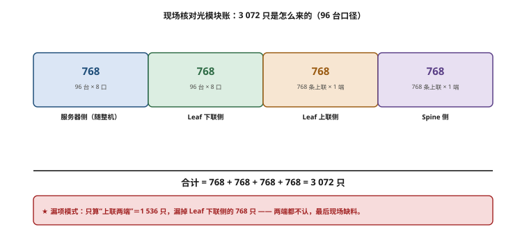
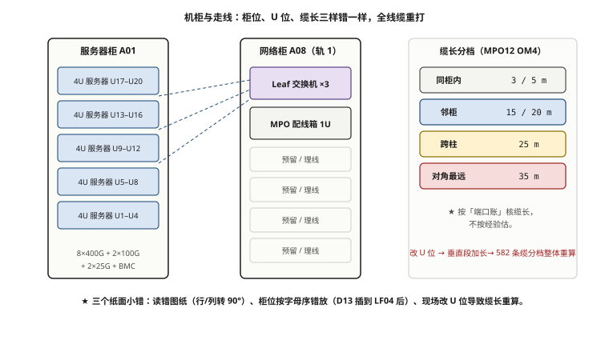

# 第 12 章　千卡集群工程打缆与物理施工

> **本章一句话结论**：图纸、柜位、U 位——三个纸面上的小错，能让全集群线缆重打一遍。

先交代本案例在这一层踩过的三个坑，它们各自的损失都可以量化：

- **读错了图纸。** 甲方给的《机房机柜物理排布图》，施工方一开始把它当"每一行是一排机柜"来读，**两天后才发现，每一行其实是一列**——布局整个转了 90 度。
- **放错了柜位。** 甲方要求 Leaf 柜位按字母序排，把 D13 插到 LF04 之后，**这会推翻一期已经定稿的 256 条下联标签与已布好的线缆**。
- **改动了 U 位。** H100 服务器 8U 约 130 kg，现场按"重物低位"把服务器从 U17–U20 改到 U2–U9，**导致服务器侧垂直段加长约 2 m，全集群 582 条线缆的缆长分档整体重算**。

三个坑的共同点是：**它们全部发生在"纸面阶段"，但每一个都能牵连到全量现场返工。** 这就是本章要建立的纪律——**施工现场的每一米线，都应该先在纸上量过。**

## 12.1　高密配线架与 MPO 预端接方案

### 12.1.1 为什么智算中心必须用 MPO 预端接

先看这个集群的线缆体量。按 96 台累计口径【设计】：

```
算力平面：
  下联 768 条（服务器 768 张 400G 网卡）
  上联 768 条（Leaf 16 × 48 口）
  光模块合计 2,976 只【设计】
存储平面：
  服务器侧 46 条 1 分 4 主缆（180 条子线）
  存交↔节点 16 条 200G-SR4
```

近三千条高速链路，如果按传统的"单芯 LC 现场熔接"来做，工程量与故障率都不可接受。MPO 预端接方案解决的就是这个问题：

| 方案 | 现场工作量 | 一致性 | 故障率 | 适用 |
|---|---|---|---|---|
| 单芯 LC 现场熔接 | 极大（每链路多芯） | 依赖施工水平 | 高 | 低速、少量 |
| LC 预端接跳线 | 中 | 好 | 中 | 常规数据中心 |
| **MPO 预端接** | **小（一次插 8~12 芯）** | **工厂级一致** | **低** | **智算高密** |

**MPO 的核心价值不是"更快"，是"一致"。** 工厂把 8 芯或 12 芯端接在同一只连接器里，现场只做一次插拔；端面质量由工厂保证，而不是由现场师傅的手决定。

### 12.1.2 高密配线架（配线箱）的形态

MPO 不能直接插到服务器网卡上（网卡是 OSFP / QSFP112 / QSFP28 封装），中间要有**配线**环节。本案例的做法：

```
服务器网卡（OSFP/QSFP112）
  → 400G/200G/100G 光模块
  → 12 芯 MPO-MPO OM4 跳线
  → 1U MPO 配线箱（配线架，含 MPO 耦合器）
  → 跳线到交换机光模块
```

**1U MPO 配线箱**（市场参考价 1 800 元/套）的作用是把"大量 MPO 跳线"收纳、固定、并提供清晰的端口对应关系。它同时也是**盘纤**的地方——光模块侧要留出弯曲半径足够的余量，不允许硬折。

### 12.1.3 两条被否掉的方案

**方案一：用 AOC（有源光缆）整体替换"光模块 + MPO"。**

被否的原因很具体：**CE9866-128DQ 没有 1:1 满速的 400G AOC**。官方配件只有三种——400G 光模块、400G→2×200G AOC（20–50 m）、400G DAC。也就是说，Leaf↔Spine 这一段**只能用光模块 + MPO**，没有 AOC 可替代。【原厂】

**方案二：交换机端口直插 100G QSFP28 模块。**

被否的原因同样具体：**CE9866-128DQ 不支持直插 100G QSFP28 模块**，要用 100G 只能通过 4×100G 拆分实现。【原厂】

> **这两条都属于"选型必须逐型号核对"的典型**：同类产品不一定有同样的限制。例如某款基于 Spectrum-4 的 64 口 400G 交换机就支持每个 400G 口无限制拆 4×100G。**不能拿"别人家的交换机支持"去假设自己家也支持。**

### 12.1.4 预端接的采购形态：标准件分开供货

配线方案的采购清单（一期）与第 10 章存储分支缆的教训一致——**不搞定制成品，用标准件组合**：

| 物料 | 规格 | 说明 |
|---|---|---|
| MPO-MPO 跳线 | 12 芯 OM4，分档长度 | 主力，按缆长模型分档 |
| 1U MPO 配线箱 | 标准 1U，含耦合器 | 配线与盘纤 |
| MPO 分线模块 | 1 分 4 等 | 存储分支用 |

**统一极性 Type B（完全交叉型），公母头按模块实物核对**（华为官方配套光纤标注为母头）。端面：**400G/200G 用 APC（绿壳，8° 斜面）**，**100G 用 PC/UPC（水蓝壳）**，两者严禁对插（第 4 章）。

### 12.1.5 预端接的现场工艺与验收

预端接的优势在工厂，但**现场仍有四道必须做对的工序**：

```
① 拆封与端面检查：预端接出厂即护帽封端，拆封后先目检端面，
   再做一次清洁（工厂到货≠现场干净）
② 弯曲半径控制：盘纤余量按固定段 3.5 m 预留，弯曲半径
   动态 ≥ 10× 光缆外径、静态 ≥ 20× 光缆外径
③ 极性核对：Type B 全线一致，A→B→A 交叉，核对发送/接收不反
④ 清洁 SOP：一按二擦三吹，单向操作，禁止来回摩擦
```

**最容易被跳过的是第①步。** 很多人认为"预端接 = 出厂已清洁，无需再擦"——但端面护帽拆开的那一刻，灰尘就可能落上去。**一次成本几秒钟的清洁，能避免第 13 章那种"随机 CRC 误码"的噩梦。**



**图 12-1　现场核对光模块账：3 072 只是怎么来的（96 台口径）**　｜　**读图要点**：3 072 只 = 服务器侧 768 + Leaf 下联侧 768 + Leaf 上联侧 768 + Spine 侧 768。**漏项模式很固定：只按「上联」两端算，得 1 536 只，漏掉 Leaf 下联侧的 768 只** —— 这部分模块既不在服务器供货包里、也不在上联清单里，两边都不认，最后现场缺料。

### 12.1.6 光模块数量的现场核对：2,976 只是怎么来的

打缆之前必须先把光模块数量对上，否则现场不是缺货就是压库。按 96 台累计口径【设计】：

```
算力光模块：
  服务器侧    768（每 GPU 一张 400G 网卡）
  Leaf 下联   768
  Leaf 上联   768（16 Leaf × 48 口）
  Spine 侧    768
  ⇒ 合计 2,976 只

存储光模块：
  服务器侧 180（96 台 × 2 口 100G QSFP28 SR4）
  存交主端 46（1 分 4 分支主缆）
  存储节点 32（16 条 200G × 2 端）
```

**这张表的用途是现场盘点**：每到一个批次，按位置核对数量与型号。**注意三个位置用的封装/端面不同**——服务器侧 400G 是 **OSFP**，Leaf/Spine 侧是 **QSFP112**，两者同接口同极性但不通用；100G 是 QSFP28（UPC 端面）。**同是一根"400G 线"，两端的模块型号可能不一样**，这是最容易配错的地方。

> 项目里真实出现过一次：网卡封装一度按 QSFP112 报了 768 只，**实测到货是 OSFP**。两者同接口同极性（MPO-12 APC），但封装不同，直接改动模块采购清单。【实测】**打缆前的第一件事，就是把"实物封装"与"清单封装"对一遍。**

## 12.2　机柜布局、U 位规划与走线标准

### 12.2.1 机房与柜位：先算清有多少可用

本案例机房是 **A–L 共 12 列 × 17 位**，理论格位：

```
理论格位 = 12 列 × 17 位 = 204 格
```

但可用格位不等于 204。要用三个数做交叉校验【实测】：

```
可用格位 = 204 − 无柜位 16 − 现有占用 6 = 182 格
```

**这个"三数交叉校验"是本章的一个方法论**，后面 12.4 讲图纸转置时还要用一次。它的作用是：**任何一次对图纸的解读，都要能被这三个数复算出来；算不出来，就是读错了。**（后面会看到，笔者正是靠它才发现机房图被转置了。）

在这 182 格里，还要扣掉非算力用途：

```
算力可用柜位 = 182 − 15（D 列核心/主干） − 7（Leaf 柜） = 160
```

**160 格位对应终态 128 台服务器，余量约 25%。** 这不是巧合，是规划的结果——但余量并不宽裕，一旦柜位数被误读，立刻就是算力柜位不够。

### 12.2.2 Leaf 与 Spine 的柜位

```
Leaf 柜位（8 个）：A08 / B08 / C08 / E08 / F08 / G08 / H08 / D13
Spine 柜位：D08 – D11（4 柜，终态 4 台/柜 = 16 台）
```

**注意 Leaf 柜位不是字母序。** 前七个是 A/B/C/E/F/G/H 的 08 位，第八个却落在 **D13**（对应 LF08，轨 8）。这个"破序"是后面 12.4 那场事故的根源，先在这里埋下。

### 12.2.3 U 位规划：从"高位装载"到"柜底装载"

原方案把服务器放在 **U17–U20**（机房通常习惯从上方开始装）。现场提出一个物理事实：

```
H100 8-GPU 整机：8U，约 130 kg【实测】
```

**130 kg 不是能随手抬上去的东西。** 按机房惯例，**重物低位、自下而上装载**——重心越低越稳，也便于搬运。于是装法改为 **U2–U9（柜底装载）**【设计】。

这个改动的连锁反应，比"移动几厘米"大得多：

```
服务器从 U17–U20 改到 U2–U9
  ⇒ 服务器到柜顶的垂直走线距离增加约 2 m
  ⇒ 缆长模型里的"垂直固定段"从 7.5 m 改为 9.5 m
     （垂直 6.0 = 原 4.0 + 2.0，盘纤预留 3.5 不变）
  ⇒ 全集群 582 条线缆的缆长分档整体重算
```

**一个 U 位，决定全集群的缆长。** 这条连锁关系会在 12.3 完整展开——**施工参数不是孤立的小数，它是能穿透到采购清单的。**

### 12.2.4 走线标准

| 规范 | 要求 | 原因 |
|---|---|---|
| **重物低位** | 服务器 U2–U9（柜底） | 重心稳定、搬运可行 |
| **盲板封堵** | 所有空 U 位装盲板 | 风道封闭，避免热回流 |
| **MoR 部署** | 配线箱放行中（Middle of Row） | 缩短平均缆长，减少跨列 |
| 走线路径 | 上走线为主，光电分离 | 避免强电干扰 |
| 弯曲半径 | 不小于光缆外径的 10 倍（动态）/ 20 倍（静态） | 防微弯损耗 |
| 绑扎 | 松绑、分类、标注 | 防挤压、便于排障 |

**盲板封堵**看起来是小事，但在高密机柜里它直接决定风道效率。**空的 U 位不封堵 = 冷风从空位短路，GPU 进风温度上升**——这是"施工影响算力"的直接通道。

### 12.2.5 风道与热管理：施工如何决定 GPU 能否满频

高密 GPU 机柜的热设计，本质是"冷风必须穿过服务器、带走热量、不回流"。施工阶段有三个动作直接影响它：

| 动作 | 做错会怎样 | 正确做法 |
|---|---|---|
| 空 U 位不封盲板 | 冷风从空位短路，进风温度上升 | **每个空 U 位都装盲板** |
| 服务器方向装反 | 冷热风道颠倒，热回流 | 严格按冷通道进风方向装 |
| 柜内线缆胡乱堆积 | 阻挡风道，局部热点 | 走线分类、贴壁、留风道 |
| 出线口不封堵 | 冷气从出线口泄漏 | 地板出线口装毛刷/密封 |

**为什么这一点在本书里反复出现**：GPU 的"降频（throttling）"很多时候不是散热系统不够，而是**施工把风道堵了或短了**。一台 H100 如果不封盲板导致进风温度上升，GPU 可能降到 90% 甚至更低的频率——**这正是第 1 章说的"网络不是唯一决定算力利用率的东西"，施工同样是。**

**MoR（Middle of Row，行中）部署**的意义也在这里：把配线箱放在两列服务器中间，平均缆长最短、走线最省、风道干扰最小。本案例采用 MoR，直接降低了跨列缆长（12.3 的公式里"跨列数"这一项就靠它压下来）。



**图 12-2　机柜、U 位、缆长三样必须同时锁死**　｜　**读图要点**：左：服务器柜按 4U 一档从 U17 向下排布；中：网络柜按轨分散，含 Leaf 与 1U MPO 配线箱；右：缆长按“同柜 / 邻柜 / 跨柱 / 对角最远”分四档采购。**任意一样变动（尤其改 U 位），都会让整批线缆的档位重算** —— 本案例曾因此重算 582 条缆。

## 12.3　缆长模型：从公式推导到分档采购

这一节是本章的骨头。**缆长不是"量一量"，是"算出来"。** 笔者把一个机房的距离关系抽象成公式，再据此分档采购。

### 12.3.1 完整公式

```
缆长(m) = 跨列数 × 2.8
        + 柜位差 × 0.6
        + 垂直固定段 9.5        ← 垂直 6.0（柜底装载 +2.0）+ 盘纤预留 3.5
向上取整到 5m 档；10 → 15，30 → 35（避免贴边）
```

各项的物理含义：

| 项 | 系数 | 含义 |
|---|---|---|
| 跨列数 | 2.8 m/列 | 列间距 + 水平走线路由 |
| 柜位差 | 0.6 m/位 | 同列内相邻柜位的水平距离 |
| 垂直固定段 9.5 m | 垂直 6.0 + 盘纤 3.5 | **与 U 位直接相关**，见 12.2.3 |

**系数是怎么标定的？** 这两个数字不是拍脑袋定的，来源是**一次实地的"线缆走一遍"**：

```
2.8 m/列：
  机房列间距（冷热通道 + 柜深）约 2.4 m
  + 上走线桥架的绕行与下垂余量约 0.4 m
  ≈ 2.8 m

0.6 m/位：
  同列相邻机柜中心距约 0.6 m（柜宽 600 mm 标准）
  ⇒ 柜位差每 +1 位，水平距离 +0.6 m
```

**注意这两个系数都是"可复用的"**：换一个机房，只要列间距与柜宽相近，公式照用，只需把系数按自己机房重标一遍。**把距离关系抽象成系数，是这套模型能跨项目复用的根本原因。** 如果每次都"量一条算一条"，就无法分档、无法采购、无法复用。

### 12.3.1.1 垂直固定段为什么是两段之和

垂直固定段 9.5 m 拆成两半，各有用途，不能合并理解：

```
垂直走线 6.0 m：机柜底部到桥架的实际垂直距离（柜底装载 +2.0 后）
盘纤预留 3.5 m：在配线箱与光模块侧的余量，用于盘绕与后期维护

合起来 = 9.5 m，再叠加上水平项，才是整条缆长。
```

**盘纤预留不能省。** 省掉它，线缆在配线箱处就会被拉直、弯曲半径不足，直接引入微弯损耗——**省下的几米线，会变成第 13 章里查不出来的光衰。**

### 12.3.2 三个算例

用公式算几条真实链路，验证模型：

```
例 1：同列相邻柜（跨列 0，柜位差 1）
  缆长 = 0 × 2.8 + 1 × 0.6 + 9.5 = 10.1 → 取整 10 → 15（避免贴边）
  ⇒ 15 m 档

例 2：跨 3 列、同柜位（跨列 3，柜位差 0）
  缆长 = 3 × 2.8 + 0 × 0.6 + 9.5 = 17.9 → 20 m 档

例 3：跨 6 列、同柜位（跨列 6，柜位差 0）
  缆长 = 6 × 2.8 + 0 × 0.6 + 9.5 = 26.3 → 取整 30 → 35（避免贴边）
  ⇒ 35 m 档
```

### 12.3.3 U 位改动前后的分档对比

一期下联共 256 条。U 位从 U17–U20 改到 U2–U9 后，垂直固定段从 7.5 m 增到 9.5 m，全部分档重算：

| 档位 | 改前（U17–U20，固定段 7.5） | **改后（U2–U9，固定段 9.5）** | 变化 |
|---|---|---|---|
| 15 m | 93 | **59** | −34 |
| 20 m | 60 | **71** | +11 |
| 25 m | 60 | **63** | +3 |
| 35 m | 43 | **63** | +20 |
| **合计** | **256** | **256** | — |

读法：**垂直段增加 2 m，把一批原本"够得着 15 m 档"的链路，推到了更长、更贵的档位。** 单看 2 m 不起眼，落到 256 条上，就是 34 条链路从最便宜的档跳到了更长的档。

### 12.3.4 一期完整采购量与金额

```
一期线缆构成：
  算力：下联 256 + 上联 256 = 512 条
  存储：70 条
  ⇒ 合计 582 条
采购：582 × 1.05 ≈ 613 条（含 5% 备件）
参考金额：约 178,600 元【设计】（分档采购，均价约 291 元/条）
```

### 12.3.5 对照：为什么不能"统一按 30 m 采购"

有人会想：与其按四个档分门别类采购，不如统一买 30 m，谁都够，简单省事。算一下就知道不可行：

```
统一 30 m 方案 = 582 条 × 450 元/条（30 m 档单价）= 261,900 元
分档方案（本案例）            = 约 178,600 元
差额 = 261,900 − 178,600 = 83,300 元 ≈ 8.3 万元

更致命的问题：35 m 档的链路（改后有 63 条）根本接不上 30 m。
```

**统一长度省的是管理，赔的是钱和可行性。** 分档采购看起来麻烦，但它同时解决了"成本"和"够不够长"两件事。**这是本章第二处"标准件组合优于单一方案"的体现。**

### 12.3.6 三期远端的档位扩展

三期 128 台时，机柜延伸到更远端，OM4 多模在 100 m 以内仍可用【原厂】，因此需要新增档位：

```
三期新增档位：40 m / 45 m / 50 m（OM4，100 m 以内）
```

**注意扩容不是"加一档"那么简单**：新增档位意味着新的采购品类、新的标签规则、新的盘纤余量。**缆长模型要在设计期就考虑终态列数，而不是等到三期再补。**

### 12.3.7 三个规模的缆长横向对比

| 规模 | 链路量级 | 缆长档位 | 主要约束 |
|---|---|---|---|
| 32 台 / 256 卡（一期） | 582 条 | 15 / 20 / 25 / 35 m | 跨列数少，档位集中 |
| 96 台 / 768 卡（主线） | 约 1,500+ 条【设计】 | 同上 + 备件档 | 交叉走线增多，盘纤空间紧张 |
| 128 台 / 1024 卡（三期） | 约 2,500+ 条【设计】 | 新增 40 / 45 / 50 m | 远端列，缆长突破原档位 |

**结论**：缆长分档不是一次性工作。**一期定的档位，要能被二、三期沿用或扩展；如果一期的档位设计得不好，二期要么补货、要么全量重打。**

### 12.3.8 档位速查表（可直接套用）

把公式做成一张"跨列数 × 柜位差 → 档位"的速查表，现场对表即可，不必每次算：

| 跨列数 | 柜位差 0 | 柜位差 4 | 柜位差 8 |
|---|---|---|---|
| 0 | 9.5→15 | 11.9→15 | 14.3→15 |
| 1 | 12.3→15 | 14.7→15 | 17.1→20 |
| 2 | 15.1→20 | 17.5→20 | 19.9→20 |
| 3 | 17.9→20 | 20.3→25 | 22.7→25 |
| 4 | 20.7→25 | 23.1→25 | 25.5→35 |
| 5 | 23.5→25 | 25.9→35 | 28.3→35 |
| 6 | 26.3→35 | 28.7→35 | 31.1→35 |
| 7 | 29.1→35 | 31.5→35 | 33.9→35 |

**读表要点**：**跨列数是主导项**（每列 2.8 m），柜位差是次要项（每位 0.6 m）。所以**压缆长的关键不是挪柜位，是减少跨列**——这也是为什么要用 MoR（行中配线）与 Leaf 就近布点。

**这张表还有一个用途**：当 U 位或垂直固定段变化时，只需重画这张表，就能快速得到新的分档结果，不必逐条重算 256 条链路。**把公式固化成表，是对抗"改一个参数、重算全集群"的最有效办法。**

## 12.4　标签系统与资产台账

### 12.4.1 事故：Leaf 柜位不是字母序

回到 12.2.2 埋下的坑。Leaf 柜位定稿是：

```
LF01 → A08
LF02 → B08
LF03 → C08
LF04 → E08
LF05 → F08
LF06 → G08
LF07 → H08
LF08 → D13    ← 轨 8，破序
```

甲方看到后提出：**Leaf 柜位应按字母序排**，把 D13（LF08）插到 LF04 之后，让 A/B/C/D/E/F/G/H 对齐机柜字母。听起来很合理——**直到有人指出，这会推翻一期已经定稿的 256 条下联标签与已经布好的线缆。**

```
若按字母序改：
  LF04 及之后的编号整体后移
  ⇒ 一期 256 条下联链路的"服务器→Leaf 端口"对应关系全变
  ⇒ 已打印、已粘贴的标签作废
  ⇒ 已布放的线缆要么重打、要么重贴标签并逐个复验
```

**处置：不改布防图，改 IP 表与方案 docx。**

因为**布防图已经是"施工标签级"的定稿文件**——线缆已经按它布好，标签已经按它贴好。它是**现场依据**。而 IP 表与方案 docx 是设计文件，改它们**不触碰现场**。

> **方法论（本章最重要的一条）**：**当两份文件冲突时，先判断哪一份是"现场依据"，然后改另一份。**
> "现场依据"的判断标准是：**它的内容是否已经被物理实现（线缆、标签、上架）**。已被物理实现的，改动成本 = 现场返工；尚未实现的，改动成本 ≈ 0。**永远改成本低的那一份。**

### 12.4.2 事故：机房图是转置的

甲方给的《机房机柜物理排布图》，承建方把它读成了"每一行是一排机柜"。**两天后才发现，它的每一行其实是一列机柜——布局整个转了 90 度。**

转置的后果是：所有"A 列第 8 位""H 列第 8 位"的判断全部错位，如果照着读去下单、去贴标签，就是全量返工。

**如何验证自己对图纸的解读没有转置？** 用 12.2.1 的那套三数交叉校验：

```
图纸解读结果，必须能复算出：
  204 格（12 列 × 17 位）
  − 无柜位 16
  − 现有占用 6
  = 182 可用

如果按"行=排"读出来的可用数 ≠ 182，说明读错了。
```

**这就是"三数交叉校验"的价值**：它给图纸解读提供了一个**独立的、不依赖直觉的验证**。人对图纸的直觉往往会脑补出一个合理的布局；但只要一算总数对不上，就知道脑补错了。**两天的时间，本可以用一次减法省掉。**

### 12.4.3 标签系统

标签是这个集群的"身份证"。设计原则：

| 标签对象 | 内容 | 示例 |
|---|---|---|
| 线缆两端 | 源端口 → 目的端口 | `S03-NIC3 ↔ LF02-P17` |
| 机柜 | 柜位编号 | `A08` |
| 服务器 | 设备编号 + U 位 | `S03 / U2–U9` |
| 光模块 | 型号 + 波长 + 端面 | `400G-SR4 / APC` |
| 配线箱 | 箱号 + 端口范围 | `PP-07 / P01–P12` |

**标签必须与 IP 表、布防图三者一致。** 三者不一致时，回到 12.4.1 的方法论——**先找哪一份是现场依据，改另外两份。**

### 12.4.4 资产台账

台账要能被"三向对账"：

```
设备台账（序列号、型号、位置）
  ↕
端口台账（IP、VLAN、端口号）
  ↕
线缆台账（缆长、档位、标签、端面、测试记录）
```

**任何一栏对不上，就是一次潜在的返工。** 台账不是"给甲方看的表"，是**施工过程里唯一能防住错漏的东西**。

### 12.4.5 标签的打印与现场管理

标签系统能不能落地，取决于三个细节：

| 细节 | 要求 | 为什么 |
|---|---|---|
| 材质 | 线缆用缠绕式标牌，设备用粘贴/牌挂 | 缠绕标签不易在插拔中脱落 |
| 打印 | **现场就近打印**，不提前批量打印 | U 位/柜位一变，预打印的标签全废 |
| 编号规则 | 与 IP 表、布防图**同源** | 一份数据，三处呈现 |
| 粘贴时机 | **打缆完成后立即贴**，不隔天 | 隔天就靠回忆，必错 |

**"现场就近打印"这条尤其重要。** 本章 U 位改动、Leaf 柜位争议，两次都说明——**任何提前批量打印的标签，都有作废风险。** 标签不是越早打印越好，是**越接近现场实况打印越好**。

> 这条与 12.4.1 的方法论一脉相承：**让"改动成本最低的那份"保持最新。** IP 表改起来几乎零成本，所以标签永远从 IP 表现打；布防图改起来成本高，所以它只用来做基准、不轻易动。

## 12.5　链路测试 SOP

链路测试是"施工合格"的判据。本案例按三个层次测：

### 12.5.1 第一层：端面检测

**任何跳线插拔前后，都必须做端面检测。** 用显微镜（400× 以上）目检连接器端面，检查划痕、污染、凹坑。

这条规则在第 1 章已经出现过一次——**一条端面污染的 MPO 跳线，曾让整个集群卡了 40 分钟**。端面检测投入约 1 人日/百条链路，能省掉的排查时间至少 5 人日，而且省掉的是最难定位的那 5 人日。

### 12.5.2 第二层：插损与回波损耗

| 指标 | 含义 | 判据 |
|---|---|---|
| **插损（IL）** | 光从一端到另一端衰减了多少 dB | 越低越好，按链路预算 ≤ 阈值 |
| **回波损耗（RL）** | 端面反射回来的光 | 越高越好（反射越小） |

**关于插损分布的数据状态**：本案例预期的光链路插损分布（P50 / P95，剔除异常点）登记为待补项 **O-05**，补采方式为**施工验收记录**，采集口径已定。**在实测数据入库之前，本章不写任何具体插损数值，一律标【待实测】。**

### 12.5.3 第三层：光功率台账

每一条链路插拔后，用光功率计复测并记录：

```
记录项：链路编号 / 发射功率 / 接收功率 / 判定（合格/复检）
形成台账，与线缆台账合并
```

光功率台账的另一个用途是**趋势监控**：链路刚布好时的接收功率是基线，运行一段时间后如果下降，就是**隐性光衰**（第 13 章的主题）。

### 12.5.4 测试 SOP 的三条铁律

```
① 插拔必检测：任何一次插拔，端面检测 + 光功率复测，缺一不可
② 混插必禁止：APC（绿壳）与 UPC（水蓝壳）物理无法对插，严禁强插
③ 记录必留痕：测试记录留存（本案例合同要求 180 日），可追溯
```

### 12.5.5 测试工具与仪表清单

现场测试组必须配齐的工具（本案例进场器具清单共 8 类 77 项【实测】，此处列与链路测试直接相关的关键项）：

| 工具 | 用途 | 关键要求 |
|---|---|---|
| 光纤端面显微镜 | 端面检测 | 400× 以上，带多种适配头（MPO/LC） |
| 光功率计 | 收/发功率测量 | 支持 850 nm 多模波长 |
| 光损耗测试仪（OLTS） | 插损 / 回波损耗 | 支持双向测量 |
| MPO 极性测试仪 | 极性核对 | 支持 8/12 芯 |
| 清洁工具 | 端面清洁 | 一按式清洁笔 + 无尘擦拭 |
| 红光笔 | 连通性粗检 | 快速定位断点 |
| 光时域反射仪（OTDR） | 断点/衰减定位 | 长链路排障用 |

**工具清单要写进施工方案**，缺一项就到不了位。本案例"进场施工器具与耗材清单（8 类 77 项）"是第 17 章的真实交付物之一——**工具没带齐，测试组就只能站在机柜前干等。**

## 12.6　施工组织与分期施工

### 12.6.1 分期施工的现实

集群是分期的：一期 32 台、二期 +64 台（累计 96）、三期 +32 台（累计 128）。**每一期都不是"孤立地建一个集群"，而是"在一片已经运行的集群上加建"。** 这就带来一条核心纪律：

> **跨期共用的柜、交换机、配线箱，一期就一次到位。**

### 12.6.2 为什么"一次到位"

以带外交换机为例（第 11 章）：一期 5 台千兆交换机按终态布点，端口按终态预留，二期 64 台 BMC 接入**不需要新增任何交换机**。如果一期只按 32 台的规模买交换机、布点，二期就要新增设备、新增布线、改配线箱——**一次到位省下的不是钱，是二期的整轮返工。**

同理适用于：

| 对象 | 一次到位的做法 | 若分期的代价 |
|---|---|---|
| 带外交换机 | 按终态布点、端口预留 | 二期新增设备与布线 |
| Leaf / Spine 柜位 | 终态柜位一次定好 | 二期设备无处可放 |
| 配线箱 | 按终态端口数预留 | 二期拆箱重配 |
| 主干缆 | 按终态跨列数选档 | 二期档位不够，补货 |
| U 位 | 按终态（柜底装载）定 | 二期高度不一致，走线混乱 |

**注意最后一行**：**U 位"一次到位"意味着各期服务器都按柜底装载、自下而上排布**，而不是一期装高位、二期装低位。否则同一机柜里两批服务器的走线高度不一致，垂直段长度不同，缆长模型会分裂成两套。

### 12.6.3 一期 32 台的交付节奏

一期的施工有三种节奏可选（本案例实际做过两版方案）：

| 版本 | 周期 | 特点 | 适用 |
|---|---|---|---|
| **4 天窗口版** | 4 天 | 集中突击，多班组并行 | 停机窗口紧张 |
| **7 日全栈版** | 7 天 | 从容，含完整测试与验收 | 常规节奏 |

无论哪一版，施工顺序都遵循同一逻辑：

```
① 布防图/缆长/标签先在纸上定稿（本章的"纸面阶段"）
② 机柜就位、上架（重物低位）
③ 光模块 + 配线箱安装、盘纤
④ 打缆、贴标
⑤ 端面检测 + 光功率台账（逐条）
⑥ 上电自检（端口 link up、DDM 读数）
⑦ 部署窗口（PXE / 镜像分发，见第 11 章）
⑧ 逐级压测（第 13 章）
```

**注意第①步在所有物理动作之前。** 本章的三个事故——读错图、放错柜、改 U 位——**全部发生在第①步，也全部可以在第①步被拦住**。

### 12.6.4 施工人员与分工

| 角色 | 职责 | 本案例配置【设计】 |
|---|---|---|
| 施工负责人 | 调度、对图、对台账 | 1 |
| 打缆组 | 布放、盘纤、贴标 | 若干 |
| 测试组 | 端面、光功率、记录 | 若干 |
| 网络组 | 交换机上电、下发配置 | 若干 |
| 系统组 | 部署、纳管、压测 | 若干 |

**测试组必须独立于打缆组**——自己打的缆自己测，测出来的"合格"没有意义。**独立复核是质量的前提。**

### 12.6.5 一期 4 天窗口的施工时间轴

"4 天窗口版"的具体排布（多班组并行，供参考，不含前置的纸面定稿）：

| 天 | 主要动作 | 依赖 | 风险点 |
|---|---|---|---|
| D0（前置） | 纸面定稿：图 / 缆长 / 标签 / 台账 | — | **本章三个坑全在这天之前暴露** |
| D1 | 机柜就位、服务器上架（柜底装载） | 柜位定稿 | U 位、盲板 |
| D2 | 光模块、配线箱、盘纤、打缆起点 | D1 完成 | 端面、极性 |
| D3 | 打缆收尾、贴标、端面 + 光功率测试 | D2 完成 | 标签一致性 |
| D4 | 上电自检 + 部署窗口 + 逐级压测起测 | D3 完成 | 部署窗口时长（第 11 章） |

**关键约束**：**D0 不能省。** 把纸面工作压缩到"边施工边想"，就是把本章三个事故重新踩一遍。**宁可 D1 晚半天开始，也不要 D0 缺半天。**

**分区并行**：96 台规模的机柜按列分区（A–H），每个班组负责若干列，**测试组按列交叉复核**（A 组打的缆由 B 组测）。这样既并行提速，又保证交叉验证。

### 12.6.6 转包施工的质量控制

实际项目里，打缆往往转包给施工队。转包能解决人力，但会引入一个核心问题：**施工队按"根"计费，你按"质量"验收。** 二者之间要靠交付标准卡住。

本案例给转包方的现场交付标准，关键是三条：

```
① 交付标准书面化：缆长分档、极性、端面、标签格式全部写成文档，
   不靠口头交底（本案例第 17 章第 7 项交付物）
② 验收与付款挂钩：每一列打缆完成后，端面 + 光功率测试合格才计工作量
③ 抽检 + 全检结合：光功率全检，端面按比例抽检，异常链路回溯全检
```

**一句话**：**施工队交付的是"线"，你验收的是"链路"。** 线缆插上不等于链路合格——中间差着端面、极性、弯曲半径、标签一致性这一整套。**验收口径不清，转包就是质量黑洞。**

## 12.7　现场检查清单

> 本章清单是施工全过程的"防返工"清单。可直接打印带到机房。

**A. 纸面阶段（施工前，最重要）**

- [ ] 布防图的解读是否用**三数交叉校验**验证过（204 − 16 − 6 = 182）
- [ ] Leaf 柜位是否按**终态定稿**核对（非字母序：A08/B08/C08/E08/F08/G08/H08/**D13**）
- [ ] 服务器 U 位是否为 **U2–U9（柜底装载，重物低位）**
- [ ] 缆长是否按公式逐条算过，并**分档汇总**（一期下联 59/71/63/63）
- [ ] 缆长模型的**垂直固定段是否已含柜底装载的 +2 m**（9.5 = 6.0 + 3.5）
- [ ] 采购量是否含备件（582 × 1.05 ≈ 613）
- [ ] 线缆 / 设备 / IP **三份文件是否一致**；不一致时是否已按"改成本低的那份"处置

**B. 物料阶段**

- [ ] MPO 跳线**极性 Type B**、**端面 APC/UPC 分型**是否正确
- [ ] 12 芯 MPO-MPO OM4 跳线**四档长度**（15/20/25/35 m）数量是否与分档结果一致
- [ ] 1U MPO 配线箱数量与端口数是否匹配（约 1 800 元/套）
- [ ] 光模块型号与封装是否逐项核对（**OSFP ≠ QSFP112 ≠ QSFP28**）
- [ ] 空 U 位**盲板**是否备足

**C. 施工阶段**

- [ ] 服务器按**柜底、自下而上**装载
- [ ] MoR（行中）配线箱就位、盘纤弯曲半径达标
- [ ] 每根线缆**两端贴标**，标签与台账一致
- [ ] 测试组**独立于**打缆组

**D. 测试阶段**

- [ ] 每次插拔后做**端面检测**（显微镜 400×+）
- [ ] 每次插拔后复测**光功率**并记录台账
- [ ] 插损分布记录（**P50 / P95，剔除异常点**）——本案例待补 **O-05**
- [ ] 测试记录留存（合同要求 180 日）

**E. 上电与单机自检**

- [ ] 端口 `link up`、速率协商正确
- [ ] 光模块 `DDM` 读数正常（发射/接收功率在标称范围内）
- [ ] 单机柜 4 台 128 口交换机满载功耗实测——本案例待补 **O-14**（现场测量，目前按【设计】代入厂标）

## 12.8　成本与工期影响

| 决策 | 成本影响 | 工期影响 |
|---|---|---|
| 缆长分档采购（vs 统一 30 m） | **省约 8.3 万元**（178,600 vs 261,900） | 采购复杂度略增，但避免 35 m 链路接不上 |
| U 位改柜底装载 | 缆长整体上移一档，线缆成本略增 | 一次性重算，避免后期走线混乱 |
| 跨期共用柜一次到位 | 一期略增预留物料 | **省掉二期整轮返工** |
| 端面检测与光功率台账 | 约 1 人日/百条链路 | 省掉 5+ 人日的难定位排查 |
| 测试组独立于打缆组 | 人力 +1~2 人 | 质量可控，避免"自测自过" |
| 提前在纸面定稿（读图/U位/柜位） | **零成本** | 避免全量返工 |

本章最核心的一条成本规律：**施工的绝大部分浪费，不是材料贵，是返工贵。** 读错图两天、D13 插错位置、U 位改动，这三个坑的共同解药只有一个——**把"纸面阶段"做扎实。**

```
返工成本 ≈ 被返工对象的规模 × 单位返工工时

  改一张 IP 表 ≈ 0
  改一份方案 docx ≈ 0
  重打 256 条线缆 + 重贴标签 + 重测 ≈ 数十人天
  96 台服务器 BMC 改址 + 台账更新 ≈ 30~40 人天【估算】
```

**结论：所有能在纸上发现的问题，都在纸上发现。** 这不是一句口号，是本章三个事故换算出来的钱。

### 12.8.1 工期账：4 天窗口 vs 全量返工

把工期也换算成成本，对比更直观：

```
正常施工（纸面定稿扎实）：
  一期 4 天窗口（或 7 日全栈版）
  主要风险：部署窗口、压测时间

返工施工（纸面出错）：
  读错图 ⇒ 重做布局与采购，+数天
  放错柜 ⇒ 重打 256 条下联 + 重贴标签 + 重测，+数十人天
  改错 U 位 ⇒ 全量重算缆长、补长线、重打，+数十人天
  ⇒ 三坑叠加，一期的 4 天窗口可能变成两周以上
```

**人力单价**（第 16 章）：按市场参考价 3 500 元/人天【市场参考】。若返工 40 人天，就是 **14 万元** 的纯损失——**比一期 582 条线缆的采购金额（约 17.9 万元）还接近。** 换句话说，**一次纸面失误的返工，代价≈把一期的线缆重新买一遍。**

**这就是"施工的钱一半花在纸上"的量化含义。** 纸面阶段零成本，返工阶段全价——**两者之间的差，就是你愿不愿意在开工前多看一遍图。**

## 本章要点回顾

- **施工的钱一半花在纸上。** 读错的图纸、放错的柜位、改动的 U 位，三个坑全部发生在纸面阶段，也全部可以在纸面阶段被拦住。
- **缆长模型**：`缆长(m) = 跨列数 × 2.8 + 柜位差 × 0.6 + 垂直固定段 9.5`，向上取整到 5 m 档，10→15、30→35 避免贴边。**垂直固定段 9.5 = 垂直 6.0（柜底装载 +2） + 盘纤 3.5。**
- **一个 U 位决定全集群缆长**：服务器从 U17–U20 改到 U2–U9，垂直段 +2 m，一期 256 条下联分档从 **93/60/60/43** 变为 **59/71/63/63**。
- **分档采购 vs 统一长度**：分档约 178,600 元，统一 30 m 需 261,900 元（贵约 8.3 万），且 35 m 链路接不上。
- **两份文件冲突时，先判断哪一份是"现场依据"，改另一份。** Leaf 柜位（A08/B08/C08/E08/F08/G08/H08/**D13**，非字母序）事故的正解是**改 IP 表与方案 docx，不改布防图**。
- **验证图纸解读没转置，用三数交叉校验**：204 − 无柜位 16 − 现有占用 6 = 182 可用。机房图被转置这件事，读了整整两天才发现，本可用一次减法省掉。
- **跨期共用柜、交换机、配线箱、U 位，一期就一次到位**——省下的不是钱，是二期的整轮返工。
- **链路测试三层**：端面检测（每次插拔）、插损/回波损耗、光功率台账。插损分布（P50/P95）与单机柜功耗为待补实测项 **O-05 / O-14**。
