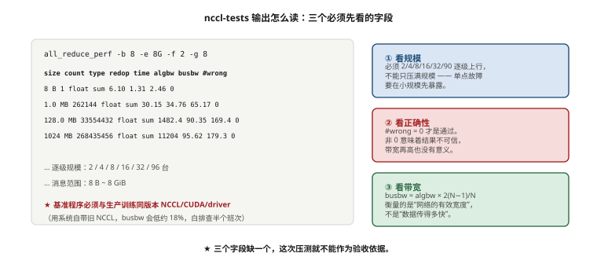
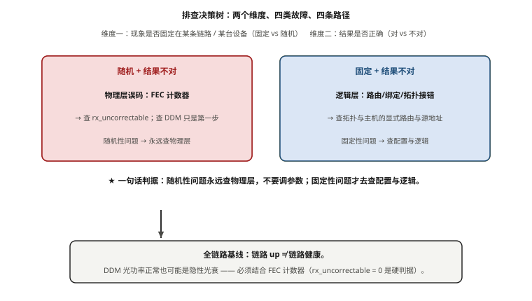

# 第 13 章　网络性能压测与故障排查

> **本章一句话结论**：压测的价值不是跑出一个漂亮数字，而是把"哪条链路会崩"变成一条可复现、可复检的路径。

## 13.1　带宽口径三件事

### 13.1.1 一次验收会上的自相矛盾

本案例进入验收阶段，甲方发来一张网络性能验收表。它是这样开头的：

> **R6**：单端口 RDMA 打流 ≥ 360 Gb/s（变异 ≤ 5%）
> **R9**：96 台全规模 AllReduce busbw ≥ 300 GB/s（平均 ≥ 256 GB/s）

这两条指标**印在同一张表上，互相冲突**。R6 要求单端口打到 360 Gb/s，R9 要求 96 台全规模打流到 300 GB/s。它们在物理上不可能同时成立，因为按 R9 反推，每张卡要跑出 300 GB/s，而它只挂了一张 400G 网卡。

核算过程只有四行：

```
busbw 是每 rank（单卡）口径，nccl-tests 的 PERFORMANCE.md 给的定义是
    busbw = algbw × 2(n−1)/n        （AllReduce 修正，按 rank 输出）
单卡挂在 400G 网卡上 ⇒ 物理上限 = 线速 400 Gb/s = 50 GB/s
扣协议开销后现场实测约 45 GB/s ⇒ 45 GB/s = 360 Gb/s   ✓ R6 正确

R9 的 300 GB/s ÷ 50 GB/s = 6 倍线速 ⇒ 物理不可能
```

数字本身没错，可以完整还原：

```
256 GB/s = 8 卡 × 40 GB/s（节点聚合口径）
         = 单卡 40 GB/s
         = 单卡 320 Gb/s
         = 80% 线速
```

**数值是对的，单位是错的。** 甲方真实想写的应该是"单卡 busbw ≥ 320 Gb/s"，写成了 GB/s。而 80% 线速这个目标值并不离谱——社区公开区间是 H100 跨机、400G 单卡 RoCEv2 的 busbw 约 280–360 Gb/s【行业公开】，320 Gb/s（80% 线速）正落在区间中段，是一个合理目标。

所以这次事故不是"甲方提了不可能的要求"，而是**甲方提了一个正确的要求，用错误的单位表达了出来，而验收表里没有第二个人替它把单位关**。

### 13.1.2 三个口径，一次说清

带宽口径是本章、也是全书的头号事故源。它其实是两个维度交叉：

**维度一：算法带宽与总线带宽**

```
algbw（算法带宽）= S / t
    S = 用户可见的数据量，t = 耗时
    反映"用户数据搬得多快"，随集合通信类型变化

busbw（总线带宽）= algbw × 修正因子
    AllReduce 修正因子 = 2(n−1)/n
    反映"网络实际承载了多少字节"，用于跨算法比较
```

为什么 AllReduce 要乘 `2(n−1)/n`？因为 Ring AllReduce 每个 rank 实际收发的字节量是 `2(n−1)/n × S`，而不是 `S`。当 n 很大时 `(n−1)/n → 1`，修正因子趋于 2。这不是"放水"，是把网络真正扛的流量折回来。

**维度二：单卡 / 节点聚合 / 集群聚合**

| 口径 | 定义 | 本案例 96 台数值 | 判别力 |
|---|---|---|---|
| **A. 单卡 busbw** | 每 rank 输出，一张网卡跑出的 busbw | 目标 ≥ 320 Gb/s = 40 GB/s【待实测】 | 最强，直接对应 nccl-tests 输出 |
| **B. 节点聚合** | 单节点 8 张网卡之和 | 8 × 40 = 256 GB/s（U 单位）【推算】 | 中等，可接受 |
| **C. 集群聚合** | 全集群网卡之和 | 96 × 8 × 40 GB/s ≈ 31 TB/s【推算】 | **无判别力，不采用** |

三个口径是同一件事的三种放大倍数。96 台/768 卡时，单卡口径读数是 40 GB/s，节点聚合是 256 GB/s，集群聚合是 31 TB/s。**口径选得越大，指标越容易过，越没有意义。**

C 口径为什么必须明确弃用：128 台全集群聚合约 41 TB/s【推算】。这意味着**只要单台机器跑出正常水平，全集群指标自动满足**——因为单台 256 GB/s 的采样点在任何聚合里都占比极小。一个"单台就能过"的验收指标，等于没有指标。

### 13.1.3 三次口径漂移：比事故本身更值钱的部分

那场验收会上，甲方先后改口三次。把过程如实记下来，是本章最有用的一段：

| 轮次 | 甲方口径 | 笔者的核算 | 结论 |
|---|---|---|---|
| 第 1 次 | 单卡 ≥ 300 GB/s | 300 ÷ 50 = 6 倍线速 | 物理不可能 |
| 第 2 次 | "节点聚合 300 GB/s 没问题" | 8 × 45 = 360 GB/s，节点聚合可达 | 但合同必须写明"节点聚合" |
| 第 3 次 | "我说的是整个集群 128 台的能力" | 128 × 8 × 40 ≈ 41 TB/s | 单台即可通过，验收形同虚设 |

三次漂移的方向是一致的：**每次都在把口径放大，直到指标容易过为止。** 这不是甲方恶意，而是口径没有书面锁定时的必然结果——人在压力下会本能地往"能过"的方向解释。

### 13.1.4 收口方法：一张三口径对照表

甲乙方就口径口头辩论三轮，消耗大约两天，毫无进展。**收口靠的不是说服，是让选择变得不可含糊。** 笔者最终交的是一张表：

```
请书面选定以下一项，作为本案例网络验收的唯一口径：

口径 A（承建方推荐）：单卡 busbw，单位 Gb/s
    目标值 ≥ 320 Gb/s（80% 线速）
    测量方法：nccl-tests all_reduce_perf，逐级规模 2/4/8/16/32/96 台
    判别力：最强，与 nccl-tests 输出直接对应，单点异常即可暴露

口径 B：节点聚合带宽，单位 Gb/s
    目标值 ≥ 2560 Gb/s（8 卡 × 320 Gb/s）
    测量方法：同上，按节点求和（须声明"求和"而非"取最大"）
    判别力：中等，单卡掉队可能被其余卡掩盖

口径 C：集群聚合带宽，单位 Tb/s
    目标值 ≈ 41 TB/s（128 台口径）
    判别力：无。单台机器达标即可满足，不能反映任何工程问题
    ⇒ 承建方明确声明不采用
```

**验收指标必须"单位 + 口径 + 测量方法"三件套同时锁定。只写数字的指标等于没写。** 这条在本案例消耗了约 2 人周才收口（第 1 章已埋下，第 17 章还会再讲一次）。它也是本章一切压测工作的前提——**口径没定，测出来的所有数字都无法判定合格与否。**

### 13.1.5 为什么是 360 Gb/s：400G 端口的带宽账本

R6 的判据是"单端口 ≥ 360 Gb/s"，不是"400 Gb/s"。差的这 40 Gb/s（10%）去哪了？全在协议开销里。把这笔账算清，才能理解"90% 线速"为什么是合理的工程目标，而不是放水。

```
400G 端口"线速" = 400 Gb/s = 50 GB/s（物理层比特率）

从线速到"应用可用带宽"，要扣掉几层开销：

1. 以太网帧开销
   前导码 8 B + 帧间隙(IFG) 12 B + 帧头/尾 18 B ≈ 38 B
   按 1500 B 有效载荷算 ⇒ 开销 ≈ 38 / 1538 ≈ 2.5%

2. FEC 前向纠错开销
   RS(544,514) 类 FEC 的开销 ≈ (544−514)/544 ≈ 5.5%
   这部分占的是物理层码字空间，对应用"看不见"

3. RoCEv2 封装与协议栈开销
   Ethernet(14) + IP(20) + UDP(8) + BTH(12) = 54 B（计入上面的帧头）
   小消息时事务开销占比上升，可达 3%～5%

综合：2.5% + 5.5% + 其余 ≈ 8%～10%
⇒ 400 Gb/s × (1 − 10%) ≈ 360 Gb/s  ⇒ 应用层实测约 360 Gb/s（90% 线速）
```

**R6 的 360 Gb/s 不是拍出来的，是 400 Gb/s 扣掉协议与 FEC 开销后的真实可用值。** 反过来看 R9：如果 300 GB/s 成立，意味着单卡跑出了约 2400 Gb/s——**比物理线速的 6 倍还多，连"扣开销"的资格都没有。** 一个指标在扣开销之前就已经不可能，就不必讨论开销了。

**工程提示**：360 Gb/s（90% 线速）是 RoCEv2 大消息场景的合理预期。若实测远低于此（比如只有 300 Gb/s，即 75%），先查**消息大小**（小消息跑不满）、**MTU**（未开 jumbo frame）、**QP 数**（单 QP 受限于单路径），最后才怀疑硬件。

---

## 13.2　nccl-tests 用法与结果解读

### 13.2.1 nccl-tests 是什么，怎么装

`nccl-tests` 是 NVIDIA 维护的集合通信基准套件，本质是"用 NCCL 跑集合通信、把带宽算给你看"。它不是性能探针，是**端到端行为探针**——走的路径和真实训练完全一致（GPU → NVLink/PCIe → 网卡 → 网络 → 对端网卡 → 对端 GPU）。

编译方式（思路，具体参数现场按 NCCL 版本核对）：

```bash
# 关键：链接的 NCCL 版本、CUDA 版本、网卡驱动必须与生产环境一致
# 否则测出来的是"另一个集群"的性能
git clone https://github.com/NVIDIA/nccl-tests.git
cd nccl-tests && make -j
# 产物：build/all_reduce_perf 等
```

一条现场真实教训：**基准程序必须与生产训练用同一套 NCCL/CUDA/driver 版本**。笔者在一次测试中用了系统自带的旧 NCCL，busbw 比生产环境低 18%，白排查了半个班次。这不是设备问题，是"用错了尺子"。

### 13.2.2 all_reduce_perf 的参数与输出

最常用的一条命令：

```bash
# 典型调用（现场参数会按消息大小区间调整）
./all_reduce_perf -b 8 -e 8G -f 2 -g 1 -c 1 -w 5 -n 20
```

参数逐条：

| 参数 | 含义 | 现场用法 |
|---|---|---|
| `-b` | 起始消息大小（Byte） | 从 8 B 起，覆盖小消息 |
| `-e` | 结束消息大小 | 到 8G，覆盖大消息 |
| `-f` | 消息大小倍增因子 | 2 = 每次翻倍 |
| `-g` | 每进程使用的 GPU 数 | 1 = 一进程一卡，最干净 |
| `-c` | 校验结果正确性 | **必须为 1** |
| `-w` | 预热迭代数 | 5，让时钟与链路进入稳态 |
| `-n` | 测量迭代数 | 20，用于算中位数 |

输出列的含义（这是解读的核心）：

```
   size         count      type   redop    root     time   algbw   busbw  #wrong
    (B)    (elements)                       (us)     (GB/s)  (GB/s)
    8G    2147483648      float     sum      -1    xxxx.x   yy.yy   zz.zz       0
```

- `size` / `count` / `type`：本条测的消息量与数据类型。
- `time`：单次 AllReduce 的平均耗时（μs）。
- `algbw`：算法带宽，`size / time`，**按 rank（单卡）输出**。
- `busbw`：总线带宽，`algbw × 2(n−1)/n`，**同样按 rank（单卡）输出**。
- `#wrong`：**结果校验失败的元素个数**。

### 13.2.3 `#wrong = 0` 到底意味着什么

`#wrong` 最容易被当成"性能指标"忽略，其实它是**正确性指标**，重要性高于带宽。

`-c 1` 让程序在每次 AllReduce 后校验结果是否与预期一致。`#wrong = 0` 意味着**这次通信的所有数据都正确到达、正确归约**。一旦 `#wrong > 0`，说明数据被损坏或丢失——哪怕带宽数字很漂亮，这次测试也是失败的。

```
#wrong = 0  ⇒  数据正确性通过
#wrong > 0  ⇒  链路存在误码 / 丢包 / 配置错误（不是"慢"，是"错"）
```

**本案例的验收判据是每个规模都必须 `#wrong = 0`**，逐级 2/4/8/16/32/96 台全覆盖【实测】。这条比"带宽达标"更硬性。理由在 13.5 节会展开：`#wrong` 非零往往不是"慢一点"，而是整个集群一起卡住。

### 13.2.4 逐级规模：为什么必须从小到大逐级压

压测不能直接上 96 台。它的规模阶梯是本案例的硬性动作：

| 规模 | 卡数 | 目的 | 判据 |
|---|---|---|---|
| 单机 | 8 | 先确认机内 NVLink 与网卡亲和 | busbw ≥ 单机中位数 90%【实测】 |
| 2 台 | 16 | 验证跨机一跳基线 | `#wrong = 0` |
| 4 台 | 32 | 覆盖一个 Leaf 下联组 | `#wrong = 0` |
| 8 台 | 64 | 覆盖 8 条轨各 1 台 | 八轨偏差 < 3%【实测】 |
| 16 台 | 128 | 跨多 Leaf、多 Spine | `#wrong = 0` |
| 32 台 | 256 | 一期全量 | `#wrong = 0` |
| **96 台** | **768** | **全规模** | **`#wrong = 0` + busbw 【待实测】** |

从小到大的意义：**故障在不同规模下暴露不同的层面。**

- 单机就能发现的：PCIe 亲和错、NVLink 降速、网卡没起来。
- 2～4 台能发现的：单条链路不通、RoCE 配置 3 台里错了 1 台。
- 8 台能发现的：某一条轨的 Leaf 端口分配错位（八轨偏差会跳）。
- 32 台以上能发现的：ECMP 哈希不均、PFC 反压扩散、收敛比打架。
- 96 台才能发现的：全集群同步行为问题、随机性误码（13.5 节的案子）。

**跳过中间规模直接上全量，等于放弃定位能力。** 一旦出问题，你只知道"768 卡里有问题"，不知道在哪一层。



**图 13-1　nccl-tests 输出怎么读：三个必须先看的字段**　｜　**读图要点**：① 规模是否逐级上行（2/4/8/16/32/96 台，不能只压满规模）；② `#wrong` 是否为 0；③ 带宽看的是 busbw 而不是 algbw。**还有一个隐形前提：基准程序必须与生产训练用同一套 NCCL/CUDA/driver 版本** —— 用系统自带的旧 NCCL，busbw 会低约 18%，白排查半个班次。

### 13.2.5 busbw 的读法与两个常见误读

读 busbw 必须带上 n：

```
busbw = algbw × 2(n−1)/n
n = 2   ⇒ 修正因子 = 1.00    （两卡直连，busbw ≈ algbw）
n = 96  ⇒ 修正因子 ≈ 1.98
n = 768 ⇒ 修正因子 ≈ 1.997
```

两个高频误读：

**误读一：只看 algbw。** algbw 随算法变化（AllReduce 是 2 倍关系），跨算法比较必须用 busbw。项目内统一用 busbw。

**误读二：用 n 修正后误以为单卡能超线速。** busbw 已经**除以了单卡的物理接口上限**——它是"每张网卡"的数字。**无论 n 多大，单卡 busbw 的物理上限都是 50 GB/s 线速、约 45 GB/s 实测。** 这就是 13.1 节 R9 那条 300 GB/s 为什么物理不可能的根本原因。

> **本节数字状态**：768 卡全规模 busbw 实测值、单节点 8×400G 满载基线、8 轨偏差实测值均为 **【待实测】**（对应参数卡 O-02、O-01、O-12）。收敛比 1:1 与 2:1 的 busbw 对比为 **【待实测】**（O-11）。**实测之前可以先看刻度**：第 1 章 §1.4.3 与图 1-4 给出了这三项的推理参考区间（单卡大消息段 34–38 GB/s；AllToAll 26–30 GB/s），可以用来判断实测值是否落在合理带内。补采方式均为现场 nccl-tests，验收时一次性采集。

---

## 13.3　RDMA 链路基准：perftest 全解

nccl-tests 测的是"端到端集合通信"，它把 GPU、PCIe、网卡、网络全部包在一起。当 busbw 不达标时，你需要更底层的一把尺子去分离变量——这就是 `perftest` 套件。

### 13.3.1 三把尺子，测三种东西

| 工具 | 测什么 | 走的路径 | 现场用途 |
|---|---|---|---|
| `ib_write_bw` | RDMA Write 带宽 | 网卡直接写对端内存 | 通用带宽基准，最常用 |
| `ib_read_bw` | RDMA Read 带宽 | 网卡拉取对端内存 | 校验读路径，暴露对称性问题 |
| `ib_send_bw` | RDMA Send 带宽 | 双边操作 | 部分场景更有代表性 |
| `ib_write_lat` | 单次操作延迟 | 小消息 | 延迟基线，与带宽分开看 |

典型调用：

```bash
# 服务端（一台机器）
ib_write_bw -d mlx5_0 -a -F --report_gbits

# 客户端（另一台机器）
ib_write_bw -d mlx5_0 -a -F --report_gbits <服务端IP>
```

关键参数：

| 参数 | 含义 | 说明 |
|---|---|---|
| `-d` | 指定设备 | **必须逐张网卡测**，不能只测一张 |
| `-a` | 跑全消息大小矩阵 | 从 2 B 到大消息，暴露小消息退化 |
| `-F` | 不要跑前自动降低 MTU | 保持配置，避免"测了个假值" |
| `--report_gbits` | 以 Gb/s 输出 | **避免单位混淆，强制带 bit 口径** |
| `-q` | 队列数（QP 数） | 单 QP 测上限，多 QP 测实际 |

### 13.3.2 为什么打流必须"双向"

只跑 `ib_write_bw` 不够，必须补 `ib_read_bw`。原因：

RDMA Write 是**单侧操作**——发起方把数据推进对端内存，接收方 CPU/GPU 几乎不参与。RDMA Read 是**拉取操作**——发起方读对端内存，对端网卡要处理请求并回传数据，路径和负载分布不同。

```
ib_write_bw  测：A → B 方向，B 侧不参与计算
ib_read_bw   测：A ← B 方向，B 侧需响应请求
```

两者在真实硬件上**可能差出 10% 以上**（尤其是某侧网卡固件、PCIe 带宽或内存带宽偏弱时）。只测一个方向，会漏掉一半的链路问题。

**现场判据：Write 与 Read 两个方向的带宽都要达 R6 的 ≥ 360 Gb/s，且两方向差异不构成异常。**【实测】

### 13.3.3 变异度：为什么单次结果不算数

R6 的判据是"≥ 360 Gb/s（变异 ≤ 5%）"。**变异度比绝对带宽更能反映链路健康。**

变异度高通常意味着：

- 链路误码在重传（带宽时高时低）。
- PFC 反压间歇触发（吞吐被周期性掐住）。
- 某条路径的 ECMP 哈希在抖动。

测法（思路）：

```
1. 同一对链路，连续测 ≥ 5 轮，每轮取稳定段的读数
2. 计算 P50（中位数）与 P95/P5（分位）
3. 变异度 =（P95 − P5）/ P50  ≤ 5% 为合格
```

**判据的正确形态是"中位数达标 + 变异度达标"，不是"最好那一次达标"。** 只报最好一次，等于把链路最差的状态藏起来。本案例的验收要求就是取中位数、变异 ≤ 5%【实测】。

**打流矩阵：三个维度都要覆盖**

单跑一条命令不足以刻画链路能力。本案例的现场打流矩阵是三个维度的组合：

```
维度1：方向（write / read / send）
维度2：消息大小（用 -a 跑全矩阵，从 64 B 到大消息）
维度3：QP 数（1 / 4 / 8）

为什么三个维度都要覆盖：
- 方向：write 与 read 走不同路径（13.3.2），只测一个方向会漏掉一半问题
- 消息大小：小消息看的是"延迟与启动开销"，大消息看的是"带宽饱和值"
  ⇒ 重点看曲线的"饱和点"（带宽在哪个消息大小后拐平）
- QP 数：单 QP 受单路径限制，多 QP 才能跑出多路径聚合带宽
  ⇒ 只测单 QP 会低估实际能力，只测多 QP 会掩盖单路径问题
```

**读打流结果的三条经验**：

1. **看曲线，不看单点。** 一条健康的曲线是"小消息带宽低、随消息增大上升、到大消息拐平到饱和值"。曲线不拐平（一直上升）说明还没测到饱和；曲线中途下坠说明有丢包或反压。
2. **对比八条轨的形状。** 不该只看绝对值——**如果某条轨的曲线形状与其余七条不同，即使绝对值达标也要查。**
3. **小消息延迟单独看。** 用 `ib_write_lat` 单独测小消息延迟，不要用带宽工具的小消息结果代替。

### 13.3.4 三个量级的横向对比

压测对象在不同规模下含义完全不同。这是本章的横向对比框架：

| 对比维度 | 单端口（1 张网卡） | 节点聚合（8 张网卡） | 集群（96 台 / 768 卡） |
|---|---|---|---|
| 测试工具 | `ib_write_bw` | 8 路并行 `ib_write_bw` | `all_reduce_perf` |
| 口径 | 单卡 | 节点聚合（求和） | 单卡 busbw（逐 rank） |
| 400G 线速上限 | 50 GB/s = 400 Gb/s | 400 GB/s（×8） | 每卡仍 50 GB/s |
| 本案例判据 | ≥ 360 Gb/s（90% 线速）【实测】 | 8 × 45 = 360 GB/s【推算】 | ≥ 320 Gb/s/卡 = 80% 线速【待实测】 |
| 主要暴露的问题 | 光模块、链路、端面 | PCIe 争用、xGMI/UPC、CPU 中断 | 拓扑、ECMP、PFC、同步行为 |
| 典型翻车点 | 端面污染、光衰 | 某张卡掉队被掩盖 | 一条链路卡住全集群 |

这三行必须一起看：

1. **单端口好，不代表节点聚合好。** 8 张卡共享 PCIe Root Complex 与内存带宽，可能有争用。
2. **节点聚合好，不代表集群好。** 集群问题几乎都出在"跨节点同步"上（PFC、ECMP、误码）。
3. **集群好，不代表业务好。** 实际训练的并行策略、overlap 程度会进一步打折（第 15 章）。

**只测一个层级，等于只留了一只眼睛。** 本案例要求三级都测，且每级都有独立判据。

---

## 13.4　PFC 死锁与 PFC 风暴排查

### 13.4.1 PFC 是什么，为什么会死锁

PFC（Priority Flow Control，基于优先级的流量控制）是无损网络的基石：接收端缓冲区快满时，向发送端发 Pause 帧，让上游"停一下"，避免丢包。

它是**逐跳、按优先级**生效的。正常工作状态下它提供反压；异常状态下它会变成两种灾难：

**PFC 死锁（Deadlock）**：当交换机之间的反压形成**环形依赖**时，A 等 B 停，B 等 C 停，C 等 A 停，谁都不动，缓冲区被永久占满。数据流全部冻结，直到 PFC 超时或链路被重置。

```
死锁条件（必须同时满足）：
  1. 存在环形依赖（拓扑本身成环，或 ECMP 路径形成环）
  2. 依赖的流量共用同一个 PFC 优先级（不隔离）
  3. 反压链条闭合，没有任何一跳能"泄压"
```

**PFC 风暴（PFC Storm）**：反压不是局部发生，而是**逐跳向外扩散**。一条链路的拥塞引发上级反压，上级反压又引发更上级反压，Pause 帧像滚雪球一样传遍全网，把本不拥塞的链路也一起掐住。

### 13.4.2 排查方法

PFC 问题的排查**必须看交换机侧计数器**，主机侧只能看到症状（丢包、卡顿），看不到 Pause 帧的传播路径。

排查思路：

```
1. 确认是否 PFC 相关：查交换机 PFC 计数器
   - 是否有端口 tx_pause / rx_pause 计数持续增长
   - 哪些优先级（PFC priority）在暂停
2. 确认反压路径：沿 Pause 帧的方向逐跳回溯
   - 上游端口收 pause → 它自己是否也发 pause
   - 找到"源头"端口（只发不收，或发远多于收）
3. 确认是否共用优先级：存储与 NCCL 是否同优先级
   - 同优先级 ⇒ 存储 incast 会暂停 NCCL（本案例第五平面独立的根因之一）
```

**判据参考**：ODCC-2019-05008 给出了 4 打 1 / 8 打 1、PFC 死锁、跨 POD 混跑等测试判据。本案例按该标准做过 4 打 1 与 8 打 1 打流测试【设计】。

### 13.4.3 处置与预防

**处置**：

- 找到持续发 Pause 的源头端口，定位是否是链路瓶颈还是配置错误。
- 确认 PFC 优先级划分：**存储与 NCCL 必须分属不同优先级**，避免互相暂停。
- 检查 ECN 门限：ECN 是 PFC 的"前置减速"机制，ECN 配得太松会让 PFC 承担全部反压，加剧风暴。

**预防**：

```
- PFC/ECN/DCQCN 三侧（网卡、Leaf、Spine）参数一致，不是出厂默认值
- 存储走独立物理平面（本案例第五平面），从物理上切断跨业务反压
- 监控 PFC pause 计数：偶发不为零正常，持续增长才告警（详见第 14 章）
```

> **一个认知要点**：PFC pause 计数**偶发不为零是正常的**——拥塞反压本来就是设计行为。真正危险的是**持续、单调增长**的计数，"什么算正常"的判定比阈值本身更难（第 14 章 14.5 节专门展开）。

---

## 13.5　链路抖动与隐性光衰定位

### 13.5.1 一次"位置随机"的全集群故障

这是本章、甚至可能是全书**最值得写的一次真实故障**。

**现象**：96 台全规模压测进行中，`all_reduce_perf` 从稳定输出突然掉到接近零，随后 `#wrong` 报错。重跑同样的测试，又能过；再跑，又在另一个位置崩。

- 位置**随机**，不可复现。
- 崩的时候不是"慢一点"，是**整个集群一起卡住**。

**第一轮排查——怀疑坏口**：换端口。故障仍在，且位置变化。排除单端口硬件损坏。

**第二轮排查——怀疑光模块**：读 `DDM`（Digital Diagnostic Monitoring，数字诊断监控）光功率读数。**所有链路光功率全部正常。**

**最终定位——端面污染**：某一条 MPO 跳线的**端面有污染**（施工阶段拆装过，没有做端面清洁）。污染导致该链路**间歇性 CRC 误码**——不是持续误码，是"某个角度、某个振动、某个温度下才误码"。所以现象随机。

### 13.5.2 为什么代价这么大：同步屏障的放大效应

单条链路的间歇性误码，为什么会冻结 768 张卡？因为集合通信是**同步屏障**：

```
AllReduce 的 Ring 结构里，每个 rank 都要等它的上游
⇒ 单条链路误码 → 该 rank 卡住（等上游数据）
⇒ 整个 ring 卡住
⇒ 768 张卡全部等待
⇒ 表现不是"慢一点"，而是"整个集群一起卡住"
```

这就是为什么**集合通信对单点误码的容忍度是零**。传统网络里，一条链路 0.01% 的误码率顶多让某条 TCP 流慢一点；在 AllReduce 里，它会让整个集群停摆。**故障的代价被集群规模线性放大。**

本章开篇那个"一次丢包让整个集群等了 40 分钟"（第 1 章坑三）说的就是同一件事。区别是：那次是端面污染，这次还是端面污染——**同一个坑，在 96 台规模上以更贵的方式又踩了一次。**

### 13.5.3 DDM 读数的正确解读：光功率正常 ≠ 链路健康

这是本次事故最贵的一课，必须单独讲。

DDM 提供光模块的实时读数：发送光功率（Tx Power）、接收光功率（Rx Power）、温度、电压、偏置电流。现场最常做的动作是"看一眼 Rx Power 在不在范围内"。

**但平均光功率正常，不等于链路健康。** 原因：

```
污染导致的损伤形式是"反射 + 局部衰减 + 模式耦合"，
其影响体现在"误码率"上，不一定体现在"平均接收光功率"上。
⇒ 平均读数可以把一条"每秒误码一万次"的链路读成"正常"
⇒ 用 DDM 平均光功率判链路健康，是在用错误的尺子量
```

**正确的判据是结合 FEC 误码计数器：**

| 计数器 | 含义 | 判据 |
|---|---|---|
| `rx_corrected_bits` | FEC 纠正的比特数 | 应接近 0 或缓慢增长；**快速增长即链路隐患** |
| `rx_uncorrectable` | FEC 无法纠正的误码 | **必须为 0**，非零即链路故障 |

```
判链路健康 =
    光功率在范围内
  ∧ rx_uncorrectable = 0
  ∧ rx_corrected_bits 增长速率可忽略
```

只看第一条会漏掉本次事故。**必须三条一起看。**

### 13.5.4 处置与 SOP

**处置动作**：

1. 换掉污染的那条 MPO 跳线。
2. **全量端面复检**——不查一条，查全部。既然施工拆装过，就可能不止一条被污染。
3. 把"**任何跳线插拔后必须做端面检测与光功率复测**"写进施工 SOP。

**SOP 条目**（本案例最终版）：

```
- 任何跳线插拔后：显微镜（400× 以上）端面检测
- 检测通过后：光功率复测 + 记录台账
- 上线后：每季度读一次 FEC 计数器，纳入例行巡检
- 新增/更换链路：观察 rx_uncorrectable 连续 24h 为 0 方可确认通过
```

**投入产出**：端面检测投入约 1 人日/百条链路，能省掉的排查时间至少 5 人日，且省掉的是**最难定位**的那 5 人日（第 1 章已算过这笔账）。

---

## 13.6　网卡 Drop / pause 计数器解读

### 13.6.1 主机侧能看到的四个关键计数

主机侧拿不到 Pause 帧的传播路径（那在交换机侧），但能拿到**本机网卡**的四个关键计数：

| 计数器 | 含义 | 健康判据 |
|---|---|---|
| `rx_pause` / `tx_pause` | 本网卡收/发的 Pause 帧 | 偶发可接受；**单调增长告警** |
| `rx_discards` | 接收后被丢弃的包 | 应接近 0；持续增长即问题 |
| `rx_out_of_buffer_errors` | 缓冲区溢出丢包 | **必须为 0**（说明网卡侧反压失效） |
| `tx_discards` | 发送丢弃 | 应接近 0 |

读取方式（思路，具体命令按驱动版本核对）：

```bash
# 读取网卡扩展统计（DCBX/PFC 相关）
ethtool -S <网卡名> | grep -Ei 'pause|discard|out_of_buffer|prio'
# 或厂商工具（如 mlnx 系列）
```

### 13.6.2 怎么读才不误判

**关键：任何计数器都要先建基线，再看增量。**

```
正确读法 =
  1. 链路空载时读一次（基线，应全为 0 或极小）
  2. 压测/业务运行时读一次
  3. 看"增长速率"，不看"绝对值"
```

四个常见解读：

- `rx_out_of_buffer_errors > 0`：**网卡缓冲区溢出，说明上游把数据推得太快而本机来不及处理。** 要么 PFC 没生效，要么主机侧处理能力不足。这是硬故障信号。
- `rx_discards` 持续增长：可能是 FEC 后的坏包、也可能是拥塞。**要结合 13.5 的 FEC 计数器一起看判断是物理层还是拥塞。**
- `rx_pause` 偶发：正常。存储 incast、NCCL 瞬时热点都会触发反压，这是设计行为。
- `rx_pause` **单调增长**：说明本机或本链路长期处于被反压状态，是持续的拥塞或配置问题。

**"偶发"与"持续"的边界**，比阈值本身更难定——这是第 14 章要解决的问题。

---

## 13.7　排查决策树：从"慢"到"定位到某条链路"

### 13.7.1 为什么需要决策树

"集群慢"这三个字信息量是零。它可能来自：单卡亲和错、单条链路误码、某个 Leaf 配置错、PFC 风暴、ECMP 不均、甚至根本不是网络问题（是框架配置）。

**没有决策树，排查就会退化成"凭经验东试西试"。** 有决策树，才能保证每次都走最短路径。

### 13.7.2 完整决策树

```
【症状】业务吞吐低 / 训练卡顿 / all_reduce_perf 异常
   │
   ├─ 步骤 1：先确认是不是网络
   │    换单机 NCCL（不出机箱）正常吗？
   │      ├─ 单机正常 → 问题在跨机路径，转步骤 2
   │      └─ 单机异常 → 问题在机内（NVLink/PCIe/亲和），查 15.1 拓扑
   │
   ├─ 步骤 2：确认故障是否"位置固定"
   │    ├─ 位置固定 → 大概率是配置/端口/拓扑问题，转步骤 3
   │    └─ 位置随机 → 大概率是物理层间歇故障（误码），转步骤 5
   │
   ├─ 步骤 3：逐级规模定位层级
   │    ├─ 2 台不过 → 单条链路或对端配置
   │    ├─ 8 台不过 → 某条轨的 Leaf 端口分配错位（看八轨偏差）
   │    ├─ 32 台不过 → ECMP 哈希 / 收敛比
   │    └─ 96 台不过 → 全集群同步行为
   │
   ├─ 步骤 4：定位到 Leaf / 端口
   │    ├─ 看交换机端口计数器：错包、PFC pause、discards
   │    ├─ 对比同轨与跨轨（13.3 三级对比表）
   │    └─ 逐端口 ib_write_bw 二分法缩小范围
   │
   └─ 步骤 5：随机性故障 → 物理层深挖
        ├─ DDM 光功率（先排除明显光衰）
        ├─ FEC 计数器 rx_corrected_bits / rx_uncorrectable（关键！）
        ├─ 端面显微镜检测（污染、划痕）
        ├─ 换线复测（确认是否跳线）
        └─ 定位到具体链路后：换线 + 全量端面复检
```

### 13.7.3 决策树的两条纪律

**纪律一：先排除"不是网络"。** 大量"网络慢"最后证明是框架、并行策略或存储拖累。先跑单机 NCCL 排除机内，再跑 2 台排除跨机——用最小成本否掉非网络因素。

**纪律二：随机性故障永远往物理层查。** `#wrong` 随机出现、重跑能过，几乎一定是物理层间歇故障（误码）。**不要在这类症状上浪费时间调 NCCL 参数**——参数是确定性的，不会产生随机的对错。

```
位置固定 + 结果错  → 配置类
位置随机 + 结果错  → 物理层类（误码）
位置固定 + 结果对但慢 → 拓扑/带宽配比类
位置随机 + 结果对但慢 → 拥塞/PFC 类
```

这张 2×2 表是决策树的浓缩。**用"位置是否固定"和"结果对不对"两个维度，就能把故障分成四类，每类的排查路径完全不同。**

### 13.7.4 一次完整走查：套用决策树定位到单条链路

把 13.5 节那次真实故障完整走一遍决策树，看清每一步省下了什么：

```
症状：96 台全规模 all_reduce_perf 掉到接近零 + #wrong 报错

步骤1（是不是网络）：单机 NCCL 正常 ⇒ 锁定跨机路径，省掉机内排查
步骤2（位置固定吗）：重跑能过、位置随机 ⇒ 判为物理层间歇故障，转步骤5
步骤5（物理层深挖）：
  - DDM 光功率：全部正常      ← 这一步差点让排查走偏
  - 换端口：仍复现            ⇒ 排除端口
  - 换光模块：仍复现          ⇒ 排除模块
  - 端面显微镜：某条 MPO 跳线端面污染 ⇒ 定位成功
处置：换线 + 全量端面复检 + SOP 固化
```

四个关键判读点：

1. "单机正常"直接锁定到跨机路径——**省掉一整轮机内排查**。
2. "位置随机"直接指向物理层——**避免了在 NCCL 参数上浪费时间**（对照 15.9 节"越调越慢"的复盘，那里就是因为没先判断"随机还是固定"）。
3. "DDM 光功率正常"**不等于链路健康**，必须补 FEC 计数器——这是本次事故最贵的一课。
4. 定位后不是"换一条线了事"，而是"全量复检 + SOP"——**把单点处置升级成体系修复。**

**决策树的价值，就是把"运气"从排查里剔除。** 同一个故障，没有决策树是"东试西试两天"；有决策树是"两小时定位到端面"。

---



**图 13-2　排查决策树：两个维度、四类故障、四条路径**　｜　**读图要点**：横轴问“现象是否固定在特定位置”，纵轴问“结果对不对”，两两组合得到四条路径。**随机性问题永远查物理层，不要调参数；固定性问题才去查配置与逻辑。**再加上一条硬判据：`rx_uncorrectable = 0`；DDM 光功率正常并不代表链路健康。

## 13.8　验收标准与标准引用

本案例引用的标准与判据：

| 标准 / 依据 | 用途 |
|---|---|
| **YD/T 4026 / 4027 / 4028-2022** | RoCE 无损网络技术要求与测试方法（通信行业标准，由运营商、研究院与设备商联合起草） |
| **ODCC-2019-05008** | 4 打 1 / 8 打 1、PFC 死锁、跨 POD 混跑测试判据 |
| ODCC-2018-05005 | RoCE 无损网络测试 |
| YD/T 4073 | 存储 RDMA 交换设备 |
| nccl-tests 社区判据 | 跨节点 > 80% 理论带宽 |
| nccl-tests PERFORMANCE.md | busbw 修正因子定义 |

**本案例实际验收项**【实测】：

- RDMA 打流 ≥ **360 Gb/s（单端口口径）**，**变异 ≤ 5%**（取中位数）。
- 单机 NCCL ≥ 单机中位数的 90%。
- 多机 **2 / 4 / 8 / 16 / 32 / 96 台逐级 `#wrong = 0`**。
- 全规模 768 卡 busbw 【待实测】（O-02）。
- 八条轨 busbw 偏差 < 3%【待实测】（O-12）。
- 24 h 混合压力测试，利用率 ≥ 90%【待实测】（O-06）。
- DCGM L3/L4 检查、NVLink 检查。
- 全部测试证据留存 **180 日**（合同要求）。

**标准引用的一条纪律**：本案例在验收指标上消耗约 2 人周，根源是合同只写了数字、没写口径（13.1 节）。**标准给了判据框架，但不会替你锁定口径。** 口径是三件套（单位 + 口径 + 测量方法），必须自己写进合同。

---

## 13.9　现场检查清单

> 本章清单聚焦"压测方法与排障路径"。可直接打印带到机房与验收会。

**A. 压测前（准备）**

- [ ] 确认 `nccl-tests` / `perftest` 与生产环境 **NCCL / CUDA / 驱动版本一致**
- [ ] 确认验收指标的**口径已书面锁定**（单卡 / 节点聚合 / 集群，三选一）
- [ ] 确认验收指标的**单位已书面锁定**（Gb/s 还是 GB/s）
- [ ] 准备逐级规模的测试计划（单机 → 2 → 4 → 8 → 16 → 32 → 96 台）
- [ ] 准备 FEC 误码计数器的读取脚本（`rx_corrected_bits` / `rx_uncorrectable`）

**B. 压测执行**

- [ ] `all_reduce_perf` 开 `-c 1`（结果校验），每一级记录 `#wrong`
- [ ] 每一级 `#wrong = 0` 才进入下一级
- [ ] `ib_write_bw` **与** `ib_read_bw` **双向都测**（不能只测 write）
- [ ] 每张网卡单独测（`-d` 逐张指定），不只测一张代表
- [ ] 多轮重复，取 **中位数**，记录 **变异度**（≤ 5%）
- [ ] 记录八条轨的 busbw，计算偏差（目标 < 3%）
- [ ] 记录 PFC pause 计数在压测前后的**增量**

**C. 故障排查（出现异常时）**

- [ ] 先跑单机 NCCL，确认故障是否在机内
- [ ] 判断故障"位置固定还是随机"（随机 ⇒ 物理层）
- [ ] 检查交换机端口计数器（错包 / pause / discards）
- [ ] 检查网卡 `rx_out_of_buffer` / `rx_discards` / `rx_pause`
- [ ] 检查 FEC 计数器，不只读 DDM 光功率
- [ ] 随机性故障：端面显微镜检测 + 换线复测

**D. 收尾（SOP 固化）**

- [ ] 任何跳线插拔后：**端面检测 + 光功率复测**
- [ ] 测试证据留存（≥ 180 日）
- [ ] 把本次故障的根因与处置写进运维手册

---

## 13.10　成本与工期影响

| 决策 | 成本影响 | 工期影响 |
|---|---|---|
| 验收指标口径提前书面锁定 | 零 BOM 成本 | 避免验收阶段扯皮（本案例曾耗约 2 人周） |
| 逐级规模压测（而非直接上全量） | 测试工时 +1～2 人周 | 但**定位能力**是省时间的，不是花时间的 |
| `ib_read_bw` 双向测试 | 测试工时 +0.5 人日/批 | 避免漏掉读路径问题 |
| 端面检测与光功率台账制度 | 仪器与工时约 1 人日/百条链路 | 避免随机误码反复排查，净省 ≥ 5 人日 |
| FEC 计数器纳入例行巡检 | 极低（脚本化） | 提前发现光衰趋势，避免突发故障 |

最后一条最值得强调：**本案例的两次重大排障（第 1 章坑三、本章 13.5），根因都是端面污染，都不是设备坏。** 两次的处置都指向同一条 SOP：**端面检测 + FEC 计数器**。这条 SOP 的性价比，是整个网络运维里最高的之一。

---

## 本章要点回顾

- 验收指标必须"**单位 + 口径 + 测量方法**"三件套同时锁定。合同里同表的 R6（≥ 360 Gb/s）与 R9（≥ 300 GB/s）冲突，根源是单位没锁；客户三次口径漂移（单卡 → 节点聚合 → 集群）是口径没锁的必然结果。
- **busbw 是每 rank（单卡）口径**，`busbw = algbw × 2(n−1)/n`。单卡物理上限是 400G 线速 50 GB/s，任何 300 GB/s 的说法都是 6 倍线速。集群聚合口径（约 41 TB/s）单台即可达标，**无判别力，明确不采用**。
- `#wrong = 0` 是**正确性判据**，比带宽更硬。逐级规模 2/4/8/16/32/96 台都必须过。
- RDMA 打流**必须双向**（write + read），**必须多轮取中位数**，变异度 ≤ 5% 才合格。
- PFC 问题看交换机侧计数器；PFC pause **偶发不为零正常，持续增长才告警**。
- **DDM 光功率正常 ≠ 链路健康**。必须结合 FEC 计数器（`rx_uncorrectable = 0` 是硬判据）。一次端面污染冻结了 768 张卡，因为同步屏障会把单点误码放大成全局停摆。
- 排查决策树的两个维度是"**位置是否固定**"与"**结果对不对**"，四类故障四条路径。**随机性问题永远查物理层，不要调参数。**

---

> **本章待补实测项**（对应参数卡）：
> O-01 单节点 8×400G 满载基线 · O-02 768 卡全规模 all_reduce_perf busbw · O-05 光链路插损分布（P50/P95）· O-11 收敛比 1:1 vs 2:1 对比 · O-12 8 轨 busbw 偏差
>
> O-01 / O-02 / O-11 / O-12 的**推理参考区间**见第 1 章 §1.4.3 与图 1-4；本表在实测入库后按实测值更新。
