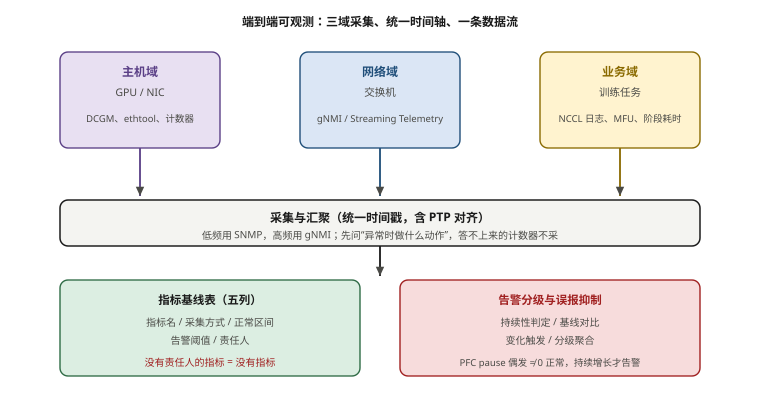
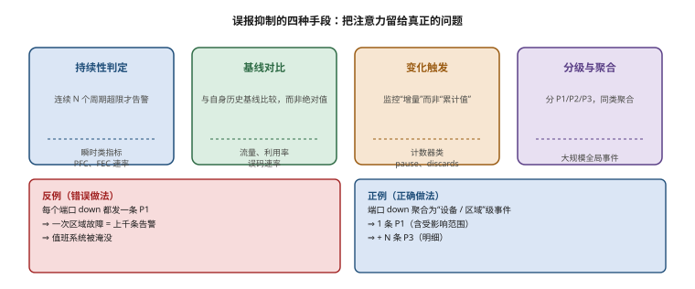
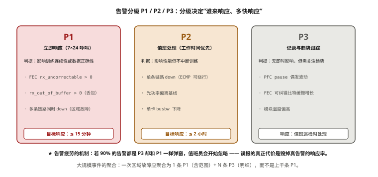

# 第 14 章　网络可观测性与运维体系

> **本章一句话结论**：集群上线后，90% 的时间花在监控和变更上，不是在压测上——可观测性是把这段时间的成本压下来的体系。

## 14.1　指标基线：上线前必须采集的项目清单

### 14.1.1 一个被评审揪出来的体系缺口

第 13 章讲的是"出了问题怎么查"。本章讲的是另一个东西：**怎么让问题在造成损失之前被看见。**

这两件事的关系可以用一句话说清：

```
第 13 章 = 排查（reactive）：故障已经发生，如何快速定位
第 14 章 = 体系（proactive）：故障还没发生，如何提前捕获
```

本案例最大的一个体系缺口，是在交付评审阶段才被发现的，发现方式很尴尬——**评审逐页翻阅"厂商现场交付标准"与"调测脚本"两份文件，发现里面完全没有 QoS / PFC / ECN 章节。**

这两份文件写得很详细：设备上架、线缆敷设、IP 配置、端口映射、连通性测试、光功率记录……唯独**无损网络的三个核心参数（QoS 队列映射、PFC 优先级、ECN 门限）没有任何一节**。

后果是什么？

```
调测脚本不含 QoS/PFC/ECN
⇒ 施工方按默认值交付
⇒ 无损网络参数与设计不一致
⇒ 上线后在高负载下才暴露（PFC 风暴、ECN 失效、pause 扩散）
⇒ 但此时没有任何基线可比对，不知道该改回哪个值
⇒ 返工代价 = 重新梳理全部交换机配置 + 重跑压测
```

**关键是：这不是"漏了几个 dashboard"，是"该看的指标根本没被写进交付标准"。** 没有交付标准，就没有责任人、没有验收动作、没有基线。问题不会因为你装了一个 Grafana 就自动出现。

所以本章要立的第一个观点是：

> **可观测性不是加几个 dashboard，而是把该看的指标写进交付标准。**

### 14.1.2 为什么 90% 的时间在监控和变更上

很多工程团队的直觉是"压测是重头戏，上线后就没那么忙了"。本案例的实际情况恰好相反。

集群交付上线后，运维的日常构成大致是这样（【估算】，按本案例 96 台规模 3 个月运维记录）：

| 工作类型 | 时间占比 | 说明 |
|---|---|---|
| 监控与告警处理 | 约 45% | 看板巡检、告警确认、误报过滤 |
| 变更与灰度 | 约 30% | 参数调整、固件升级、扩容接入 |
| 故障排查 | 约 15% | 第 13 章的能力兑现 |
| 压测与验证 | 约 10% | 大变更前后 |

压测只占十分之一。**90% 的时间在监控和变更上。** 这两个环节做不好，故障会以"别人替我制造"的方式不断出现——因为变更本身就会引入故障。

```
变更引入故障的机制：
  改一个交换机配置 → 影响一条 PFC 优先级 → 引发局部反压
  → 无告警 → 直到某次大训练翻车才发现
  ⇒ 缺的不是排查能力，是"变更后立刻能看见影响"的能力
```

**所以本章的目标很明确：把"该采集什么、什么算正常、什么情况告警、谁负责看"四件事，变成可执行的体系。**

### 14.1.3 指标基线表：一张必须填满的表

可观测性的起点是**基线（baseline）**。没有基线，一切告警阈值都是拍脑袋。

指标基线表的五列是固定结构：

```
指标名 | 采集方式 | 正常区间（基线） | 告警阈值 | 责任人
```

前四列定义"什么算正常、什么算异常"，第五列定义"谁负责在异常时行动"。**没有责任人的指标等于没有指标**——它只会在 dashboard 上好看，不会在出事时被处理。

一张填满的基线表（本案例计算网段示例）:

| 指标名 | 采集方式 | 正常区间（基线） | 告警阈值 | 责任人 |
|---|---|---|---|---|
| 端口光功率 Rx | 交换机 DDM / 网卡 DDMon | 各模块规格范围内 | 偏离基线 ±2 dB 持续 5 min | 网络运维 |
| FEC `rx_uncorrectable` | 交换机 / 网卡 FEC 计数 | **恒为 0** | **> 0 立即告警** | 网络运维 |
| FEC `rx_corrected_bits` 速率 | 同上，取增量 | 接近 0 | 增速 > 基线 10 倍持续 10 min | 网络运维 |
| PFC pause 计数（增量） | 交换机端口计数 | 偶发（非零但稳定） | **持续单调增长 ≥ 10 min** | 网络运维 |
| 网卡 `rx_out_of_buffer` | 主机侧 ethtool -S | 恒为 0 | **> 0 立即告警** | 系统运维 |
| 网卡 `rx_discards` | 主机侧 | 接近 0 | 增速异常告警 | 系统运维 |
| 端口错包（CRC / symbol） | 交换机端口计数 | 恒为 0 | **> 0 立即告警** | 网络运维 |
| Leaf 上联 ECMP 均衡度 | 端口流量 | 各成员偏差 < 10% | 偏差 > 25% 告警 | 网络运维 |
| 链路 up/down 翻转 | 交换机 / BFD | 0 次 | 任意翻转告警 | 网络运维 |
| GPU 利用率（DCGM） | DCGM Exporter | 训练期 > 85% | 持续 < 60% 告警 | 平台运维 |
| PCIe/NVLink 带宽 | DCGM | 符合规格 | 显著降速告警 | 系统运维 |
| NCCL busbw（定时探针） | 定时跑 all_reduce_perf | 达基线 95% | 跌破基线 90% 告警 | 平台运维 |

**上表每一行都必须由现场填满**，因为基线是项目专属的：不同拓扑、不同收敛比、不同模块，正常区间不同。**别人集群的基线不能直接抄。**

> **⚠️ 本表为模板。** 本案例交付评审后补做的 QoS/PFC/ECN 指标项【设计】，基线值需按现场压测结果填入。光链路插损分布（P50 / P95）为 **【待实测】**（参数卡 O-05，采集口径已定）。

### 14.1.4 基线是怎么建立起来的（四步）

基线不是"抄一份别的集群的数值"，它有明确的建立流程：

```
步骤1（采集期）：选一段"健康期"，连续采集 1～2 周
   —— 健康期 = 系统已通过验收、无已知问题、负载有代表性
   —— 负载不代表性（如整周闲置）采集的基线没有意义

步骤2（统计期）：对每个指标计算分布
   —— 取 P50（典型值）与 P95 / P5（边界），而不是只取均值
   —— 均值会被突刺污染，分位数更稳

步骤3（定阈值）：基线 ± 裕度
   —— 硬阈值：健康期必须为 0 的（如 FEC 不可纠错、out_of_buffer）
   —— 软阈值：基线 ± 2 倍标准差，或取 P95 外推
   —— 速率阈值：健康期增长速率 × 10

步骤4（迭代期）：观察告警历史，持续调整
   —— 误报多 ⇒ 放宽阈值或加持续性判定
   —— 漏报 ⇒ 收紧，但要先确认不是"阈值太紧造成疲劳后被人为忽略"
```

**基线的三条纪律**：

1. **基线是项目专属的。** 别人集群的数字不能抄——拓扑、收敛比、模块型号、负载模式不同，正常区间就不同。
2. **变更后必须重采。** 改了拓扑、换了模块、升了固件，基线可能改变。**用旧基线判新系统 = 批量制造误报。**
3. **基线不是一次性的。** 环境会漂移（光衰、固件、负载模式），基线要定期复核。

---

## 14.2　端到端可观测的数据流：从 GPU 到交换机

### 14.2.1 为什么要端到端，而不是"分设备看"

智算网络的观测对象是一条完整路径：

```
GPU → NVLink/NVSwitch → PCIe → 网卡(HCA) → 光模块 → 光纤 → Leaf → Spine → ...
                                                                         ↓
                                                                    对端设备反向
```

**故障可能发生在链路的任何一段，而每段的观测手段不同、责任团队不同。** 如果只看交换机，你看不到 GPU 侧；如果只看主机，你看不到 Pause 帧在网络里的传播。

端到端的核心价值是：**当一个"业务感知"的指标（如训练吞吐）下降时，你能沿着这条链一层层定位是哪一段拖慢了它。**

### 14.2.2 三个观测域

端到端可观测分成三个域，各有采集方式和数据流：

| 观测域 | 观测对象 | 采集方式 | 数据时效 | 责任团队 |
|---|---|---|---|---|
| **主机侧** | GPU、NVLink、PCIe、网卡 | DCGM、ethtool、厂商工具 | 秒级 | 系统运维 |
| **网络侧** | 交换机端口、PFC、ECN、BFD | gNMI / Streaming Telemetry / SNMP | 秒～分钟级 | 网络运维 |
| **业务侧** | 训练吞吐、集合通信 busbw | 训练框架日志、定时 NCCL 探针 | 分钟级 | 平台运维 |

三个域的数据必须在**同一个时间轴**上对齐，否则无法做关联。**这是体系设计的第一个要求：统一时间源。**

本案例所有采集节点通过 PTP/NTP 同步（本案例时间同步精度实测为 **【待实测】**，参数卡 O-13，第 11 章按【设计】写）。时间不对齐，PFC pause 计数和业务吞吐的曲线就无法叠加分析。

### 14.2.3 数据流的两个方向

```
【自下而上】采集 → 汇聚
  GPU/主机/交换机 各自产生指标
  → 采集代理（Exporter / Telemetry Subscriber）
  → 时序数据库（TSDB）
  → 可视化（看板）与告警引擎

【自上而下】告警 → 行动
  告警引擎判定异常
  → 通知值班（工单/IM/短信）
  → 按决策树（第 13 章）执行排查
  → 处置结果回写（形成新基线/新知识）
```

**这里有一个常见误区**：把精力全投在"自下而上"（装采集、建看板），忽略"自上而下"（告警到行动）。结果是看板很漂亮，出事时没人知道该看哪个图。

**可观测性的完成标准不是"能看到数据"，是"看到数据后知道该做什么"。** 这要求每个关键指标都绑定：告警阈值 + 责任团队 + 处置预案（第 13 章决策树）。

### 14.2.4 三个规模的观测重点

同一套体系，规模不同，观测重点不同：

| 观测重点 | 32 台 / 256 卡（一期） | 96 台 / 768 卡（主线） | 128 台 / 1024 卡（三期） |
|---|---|---|---|
| 核心关注 | 物理层健康、配置一致性 | **PFC/ECN 体系、跨轨流量** | 规模带来的收敛与告警淹没 |
| 主要采集量 | 256 网卡 + 16 交换机 | 768 网卡 + 24 交换机 | 1024 网卡 + 32 交换机 |
| 告警复杂度 | 低，人工可覆盖 | 中，需要分级与抑制 | **高，必须自动降噪** |
| 典型盲区 | 端面污染（随机） | **QoS/PFC/ECN 未纳入交付** | 告警风暴掩盖真故障 |
| 观测配置工作量 | 低 | 中 | 高（采集点位线性增长） |

这张表说明一件事：**规模越大，"把每个指标都告警"越不可行**——128 台时，任何一个全局事件都会触发上千条告警，值班员会被淹没。所以大规模集群的可观测体系**必须以"抑制与聚合"为核心**，这正是 14.5 节的主题。

---



**图 14-1　端到端可观测的数据流：三域采集、统一时间轴**　｜　**读图要点**：主机域（DCGM/计数器）、网络域（gNMI 高频采集）、业务域（NCCL/MFU）三域各自采集，汇聚时统一时间戳（与 PTP 对齐），再落到指标基线与告警。**没有责任人的指标等于没有指标**；告警必须做误报抑制，否则值班会被淹没。

## 14.3　交换机侧 Telemetry：gNMI 与端口计数器的选择

### 14.3.1 三种采集方式的取舍

交换机侧数据采集有三条主流路径：

| 方式 | 机制 | 时效 | 开销 | 适用 |
|---|---|---|---|---|
| **SNMP** | 轮询 MIB | 分钟级 | 低（但 OID 覆盖有限） | 传统指标、设备清单 |
| **gNMI + Streaming Telemetry** | 订阅式，设备主动推送 | **秒级 / 亚秒级** | 中（可调） | 高频计数器、瞬时事件 |
| **Syslog / Trap** | 事件上报 | 事件触发 | 低 | 告警、日志 |

本案例对**高频计数器**（PFC、FEC、错包）采用 gNMI / Streaming Telemetry 订阅，对**低频状态**（设备清单、链路状态）保留 SNMP。理由是：

```
PFC 风暴是"秒级"事件
⇒ SNMP 60 s 轮询会完全漏掉它，或只看到一个被平滑后的值
⇒ 必须用 Streaming Telemetry 的秒级/亚秒级推送
```

**gNMI（gRPC Network Management Interface）** 是订阅机制，设备按约定的周期或变化事件主动推送数据。相比轮询，它的优势是"设备主动、周期可调、支持变化触发（on-change）"。

### 14.3.2 端口计数器的选择：哪些必须要，哪些可以不要

交换机一个 400G 端口有几十个计数器，全采会让采集量和存储爆掉。**必须做选择。** 本案例的取舍：

**必须采集（核心）**：

| 计数器类 | 具体项 | 为什么必须 |
|---|---|---|
| 光层 | DDM 光功率（Tx/Rx）、温度、偏置电流 | 光衰趋势与突发光故障 |
| FEC | `rx_corrected_bits`、`rx_uncorrectable` | **误码的唯一可信判据**（13.5 节） |
| PFC | tx_pause / rx_pause（按优先级） | PFC 反压与风暴 |
| ECN | ECN 标记计数 | 拥塞控制是否在工作 |
| 错包 | CRC / symbol / alignment error | 物理层故障 |
| 流量 | 端口 in/out 速率、带宽利用率 | 带宽瓶颈、ECMP 均衡 |
| 队列 | 各队列丢包、队列深度（若支持） | 拥塞点定位 |

**可以降采样或按需采集**：

- 每端口的详细队列统计（基数太大）。
- 二三层转发表项计数（变化慢）。
- 与业务无关的管理类计数器。

**选型的一条原则**：**先问"这个计数器异常时我会做什么动作"，答不上来的就不采。** 采集是有成本的——存储、带宽、采集代理 CPU。**采了不看的指标，和没采一样，还多占了资源。**

### 14.3.3 端口分段与计数器命名的一致性

本案例端口分段统一为 **P01–P64 下联 / P65–P128 上联**（参数卡 4.1）。这个约定对可观测性同样关键：

```
统一分段 ⇒ 采集模板可按端口段套用
          ⇒ 告警规则可区分"下联异常"与"上联异常"
          ⇒ 上游/下游问题的初判变得机械、可靠
```

如果一个集群的端口编号在不同文档里口径不一致（比如有的按物理序、有的按逻辑序），采集与告警的规则就无法批量套用，只能一台台手工配。**命名一致性是可观测性体系能够自动化的前提。**

---

## 14.4　网卡与主机侧采集：DCGM 与 GPUDirect 计数器

### 14.4.1 DCGM：GPU 侧的观测量

**DCGM（Data Center GPU Manager）** 是 NVIDIA 的 GPU 监控与管理工具，提供 GPU 侧的功耗、温度、利用率、时钟、显存、NVLink/PCIe 带宽等指标。

网络侧必须关注的 DCGM 项：

| 指标组 | 具体项 | 与网络的关系 |
|---|---|---|
| GPU 利用率 | SM 利用率、Tensor Core 利用率 | 低利用率可能是网络等待 |
| NVLink | 各链路收发带宽 | 机内通信是否正常 |
| PCIe | 各链路带宽 | GPU ↔ 网卡亲和是否正确 |
| 时钟 / 功耗 / 温度 | 当前值、降频状态 | 热降频会伪装成"网络慢" |

**一个真实教训**（本案例，第 1 章坑一的延伸）：DCGM 的 PCIe 带宽项可以直接暴露"网卡与 GPU 亲和错位"的问题——如果 GPU0 和 GPU1 的 PCIe 带宽不对称，说明 NIC i ↔ GPU i 的对应关系破了。**这个指标比翻 8 张表的物理接线快得多。**

### 14.4.2 GPUDirect 计数器：谁在真正搬数据

**GPUDirect RDMA** 让网卡直接读写 GPU 显存，跳过 CPU 与主机内存拷贝。它是否生效，直接决定 NCCL 走的是"快速路径"还是"CPU 拷贝的慢速路径"。

观测点：

```
1. 亲和性：nvidia-smi topo -m 看 NIC 与 GPU 的 PCIe 拓扑
2. 驱动模块：nvidia_peermem（或旧版 nv_peer_mem）是否加载
3. 运行时：NCCL 的日志（NCCL_DEBUG=INFO）会显示是否使用 GPUDirect
```

**如果 GPUDirect 未生效，NCCL 会退化为 CPU 拷贝路径**，busbw 会显著下降——这是一个"看起来像网络问题、实际是主机配置问题"的经典陷阱。**观测体系必须包含"GPUDirect 是否生效"这一项**，否则这类问题会被归错类。

### 14.4.3 pause/drop：网卡侧的反压信号

第 13.6 节列出的 `rx_pause` / `tx_pause` / `rx_discards` / `rx_out_of_buffer_errors` 四个计数器，主机侧采集的要点是：

```
1. 采集频率：不必亚秒级，但至少秒级（PFC 事件可能持续几秒）
2. 采集方式：ethtool -S 或厂商工具，脚本化，字段名按驱动版本核对
3. 关联分析：必须与交换机侧 PFC 计数、业务吞吐对齐时间轴
```

**主机侧与交换机侧的 pause 计数是互补的**：

- 交换机侧看到的是"网络内部谁在互相暂停"。
- 主机侧看到的是"本机网卡被网络暂停了几次、丢了多少包"。

**只有两侧对齐，才能判断"反压源头是在这台主机，还是在网络中间"。**

### 14.4.4 关联分析：三域数据怎么合起来读

单域的数据往往指向模糊，三个域合起来看才能定量。一个真实场景的读法：

```
现象：某节点训练吞吐下降，GPU 利用率从 88% 掉到 62%
  ↓
主机侧：该节点 8 张网卡的 rx_pause 计数在近 10 分钟持续增长
  ⇒ 指向"被反压"，但不知道被谁反压
  ↓
网络侧：该节点上联 Leaf 的某端口 tx_pause 持续增长
  ⇒ 指向"该 Leaf 在向这台服务器发反压"
  ↓
网络侧继续：该 Leaf 的上联端口出现拥塞 + ECN 标记激增
  ⇒ 指向"跨 Spine 路径拥塞，反压顺着传下来"
  ↓
结论：不是这台服务器的问题，是它所在的轨跨 Spine 路径拥塞
处置：查 ECMP 均衡度、查是否有单路径被打满（第 13 章）
```

**这条链路的价值在于"排除"**：只看主机侧，第一反应可能是"这台服务器网卡坏了"；三域对齐后，才能确认根因在网络的跨 Spine 路径上。**可观测性的意义不是"多看到一些数据"，而是"把猜测变成可证伪的推理链"。**

---

## 14.5　告警阈值设计与误报抑制

### 14.5.1 "什么算正常"比阈值更重要

这是本章最核心的一节，也是本案例运维体系里最容易被做错、也最有价值的部分。

先讲一个反直觉的事实：

> **PFC pause 计数偶发不为零是正常的。**

为什么？因为 PFC 本就是"拥塞反压"的机制。存储 incast、NCCL 瞬时热点、批量数据加载，都会触发反压。**如果一条链路的 pause 计数恒为零，反而说明 PFC 可能根本没生效**——拥塞发生时没有反压，接下来就是丢包。

所以对 PFC pause 计数，正确的判定不是"是否为零"，而是"**是否在持续增长**"：

```
正常（设计行为）：
  偶发 pause，计数非零但稳定，或随业务周期性波动
  ⇒ 不告警

异常（需要干预）：
  计数持续、单调增长 ≥ 10 min，且无明显业务对应
  ⇒ 告警：持续反压，可能是配置错误或拥塞
```

**"什么算正常"的判定，比"阈值定多少"更重要。** 因为把正常行为设成告警，会导致两种后果：

1. **告警疲劳**：值班员每天处理几十条 PFC 告警，最后全部忽略，真故障也被忽略。
2. **掩盖真信号**：真正的"持续增长"淹没在"偶发非零"的告警里。



**图 14-2　误报抑制的四种手段**　｜　**读图要点**：四种手段：持续性判定（连续 N 个周期超限才告警）、基线对比（与自身历史比而非绝对值）、变化触发（看增量而非累计值）、分级与聚合。**规模上去以后，第四种是必需品**：一次区域故障会触发上千条「链路 down」，必须聚合成 1 条 P1（含范围）+ N 条 P3（明细），否则值班系统会被淹没。

### 14.5.2 误报抑制的四种手段

本案例采用的误报抑制手段（思路）：

| 手段 | 做法 | 适用 |
|---|---|---|
| **持续性判定（duration）** | 连续 N 个周期超限才告警 | 所有瞬时类指标（PFC、FEC 速率） |
| **基线对比（baseline）** | 与自身历史基线比较，而非绝对值 | 流量、利用率、误码速率 |
| **变化触发（delta）** | 监控"增量"而非"累计值" | 计数器类（pause、discards） |
| **分级与聚合（severity）** | 分 P1/P2/P3，同类聚合 | 大规模全局事件 |

**第一条（持续性判定）是抑制误报的主力。** 用"持续 10 分钟"过滤掉所有瞬时抖动，只保留趋势性异常。

**第四条（分级与聚合）是 128 台规模的必需品。** 当一个 Spine 或整片区域故障时，会触发上千条"链路 down"告警——必须聚合为一条"区域 X 故障"，否则值班员无从下手。

```
反例（错误做法）：
  每个端口 down 都发一条 P1 告警
  ⇒ 一次区域故障 = 上千条告警 = 值班系统被淹没

正例（正确做法）：
  端口 down 聚合为"设备/区域"级事件
  ⇒ 一次区域故障 = 1 条 P1（含受影响范围） + N 条 P3（明细）
```

### 14.5.3 阈值的三种类型

阈值不是只有"大于某个值"一种。本案例的阈值分三类：

```
1. 硬阈值（绝对）：异常即告警
   例：rx_uncorrectable > 0、rx_out_of_buffer > 0、CRC 错包 > 0
   依据：这些量在健康链路上必须恒为 0

2. 软阈值（相对基线）：偏离基线才告警
   例：端口光功率偏离基线 ±2 dB、ECMP 均衡度偏差 > 25%
   依据：绝对值在范围内不代表正常，要相对自身基线

3. 速率阈值（增量/时间）：增长速率异常才告警
   例：PFC pause 持续增长、rx_corrected_bits 增速 > 基线 10 倍
   依据：累计值无意义，要看变化速率
```

**三类阈值的组合，才能覆盖"突发故障"（硬）、"慢性退化"（软）、"趋势恶化"（速率）三种故障形态。**

### 14.5.4 阈值的定法：从基线出发，不要拍脑袋

正确的阈值定法：

```
步骤 1：采集 1–2 周的"健康期"数据，建立基线分布
步骤 2：对每个指标，取基线 + 合理裕度作为阈值
步骤 3：观察告警历史，调整（降低误报、不漏报）
步骤 4：任何变更后，重采基线（变更会改变正常范围）
```

**拍脑袋定阈值 = 制造误报。** 本案例早期把"PFC pause > 0"设为告警，第一天就触发几百条——因为正常业务就会触发反压。改成"持续增长 ≥ 10 min"后，告警量降到个位数，且都是真问题。



**图 14-3　告警分级 P1 / P2 / P3：分级决定「谁来响应、多快响应」**　｜　**读图要点**：P1 影响训练连续性或数据正确性（`rx_uncorrectable > 0`、`rx_out_of_buffer > 0`、多条链路同时 down），目标 ≤ 15 分钟响应；P2 影响性能但不中断训练，≤ 2 小时；P3 无即时影响但需看趋势，巡检时处理。**告警疲劳的机制是：如果 90% 的告警都是 P3 却和 P1 一样弹窗，值班员会开始忽略 —— 误报的真正代价是毁掉真告警的响应率。**

### 14.5.5 告警分级：P1 / P2 / P3 的判据

阈值之外，还需要分级。分级决定"谁来响应、多快响应"：

```
P1（立即响应，7×24 呼叫）：
  - 影响训练任务连续性 或 数据正确性
  - 例：FEC rx_uncorrectable > 0（可能引发 #wrong）
        rx_out_of_buffer > 0（丢包）
        多条链路同时 down（区域故障）
  - 目标响应：≤ 15 分钟

P2（值班处理，工作时间优先）：
  - 影响性能但不中断训练
  - 例：单条链路 down（ECMP 可绕行）
        光功率偏离基线
        单卡 busbw 下降
  - 目标响应：≤ 2 小时

P3（记录与趋势跟踪）：
  - 无即时影响，但需关注趋势
  - 例：PFC pause 偶发波动
        FEC 可纠错比特缓慢增长
        模块温度偏高
  - 目标响应：值班巡检时处理
```

**分级的目的是"把注意力分配到正确的地方"。** 大集群里，若 90% 的告警都是 P3，却和 P1 一样弹窗告警，值班员会不可避免地开始忽略——**这就是告警疲劳的机制，也是误报的真正代价：它会顺带毁掉真告警的响应率。**

---

## 14.6　灰度变更与故障演练

### 14.6.1 变更是最常见的故障源

运维里有一句实话：**大部分故障不是设备老化的结果，是变更的结果。** 改配置、升级固件、加设备、调参数——每一次变更都可能是故障的起点。

所以变更必须**灰度（canary）**：

```
灰度原则：
  1. 先在小范围试（1 条轨、1 台 Leaf、1 组下联）
  2. 观察关键指标 N 分钟（确认无异常）
  3. 再逐步扩大到全集群
  4. 每一步保留回滚点
```

**没有可观测性，灰度无法执行**——因为你没法判断"这一步是否引入了异常"。灰度与可观测性是一体的：**灰度需要指标来判定"这一步安全"，可观测性是提供这个判定的眼睛。**

### 14.6.2 QoS/PFC/ECN 变更的特殊性

回看 14.1 节的体系缺口：QoS/PFC/ECN 参数在交付时未被纳入。这类参数一旦要补，属于**高风险变更**：

```
QoS/PFC/ECN 变更的风险：
  1. 三侧（网卡、Leaf、Spine）必须一致，改一侧会引入不一致
  2. 不一致的后果是"局部反压失效"或"pause 风暴"
  3. 影响面是全局的（无损网络参数是所有流量的公共基础）
⇒ 必须灰度，且必须准备回滚
```

本案例补做该章节时的做法是【设计】：

```
1. 在一期 32 台的 1 条轨上做试点
2. 压测验证 PFC/ECN 参数生效且无风暴
3. 观测 PFC pause、ECN、错包计数稳定
4. 确认后逐步推广
```

**这类变更必须"先小范围证明，再全量"**——因为它一旦出错，影响的是全集群，而不是一条链路。

### 14.6.3 故障演练：把排查能力变成肌肉记忆

第 13 章讲的是排查能力，但**能力不演练会退化**。故障演练（chaos drill）的作用是：在可控条件下制造真实故障，验证"告警能不能触发、值班员能不能按决策树定位"。

本案例设计的演练项目（【设计】）：

| 演练项 | 制造方式 | 验证目标 |
|---|---|---|
| 单条链路 down | 拔纤 / 关端口 | BFD 切换时间、告警是否触发 |
| 单 Leaf 故障 | 关整台 Leaf | ECMP 收敛、业务是否降级而非中断 |
| PFC 反压注入 | 定向打流制造拥塞 | PFC 计数告警、是否扩散 |
| 光功率衰减 | 加衰减器 | DDM 阈值告警 |
| 误码注入 | 制造端面污染 / 加扰 | FEC 计数器告警、决策树是否走通 |

**演练的价值不在"制造故障"，在"验证响应链路"。** 一次演练能暴露的问题包括：告警没配、阈值太松、值班员不知道看哪个图、处置预案缺失。**这些问题在真故障时暴露，代价是停机；在演练时暴露，代价是半天时间。**

### 14.6.4 演练发现的一个真实问题

本案例在一次演练中发现的典型问题【实测】：

```
演练：拔掉某条下联光纤，模拟单链路故障
预期：5 s 内 BFD 切换，业务不中断，触发告警

实际：
  - BFD 切换正常（业务未中断）✓
  - 但告警延迟了 3 分钟才出现       ✗
  - 根因：告警规则用的是 SNMP 60 s 轮询 + 持续性判定 3 个周期
  - 处置：改为 Streaming Telemetry 订阅链路状态变化
```

**这个问题的价值：如果没演练，它会在某次真故障时暴露，让"快速定位"变成"慢三分钟定位"。** 演练把"体系建设中的盲点"提前变成了"待修项"。

### 14.6.5 变更窗口与冻结期

变更不仅要灰度，还要挑时间。本案例的变更窗口规则：

```
1. 大变更（拓扑、PFC/ECN、固件）必须走变更窗口（预定的低负载时段）
2. 变更前：备份配置 + 明确回滚步骤 + 通知相关方
3. 变更后：设观察期（关键指标持续正常 N 分钟）才算成功
4. 训练任务关键期设置变更冻结（freeze）：不执行任何非紧急变更
```

**为什么需要冻结期**：14.1.2 讲的"变更引入故障"机制，在"高价值负载期"代价最大——同样一个配置错误，在低负载测试窗口只是几条告警，在千卡训练任务期间就是几十万元的算力损失。**宁可延后变更，也不要在关键训练期冒险。**

**变更窗口的判定依据是数据，不是感觉。** 哪里能看到"当前是否高价值负载期"？看业务侧指标（训练吞吐、GPU 利用率、任务数）——这又回到 14.2 节的三域对齐：**变更管理离开可观测性，就只能靠"感觉"排窗口。**

---

## 14.7　运维值班与能力矩阵

### 14.7.1 值班模型

智算中心网络的值班不能照搬传统数据中心。传统运维"按设备划分"（交换机归网络组、服务器归系统组），智算场景下**故障经常横跨多个域**（一个断链可能同时表现为交换机告警和 GPU 利用率下降）。

本案例采用的值班模型：

```
一线（7×24）：看板巡检 + 告警确认 + 按预案处置
  能力要求：熟练使用决策树、能判读关键计数器
  覆盖：P1/P2 告警的初步响应

二线（工作日 + 值班）：深度排查 + 变更执行
  能力要求：RDMA/NCCL 调试、交换机配置、路由
  覆盖：一线无法定位的问题

三线（专家/原厂）：罕见问题 + 固件/协议级
  能力要求：厂商支持、协议栈调试
  覆盖：疑难杂症
```

**关键设计：一线必须能"按预案处置"，而不是"什么都往上抛"。** 这要求决策树足够简单、计数器判读足够机械。

### 14.7.2 能力矩阵

运维团队需要的能力矩阵（本案例版本）：

| 能力项 | 一线 | 二线 | 三线 |
|---|---|---|---|
| 看板与告警判读 | ● | ● | ● |
| 计数器解读（PFC/FEC/pause） | ● | ● | ● |
| 第 13 章排查决策树 | ● | ● | ● |
| RDMA / perftest | ○ | ● | ● |
| NCCL 调试与环境变量 | ○ | ● | ● |
| 交换机配置（PFC/ECN/路由） | ○ | ● | ● |
| 光层检测（端面/光功率） | ○ | ● | ● |
| 协议栈 / 固件级调试 | ○ | ○ | ● |

（● = 独立操作；○ = 了解即可）

**能力矩阵的作用是"可考核"**：团队缺哪一格，就补哪一格；谁负责哪一格，写清楚。**没有能力矩阵，"值班"就只是"有人在"**，而不是"有人能处理"。

### 14.7.3 值班的必要工具与文档

值班台必须常备：

- **指标基线表**（14.1 节，含责任人与阈值）。
- **排查决策树**（第 13 章，一页纸版）。
- **变更记录与回滚手册**（14.6 节）。
- **关键计数器速查卡**（正常 / 异常判读）。
- **升级路径**（谁能联系到原厂、多久响应）。

**其中"关键计数器速查卡"最实用**：把 14.1 表里最常用的十来个指标，做成"正常什么样、异常什么样、异常时做什么"的三列卡片，贴在值班台。**它把知识从"某个人的经验"变成"团队的标准动作"。**

### 14.7.4 交接与复盘：让知识留下来

值班体系还有两个容易被省略、但决定长期水平的动作：

**交接（shift handover）**：每班交接必须包含"本班有哪些未闭环的告警 / 变更 / 异常趋势"。**没有交接，"观察中的问题"会在换班时丢失**，下一班从零开始。

**复盘（postmortem）**：每次 P1 处置后必须复盘，产出三样东西——根因、处置、**要新增或修改的监控/阈值/SOP**。最后一项最关键：**如果一次故障没有让监控体系变强，那它就是白发生了一次。**

```
一条经验固化的完整路径：
  故障 → 决策树定位 → 根因确认 → 处置
    → 复盘产出"新增监控项"或"修改阈值"
    → 写进 14.1 基线表 / 14.8 清单
    → 下次同类故障提前被捕获
```

**这就是可观测性体系"会成长"的机制**：每一次故障都在给体系加一条新规则，而不是每次靠同一个人重新排查一遍。

---

## 14.8　现场检查清单

> 本章清单聚焦"可观测性体系是否落地"。可用于上线前审计与例行运维评审。

**A. 指标基线（上线前）**

- [ ] 指标基线表已填满（指标名 / 采集方式 / 正常区间 / 告警阈值 / 责任人）
- [ ] 每个指标都有**明确责任人**，无孤项
- [ ] 关键指标已绑定**处置预案**（对应第 13 章决策树）
- [ ] QoS / PFC / ECN 指标**已纳入交付标准与调测脚本**（本案例缺口已补）
- [ ] 光功率基线、FEC 基线、PFC pause 基线已采集

**B. 采集链路**

- [ ] 主机侧：DCGM、ethtool 计数器、GPUDirect 状态采集已上线
- [ ] 网络侧：Streaming Telemetry 订阅高频计数器（PFC/FEC/错包）
- [ ] 网络侧：SNMP 覆盖低频状态（设备清单、链路状态）
- [ ] 统一时间源（PTP/NTP），三域数据时间轴对齐
- [ ] 数据保留期满足运维与审计要求

**C. 告警设计**

- [ ] 阈值分三类：硬阈值 / 软阈值（基线）/ 速率阈值
- [ ] 持续性判定已配置（避免瞬时抖动误报）
- [ ] PFC pause 采用"**持续增长**"判定，非"非零即告警"
- [ ] 大规模告警已做**分级与聚合**（避免告警风暴）
- [ ] 告警历史已复盘，误报率可接受

**D. 变更与演练**

- [ ] 变更流程含灰度步骤与回滚点
- [ ] QoS / PFC / ECN 变更按高风险流程执行
- [ ] 定期故障演练（链路 / 设备 / 反压 / 误码）
- [ ] 演练暴露的问题已闭环修复

**E. 值班与能力**

- [ ] 值班模型（一线/二线/三线）已定义并有人员
- [ ] 能力矩阵已定义，缺口有计划补齐
- [ ] 值班台常备工具与文档齐全（基线表 / 决策树 / 速查卡 / 回滚手册）
- [ ] 升级路径（含原厂联系方式与响应时限）明确

---

## 14.9　成本与工期影响

| 决策 | 成本影响 | 工期影响 |
|---|---|---|
| 建立指标基线并纳入交付标准 | 采集系统与人力投入（人数日级） | 上线前多 1～2 人周，避免上线后长期救火 |
| 采用 Streaming Telemetry | 软件许可/开发工作量（若用商业方案） | 偶发故障定位从"小时级"到"分钟级" |
| 告警误报抑制设计 | 设计工时（人日级） | 避免值班淹没，长期节省大量人力 |
| 定期故障演练 | 每次演练约 1 人日 | 把"真故障时的停机代价"换成"演练时的半天" |
| QoS/PFC/ECN 补入交付标准 | 补做配置的工作量 | **本案例返工的根源，本应在交付前完成** |

最后一行是这个项目最贵的教训：**一个交付标准里缺失的章节，代价是整个无损网络参数需要返工重做 + 重跑压测。** 这笔账本可以在交付前以一个章节的写作成本省掉。

---

## 本章要点回顾

- 第 13 章讲"排查"（reactive），本章讲"体系"（proactive）。**集群上线后 90% 的时间在监控和变更上，不是在压测上。**
- **可观测性不是加几个 dashboard，而是把该看的指标写进交付标准。** 本案例最大的体系缺口是交付标准与调测脚本完全没有 QoS/PFC/ECN 章节，直到评审才发现。
- 指标基线表五列：**指标名 / 采集方式 / 正常区间 / 告警阈值 / 责任人**。没有责任人的指标等于没有指标。
- 端到端观测分三域（主机 / 网络 / 业务），必须统一时间轴。**完成标准不是"能看到数据"，是"看到数据后知道做什么"。**
- 交换机侧高频计数器用 gNMI / Streaming Telemetry，低频用 SNMP。**先问"异常时做什么动作"，答不上来的计数器不采。**
- **"什么算正常"比阈值本身更重要。** PFC pause 偶发不为零是正常的（拥塞反压是设计行为），**只有持续增长才是问题**。误报抑制四手段：持续性判定、基线对比、变化触发、分级聚合。
- 变更必须灰度，故障必须演练。**演练的价值不在制造故障，在验证响应链路。**

---

> **本章待补实测项**：O-05 光链路插损分布（P50 / P95，采集口径已定，第 12、13 章共用）；O-13 PTP/NTP 时间同步精度（第 11 章按【设计】写）。
