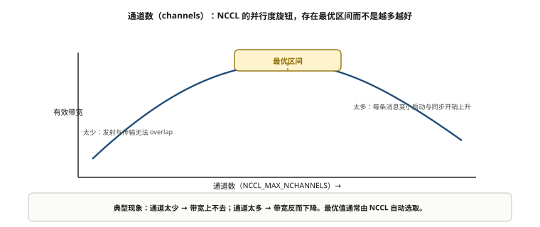
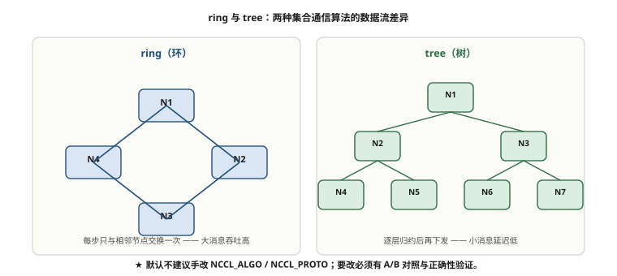
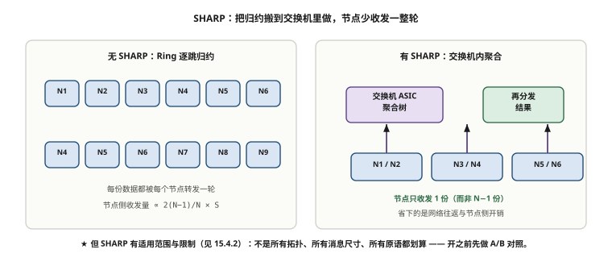

# 第 15 章　通信库与集合通信调优

> **本章一句话结论**：通信库能优化的上限，是网络设计和接线给的；接线错了，任何 NCCL 参数都救不回来。

## 15.1　NCCL 拓扑探测机制

### 15.1.1 一个被反复误解的问题：NCCL 到底"看见"了什么

现场最常见的一个误解是：

> "NCCL 会自己发现拓扑，所以按轨组网它也能自动按轨跑。"

这个说法**对了一半**，而错的那一半恰恰是事故的来源。

NCCL 的拓扑探测（topology discovery）做两件事：

```
1. 节点内探测：GPU 之间是 NVLink 还是 PCIe、距离几跳；
               网卡与哪张 GPU 在同一个 PCIe 拓扑分支上（亲和性）
2. 系统级探测：枚举 RDMA 设备、读取其属性（速率、端口）
```

**NCCL 能看到的东西，都在"节点内"和"设备属性"层面。** 它看不到 Leaf 交换机，看不到轨（rail），看不到跨机接线的真实走向。

NVIDIA 官方文档 `NCCL_NETDEVS_POLICY` 的原文表述是：网络设备的选择会"taking into account their network bandwidth and **the node topology**"（考虑网络带宽和**节点拓扑**）。注意——是 **node topology（节点拓扑）**，不是 **network topology（网络拓扑）**。这个措辞是精确的。

### 15.1.2 那 NCCL 为什么能"按轨"工作

既然如此，NCCL 在 SuperPOD 式同轨组网里为什么能跑出接近线速的性能？答案是：

**它靠的是接线提供的假设，不是它自己发现的能力。**

NVIDIA 的网络设计文档里有一句关键假设：

> "each NIC on a node connects to a different network switch (network rail)"
> （节点上的每张网卡连接到不同的网络交换机，即网络轨）

翻译成工程语言：

```
接线保证了：
  节点内第 g 号网卡 → 接到第 g 号那组 Leaf（轨 g）
⇒ NCCL 只要把"同一个 rank 的同一张网卡"用于同一段环，
   跨机流量自然落在同一条轨上
⇒ 看起来像"NCCL 会按轨"，实质是"接线已经按轨，NCCL 顺着用"
```

**这就是本章最重要的一个认知：网络设计是通信库优化的前提，不是反过来。** NCCL 的优化空间，建立在"接线是对的"这个前提上。如果接线错了——比如 8 张网卡没有一一对应到 8 条轨，或者某张卡接错了 Leaf——NCCL 不会报警，它只会"顺着错的接线跑出错的性能"。

**NCCL 不会替你发现接线错误，它只会忠实地放大接线错误。**

### 15.1.3 拓扑探测的导出与校验

NCCL 提供了两个环境变量来处理拓扑：

| 变量 | 作用 | 现场用途 |
|---|---|---|
| `NCCL_TOPO_DUMP_FILE` | 把 NCCL 探测到的**结果**转储到文件 | **上线前必须导出，人工核对是否与实际接线一致** |
| `NCCL_TOPO_FILE` | 指定一个**外部拓扑文件**让 NCCL 读取（覆盖自动探测） | 自动探测错误时手工修正 |

正确用法：

```bash
# 导出拓扑探测结果，人工校验
export NCCL_TOPO_DUMP_FILE=/tmp/nccl_topo.xml
# 跑一次任意 NCCL 程序（如 all_reduce_perf），生成转储
# 然后核对：每张网卡是否挂在正确的 GPU 下、是否与预期接线一致
```

**这是第 1 章清单里"配置阶段"的一条，也是本章动作的第一步**：不导出拓扑，你永远不知道 NCCL"以为"的接线是什么样。当 busbw 不达标时，第一件事不是调参数，是**核对 NCCL 看到的拓扑与图纸是否一致**。

```
顺序不能反：
  1. 核对拓扑（NCCL_TOPO_DUMP_FILE）   ← 接线对不对
  2. 核对网卡-NIC 绑定（NCCL_IB_HCA）   ← 用没用对网卡
  3. 才轮到调参数（各种 NCCL_*）        ← 最后一步
```

**跳过前两步直接调参数，是在错误的拓扑上做精细优化。**

---

## 15.2　ring / tree 的选择与环数、通道数

### 15.2.1 两种算法的取舍

NCCL 的集合通信（AllReduce）有两个主要算法：

| 算法 | 结构 | 优点 | 缺点 | 适用 |
|---|---|---|---|---|
| **Ring** | 环形，数据分块绕圈 | 带宽利用率高，适合大消息 | 延迟随规模线性增长 | 大消息、规模不太大 |
| **Tree** | 树形，逐层归约 | 延迟随规模对数增长 | 带宽利用率低于环 | 小消息、大规模 |

NCCL 会**自动选择**：小消息偏 Tree（省延迟），大消息偏 Ring（省带宽）。这个切换点由 `NCCL_ALGO` 与内部启发式决定。

```
判断口径（经验，非精确阈值）：
  消息小、延迟敏感 → Tree 更优
  消息大、带宽敏感 → Ring 更优
  真实训练里 AllReduce 的梯度通常是"大消息" ⇒ 多数落在 Ring
```

**现场纪律：不要凭直觉手改 `NCCL_ALGO`。** 默认的自动选择通常优于人为指定。只有当你确认某类消息的瓶颈并做过对照测试时，才手动干预。

### 15.2.2 环数（nrings）：多条逻辑环并行

Ring AllReduce 可以拆成多条**逻辑环（ring）**并行跑，每条环走不同的物理路径。

```
nrings = 1：一条环，所有数据串行绕一圈
nrings = 2：两条环并行，数据分两半，各走一条
...
```

**多条环的价值**：把流量分散到多条物理链路上，理论上提高聚合带宽。但代价是：

- 每条环的路径不同，负载可能不均。
- 环数过多时，每条环的数据量太小，启动开销占比上升。

NCCL 有内部默认（按拓扑和规模），通常**不需要手动调**。手动指定环数的场景是特定的拓扑病态（比如某条路径特别弱）。



**图 15-1　通道数（channels）：NCCL 的并行度旋钮**　｜　**读图要点**：通道太少，GPU 发射与网络传输无法充分 overlap，带宽上不去；通道太多，每个 channel 分到的消息变小，启动与同步开销上升，带宽反而下降。**存在最优区间，通常由 NCCL 自动选取** —— 要手改这个值，必须做 A/B 对照与正确性验证。

### 15.2.3 通道数（channels）：NCCL 的"并行度旋钮"

**通道（channel）是 NCCL 里最值得理解的并行度概念。** 一个 NCCL 通信操作会被拆成多个 channel，每个 channel 有独立的 CUDA 流、独立的执行上下文。

```
channels 的作用：
  把一次集合通信拆成 C 份，每份用不同的 CUDA 流并行执行
  ⇒ 提高 GPU 侧发射与网卡侧传输的重叠度
  ⇒ 但也消耗更多资源（显存、流、QP）

NCCL_MAX_NCHANNELS / NCCL_MIN_NCHANNELS：控制通道数上下限
```

**直观理解**：channel 越多，NCCL 越"忙"（更多并行），但每个 channel 分到的数据越少。存在一个最优点，多了反而因为开销而下降。

```
典型现象：
  channel 太少 → GPU 发射与网络传输无法充分 overlap，带宽上不去
  channel 太多 → 每个 channel 消息太小，启动开销与同步开销上升，带宽下降
  ⇒ 存在最优区间，通常由 NCCL 自动选取
```

### 15.2.4 三个规模的调优重点

同一套参数，规模不同，调优重点不同：

| 调优重点 | 2～8 台 | 32 台（一期） | 96 台（主线） | 128 台（三期） |
|---|---|---|---|---|
| 主要瓶颈 | 链路本身（物理层） | 轨内端口分配 | **跨 Spine 流量、ECMP** | 收敛比、告警淹没 |
| 算法选择 | 差别不大（Ring 即可） | Ring 为主 | Ring + 跨轨路径 | 需关注 Tree/Ring 切换点 |
| 环数/通道 | 默认即可 | 默认即可 | 关注多轨并行度 | 关注负载均衡 |
| 最该做的动作 | 核对拓扑 | 核对 8 轨偏差 | **核对 host 路由（15.7）** | 系统级容量规划 |
| 典型翻车点 | 网卡亲和错 | 端口错位 | **多网卡路由压单点** | 跨轨带宽不足 |

**注意最右列与最左列**：2～8 台的调优重点在"物理层对不对"，90～128 台在"流量分配对不对"。**同样的工具，不同规模要用在不同地方。**

---



**图 15-2　ring 与 tree：两种集合通信算法的数据流**　｜　**读图要点**：ring 每步只与相邻节点交换，适合大消息；tree 逐层归约，适合小消息。**默认不建议手改 `NCCL_ALGO` / `NCCL_PROTO`**；要改必须有 A/B 对照与正确性验证，否则很容易“越调越慢”。

## 15.3　NCCL_* 关键环境变量逐条解读

这一节把现场真正会用到的环境变量逐条讲清。先说一条总原则：

> **每改一个变量，都要有"为什么改、改了看什么、怎么回滚"三件事。** 盲目照抄网上参数配置，是把别人的环境病当成自己的药。

### 15.3.1 `NCCL_IB_HCA`：指定用哪些网卡（含 rail 字段）

这是最核心、也最容易配错的一个变量。它告诉 NCCL"用哪几张 RDMA 网卡、按什么端口、属于哪条轨"。

**官方格式（必须记准）**：

```
NCCL_IB_HCA = <hca>[:<port>[:<rail>[:<plane>]]]
```

即每个设备条目可以带四个字段，用冒号分隔：**HCA 名 : 端口 : rail : plane**。多个设备用逗号分隔，前缀 `=` 表示精确匹配（而非子串匹配）。

**官方原文（NCCL User Guide · Environment Variables）**：

> each entry follows the form `<dev>[:<port>[:<rail>[:<plane>]]]` … **The optional `<rail>` and `<plane>` fields assign a rail and plane identity to the associated device. Both default to `-1` (unassigned) when omitted.**

官方给的两个例子正好是本案例的形状：

```
=mlx5_0:1:0:0,=mlx5_1:1:0:1    # mlx5_0 与 mlx5_1 都属 rail 0，分属 plane 0 / plane 1
=mlx5_0::0:0,=mlx5_1::0:1      # 省略 port 时字段位必须留空（::），否则位次会串
```

**另一条容易踩的官方限制**：*"There is a fixed upper limit of **32 HCA devices** supported in NCCL."* —— 一台机器上被 NCCL 纳入的设备数有 32 个硬上限，多口 / 多平面方案要在这一步先算清楚。

**还必须说清它的性质**：`NCCL_IB_HCA` 的官方定义是 *"**filter** IB Verbs interfaces to be used by NCCL"* ——**它是"允许用哪些卡"的白名单过滤器，不是"GPU ↔ 网卡"的绑定关系**。绑定来自硬件（GPU i 与 NIC i 之间的 PCIe 亲和），`NCCL_IB_HCA` 只能决定 NCCL **看得见**哪些卡，不能把某张卡钉给某个 GPU。要把"只能走本轨网卡"真正做到，需要三层同时到位：

```
① 硬件：GPU i 与 NIC i 之间的 PCIe 亲和（DGX 类机型出厂即如此；PCIe-only 机型注意是否可 P2P）
② 变量：NCCL_IB_HCA 逐卡写死 <rail>（与物理接线一致）
③ 开关：NCCL_CROSS_NIC=0（同一 ring/tree 在所有节点用同编号 NIC）
```

**注意第 ③ 条只是"尽量"**（见 15.3.3 的官方原文）——同轨是**策略**，不是**保证**。这也是第 3 章 P2「上联全交叉」的由来：轨道之间在网络顶层必须连通。

**现场示例**：

```bash
export NCCL_IB_HCA==mlx5_0:1:0:0,=mlx5_1:1:1:0
```

逐字段解读：

| 字段 | 含义 | 示例值 | 说明 |
|---|---|---|---|
| `<hca>` | 设备名 | `mlx5_0` | 前缀 `=` 表示精确匹配该设备 |
| `<port>` | 端口号 | `1` | 单口 400G 卡通常为 1 |
| `<rail>` | **轨号** | `0` | **轨身份就在这里** |
| `<plane>` | 平面号 | `0` | 多平面组网时使用 |

**最关键的一条（官方原文）**：如果省略，`rail` 与 `plane` **默认为 `-1`（unassigned，未分配）**。

```
不显式配 rail ⇒ NCCL 不知道这张卡属于哪条轨
             ⇒ 轨身份为 -1（未分配）
             ⇒ 依赖轨的优化（如按轨选路）无法生效
```

**所以现场必须逐张卡显式写出 rail 字段**，让它与物理接线的轨号一致。这是"接线假设"能被 NCCL 用上的唯一入口。

### 15.3.2 一个必须澄清的误解：不存在 `NCCL_*RAIL*` 环境变量

现场经常有人问："`NCCL_IB_RAILS` 或类似的变量怎么配？"

**答案是：NCCL 并不存在名为 `NCCL_*RAIL*` 的环境变量。** 你搜不到 `NCCL_IB_RAILS`，因为它不存在。

轨身份只出现在两个地方：

```
1. NCCL_IB_HCA 的第三个字段（<rail>）   ← 环境变量方式
2. NCCL ≥ 2.29.7 的设备 API 枚举：
     NCCL_GIN_CONNECTION_RAIL
     NCCL_GIN_CONNECTION_FULL
   ← 这是设备枚举 API 的档位，不是环境变量
```

**记法**：轨不是通过"一个叫 RAIL 的环境变量"配置的，而是**通过 `NCCL_IB_HCA` 的字段位置**表达的。找不到某个变量，不代表轨不能配——它藏在 `IB_HCA` 里。

### 15.3.3 `NCCL_CROSS_NIC`：跨网卡通信的开关

控制当同一个 rank 有多张可用网卡时，是否允许"跨 NIC"通信。

```
NCCL_CROSS_NIC = 0   ⇒ 同一 ring/tree 在所有节点固定用同一张 NIC（不跨轨）
NCCL_CROSS_NIC = 1   ⇒ 不尝试用同一张 NIC（适合"一个节点的所有网卡挂同一台交换机"的网络）
NCCL_CROSS_NIC = 2   ⇒ 默认值：尽量用同一张，但若换一张性能更好就换
```

**官方原文（三条取值，逐字）**：

> 0: Always use the same NIC for the same ring/tree, to avoid crossing network rails. Suited for networks with per NIC switches (rails), with a slow inter-rail connection. **Note that if the communicator does not contain the same GPUs on each node, NCCL may still need to communicate across NICs.**
> 1: Allow the use of different NICs for the same ring/tree. This is suited for networks where all NICs from a node are connected to the same switch…
> 2: (Default) Try to use the same NIC for the same ring/tree, but still allow for the use of different NICs if it would result in a better performance.


NCCL 官方文档的原话是 "**Try** to use the same NIC for the same ring/tree"——注意是 **Try（尽量）**，不是 **Force（强制）**。

**官方那段里藏着本书最该记住的一句**：即便把它设成 `0`，官方也明说了 *"NCCL may still need to communicate across NICs"*（当同一个 communicator 在各节点上的 GPU 不一致时）。NCCL 早期版本的同一段还写过更直白的一句：*"there are corner cases for which NCCL may still cause cross-rail communication, so **rails still need to be connected at the top**."*

三个关键限制：

```
1. 它是"尽量"，不是"强制"，最终仍受拓扑与可用设备影响
2. NCCL_CROSS_NIC 只管 ring/tree 拓扑
   ⇒ 管不到 AllToAll（详见 15.5 节，这是最容易被忽略的一条）
3. 即使设成 0，官方也承认"仍可能跨 NIC"
   ⇒ 推论：轨道之间在网络顶层必须连通（这就是第 3 章 P2"上联全交叉"的官方依据）
```

### 15.3.4 `NCCL_IB_QPS_PER_CONNECTION`：每连接的 QP 数

控制每对通信连接使用多少个 QP（Queue Pair）。

```
NCCL_IB_QPS_PER_CONNECTION > 1  ⇒ 使用多个 QP
```

**价值**：多 QP 能利用网卡的多路径能力，在 ECMP 环境下把一条逻辑连接的数据分散到多条物理路径，提高带宽利用率、缓解单路径拥塞。

**现场判断**：在 ECMP 哈希不够均匀、单 QP 跑不满线速时，多 QP 可能有帮助。但它不是万灵药——**如果底层物理路径本身有问题，多 QP 只会让问题更分散、更难定位。**

### 15.3.5 `NCCL_NET_GDR_LEVEL`：GPUDirect RDMA 的开关与级别

控制 GPUDirect RDMA（网卡直接读写 GPU 显存）的使用级别。

```
级别越高 ⇒ 越倾向于使用 GPUDirect（网卡直连 GPU 显存）
级别为 0 / 特定值 ⇒ 可能退化为经主机内存拷贝
```

**为什么重要**：GPUDirect 生效时，数据走"GPU ↔ 网卡"直接路径；不生效时，数据要经主机内存中转（GPU → 内存 → 网卡），多两次拷贝，带宽和延迟都受影响。

**现场最容易踩的坑**：这个级别需要**主机侧的 GPUDirect 支持真正生效**（`nvidia_peermem` 等模块加载），否则你配了高级别，实际仍会退化。**验证方式不是看配置，是看运行时行为**（NCCL_DEBUG=INFO 日志会显示实际路径）。

### 15.3.6 `NCCL_ALGO` 与 `NCCL_PROTO`

```
NCCL_ALGO   : 指定集合通信算法（如 Ring、Tree、CollNet 等）
NCCL_PROTO  : 指定传输协议（如 Simple、LL、LL128）
```

| 协议 | 特点 | 适用 |
|---|---|---|
| Simple | 通用，开销均衡 | 大消息 |
| LL（Low Latency） | 低延迟，小消息 | 小消息、延迟敏感 |
| LL128 | 折中（128 B 粒度） | 中等消息 |

**纪律**：这两个变量默认由 NCCL 自动选择，**通常不要手改**。手动指定的唯一理由是：你确认了某类消息的瓶颈，并做过 A/B 对照验证。**没有对照测试的手改，是在赌。**

### 15.3.7 `NCCL_IB_TIMEOUT` 与 `NCCL_IB_RETRY_CNT`：重试与超时

这两个参数控制 RDMA 操作超时后的行为：

```
NCCL_IB_TIMEOUT   : 超时时间（指数编码，不是直接秒数）
NCCL_IB_RETRY_CNT : 重试次数
```

**为什么要关注**：

- 超时太短 + 重试太少 ⇒ 链路瞬时抖动直接变成通信失败（`#wrong` 或超时错误）。
- 超时太长 + 重试太多 ⇒ 真故障时"卡很久才报错"，掩盖问题。

**现场的一个真实权衡**：本案例曾在一次链路抖动中遇到"通信超时直接失败"的问题，第一反应是调大重试——但**根因是物理层间歇误码（第 13.5 节的端面污染）**。调大重试只是把故障从"立刻失败"变成"卡顿后偶尔成功"，**没有解决根因，还让排查更困难。**

**结论：这两个参数是"缓解症状"的，不是"治根"的。** 出现超时/重试问题，先按第 13 章决策树查物理层。

### 15.3.8 `NCCL_DEBUG` 与 `NCCL_DEBUG_SUBSYS`：调试信息的开关

```
NCCL_DEBUG        : 调试级别（如 WARN / INFO / TRACE）
NCCL_DEBUG_SUBSYS : 指定输出哪些子系统的信息（如 INIT / NET / GRAPH / TOPO）
```

**用法**：

```bash
# 定位初始化与网络问题（最常用）
export NCCL_DEBUG=INFO
export NCCL_DEBUG_SUBSYS=INIT,NET

# 定位拓扑/图构建问题
export NCCL_DEBUG_SUBSYS=GRAPH,TOPO
```

**关键纪律：调试级别只用于排查，不要长期开启。** `TRACE` 级别会产生海量日志，拖慢训练、写满磁盘，而且海量日志里真正有用的信息被淹没。**排查完立即关掉。**

**现场用法**：当出现 busbw 不达标或初始化失败时，用 `NCCL_DEBUG=INFO` + `NCCL_DEBUG_SUBSYS=INIT,NET` 抓一次日志，通常能直接看到：用了哪张网卡、走没走 GPUDirect、建了什么环、报了什么错。**这比盲目试参数快得多。**

### 15.3.9 关键参数速查表与配置顺序

把本节讲的变量收口成一张表，便于现场按序核对：

| 变量 | 作用 | 默认 | 现场建议 |
|---|---|---|---|
| `NCCL_IB_HCA` | 指定网卡 + rail | 自动枚举 | **逐卡显式配 rail，不能是 -1** |
| `NCCL_CROSS_NIC` | 跨 NIC 通信 | 自动 | DP 场景可调；**AllToAll 无效** |
| `NCCL_IB_QPS_PER_CONNECTION` | 每连接 QP 数 | 1 | ECMP 不均时可加，须 A/B 对照 |
| `NCCL_NET_GDR_LEVEL` | GPUDirect 级别 | 依拓扑 | 确认**实际生效**（看日志，非看配置） |
| `NCCL_ALGO` | 算法 | 自动 | 不动，除非有 A/B 依据 |
| `NCCL_PROTO` | 协议 | 自动 | 不动，除非有 A/B 依据 |
| `NCCL_IB_TIMEOUT` | 超时 | 依版本 | 治标不治本，先查物理层 |
| `NCCL_IB_RETRY_CNT` | 重试次数 | 依版本 | 同上 |
| `NCCL_DEBUG` | 调试级别 | WARN | 仅排查时开，之后关 |
| `NCCL_DEBUG_SUBSYS` | 调试子系统 | 全部 | 排查时收窄到 INIT/NET |

**配置顺序很重要**（顺序颠倒会让后面的调优建立在错误前提上）：

```
第一步：定义事实的变量
    NCCL_IB_HCA（哪张卡、哪条轨）—— 这是"接线事实"在软件里的表达
第二步：影响策略的变量
    NCCL_CROSS_NIC、NCCL_IB_QPS_PER_CONNECTION、NCCL_NET_GDR_LEVEL
第三步：影响算法的变量（最后才碰）
    NCCL_ALGO、NCCL_PROTO
```

先把"事实"配对，再调"策略"，最后才碰"算法"。**在错误的 rail 配置上调 ALGO，等于在错的地图上找路线。**

---

## 15.4　SHARP 网内计算的收益与限制



**图 15-3　SHARP：把归约搬到交换机里做**　｜　**读图要点**：没有 SHARP 时 Ring 逐跳归约，节点侧收发量正比于 `2(N−1)/N × S`；有 SHARP 时归约在交换机 ASIC 内完成，节点只收发 1 份（而不是 N−1 份）。**省下的是网络往返与节点侧开销**，但它有适用范围与限制——不是所有拓扑、消息尺寸与原语都划算，开之前先做 A/B 对照。

### 15.4.1 SHARP 是什么

**SHARP（Scalable Hierarchical Aggregation and Reduction Protocol）** 把集合通信的归约计算**卸载到交换机**执行。

传统 AllReduce 的 Ring 结构里，数据要在节点间绕圈，每个节点都要"收—加—发"。SHARP 让交换机在转发时顺便做加法：

```
传统 Ring：  rank0 → rank1 → rank2 → ... → rank0   （每跳都参与计算）
SHARP：      所有 rank → 交换机归约 → 结果广播          （节点侧不做归约）
```

**理论收益**：减少节点侧的计算与数据搬运，降低通信量，提高 AllReduce 效率。**对带宽敏感的大规模 AllReduce 尤其有价值。**

### 15.4.2 SHARP 的限制：什么时候不该开

SHARP 不是万能的。不能在以下情况盲目开启：

| 限制 | 说明 |
|---|---|
| **需要交换机硬件支持** | 不是所有交换机都支持 SHARP（本案例的 CE9866-128DQ 支持情况需按官方文档核对） |
| **支持的集合通信类型有限** | 主要对 AllReduce 有效；**AllToAll 不支持**（15.5 节） |
| **支持的算法/数据类型有限** | 特定归约操作与数据类型才在硬件支持范围内 |
| **拓扑要求** | SHARP 树形结构对拓扑有要求，轨优化拓扑需要核对兼容性 |
| **与并行策略耦合** | TP/PP/DP/EP 场景的收益不同 |

**什么时候"不该开"**：

```
1. 业务以 AllToAll（MoE/EP）为主 —— SHARP 帮不上，开了也没用
2. 小规模（2～8 台）—— 通信量小，SHARP 的收益被开销抵消
3. 拓扑不兼容 —— 强行开启可能报错或性能更差
4. 未做对照测试 —— 不要基于"SHARP 一定更快"的直觉开启
```

**现场纪律：SHARP 的收益必须用 A/B 对照测试确认，不能凭理论推断。** 在 AllReduce 为主、规模大、拓扑兼容的场景，它可能有效；在其他场景，它可能无效甚至有害。

> **SHARP 收益的实测数据本案例尚未采集。** 属于调优前后对比的一部分，标 **【待实测】**（O-07）。

---

## 15.5　通信库与并行策略的耦合

### 15.5.1 四种并行，四种配置思路

第 1 章讲过四类并行的通信模式，这里要把它们与通信库配置的耦合讲清。

| 并行策略 | 通信原语 | 对配置的影响 | 调优重点 |
|---|---|---|---|
| **DP** | AllReduce | 大消息、带宽敏感 | Ring 优化、channel 数 |
| **TP** | AllReduce / AllGather | 延迟敏感，通常限单机 NVLink | 尽量不出机箱，`NCCL_CROSS_NIC` |
| **PP** | 点对点 Send/Recv | 延迟与抖动敏感，带宽低 | 延迟优化、避免误码抖动 |
| **EP（MoE）** | **AllToAll** | **几乎 100% 跨轨** | **`NCCL_CROSS_NIC` 管不到！** |

### 15.5.2 最容易被忽略的一条：AllToAll 场景 `NCCL_CROSS_NIC` 管不到

这是本章必须写透的一个点。

`NCCL_CROSS_NIC` 的作用范围是 **ring / tree 拓扑**——它通过"尽量让同一段环用同一张网卡"来优化 DP/TP 类通信。

**但 AllToAll 不是 ring/tree 结构。** 它不存在"一条环"，它是一次"所有 rank 到所有 rank"的全连接交换。所以：

```
NCCL_CROSS_NIC 控制的是：
  "同一个 ring/tree 里，尽量用同一张 NIC"
  
AllToAll 里没有 ring/tree 这个概念
⇒ NCCL_CROSS_NIC 对 AllToAll 无效
⇒ 你在 DP 场景靠它压住的跨轨流量，
   在 EP（MoE）场景下完全不受控
```

**后果**：如果按"跨轨只占 10~20%"去配 Spine 带宽（DP 场景的经验），一旦上 MoE（EP/AllToAll），跨轨流量接近 100%，**Spine 带宽会瞬间打满**。

**这是第 1 章坑二"跨轨占比 51%"的进一步延伸**，也是本书反复强调的一条：

> **如果这个集群将来要跑 MoE，按"跨轨只占 10~20%"配 Spine 带宽，一定翻车。**

NCCL 从 **2.29.7** 起提供 `NCCL_GIN_CONNECTION_RAIL` 与 `NCCL_GIN_CONNECTION_FULL` 两档设备枚举，**就是为了承认"跨轨连接"是 NCCL 的一等公民**——它不再假设"通信一定在轨内"。这是对 AllToAll 类负载的正式支持（注意：这两个是设备枚举 API 档位，不是环境变量，见 15.3.2）。

### 15.5.3 配置与策略的对应关系

```
DP 为主（纯稠密模型）：
  - 依赖 Ring/AllReduce 优化
  - NCCL_CROSS_NIC 有效
  - 主要压力在轨内带宽 + 跨 Spine
  - 按 O-11（收敛比对比）验证

TP 为主（层内切分）：
  - 尽量限制在单机 NVLink 域内
  - 跨机必须尽量避免（NVLink 900 GB/s vs 400G 网卡 50 GB/s）
  - 一旦跨机，网络先崩

PP 为主（流水线）：
  - 通信量小，但每次气泡不可隐藏
  - 关注延迟与抖动（PFC、误码都会放大）
  - 9 分片优化、1F1B 等属框架层

EP / MoE（AllToAll）：
  - NCCL_CROSS_NIC 无效（见上）
  - 跨轨流量接近 100%
  - 必须为跨 Spine 预留足够带宽
  - 考虑 NCCL_GIN_CONNECTION_RAIL/FULL 档位
```

**并行策略不是通信库能决定的，但它决定了通信库的配置有没有意义。** 用 DP 场景的最优参数去打 MoE，就是把错的药用在错的病上。

---

## 15.6　通信与计算 overlap

### 15.6.1 为什么 overlap 是"网络之外"的关键

第 1 章给出了一个可直接算的结论：**不做通信-计算 overlap，网络再好也没用。** 这里把它量化。

按本案例真实参数（96 台 / 768 卡，7B 模型 bf16 训练），第 1 章的算式结论是：

```
T_comm / T_compute = 5923 / B      （B = 每个 DP rank 每步 token 数）
```

对应表：

| 每 rank 每步 token 数 B | 通信/计算时间比 | 不做 overlap 时的等效吞吐 |
|---|---|---|
| 4,096 | 1.45 | 掉到 41% |
| 16,384 | 0.36 | 掉到 74% |
| 65,536 | 0.09 | 掉到 92% |

**读法**：通信与计算的时间比越小，overlap 越容易把通信藏进计算里；比值越大，通信就越藏不住。

### 15.6.2 overlap 的分层量化

overlap 不是"0 或 1"，它有三个层级：

| 层级 | 做法 | 效果 | 代价 |
|---|---|---|---|
| **L0：无 overlap** | 算完再通信，通信完再算 | 吞吐 = 1 / (1 + T_comm/T_compute) | 无 |
| **L1：梯度分桶 overlap** | 把梯度分桶，算完一桶就通信一桶 | 部分通信隐藏；**Ring 的天然特性可让通信与反向计算重叠** | 需框架支持（如 PyTorch DDP bucket） |
| **L2：全重叠（通信/计算流水）** | 更细粒度切分与调度 | 大部分通信可隐藏 | 复杂度高，需调优 |

**L1 是"性价比最高"的一层**：现代框架（DDP、DeepSpeed、Megatron）普遍支持梯度分桶，把 AllReduce 与反向传播重叠。**这一层做与不做，差别最大。**

### 15.6.3 分层量化示例（按第 1 章数字）

以 B = 16,384 为例（T_comm / T_compute = 0.36）：

```
L0 无 overlap：
  吞吐 ≈ 1 / (1 + 0.36) = 74%

L1 梯度分桶 overlap（理想情况，通信完全藏在反向计算里）：
  吞吐 ≈ 100% × (计算部分)  （通信被隐藏）
  ⇒ 理论提升 = 74% → 接近 100%
  ⇒ 提升幅度可观

L2 进一步优化：
  在 L1 基础上收益递减（边际改善通信尾巴）
```

**注意**：这里的百分比是"理想模型下的计算"，**不是实测的 MFU**。真实的 MFU 提升幅度取决于框架实现、切分粒度、网络抖动、负载均衡等多因素。

> **调优前后 MFU 提升幅度：本案例尚无实测数据**（参数卡 O-07，状态"待后续"）。补采方式：**端到端训练对比**（同模型、同 batch、同数据，仅改通信配置，跑足够步数取稳定段 MFU 均值）。**本章不给出任何 MFU 提升幅度的具体数字，一律标【待实测】。**

### 15.6.4 overlap 与网络的耦合

一个容易被忽略的点：**overlap 的效果依赖网络的"稳定性"，不只是平均带宽。**

```
如果链路有间歇性误码（第 13.5 节）：
  ⇒ 偶发的通信卡顿会打破 overlap 的流水
  ⇒ 计算被迫等待通信（barrier 效应）
  ⇒ overlap 效果大幅打折（甚至不如不 overlap）
```

**所以 overlap 的优化前提，是先有"无随机故障"的链路。** 这又回到第 13 章：**排障能力是调优能力的地基。**

---

## 15.7　主机侧路由与多网卡绑定的隐形坑

### 15.7.1 坑是怎么形成的

这是本章要写透的一个真实工程坑，它的表现形式极具欺骗性：**所有网卡都配好了，压测也能跑，但性能卡在某个上限上不去。**

本案例的配置是：**8 卡 8 网卡，一一对应，每张网卡在自己的网段。** 从参数卡看：

```
8 张 ConnectX-7 400G 单口 OSFP
⇒ 8 个网卡，8 个轨网段（10.1.1.0/24 … 10.1.8.0/24）
⇒ 每张网卡应该只承载"本轨"的流量
```

坑出在**主机路由表**上：

```
Linux 默认路由（default route）只能指向一张网卡
⇒ 假设默认路由指向 mlx5_0（轨 1）
⇒ 任何"没有显式路由"的出向流量，
   都会走默认路由 ⇒ 全部压到 mlx5_0 那张 400G 上
⇒ 存储流量、管理流量、跨轨流量……全走这一张卡
⇒ 结果：8 张 400G 的聚合能力，退化成 1 张 400G 的单点
```

**最危险的是它不容易被发现**：链路都 up，连通性都通，压测小规模也能过。只有在大规模、多轨并发时，才会因为"所有流量挤在默认路由那张卡上"而撞到瓶颈。

### 15.7.2 正确的做法思路（Linux 侧）

解决思路分两步：**显式路由** + **源地址选择策略**。这里给出思路与验证方法，**不贴未经验证的具体命令参数**（参数随内核版本、发行版、网卡驱动不同而不同，现场必须用自己环境验证）。

**第一步：显式路由**

```
目标：让每种流量走它该走的那张网卡
  - 轨 g 的流量 → 走第 g 张网卡
  - 存储流量 → 走存储网段对应的网卡
  - 管理流量 → 走管理网段对应的网卡
做法思路：
  为每个目标网段配置"显式路由"，指定下一跳与出接口
  ⇒ 不再依赖默认路由
```

**第二步：源地址选择策略**

这是关键。Linux 的**传统路由是"按目的地址查表"**——同一张路由表里，无论流量从哪里发出，都按目的地址匹配。这会导致"出接口与源地址不匹配"的问题。

**解决思路是用策略路由（policy routing）做"按源地址选表"**：

```
思路：
  1. 建立多张路由表（每张网卡一张，或每类流量一张）
  2. 用 ip rule 规则，按"源地址"把流量导向对应的路由表
     （源地址 = 该网卡自己的 IP ⇒ 该流量走该网卡的表）
  3. 对应的表里，默认路由指向该网卡
  ⇒ 效果：进来时"从哪张卡来的流量，回程就从哪张卡出去"
           出去时"指定源地址的流量，走对应的表"

核心思想：用"源地址"作为选路的依据，
          而不是只用"目的地址"
```

**为什么必须做源地址策略**：在 8 网卡环境下，"从 A 进、从 B 出"会造成对称性破坏，RoCE 的拥塞控制（DCQCN）与 PFC 反压都假设路径对称。**不对称会导致反压走错方向、拥塞控制失效。**

**第三步：验证方法**

```
验证要点（不依赖具体命令）：
  1. 从每个源网段分别发起测试，确认出接口是"该网段对应的网卡"而不是默认路由那张
     ⇒ 用带源地址选项的连通性测试逐网段验证
  2. 观察 8 张网卡的流量分布：正常情况下应按轨分布，
     不应出现"一张卡打满、其余卡空闲"
  3. 在压测时读 8 张网卡的计数器，确认没有单卡成为瓶颈
  4. 反向验证：故意从某张卡发起流量，确认回程也从该卡回来（路径对称）
```

### 15.7.3 这条坑的通用性

这个坑不只属于本案例。**任何"多网卡多网段"的服务器都会遇到：**

```
通用规律：
  默认路由只能有一个出口
  ⇒ 有 N 张网卡却只配了默认路由 ⇒ 实际只用得上 1 张
  ⇒ 另外 N−1 张在"没用显式路由的流量"上是废的
  ⇒ 必须为每个需要独立出口的网段写显式路由 + 源地址策略
```

**在智算中心，这条坑的代价被放大**：单卡 400G 是带宽，8 卡聚合是 8 倍带宽。**退化成单卡，等于把节点的网络带宽砍到 1/8。** 而且因为它"能跑、只是慢"，最容易被误判成"网络质量问题"而去查交换机——**方向错了，白查。**

**现场纪律**：**8 网卡服务器的路由配置，必须逐网段验证出接口，不能只看"能 ping 通"。** 能 ping 通 ≠ 走对了卡。

### 15.7.4 为什么这不是"配一次就完事"

多网卡路由配置有一个容易被忽略的特性：**它会在系统变更后静默失效。**

```
会破坏路由配置的常见变更：
  - 网卡重命名 / 驱动升级（网卡名变了，原来绑的路由规则指向不存在的接口）
  - IP 重新规划（网段变了，显式路由的目标网段就错了）
  - 增加/更换网卡（新卡默认没有策略路由规则）
  - 系统或网络配置管理工具覆盖（配置被"标准化"模板冲掉）
```

**这类失效是静默的**：配置语法都对、设备都 up、ping 都通，只是流量又重新挤回了默认路由那张卡。**它不会报错，只会让性能悄悄退回到 1/8。**

所以在 15.9 的检查清单里，"逐网段验证出接口"不是一次性动作，而是**每次涉及网络配置的变更后必须重跑的验证项**。验证方法本身很简单（逐源网段发出流量、看出接口、看 8 卡流量分布），但**不验证就等于默认它又坏了**——因为从经验看，它最终一定会坏。

---

## 15.8　HCCL 与国产通信库差异

### 15.8.1 为什么要了解 HCCL

本案例是 H100 集群，主用 NCCL。但在国产算力集群与混合集群中，通信库生态不同，运维与调优的知识不能直接平移。

**HCCL（Huawei Collective Communication Library）** 是华为昇腾生态的集合通信库，地位与 NCCL 相当。

### 15.8.2 主要差异对照

| 维度 | NCCL（NVIDIA） | HCCL（华为昇腾） | 现场含义 |
|---|---|---|---|
| 硬件生态 | NVIDIA GPU + NVLink + IB/RoCE | 昇腾 NPU + HCCS + RoCE | 不通用，各自生态 |
| 集合通信接口 | ncclAllReduce 等 | HcclAllReduce 等 | 框架适配层不同 |
| 环境变量 | `NCCL_*` | `HCCL_*`（命名与语义不完全对应） | **不能照抄 NCCL 参数** |
| 拓扑探测 | 节点内 PCIe/NVLink 亲和 | 节点内 HCCS 亲和 | 思路类似，细节不同 |
| 拓扑导出 | `NCCL_TOPO_DUMP_FILE` | 有对应的转储机制 | 上线前同样必须导出核对 |
| 基准工具 | nccl-tests | 有对应基准工具 | 判据思路类似 |
| 网络侧 | IB / RoCEv2 | 主要 RoCE | 无损网络要求一致 |

### 15.8.3 知识迁移的原则

虽然具体变量名与工具不同，**底层原理是一样的**：

```
可迁移的（原理层）：
  1. 集合通信是同步屏障 ⇒ 单点故障放大为全局（第 13 章）
  2. 拓扑探测只看节点内 ⇒ 按轨靠接线假设（15.1）
  3. 单卡物理上限决定 busbw 天花板（第 13 章）
  4. 多网卡路由必须显式配置 + 源地址策略（15.7）
  5. 无损网络 PFC/ECN 参数必须三侧一致（第 14 章）

不可迁移的（实现层）：
  1. 具体环境变量名与语义
  2. 具体工具与命令
  3. 具体的算法/协议默认值
```

**原则**：**把原理带走，把参数留下。** 到国产平台上，重新做拓扑核对、重新建基线、重新做 A/B 测试——**但排查的思路（第 13 章决策树）可以直接用。**

一个混合集群（NVIDIA + 昇腾）的现实：**两套通信库共存时，网络侧的"无损网络配置"是共同的公共基础**——PFC 优先级划分、ECN 门限、QoS 队列映射，对两边都生效。**这也是为什么第 14 章的 QoS/PFC/ECN 缺口如此致命：它是所有通信库的共同地基。**

---

## 15.9　调优案例复盘与检查清单

### 15.9.1 一次"越调越慢"的复盘

**背景**：压测阶段，某条轨的 busbw 略低于其他轨。工程师的第一反应是调参数。

**动作序列**（错的）：

```
1. 改 NCCL_ALGO 强制 Ring  → 无改善
2. 加 NCCL_IB_QPS_PER_CONNECTION → 略降
3. 调 NCCL_MAX_NCHANNELS → 反而下降
4. 改 NCCL_IB_TIMEOUT/RETRY → 表面上偶尔"恢复"
```

**根因**（按第 13 章决策树重查）：**该轨的一条链路存在间歇性误码**（光层问题，第 13.5 节）。参数调优改变不了物理误码。

**复盘结论**：

```
1. 调优前必须先用第 13 章决策树确认"不是物理层"
2. "位置固定"的慢 → 查配置/拓扑
   "位置随机"的慢 → 查物理层
   （本例实际是随机，被误当成固定）
3. 参数调优是最后一步，不是第一步
```

**本案例据此固化的调优顺序**：

```
调优四步（顺序不可颠倒）：
  1. 核对拓扑（NCCL_TOPO_DUMP_FILE）—— 接线对不对
  2. 核对网卡绑定与路由（NCCL_IB_HCA + 主机路由）—— 用没用对卡
  3. 确认链路健康（FEC 计数、第 13 章）—— 物理层干不干净
  4. 最后才调参数（NCCL_*）—— 精细优化
```

**"越调越慢"的本质，是在错误的地基上做精装修。**

### 15.9.2 调优检查清单

> 可直接打印带到机房。顺序即执行顺序。

**A. 拓扑核对（第一步）**

- [ ] 导出 `NCCL_TOPO_DUMP_FILE`，人工核对与实际接线一致
- [ ] 核对每张网卡挂在正确的 GPU 下（`nvidia-smi topo -m`）
- [ ] 确认 NIC i ↔ GPU i 一一对应（本案例要求）
- [ ] 若自动探测错误，用 `NCCL_TOPO_FILE` 修正并复测

**B. 网卡绑定与路由（第二步）**

- [ ] `NCCL_IB_HCA` 逐张卡显式配置，**rail 字段与物理轨号一致**（`=<hca>:<port>:<rail>:<plane>`）
- [ ] 确认每个 rail 字段不是默认的 `-1`（unassigned）
- [ ] **主机侧显式路由已配置**（存储、管理网段各走自己的卡）
- [ ] **源地址策略已配置**（`ip rule` / 多路由表，按源地址选表）
- [ ] 逐网段验证出接口，**不只验证"能 ping 通"**
- [ ] 压测时确认 8 张网卡流量按轨分布，无单卡打满

**C. 链路健康（第三步）**

- [ ] FEC 计数器：`rx_uncorrectable = 0`（第 13 章）
- [ ] PFC pause 计数无持续增长
- [ ] 网卡 `rx_out_of_buffer` / `rx_discards` 正常
- [ ] GPUDirect RDMA 实际生效（`NCCL_DEBUG=INFO` 确认路径）

**D. 参数调优（第四步）**

- [ ] 每次只改一个变量，有 A/B 对照
- [ ] `NCCL_ALGO` / `NCCL_PROTO` 默认不动，除非有对照依据
- [ ] `NCCL_CROSS_NIC` 明确适用场景（**不适用于 AllToAll**）
- [ ] `NCCL_DEBUG` 排查后关闭，不长期开启
- [ ] 记录改前/改后 busbw（**标注【待实测】，参数卡 O-01、O-02、O-11、O-12**）

**E. 并行策略适配**

- [ ] 确认业务是 DP/TP/PP/EP 哪种为主
- [ ] **MoE/EP 场景：为跨 Spine 预留足够带宽**（`NCCL_CROSS_NIC` 管不到）
- [ ] overlap 分层确认（L0/L1/L2）
- [ ] 记录调优前后 MFU（**【待实测】，O-07**）

---

## 15.10　成本与工期影响

| 决策 | 成本影响 | 工期影响 |
|---|---|---|
| 上线前导出并核对 NCCL 拓扑 | 零 BOM 成本 | 约 0.5 人日，避免"接线错误无告警" |
| `NCCL_IB_HCA` 逐卡配 rail | 配置工时（人日级） | 让轨优化真正生效 |
| 主机侧显式路由 + 源地址策略 | 配置工时 | **避免 8 卡退化为 1 卡（带宽损失 7/8）** |
| 规范调优四步顺序 | 零成本（流程） | 避免"越调越慢"式返工 |
| 端到端 MFU 对照测试 | 训练机时（较长） | 获得真实调优收益数据（O-07） |

第二条与第三条最值得强调：

- **`NCCL_IB_HCA` 不配 rail 字段 ⇒ 轨身份默认为 -1 ⇒ NCCL 的轨优化无法生效。** 这不是"配置不完美"，是"优化根本没启动"。
- **主机路由不配 ⇒ 8 张 400G 只剩 1 张工作。** 这是本案例里"单位带宽损失最大"的一个配置错误，且它是**静默的**——链路都 up，测试都能过。

---

## 本章要点回顾

- **NCCL 看不到 Leaf 交换机，只探节点内 PCIe/NVLink 亲和。** 它按轨工作靠的是接线假设："each NIC on a node connects to a different network switch (network rail)"。**网络设计是通信库优化的前提，不是反过来。**
- **NCCL 并不存在 `NCCL_*RAIL*` 环境变量。** 轨身份只在两处：`NCCL_IB_HCA` 的第三个字段（格式 `<hca>[:<port>[:<rail>[:<plane>]]]`，如 `=mlx5_0:1:0:0`），以及 NCCL ≥ 2.29.7 的设备 API 枚举（`NCCL_GIN_CONNECTION_RAIL` / `NCCL_GIN_CONNECTION_FULL`，非环境变量）。**省略 rail 字段默认 -1（unassigned）⇒ 不显式配则 NCCL 无轨身份。**
- ring 适合大消息、tree 适合小消息；`NCCL_ALGO` / `NCCL_PROTO` 默认不动，手改必须有 A/B 对照。
- **`NCCL_CROSS_NIC` 只管 ring/tree，管不到 AllToAll。** MoE/EP 场景跨轨流量接近 100%，按 DP 经验配 Spine 带宽一定翻车。
- SHARP 有收益但有限制；AllToAll 用不上，小规模不划算，必须 A/B 验证。
- 通信与计算 overlap 分三层，**L1 梯度分桶性价比最高**；overlap 效果依赖链路"稳定性"，不只看平均带宽。
- **主机侧 8 网卡 8 网段，默认路由只能指向一张卡。** 存储、管理、各轨流量必须写**显式路由 + 源地址策略**，否则全部流量压到默认路由那张 400G 上，**8 卡聚合退化为单点**（带宽损失 7/8）。
- 调优顺序不可颠倒：**先核对拓扑 → 再核对绑定与路由 → 再确认链路健康 → 最后调参数。**
- **本章及调优收益的 busbw / MFU 实测数字一律为【待实测】**（O-01、O-02、O-07、O-11、O-12），不编造提升幅度。

---

> **本章待补实测项**（对应参数卡）：
> O-01 单节点 8×400G 满载基线 · O-02 768 卡全规模 all_reduce_perf busbw · O-11 收敛比 1:1 vs 2:1 · O-12 8 轨 busbw 偏差 · **O-07 通信库调优前后 MFU 提升幅度（补采方式：端到端训练对比，同模型/同 batch/同数据，取稳定段 MFU 均值）**
>
> O-01 / O-02 / O-11 / O-12 的**推理参考区间**见第 1 章 §1.4.3 与图 1-4。**参考区间不是实测值**，只用来自检实测结果是否落在合理带内，不得写进验收报告。
