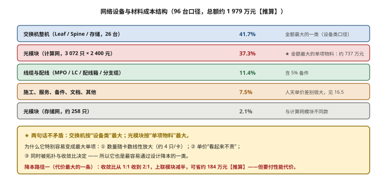
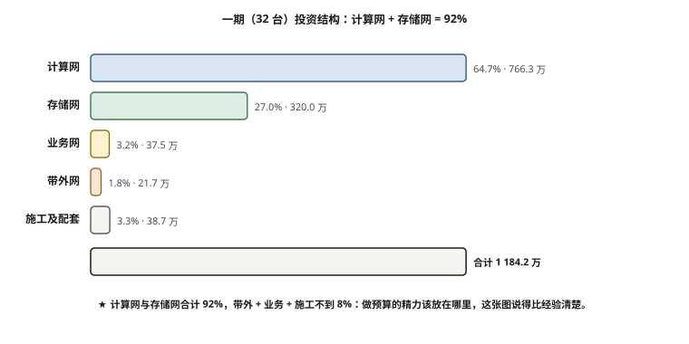

# 第 16 章　预算评估、BOM 编制与招投标

> **本章一句话结论**：网络预算里真正会翻车的不是总价，而是口径——同一根线在两份报价单里叫两个名字、两个长度，比价就变成了猜谜。

## 16.1　智算网络 BOM 编制模板

### 16.1.1 工程问题：三份报价单放一起，没人敢下结论

本案例到了比价阶段，桌上摊开三份渠道报价。总价差不大，但技术负责人扫了十分钟，只问了一句："这三份里，有哪一行是同一个东西？"

- 一份把算力 MPO 跳线统一按 30 m 报，另一份按 15/20/25/35 m 四档报。
- 一份写"存储交换机 4 台"，另一份写"2 台"。
- 一份的"CAT6-10M"这三列里，行名写 10M、规格写 20 米、单价按 20 元——一行里三个数互相打架。

这不是供应商在坑人，而是**笔者没给统一的编制口径**。BOM（Bill of Materials，物料清单）在智算项目里的作用，不是"把东西列出来"，而是**把数量来源锁死、把单价口径锁死、把链路与整机解耦**。做到这三点，谁来报价都对得上；做不到，比价阶段就是一场返工。

更现实的一个后果：**比价时"便宜"的那家，往往只是漏报得最多。** 本案例两份报价的存储架构完全互斥（一份 64 口、直连、6×400G；另一份 128 口、1 分 4、12×200G），在口径没统一前，任何"谁更便宜"的结论都是假的。这一条第 17 章会展开成完整的翻车复盘。

### 16.1.2 最小必要原理：BOM 的三条编制原则

智算网络 BOM 和企业网 BOM 最大的区别在于：**它的数量几乎全部是"算"出来的，不是"估"出来的。** 企业网一个办公楼层点位数，可以按工位数乘以 1.2 去估；智算中心的网卡数、链路数、模块数，全部由卡数、拓扑和端口配比唯一确定。因此模板必须先立三条规则。

**规则一：数量来源可追溯。** 每一行的"数量"都要能指回一个算式或一张表，而不是一个印象。

```
服务器侧模块数 = 服务器台数 × 单机计算网卡数 = 96 × 8 = 768        【推算】
交换机侧下联模块数 = 下联链路数 = 768                            【推算】
交换机侧上联模块数 = 上联链路数 = 768                            【推算】
计算网光模块合计 = 768 + 768 + 768 + 768 = 3072                  【推算】
```

凡是没有算式的行，一律标注【估算】并写出误差范围。这条规则听着啰嗦，但它是**唯一能防住"数字漂移"的手段**。本案例参数卡记过一个真实漂移：Spine 台数一度按"上联 1024 条 ÷ (128 × 75%) = 10.7，向上取整得 11 台"定下来，但 11 台会让**每台 Leaf 到每台 Spine 的上联条数 64 ÷ 11 = 5.8 不是整数**，ECMP 无法均匀摊分；叠加"每 Spine 占用 ≤ 75%"这条硬准则后，最终定在 **16 台**（64 ÷ 16 = 4 条/对）。**除不尽，而拓扑要求"每台 Leaf 接每台 Spine"，所以"11 台 Spine + 全互联"是自相矛盾的。** 这条错误先后出现在报价单、方案 docx、技术说明里，改了三轮。

如果 BOM 的每一行都挂着算式，那么"11 台 Spine"这个数一填进公式，`64 ÷ 11` 除不尽，当场就暴露了。**算式是 BOM 的自检器。**

**规则二：单价口径统一。** 是"含税/不含税"、"含安装/不含安装"、"原厂/兼容"，三件必须在表头声明，缺一不可。本案例三份报价口径不一，根源就是这一条没做。

**规则三：链路与整机解耦。** 链路数（多少条线、多少只模块）和整机数（多少台交换机）是两套账。二期扩容时"要不要补购 Spine 整机"和"要不要重算线缆"是两个独立问题——第 17 章那个"96 台阶段不补购 Spine、线缆零变化"的案例，就是这条规则的直接产物。当时清单里的链路数本来就是按 8 台 Spine 的口径算的，二期只是把"补购 8 台 Spine"这行整机留着、暂不启用 SP09–16，线缆和模块一个数都不用动。

### 16.1.3 选型对比：五类网络的 BOM 分类框架

按本案例的五平面划分，网络 BOM 拆成五类。每类下该列哪些行，见下表。

**表 16-1　智算网络 BOM 分类模板**

| 分类 | 必列行（最小集） | 数量来源 |
|---|---|---|
| **计算网** | ① Leaf/Spine 交换机（型号/端口数/台数）② 服务器侧光模块 ③ 交换机侧光模块（下联+上联）④ MPO 跳线（按长度分档）⑤ 1U MPO 配线箱 ⑥ 机柜/PDU/理线件 ⑦ 备用件（模块+跳线） | 端口配比算式（第 3 章 §4.2） |
| **存储网** | ① 存储交换机（双平面）② 服务器侧 100G 模块 ③ 存交侧分支主端模块 ④ 节点侧 200G 模块 ⑤ 1 分 4 主缆 ⑥ 分线盒 ⑦ 分线模块 ⑧ 子线 ⑨ 配线箱 | 存储平面配比（第 10 章 §5） |
| **业务网** | ① 业务/管理交换机 ② LC 光模块（含远端长距档）③ LC 跳线 ④ 机柜/理线件 | 平面容量配比（第 2 章） |
| **带外网** | ① 带外管理交换机 ② 铜缆/短距光纤 ③ 跳线 | 每节点 1–2 口 |
| **施工与服务** | ① 桥架敷设 ② 上架理线 ③ MPO 端接 ④ 链路初测 ⑤ 无损联调人天 ⑥ NCCL 压测人天 ⑦ 培训 ⑧ 文档/布防图 ⑨ 质保期服务 | 人天单价 × 人天（见 16.5） |

**每类最容易漏的行，逐条说：**

- **计算网**：最容易漏的是"1U MPO 配线箱"（市场参考价 1,800 元/套）和"备用件"。配线箱不是可选项——MPO 跳线要经过配线箱做汇聚和标签管理，漏了它，现场只能把长跳线直接插到交换机面板上，理线立刻失控。
- **存储网**：最容易漏的是"1 分 4"的四个组成件——主缆、分线盒、分线模块、子线。本案例是"主缆 48 根 + 分线盒 24 只 + 分线模块 48 套 + 子线 192 条"【实测】。只报"主缆"不报"分线盒"，现场会缺 24 只盒子，属于硬停工。
- **业务网**：最容易漏的是"远端长距档"。本案例业务网 LC 一度没有 35 m 档，导致 19 根远端链路接不上，必须单独补长距档。
- **带外网**：单价低、数量多，最容易被当成"小钱"整体忽略，但它和全网物理隔离，交换机、铜缆、跳线一样不能少。
- **施工与服务**：最容易漏的是"文档"和"验收扯皮"（见 16.4）。这两项在报价单上通常没有行，但它们在项目末期一定会出现。

这套框架的价值在于：**它是厂商中立的。** 每一行只描述"接口/速率/距离分档/数量"，不绑定型号。把这张表直接发出去当询价表，是项目里犯过的最大错误（第 17 章详述）——正确的询价方式是先出《技术需求规格书》，BOM 是内部核算工具，不是对外询价工具。这两者的区别，就是"笔者算清楚要花钱买什么"和"让厂商替笔者决定要买什么"的区别。

> **冷幽默一处**：BOM 这东西，写得好的时候没人夸，写得差的时候，人人在比价会上指着它问你——"这一行，到底算了几米？"

### 16.1.4 一份填好数的计算网 BOM（96 台口径）

把模板套上本案例的数，就是下面这张表。这是内部核算表，对外询价前必须先转成《技术需求规格书》。

**表 16-2　计算网 BOM 填数示例（96 台 / 768 卡）**

| 行 | 物料 | 规格 | 数量 | 单价（元） | 来源 |
|---|---|---|---|---|---|
| 1 | Leaf 交换机 | 128×400G，4U | 16 台 | 290,000–320,000/台 | 【市场参考】区间 |
| 2 | Spine 交换机 | 128×400G，4U | 8 台 | 290,000–320,000/台 | 【市场参考】区间 |
| 3 | 存储交换机 | 128×400G，4U | 2 台 | 290,000–320,000/台 | 【市场参考】区间 |
| 4 | 服务器侧模块 | 400G OSFP SR4 | 768 只 | 2,400 | 【市场参考】 |
| 5 | 交换机侧模块（下联） | QSFP112 SR4 | 768 只 | 2,400 | 【市场参考】 |
| 6 | 交换机侧模块（上联） | QSFP112 SR4 | 768 只 | 2,400 | 【市场参考】 |
| 7 | Spine 侧模块 | QSFP112 SR4 | 768 只 | 2,400 | 【市场参考】 |
| 8 | 算力 MPO 跳线 | 12 芯 OM4，15/20/25/35 m 分档 | 1536 条 | 450（30 m 档基准） | 【市场参考】 |
| 9 | 1U MPO 配线箱 | — | 若干 | 1,800/套 | 【市场参考】 |
| 10 | 备用件 | 模块 + 跳线（约 5%） | — | — | 【估算】 |

把第 4–7 行的数量一加：768 + 768 + 768 + 768 = 3072 只，与参数卡 §6.1 完全对上。**这就是"算式自检"的效果**——只要有一行数不对，加总立刻对不上。

这张表编完之后要做三件事，缺一不可：

1. **加总校验。** 模块数量对参数卡、跳线数量对缆长分档表、交换机台数对端口配比表。三张表任一对不上，先查数，不要先找供应商。
2. **转成内部核算表 → 对外规格书。** 这张表里的"型号"（如 CE9866-128DQ）在对外时全部删掉，只保留"128×400G、4U、端口分段 P01–P64/P65–P128"这类中立描述。**型号是笔者的选择，规格是客观需求；询价发的是规格，不是选择。**
3. **标注【争议】项。** 项目里凡是"数值没锁死、口径吵过"的行（如存储交换机 2 台 vs 4 台、业务交换机 4 台 vs 6 台），在内部表里显式标记，对外统一按定稿口径。**不标记，这些争议项会在比价时变成"三家三种答案"。**

## 16.2　光模块与线缆的成本占比与降本路径

### 16.2.1 本案例真实的账

先把计算网的光模块账算清楚，这是整个网络 BOM 里最值得逐项盯的一块。

```
计算网光模块明细（96 台 / 768 卡口径）                【实测】
  服务器侧   400G OSFP SR4          768 只
  Leaf 下联  QSFP112 SR4            768 只
  Leaf 上联  QSFP112 SR4            768 只
  Spine 侧   QSFP112 SR4            768 只
  ─────────────────────────────────────────
  合计                              3072 只

金额（400G QSFP112 模块基准单价 2,400 元/只）        【市场参考】单价、【推算】金额
  3072 × 2,400 = 7,372,800 元 ≈ 737 万元量级

按侧别拆分：
  服务器侧 = 768 只
    → 768 × 2,400 = 1,843,200 元 ≈ 184.3 万元           【推算】
  交换机侧 = Leaf 下联 768 + Leaf 上联 768 + Spine 侧 768 = 2304 只
    → 2304 × 2,400 = 5,529,600 元 ≈ 553 万元            【推算】
  校验：768 + 2304 = 3072 只，与参数卡 §6.1 一致
```

参数卡 §6.1 的 3072 只，拆成“服务器侧 768 + 交换机侧 2304”两个口径。**这个拆分非常重要**：服务器侧模块随服务器一起到货、随服务器供应商走；交换机侧模块随组网采购走。两边的到货节奏、保修、批次都可能不同，混在一张表里必然乱。

它还会直接影响第 17 章的两个判断：服务器侧模块归服务器方供货，交换机侧模块归组网方供货；**同一段链路的模块，两端必须由同一方负责，否则"一端原厂一端兼容"的组合最容易出兼容性事故。**

### 16.2.2 占比：光模块是最大的一块单项物料

把网络设备与材料总额约 1 979 万元【推算】按类拆开：

**表 16-3　网络设备与材料成本结构（96 台口径）**

| 类别 | 数量 | 单价口径 | 金额（元，量级） | 占比 | 来源 |
|---|---|---|---|---|---|
| 交换机整机（Leaf/Spine/存储） | 26 台 | 290,000–320,000/台 | 约 8.26 M | 41.7% | 【推算】 |
| 光模块（计算网） | 3072 只 | 2,400/只 | 7,372,800 | 37.3% | 【推算】 |
| 光模块（存储网） | 约 258 只 | 1,600/只 | 约 0.41 M | 2.1% | 【估算】 |
| 线缆与配线（MPO/LC/配线箱/分支缆） | — | — | 约 2.26 M | 11.4% | 【估算 ±20%】 |
| 施工、服务、备件、文档、其他 | — | — | 约 1.48 M | 7.5% | 【估算 ±30%】 |
| **合计（市场参考价口径）** | | | **约 19,788,000** | 100% | 【推算】 |

> **读表要点**：交换机整机按"类"计约 826 万元，是金额最大的一类；但**若按“单项物料”计，光模块（计算网 737 万元）是金额最大的一条**——它是 BOM 里唯一一条"单价上千、数量上千"的行，也是最值得逐项谈判的行。这两句话不矛盾：一个是设备类，一个是材料单项。

**为什么光模块特别容易变成最大的单项？** 三个原因叠加：

1. **数量是卡数的线性放大。** 768 卡对应 3072 只模块，约 4 只/卡。卡越多，模块涨得越线性。
2. **单价比“看起来”贵。** 一只 2,400 元听着不多，但乘 3072 就是 737 万。
3. **它同时被拓扑和收敛比决定。** 上联每减一半，模块省一半——所以它也是**最容易通过设计降本**的一类。



**图 16-1　光模块是金额最大的单项物料：占比与降本路径**　｜　**读图要点**：96 台口径的网络设备与材料总额约 1 979 万元中，交换机按「设备类」占约 42%，而**光模块按「单项物料」占 37.3%（约 737 万元），是金额最大的一条**。它同时被拓扑与收敛比决定：收敛比从 1:1 收到 2:1，上联模块减半，可省约 184 万元【推算】——代价是性能。

### 16.2.3 降本路径：哪些真省，哪些是陷阱

**路径一：收敛比换模块（省得最多，但要付性能代价）。**

```
现方案：上联 768 条 × 2 端 = 1536 只模块
若收到 2:1 收敛：上联 384 条 × 2 端 = 768 只模块
省额 = (1536 − 768) × 2,400 = 768 × 2,400 = 1,843,200 元 ≈ 184 万元   【推算】
```

184 万元不是小钱，但**它买的是性能**——跨轨带宽腰斩，NCCL busbw 会掉。这个取舍必须用实测回答，本案例在参数卡里登记为待验收项 O-11（1:1 与 2:1 的 busbw 对比），**没有实测之前，不要拿 184 万元去赌。** 一个稳妥的写法是：一期按 1:1 建，把"是否降到 2:1"作为三期扩容时的可选项，到时用 busbw 曲线说话。

**路径二：缆长分档（省得确定，风险最低）。**

本案例算力 MPO 共 1536 条【实测】。按 15/20/25/35 m 四档采购，对比"统一 30 m"：

```
统一 30 m：1536 × 450 = 691,200 元
分档采购：约 605,000 元（按当期档位分布）      【估算 ±15%】
省额 ≈ 8.6 万元                                【推算】
且统一 30 m 方案下，最长档 35 m 的链路根本接不上
```

8.6 万元在网络预算里不大，但它**零性能风险、零运维风险**，是标准的"该省就省"。反过来，"拿 30 m 去凑 35 m 的链路"是典型的事故源——跳线长度不够时，现场要么硬拉（弯折半径超标）、要么接延长器（多一个故障点），两种做法都会在验收阶段以偶发误码的形式报复回来。

**路径三：兼容/第三方模块（价差大，风险也大）。**

第三方兼容模块与原厂模块价差通常在 2–3 倍量级【估算 行业常识，口径未核实】。**但不能只看价差**，必须同时评估三件事：

1. **兼容性**：交换机固件升级后是否仍识别；
2. **批次一致性**：混批模块的 DDM 读数与误码表现是否一致（第 17 章详述）；
3. **保修边界**：模块出问题，交换机厂商是否甩锅给模块。

本案例的处理是：**服务器侧可考虑兼容（随服务器、风险自担可界定），交换机侧优先原厂或已认证兼容**。这不是保守，而是因为交换机侧链路占 2304 只、占模块总量的 75%【推算】，一旦批次一致性问题爆发，影响面最大。

**路径四：用 AOC/DAC 整体替换光模块+光纤——本案例不可行。**

参数卡 §6.4 记录得很清楚：CE9866-128DQ 官方配件只有三种——400G 光模块、400G→2×200G AOC（20–50 m）、400G DAC。**没有 1:1 满速 400G AOC。** 所以 Leaf↔Spine 只能用"光模块 + MPO"。看到"用 AOC 替换整层光模块"的方案，直接否掉。

**降本优先级排序（本案例采用）：**

```
1. 缆长分档（省 ~8.6 万，零风险）            ← 立刻做
2. 模块按侧别谈判、锁批次（省额不固定，风险低） ← 立刻做
3. 收敛比降级（省 ~184 万，有性能代价）        ← 待 O-11 实测后再定
4. 兼容模块用于交换机侧（省 50%+，风险高）     ← 不推荐
5. AOC 替换（—）                              ← 物理不可行
```

### 16.2.4 顺手一算：100G 模块与存储侧的口径

存储专网里，服务器侧是 100G QSFP28 SR4，市场参考单价 1,600 元/只。注意它和 400G 模块不是一回事：

```
400G QSFP112 SR4：2,400 元/只，MPO-12 APC（绿壳）
100G QSFP28 SR4 ：1,600 元/只，PC/UPC（水蓝壳）
```

单价差 50%，但**端面体系完全不同，物理上不能对插**。BOM 里这两行必须分开列，混在一起最容易被供应商拿错货。

存储侧还有两个容易被忽略的成本点：**1 分 4 分支缆的四个组成件**（主缆 48 + 分线盒 24 + 分线模块 48 + 子线 192），以及**节点侧 200G 模块 24 只**。200G 模块单价本案例未取得基准价，按【待实测】处理；按同代 SR4 模块的量级估计在千元附近【估算 ±30%】，对总成本影响有限，但不能在表里消失——**消失的行比贵的行更危险。**



**图 16-2　一期投资结构：计算网 + 存储网 = 91%**　｜　**读图要点**：一期 1 184.2 万元中，计算网占 64.7%、存储网占 27.0%，两者合计 92%；带外 + 业务 + 施工不到 9%。**做预算时把精力放在哪里，这张图比任何经验都清楚。**同时提醒：Leaf 下联侧的光模块最容易被漏算（原规划漏了 1024 只）。

## 16.3　交换机、光模块、线缆的行情与议价策略

三类物料的议价空间完全不同，打法也完全不同。

**表 16-4　三类物料的议价特征**

| 物料 | 价格弹性 | 议价抓手 | 注意 |
|---|---|---|---|
| 交换机整机 | 低。受限于原厂渠道价，批量折扣有台阶 | 批量台数、框式 vs 盒式、是否含原厂调测、质保年限 | 单价区间 290,000–320,000/台【市场参考】，低端多为"裸机不含服务" |
| 光模块 | 高。市场波动大、第三方生态成熟 | 数量分档、批次锁定、兼容与原厂分线报价、封装规格核对 | **必须先锁端面与极性**，否则再便宜也不能用 |
| 线缆/跳线 | 中高。MPO 跳线毛利较高 | 长度分档定制、端面类型、极性 Type B、是否预端接 | 定制长度 vs 标准档，交期差 1–3 周 |

**四条议价原则：**

1. **先锁规格，再谈价格。** 参数卡 §6.2 的端面（APC/UPC）、极性（Type B）、封装（OSFP/QSFP112/QSFP28）三件必须先书面锁定。规格没锁就比价，等于比的是"三家报的不同东西谁便宜"。
2. **模块按"侧别"分开谈。** 服务器侧 768 只与交换机侧 2304 只的渠道、保修、风险不同，合在一起谈只会被"打包价"糊弄。
3. **线缆按分档报，反对一口价。** 要求渠道按 15/20/25/35 m 逐档给单价，而不是给一个"平均价"。一口价的最大问题是：它把"你有没有能力按分档供货"这个关键能力给盖住了。
4. **模块与跳线指定唯一供货方。** 避免"模块一家、跳线一家"，调不通时两家互推（第 17 章的责任风险）。

**关于议价时点与节奏，三条实战经验：**

- **不要等到全部方案定稿才询价。** 行情是动的，应在方案 80% 冻结时开始做"技术需求规格书 → 技术应答"的预询，用应答结果反哺方案收口。
- **分批锁价优于一次性锁全量。** 一期 32 台先锁，二期 64 台的模块价格随行情走——但要在一期合同里约定"二期同规格模块的最高限价"或价格调整机制，否则二期涨价时没有抓手。
- **模块交期是价格的孪生变量。** 交期紧张时，模块价格上浮是常态；反过来，愿意接受较长交期的批次，价格通常更友好。**把交期和价格一起谈，不要只砍价。**

> **冷幽默两处**（本章第二处）：行情这玩意儿，你问三家渠道，能听到三个"最近涨了"和两个"最近跌了"，最后一个说"看今天汇率"。

## 16.4　隐性成本：报价单上永远没有的那几行

显性成本（设备、材料）只占总成本的一部分。本案例真正吃掉预算和工期的，是下面这六项隐性成本。

**表 16-5　隐性成本清单与量级**

| 隐性项 | 具体内容 | 成本/工期量级 | 来源 |
|---|---|---|---|
| 施工 | 桥架敷设、上架理线、MPO 端接、初测；分"4 天窗口版"与"7 日全栈版" | 见第 12 章；窗口版工期短但人手翻倍 | 【设计】 |
| 测试 | 端面检测、光功率台账、逐级 NCCL 压测、24 h 稳定性 | 端面/光功率约 1 人日/百条链路；逐级压测 2–3 人日 | 【估算】 |
| 培训 | 客户运维接手、Runbook 交接 | 约 5–10 人日 | 【估算 ±50%】 |
| 备件 | 布缆 5% 备件（本案例采购 613 条含 5% 备件）；模块备件 | 备件约占总材料 3–5% | 【实测】 |
| 文档 | IP 规划与端口表（10 页签、含 1024 行互联 IP）、布防图（A3×5 页）、施工方案 | 文档工作量约 10–15 人日 | 【实测】 |
| 验收扯皮 | 指标口径未锁死导致的反复沟通与复测 | 本案例在验收指标上消耗约 2 人周 | 【实测】 |

**逐项说清楚为什么它"隐性"：**

- **施工**：报价单上通常只写"含施工"，不写施工方案。而"4 天窗口版"和"7 日全栈版"是**两种完全不同的组织方式**：窗口版靠人手翻倍在 4 天内干完，全栈版按 7 天平摊。两者的成本结构不同，必须按实际情况选。把它写成"含施工"，等于把最大的变数藏进了一个词里。
- **测试**：端面检测和光功率台账看起来是"小动作"，但第 1 章算过——**端面检测投入 1 人日，能省掉至少 5 人日最难定位的排查时间。** 这笔账算的是概率：一次没做端面清洁导致的偶发误码，排查成本是"5 人日起步，且不保证一次找到"。
- **培训**：客户要"接手运维"，就得有人把 Runbook 讲清楚。培训做得好，后续运维省事；做得差，交付后半年仍在被电话叫醒。
- **备件**：布缆 5% 备件是本案例定稿口径【实测】。备件不是"多买一点"，而是**按链路总数的固定比例预留**——因为后期补一根定制长度的跳线，交期和最小起订量都比备件贵。
- **文档**：这是最容易被"技术上轻视、结算时重视"的一项。本案例文档包括 10 页签的 IP 规划与端口表（含 1024 行互联 IP）、A3×5 页的机柜布防图、4 天/7 日两版施工方案。**这些文档本身就是交付物，不是"顺便写的"。**
- **验收扯皮**：见下。

**第 6 项最贵，也最冤。** "验收扯皮"不是技术问题，是**合同问题**：指标的单位、口径、测量方法没在签合同时三件套锁定。第 1 章记过的"300 GB/s"事故（6 倍线速），本质就是这里省了几天，验收时还了几周。客户先后改口三次口径（单卡 GB/s → 节点聚合 → 集群聚合），每一轮都要重新核算、重新沟通，最后消耗约 2 人周【实测】。

**隐性成本的编制纪律**：不允许出现在"其他"一行里打包。每一项单列一行、给量级、标来源。理由是——**但凡没单列的隐性成本，最后都会以"增项"的形式杀回来**，而增项的议价权在你手里是最弱的（项目末期，骑虎难下）。

**为什么隐性成本总是被低估？** 三个心理机制，都有解药：

- **只算"买到手的"，不算"装进去的"。** 设备款有发票，施工工时没有发票。解药：把所有工作项折算成人天，人天再折算成钱（见 16.5）。
- **只算"成功路径"，不算"返工路径"。** 一次验收失败的重测、一根错插的返工，都不在初始预算里。解药：给测试和端面检测预留固定人天。
- **把"文档"当副产品。** 文档常常被默认"写方案时顺手就写了"。本案例的 IP 表有 10 页签、1024 行互联 IP，布防图 A3×5 页——**这不是副产品，这是独立的交付物。** 解药：给文档单列工作量。

## 16.5　人天单价怎么定

### 16.5.1 一个真实教训：3 500 元/人天的单价，错在哪

本案例的报价单里，有这么一行：

```
网络调试与系统集成费（RoCEv2 PFC+ECN 无损联调）
  = 20 人天 × 3,500 元/人天 = 70,000 元              【市场参考】
```

这个 **3 500 元/人天本身没有问题**——它正落在表 16-6 的"GPU 专项调优"档（2,500–4,000）里。用在无损联调这一行，价格是站得住的。真正错的是**笔者后来做的事**：

> 承建方给运维服务做增项报价时，**沿用**了报价单里这 3,500 的统一单价。结果被质疑"偏高"。

被质疑得对不对？反查市场对标就清楚了。

**表 16-6　服务人天单价市场对标**

| 服务档位 | 市场价格（元/人天） |
|---|---|
| 常规现场服务 | 1,200 – 2,000 |
| HCIE/CCIE 级工程师 | 1,800 – 2,800 |
| GPU 集群 RoCE/NCCL 专项调优 | 2,500 – 4,000 |
| 原厂（NVIDIA/华为原厂） | 4,000 – 8,000 |

**结论：3 500 正落在"专项调优"档里。** 用它来报 NCCL 调优，合理——20 人天的无损联调，本来就是 2,500–4,000 档里最贵的那类活；用它来报常规 OS 部署，就明显偏高——常规现场服务的市场价只有它的三到六成。

**这里有个容易忽略的细节**：那 20 人天标的恰恰是"RoCEv2 PFC+ECN 无损联调"，本来就该用高价档。所以这个单价用在那一行没错。错的是**笔者把它挪用到了常规任务上**。一行正确的价格，被复制成了一张表的统一口径，就变成了错误。

### 16.5.2 方法论：人天单价不能全项目一刀切

**同一个项目里，不同任务的技术含量、稀缺度、可替代性差好几倍，用一个单价包住它们，注定有一半的项是被高估或被低估的。**

正确做法是**按任务类型分档报价**，写法如下：

```
分档报价模板
─────────────────────────────────────────────
任务类型                        建议档位         单价区间（元/人天）
  设备上架 / 插拔 / 理线        常规现场服务      1,200 – 2,000
  OS 安装 / 驱动 / 基础配置     常规现场服务      1,200 – 2,000
  交换机路由 / BGP / ECMP 配置  HCIE/CCIE 级      1,800 – 2,800
  RoCEv2 PFC / ECN 无损联调      GPU 专项调优      2,500 – 4,000
  NCCL 拓扑与参数调优            GPU 专项调优      2,500 – 4,000
  原厂驻场 / 兜底支持            原厂             4,000 – 8,000
─────────────────────────────────────────────
报价 = Σ(各档人天数 × 该档单价)，并附"人天×任务"分解表
```

**一个可套用的分解表长这样：**

**表 16-7　人天×任务分解表（示例，运维服务增项）**

| 任务 | 档位 | 人天 | 单价区间（元） | 小计（元，区间） |
|---|---|---|---|---|
| OS/驱动/基础配置 | 常规现场服务 | 10 | 1,200–2,000 | 12,000–20,000 |
| 交换机路由/BGP/ECMP | HCIE/CCIE 级 | 6 | 1,800–2,800 | 10,800–16,800 |
| RoCEv2 PFC/ECN 联调 | GPU 专项调优 | 12 | 2,500–4,000 | 30,000–48,000 |
| NCCL 调优 | GPU 专项调优 | 8 | 2,500–4,000 | 20,000–32,000 |
| **合计** | | **36** | | **72,800–116,800** |

对比一下：如果全部按 3,500 报，36 人天 = 126,000 元【推算】——比市场分档区间的上限还高 8%。这就解释了为什么"沿用统一口径"会被质疑。

**为什么必须分档，而不是继续用一个均价？** 三个实际好处：

1. **抗质疑。** 对方质疑"单价高"，你可以说"这 36 人天里有 20 天是 GPU 专项调优（2,500–4,000 档）、其余 16 天是常规和 HCIE 档"，逐一对应，站得住。
2. **暴露工作量结构。** 分档后能看出"到底哪一类工作占了大头"，为压价或增补提供依据。
3. **保护高价值工作。** 如果全用均价，常规服务会拉到均价、专项调优被压到均价，**等于用低价值工作补贴了高价值工作**，最后没人愿意做难的那部分。

本案例事后收口：增项报价重做成"分档 + 人天分解表"，质疑当场化解。这条经验后来写进了《技术需求规格书》模板的服务条款（第 17 章交付物清单第 11 项）。

## 16.6　招投标技术评分项设计

### 16.6.1 判别力：评分项要么能筛人，要么别写

招投标的技术评分项，只有一个检验标准：**写完这一条，能不能把"真能干的"和"不能干的"分开？** 分不开的，写了等于没写。本案例在这一点上，反例和正例都很有代表性。

**表 16-8　反例：写了等于没写的评分项**

| 反例表述 | 为什么没有判别力 |
|---|---|
| "AllReduce busbw ≥ 300 GB/s" | **单位/口径错**，busbw 是单卡口径，300 GB/s = 6 倍线速，物理不可能 |
| "整个集群聚合带宽 ≥ X" | **无判别力**，单台机器就能过全集群指标，验收形同虚设 |
| "支持 RoCEv2" | **人人都有**，2026 年没有哪家交换机能不"支持 RoCEv2" |
| "网卡支持 GPUDirect RDMA" | 同上，主流网卡的标配，不构成差异 |
| "整机功耗 ≤ 某值" | 除非配上实测条件，否则厂商按厂标填，无区分度 |

**表 16-9　正例：有判别力的评分项**

| 正例表述 | 判别力来自 |
|---|---|
| 单卡 busbw ≥ 320 Gb/s（80% 线速） | 口径明确（单卡）+ 数值物理可达（400G 网卡的 80%） |
| 8 条轨之间 busbw 偏差 < 3% | **偏差类指标**，暴露端口分配或光链路问题 |
| 逐级规模 2/4/8/16/32/96 台，每级 `#wrong = 0` | 分档验证，任何一级掉链子都拦得住 |
| 24 h 混合压力利用率 ≥ 90%，**给出曲线而非单点值** | 单点极值可作弊，曲线不能 |
| QoS/PFC/ECN 三侧参数一致性的**可交付证据** | 要"证据"而不是"承诺" |

### 16.6.2 判别力来自三件事

把上面正例反例抽象一下，**一个有判别力的评分项 = 口径明确 + 数值物理可达 + 偏差类指标（而不是单点极值）**。

```
口径明确：单位、测量对象（单卡/节点/集群）、测量工具全部写死
          → 反例："≥ 300 GB/s"（口径缺失且不可能）
数值物理可达：给定硬件，这个数必须算得出来
          → 单卡上限 = 网卡线速 × 有效系数 ≈ 400 × 0.8 = 320 Gb/s
偏差类指标：不问"最高跑到多少"，问"八条轨差多少"
          → 单点极值可以挑最好的那条轨交差；偏差藏不住
```

**写法建议（可直接抄进招标文件）：**

```
技术评分项（计算网性能，示例）
  T1  单卡 all_reduce_perf busbw ≥ 320 Gb/s        （权重 8）
  T2  8 条轨 busbw 相对偏差 < 3%                     （权重 6）
  T3  逐级规模 2/4/8/16/32/96 台，每级 #wrong = 0   （权重 8）
  T4  24 h 混合压力，利用率 ≥ 90% 且提交时间曲线     （权重 6）
  T5  QoS/PFC/ECN 三侧参数一致性可交付证据           （权重 4）
```

**权重怎么定？** 一条朴素的原则：**权重给"拦得住事故"的项，而不是给"看起来高大上"的项。** T3（逐级验证）最该给高权重——它是唯一能在交付阶段逐级暴露"某一段链路或某一级拓扑有问题"的项；T2（偏差）次之，它能暴露"整个系统是不是八条轨都健康"；T1 是基本盘；T4 是长期稳定性。把权重给到 T3、T2 上，比给"支持某协议"要实在得多。

**注意 T1 与合同里的 RDMA 打流指标 R6（单端口 ≥ 360 Gb/s）的区别**：R6 考的是单端口线速能力，T1 考的是端到端集合通信能力，两个都要有，但**不能互相替代**。本案例原合同把 R9 写成"300 GB/s"，与 R6 自相矛盾，就是这个坑（第 1、13 章各写过一次）。

### 16.6.3 技术评分与商务评分必须分离

一个容易被忽略的制度设计：**技术评分项和商务评分项要分开评委、分开计分，不能混在一张表里加权。** 本案例见过"技术分 70% + 商务分 30%"的做法，问题在于——如果技术分靠"支持 RoCEv2"这类无判别力的项堆出来，那技术分就变成了"人人满分"，最后实际是在拼商务分，技术把关形同虚设。

正确的做法是两段式：

```
第一段（技术评审，通过/不通过 + 分档）
  逐条对《技术需求规格书》评分 → 输出"满足 / 偏离 / 不满足"及影响
  只有"技术满足"的投标进入第二段
第二段（商务评审，比价）
  在口径统一、技术同档的前提下比总价
```

**先判"能不能组网"，后比价，不比总价**——这条顺序不能颠倒。颠倒的后果，本案例的翻车复盘（第 17 章）讲得很透：两份报价的存储架构完全互斥，却先比了总价，比出来的是个假数。

## 16.7　现场检查清单

**A. BOM 编制阶段**

- [ ] 每一行的**数量**都能指出算式或来源表，未标算式的行标注【估算】+ 误差范围
- [ ] 表头声明**单价口径**：含税/不含税、含安装/不含、原厂/兼容
- [ ] **链路数与整机数分行**，不要把"多少条线"和"多少台交换机"混在一行
- [ ] 五类（计算/存储/业务/带外/施工服务）齐全，无"其他"兜底行
- [ ] 光模块按**服务器侧 / 交换机侧**分开列
- [ ] 100G（UPC）与 400G（APC）模块**分行**，标注端面与极性
- [ ] 存储 1 分 4 的四个组成件（主缆/分线盒/分线模块/子线）齐全
- [ ] 1U MPO 配线箱与备用件单列

**B. 成本与议价阶段**

- [ ] 交换机、光模块、线缆分三类谈，模块再按侧别拆
- [ ] 线缆要求**逐档报价**（15/20/25/35 m），反对一口价
- [ ] 模块规格（端面/极性/封装）**书面锁定后**再比价
- [ ] 收敛比降本方案附**性能实测**依据，未实测不用
- [ ] AOC/DAC 替换方案先核对该型号**是否有 1:1 满速 AOC**（本案例不可行）
- [ ] 二期模块价格机制（最高限价或调价条款）写进一期合同

**C. 隐性成本阶段**

- [ ] 施工、测试、培训、备件、文档、验收扯皮**六项单列**
- [ ] 施工方案区分**窗口版 / 全栈版**并给出工期
- [ ] 备件比例（布缆 5%）写入采购清单
- [ ] 文档工作量（IP 表页签数、布防图页数）估算入项
- [ ] 测试项里包含端面检测与光功率台账的人天

**D. 人天与评分项阶段**

- [ ] 人天单价**按任务类型分档**，附"人天×任务"分解表
- [ ] 每个技术评分项自检：口径明确？数值物理可达？偏差类还是单点？
- [ ] 剔除"人人都有"的项（支持 RoCEv2、支持 GPUDirect、功耗按厂标）
- [ ] 验收指标单位、口径、测量方法**三件套**写入合同
- [ ] 权重优先给"逐级验证"和"偏差类"指标

## 16.8　成本与工期影响

本章决策对预算与工期的量化影响汇总如下。

**表 16-10　本章决策的成本与工期影响**

| 决策 | 成本影响 | 工期影响 |
|---|---|---|
| 收敛比 1:1 → 2:1 | 省约 184 万元（模块）【推算】 | 无直接工期影响，但 busbw 下降待实测（O-11） |
| 缆长分档 vs 统一档 | 省约 8.6 万元，且避免 35 m 链路接不上【推算】 | 定制档交期 +1–3 周 |
| 兼容模块（交换机侧） | 名义省 50%+ | **不推荐**：批次一致性风险，返工成本远高于省额 |
| BOM 口径统一 | 零成本 | **避免比价返工**（本案例因口径不一重做多轮报价） |
| 隐性成本单列 | 前期报价略高，但真实 | 避免后期增项扯皮 |
| 人天分档报价 | 报价更贴近市场，抗质疑 | 增项议价周期缩短 |
| 评分项判别力设计 | 零成本 | **避免验收扯皮**（本案例该项消耗约 2 人周） |

一句话：**本章里"零成本但避免返工"的三项（口径统一、人天分档、评分项设计），实际价值高于任何一项降价谈判。** 降价谈判省的是百分之几，口径统一省的是整轮的重复劳动。

## 本章要点回顾

- 网络 BOM 的编制核心是三条：**数量可追溯、单价口径统一、链路与整机解耦**。本案例比价阶段的全部混乱，都源于这三条没做。
- 本案例成本结构（市场参考价口径）：网络设备与材料总计 **约 1 979 万元**；计算网光模块 **3072 只 × 2,400 元 ≈ 737 万元**，是金额最大的单项物料；交换机整机 26 台按类计约 826 万元。
- 降本路径里，**缆长分档（省约 8.6 万，零风险）** 最该做；**收敛比降到 2:1（省约 184 万）** 必须先有 busbw 实测；**兼容模块**在交换机侧不推荐；**AOC 替换**在本案例物理不可行。
- 隐性成本六项必须单列，其中**验收扯皮最贵**（本案例约 2 人周），根因是合同没锁"单位+口径+测量方法"三件套。
- 人天单价**不能一刀切**。3 500 元/人天属"专项调优"档，用于 NCCL 调优合理、用于常规 OS 部署偏高；正确做法是**按任务类型分档报价 + 人天分解表**。
- 招投标评分项的判别力来自三件事：**口径明确 + 数值物理可达 + 偏差类指标**。写"支持 RoCEv2""集群聚合带宽"这类条目，等于没写。
