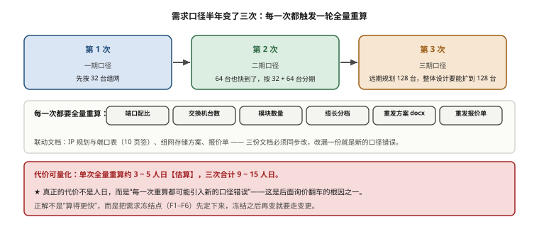
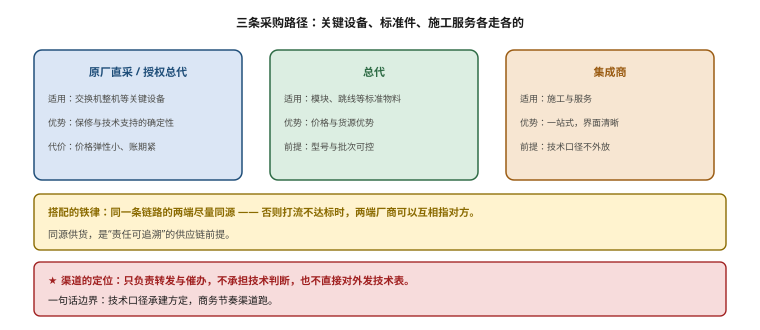

# 第 17 章　项目全周期交付管理

> **本章一句话结论**：交付管理的全部难点，不在设备，在口径——需求口径、询价口径、界面口径、工期口径，四个口径没锁死，技术再对也交付不了。

## 17.1　需求测算与方案确认



**图 17-1　需求口径变了三次：每一次都触发一轮全量重算**　｜　**读图要点**：口径半年内变了三次（32 台 → 32+64 台分期 → 远期 128 台），每一次都要全量重算端口配比、交换机台数、模块数量、缆长分档，并重发方案与报价单。**单次约 3~5 人日，三次合计 9~15 人日；真正的代价不是人日，而是每一次重算都可能引入新的口径错误** —— 这是后面询价翻车的根因之一。

### 17.1.1 工程问题：需求改了三次，BOM 重算了三次

本案例的规模口径，半年内变了三次：

- 第 1 次：客户说"先按 **32 台**组网"。
- 第 2 次：客户说"64 台也快到了，整体要按 **32 + 64 台**分期"。
- 第 3 次：客户说"远期规划是 **128 台**，整体设计要能扩到 128 台"。

三次口径变更，笔者**每一次都做了全量重算**——重算端口配比、重算交换机台数、重算模块数量、重算缆长分档、重发方案 docx、重发报价单。事后复盘，这是第 17.8 节那个大翻车的**根因之一**。

代价可以量化：一次全量重算涉及 IP 规划与端口表（10 页签）、组网存储方案、报价单三份文档的联动修改，单次约 3–5 人日【估算】。三次就是 9–15 人日，**而且每次都可能在重算中引入新的口径错误**。

### 17.1.2 最小必要原理：需求测算是一条链，不是一堆数

智算网络的需求测算，本质是一条**从卡数出发的单向链**，每一环都由上一环唯一决定：

```
卡数 / 节点数
   ↓ × 单机网卡数
计算网端点总数
   ↓ ÷ 单 Leaf 下联容量（64）
Leaf 台数（同轨拆机）
   ↓ Spine = Leaf / 2（1:1 条件）
Spine 台数
   ↓ 每对 Leaf-Spine 上联条数 × 对数 × 2 端
上联模块数
   ↓ 端点 + 上联端点
光模块总数
   ↓ 缆长模型（跨列 × 2.8 + 柜位差 × 0.6 + 垂直 9.5，向上取 5 m 档）
跳线分档数量
```

**这条链的关键性质是"单向"**：改一个上游参数，下游全部要重算；但改一个纯数量参数（如缆长分档的分布），不影响上游结构。**把这两类变更区分开，是交付管理省掉一半工作量的核心方法**（见 17.8 的"变更分级"）。

本案例 96 台口径的完整链条落点：Leaf 16 + Spine 8 + 存储 2 = 26 台交换机；光模块 3072 只；算力 MPO 1536 条【实测】。

### 17.1.3 方案确认：必须有"冻结点"

需求测算做完，必须进入**方案冻结**。冻结点的定义是：**此后任何变更，都要走变更流程，而不是随手改。** 本案例前三次口径变更都没有冻结点，"随手改"导致了全量重算和后续的询价灾难。

一个可操作的冻结点清单：

```
方案冻结清单（签认项）
  F1  规模口径：台数 / 卡数 / 分期安排
  F2  拓扑口径：Leaf / Spine 台数、每对上联条数、收敛比
  F3  端口口径：端口分段（P01–P64 下联 / P65–P128 上联）、端口表
  F4  物理口径：缆长模型、U 位（柜底）、机柜编号规则
  F5  接入口径：存储采用 1 分 4 还是直连、每节点几条 200G
  F6  数量口径：各物料数量与分档
  ─────────────────────────────────
  以上六项任一项变更 → 触发变更流程，重新评估下游影响
```

**没有冻结点，就没有"定稿"**；没有"定稿"，三份报价就永远对不齐——这正是本案例比价阶段的真实困境。

### 17.1.4 一个可复用的需求测算示例（96 台口径）

把 17.1.2 的链条套上本案例的数，走一遍：

```
输入：96 台服务器，每台 8 卡、8 张 400G 计算网卡
步骤 1  计算网端点 = 96 × 8 = 768 条下联
步骤 2  每 Leaf 下联上限 64 口 → 每轨需 ≥ 96/64 = 1.5 → 拆 2 台 Leaf
        8 轨 × 2 = 16 台 Leaf
步骤 3  每台 Leaf 下联 = 768 / 16 = 48 口
步骤 4  上联取 48 口（8 Spine × 6 条/对）→ 上行 16 × 48 = 768 条
步骤 5  收敛比 = 768×400 / 768×400 = 307.2 / 307.2 = 1 : 1
步骤 6  模块 = 下联 768 + Leaf 上联 768 + Spine 侧 768 + 服务器侧 768 = 3072 只
步骤 7  缆长按模型分档 → 跳线分档数量
```

**注意步骤 3 与步骤 4 的关系**：每台 Leaf 下联实用 48 口，上联也按 48 口配——因为拓扑要求"每台 Leaf 接每台 Spine"，**上联口数必须是 Spine 台数的整数倍**（48 ÷ 8 = 6 条/对）。这个整除性检查看着琐碎，却是需求测算里最容易漏的一步：第 16 章记过一个真实漂移——Spine 台数一度按"上联 1024 条 ÷ (128 × 75%) 向上取整"定为 11 台，但 64 ÷ 11 除不尽，每台 Leaf 到每台 Spine 的上联条数无法均匀摊分，最终改定为 16 台。**只要需求测算时把这一步的整除性检查做掉，下游文档就不会带病传播。**

需求测算的产物，是后面所有文档（IP 规划与端口表、报价单、布防图）的共同上游。**上游错一个数，下游三份文档全错。** 所以 17.1 的第一条纪律是：**测算链条上每一步都写算式，不写"经验值"。**

## 17.2　POC / 选型测试的测试项与验收标准

### 17.2.1 选型对比：POC 要测什么

POC（Proof of Concept，概念验证）不是"跑个 demo 看看行不行"，而是**把验收指标提前在候选设备上跑一遍**。本案例的测试项与验收标准如下。

**表 17-1　POC 测试项与验收标准**

| 层级 | 测试项 | 验收标准 | 工具 |
|---|---|---|---|
| 物理层 | 端口 link up、DDM 光功率 | 全部端口 up，光功率在模块规格范围内 | 交换机 CLI / 光功率计 |
| 链路层 | RDMA 打流（单端口） | ≥ 360 Gb/s，变异 ≤ 5% | `ib_write_bw` / `perftest` |
| 单机 | 8×400G all_reduce_perf | busbw ≥ 中位数 90% 档 | `nccl-tests` |
| 多机逐级 | 2/4/8/16/32/96 台 | 每级 `#wrong = 0` | `nccl-tests` |
| 全规模 | 768 卡 busbw | ≥ 320 Gb/s/卡（80% 线速） | `nccl-tests` |
| 一致性 | 8 条轨 busbw 偏差 | < 3% | `nccl-tests` 逐轨统计 |
| 长稳 | 24 h 混合压力 | 利用率 ≥ 90%，提交时间曲线 | 训练/压测框架 |
| 无损 | PFC / ECN / QoS 三侧一致 | 提供三侧参数一致性证据 | 交换机 + 网卡配置导出 |
| 健康 | DCGM L3/L4、NVLink、GPU 挂载 | 全绿 | DCGM / `nvidia-smi topo -m` |

### 17.2.2 验收标准的三条硬规则

POC 的验收标准，必须服从第 16.6 节讲过的判别力三要素。落到 POC 上，就是三条硬规则：

1. **口径明确。** 单卡还是节点聚合还是集群，写死；Gb/s 还是 GB/s，写死（本案例 300 GB/s 事故就是这里没写死）。
2. **数值物理可达。** 320 Gb/s/卡 = 400 × 80%，算得出来。凡是要"算一下才发现不可能"的数，一律先算再写。
3. **偏差类指标优先于单点极值。** 8 条轨偏差 < 3%，比"最好的那条轨跑到多少"有判别力得多。

**POC 的一个真实用途**：本案例在 POC 阶段就发现"某候选交换机不支持直插 100G QSFP28 模块，只能用 4×100G 拆分实现"（参数卡 §6.4）。这个问题如果拖到交付阶段才发现，存储物理隔离的整个方案都要改。**POC 的价值，就是把交付期的事故提前到选型期暴露。**

### 17.2.3 POC 怎么组织才有效

POC 的组织方式，决定了它能不能真的暴露问题。三条经验：

- **用"承建方环境 + 承建方数据"跑，不用厂商环境。** 厂商 POC 报告是【原厂】，可信度中高，但不是笔者的现场。**只有在承建方拓扑上跑出来的数据，才是【实测】。** 本案例明确要求"逐级规模 2/4/8/16/32/96 台"必须在实际到货设备上跑。
- **POC 要跑到"验收口径"，而不是"能跑通"。** 能跑通 `nccl-tests` 和"8 条轨偏差 < 3%"是两回事。POC 阶段就要按验收指标跑，否则交付阶段第一次看到偏差数据时，已经来不及改拓扑。
- **POC 结论要形成"偏差清单"。** 每一条"满足/偏离/替代/不满足"都要留档，作为后续比价与合同附件的依据。**POC 不是一次演示，是一次带证据的技术尽调。**

## 17.3　供应链与交期管理

### 17.3.1 工程问题：32 台先到，64 台 12 月到

本案例最现实的约束：**首批 32 台服务器（华硕）先到货，剩余 64 台（超威）要 12 月才到。** 但组网设备必须"现在"就决定采购方案。这就产生了一个必须回答的问题：

> **要不要只采购够 32 台用的组网设备，二期再补？**

### 17.3.2 选型对比：全期到位 vs 最省一期

**表 17-2　分期组网两方案对比（计算网）**

| 维度 | 方案一：全期到位 | 方案二：最省一期 |
|---|---|---|
| 一期 Spine 台数 | 8 台全上 | 4 台 |
| 一期 Spine 端口使用 | 每台 32 口用、余 96 口预留 | 每台 64 口用满 |
| 二期扩容动作 | 直接接二期 Leaf，**零改线零断网** | +4 Spine，**重配旧 Leaf 的 256 条上联（4→8 Spine）** |
| 二期业务中断 | 0 | **4–8 h** |
| 一期投入 | 约 1 185 万元 | 约 873 万元（省 312 万元） |
| 全周期额外成本 | — | **多 23 万元（改造费 + rebalance 费）** | 
| 来源 | 【实测】 | 【实测】 |

存储侧同理：

**表 17-3　分期组网两方案对比（存储网）**

| 维度 | 方案一：全期到位 | 方案二：最省一期 |
|---|---|---|
| 一期并行文件存储 | 3 节点、300 TB 一期全上 | 1 节点、100 TB 起步 |
| 二期扩容动作 | 直接扩 | +2 节点，需 rebalance |
| 二期业务中断 | 0 | **停写 2–6 h** |
| 来源 | 【实测】 | 【实测】 |

**甲方最终选了方案一。** 理由只有一条：**全年 99.5% 可用率要求。**

这条理由值得单独记住。方案二一期省 312 万元，但换来 4–8 h 的断网；**在 99.5% 可用率约束下，4–8 h 的计划外/计划内停机的价值，远远超过 312 万元。** 算一下：

```
全年 99.5% 可用率 ⇒ 允许停机 = 365 × 24 × 0.5% = 43.8 h/年
一次 4–8 h 的断网 = 吃掉全年停机预算的 9%–18%
若同期还有别的维护窗口，预算立刻吃紧
```

**⇒ 方法论：可用率 SLA 是决定分期策略的那把尺子。** 不先问 SLA 就问"要不要省一期"，是把技术题当成了算术题。

### 17.3.3 更有参考价值的第三种做法：96 台阶段不补购 Spine

项目后期，出现了一个比"方案一/方案二"都更省事的做法，值得单独写。

背景：一期已经按方案一上了 8 台 Spine（SP01–08）。到二期 96 台阶段，需要 8 台 Spine 提供 768 条上联——**而这 8 台一期已经到位了**。于是二期的采购包变成：

```
二期 96 台阶段采购包 = 8 台 Spine（一期已到位，本包不重复采购）+ 16 台 Leaf
SP09–16（第 9–16 台 Spine）→ 随三期扩容再采购并启用
关键：线缆与光模块数量零变化
```

为什么"零变化"？**因为清单里的链路数，本来就是按 8 台 Spine 的口径算的。** 二期只是把整机采购行里"补购 8 台 Spine"这一行留着（暂不启用），链路、模块、缆长分档一个数都不用动。

**⇒ 方法论：先看清"变的是整机还是链路"，再决定要不要重算 BOM。** 这是第 16.1 节"链路与整机解耦"原则的直接兑现。整机行可以留待后期，链路账一旦按终态口径算好，就不必随整机采购节奏反复重算。

### 17.3.4 光模块批次一致性：最隐蔽的供应链风险

光模块最容易被当成"标准件"——型号一样、单价一样，似乎批次无所谓。实际不是。**同一型号、不同批次的光模块，DDM 读数（发射/接收光功率、温度）和误码表现可能有细微差异。** 在一张需要"8 条轨偏差 < 3%"的验收表面前，混批是直接的威胁。

三条管理动作：

1. **按"侧别 + 批次"分账到货。** 服务器侧 768 只与交换机侧 2304 只分开；交换机侧再按 Leaf 下联/上联、Spine 侧分账。
2. **同一条链路两端尽量同批次。** 至少同一台 Leaf 上的模块尽量同批，避免"同机混批"。
3. **到货即抽检。** 按批次抽样做 DDM 读数与打流，异常批次整批退。

**批次一致性问题的麻烦在于：它不会在开箱时暴露，只会在验收跑偏差指标时暴露。** 到那时再退货换货，工期已经赔进去了。

### 17.3.5 交期管理的三条一般原则

除光模块批次外，交期管理还有三条可复用的原则。

**原则一：盯关键路径物料，而不是盯"最贵"的物料。** 本案例的关键路径物料不是交换机（贵但交期可控），而是**定制长度的 MPO 跳线和 1 分 4 分支缆**——它们要按分档定制、有最小起订量、交期比标准件长 1–3 周。**贵的不一定卡你，定制的才会卡你。**

**原则二：分批到货要"先到先组网、后到后接入"，而不是"等齐再干"。** 本案例 32 台先到、64 台 12 月到。若等 96 台齐了再组网，等于把一期的组网工期平白推迟。正确做法是：**一期按 32 台口径先把 Leaf-Spine 搭起来，二期 64 台到货后按 17.3.3 的"不补购 Spine"方式增量接入。** 这样一期的组网能力先上线，二期只是"插线 + 配置"。

**原则三：交期谈判要和价格一起谈。** 见第 16.3 节——把愿意接受的交期作为议价筹码，交期长一点的批次，价格通常更友好；反之，赶交期要付溢价。**把"什么时候到"和"多少钱"当一对变量谈，而不是只砍价。**

**三条原则背后是同一个认知：供应链管理的目标不是"最短交期"，而是"最短的关键路径 + 最低的停工风险"。** 为了压非关键物料的交期而付溢价，是浪费；让关键路径物料晚到一天，是停工。

## 17.4　三条采购路径：原厂直采 / 总代 / 集成商

**表 17-4　三条采购路径对比**

| 路径 | 优势 | 劣势 | 适用 |
|---|---|---|---|
| 原厂直采 | 货真、保修清晰、技术支持强 | 价格高、账期短、交期不可控 | 关键设备、原厂锁定型号 |
| 总代 | 价格较优、货源稳定 | 技术支持弱、技术判断能力有限 | 标准化程度高的物料（模块、线缆） |
| 集成商 | 一站式、含施工与服务 | 加价、技术能力参差、责任界面易模糊 | 需要"设备 + 施工 + 服务"打包 |

### 17.4.1 渠道的合理定位

本案例在渠道上吃过一次大亏（17.8 节），收口后的结论很明确：

> **渠道只负责转发与催办，不承担技术判断，也不应直接对外发技术表。**

拆开说三层意思：

- **渠道不承担技术判断。** 渠道的强项是商务（价格、账期、交期），不是"这个方案能不能组网"。让渠道替笔者判断技术，等于让不跑现场的人定方案。
- **渠道不直接对外发技术表。** 技术表（技术需求规格书）由承建方出、承建方发、承建方收应答。渠道夹在中间转发技术表，会引入二次失真——本案例询价灾难的第一层失真，就发生在"承建方 BOM → 渠道 → 厂商"这条链上。
- **渠道负责路由与催办。** 把"文件在几方之间怎么流转、谁什么时候回"交给渠道，这是承建方该用渠道的地方。

**一句话边界：技术口径承建方定，商务节奏渠道跑。**



**图 17-2　三条采购路径：关键设备、标准件、施工服务各走各的**　｜　**读图要点**：关键设备走原厂直采或授权总代（保确定性），标准化物料走总代（保价格与货源），施工服务走集成商（保界面）。**一条铁律：同一条链路的两端尽量同源** —— 否则打流不达标时，两端厂商可以互相指对方。渠道的定位是转发与催办，不承担技术判断。

### 17.4.2 怎么组合这三条路径

实际项目中，三条路径通常是**搭配**使用的，而不是二选一：

```
关键设备（交换机整机）    → 原厂直采 或 原厂授权总代（保修与技术支持的确定性优先）
标准化物料（模块、跳线）  → 总代（价格与货源优势）
施工与服务                → 集成商（一站式，但界面要划清）
```

搭配的一条铁律：**同一条链路的两端，尽量同源。** 例如某条 Leaf-Spine 链路，如果 Leaf 侧模块走原厂、Spine 侧模块走第三方兼容，一旦打流不达标，两端厂商可以互相指对方——**同源供货，是"责任可追溯"的供应链前提。**

另一个反例：本案例曾考虑"服务器侧模块随服务器走、交换机侧模块随组网走"。这个拆分本身是对的（节奏不同），但要额外约定一条：**当两侧模块出现兼容性问题时，由谁牵头排查。** 否则会出现"服务器方说是模块问题、组网方说是服务器网卡问题"的僵局。

## 17.5　里程碑、验收与质保

**表 17-5　交付里程碑（示意）**

| 里程碑 | 交付物 | 门禁条件 |
|---|---|---|
| M1 方案冻结 | 组网存储方案 docx、定稿报价单 | 17.1 的 F1–F6 签认 |
| M2 设备到货 | 交换机 / 模块 / 线缆到货，批次抽检通过 | 抽检通过、数量核对无误 |
| M3 施工完成 | 上架理线、MPO 端接、链路初测 | 全部端口 up、光功率台账完整 |
| M4 联调完成 | RoCEv2 PFC/ECN 联调、ECMP 验证 | 三侧参数一致性证据 |
| M5 压测完成 | 逐级 NCCL 压测、24 h 稳定性 | 每级 `#wrong = 0`、偏差 < 3% |
| M6 验收 | 验收报告、证据包（留存 180 日） | 验收标准全部通过 |
| M7 质保启动 | 维保手册、Runbook | 培训完成 |

**质保的关键条款：5 年维保、99.5% 可用率框架。** 这里有两个坑：

- **"可用率"的定义必须写死。** 是设备可用率还是业务可用率？计划维护窗口算不算停机？本案例要求把"计划内维护"与"故障停机"分开统计，避免"用计划维护偷走停机预算"。
- **维保范围要覆盖"软件"还是只覆盖"硬件"。** 无损网络的 PFC/ECN 参数调优、NCCL 调优这类"服务"，是否在 5 年质保内？本案例明确为"框架"，即服务范围与响应时限另立附件。

### 17.5.1 验收阶段最常见的三个坑

1. **"验收即最后一次压测"的误解。** 验收不是"再跑一遍看看行不行"，验收是"对照合同三件套（单位+口径+测量方法）逐条出证据"。前者靠运气，后者靠流程。
2. **证据留存不到位。** 本案例合同要求证据留存 180 日。验收时如果拿不出某一次逐级压测的原始日志，等于这一级没跑过。**证据要在测试当场就归档，不能等验收时补。**
3. **质保起算点含糊。** 5 年维保从"设备到货"起算还是"验收通过"起算？两者可能差几个月。本案例明确按**验收通过**起算，避免"设备在库房躺了三个月，质保白扣三个月"。

## 17.6　交付界面划分：必须逐条书面确认

### 17.6.1 工程问题：调不通的时候，谁负责？

交付现场最经典的一问："这条链路调不通，是模块的问题、跳线的问题，还是没端接好的问题？" 如果界面没划清，答案就是**三家互相看**。

### 17.6.2 四方界面（本案例真实分工）

**表 17-6　交付界面划分表**

| 工作项 | 施工队（或设备商总包） | 设备供应商 | 承建方 | 服务器方 |
|---|---|---|---|---|
| 桥架敷设 | ● 执行 | | ○ 设计路径 | |
| 上架理线 | ● 执行 | | ○ 设计布防 | |
| MPO 端接 | ● 执行 | | ○ 端接标准 | |
| 链路初测 | ● 执行 | | ○ 验收判定 | |
| 交换机厂商调测支持 | | ● 执行 | ○ 标准制定 | |
| 存储安装部署演练 | | ● 执行 | ○ 复核 | |
| 模块线缆到货测试报告 | | ● 提供 | ○ 验收 | |
| 服务器加电 + 网卡侧端接 | | | ○ 复核 | ● 执行 |
| 端口表设计 | | | ● 执行 | |
| 无损参数模板 | | | ● 执行 | |
| ECMP + NCCL 压测 | | ○ 配合 | ● 执行 / 判定 | |
| 验收文档 | | ○ 提供证据 | ● 执行 | |
| 5 年维保 99.5% 框架 | | ○ 部分 | ● 主责 | |

> ● = 主责执行，○ = 配合/审核。**每一行必须在开工前逐条书面确认，口头共识不算数。**

### 17.6.3 一个真实的口径转变：转包但保留技术主导权

本案例为快速交付，**RoCE 调测改由网络设备厂商派人执行、承建方配合**。但这里有个措辞问题：文字上不能显得"承建方什么都不做"。于是把角色重新拆分：

```
执行角色   = 网络设备厂商（派人到现场做 PFC/ECN 联调）
承建方保留四角色：
  ① 调测标准与参数口径制定   —— 参数模板、门限值由承建方定
  ② 过程督导                 —— 现场执行过程由承建方督导
  ③ 结果复核                 —— 调测结果由承建方复核
  ④ 验收判定                 —— 是否通过由承建方判定
  +  路由 / BGP 及跨设备变更须经承建方审核
```

**这就是"转包但保留技术主导权"的写法样本。** 它的要点是：把"谁动手"和"谁定标准、谁判定"分开。动手可以转包，标准和判定权不能转包。第 16 章的《技术需求规格书》里之所以要写"组网可实施性声明"，本质也是把判定权留在技术侧。

### 17.6.4 界面模糊的三种典型纠纷

界面没划清时，现场几乎一定会在这三处卡住：

- **纠纷一：光模块 vs 跳线。** 链路不通，是模块坏还是跳线坏？如果模块和跳线由两家供货，两家都会说自己没问题。**解法：抽检时用"替换法"定位——但前提是界定"谁提供替换件"。**
- **纠纷二：端面污染的责任。** 一条链路端面污染，是施工队端接时弄脏的，还是到货时就脏的？**解法：到货即做端面检测并留影像台账，插拔前后各测一次，责任归属看时间戳。**
- **纠纷三：服务器侧网卡端接。** 服务器网卡侧的光纤端接，是服务器方做还是施工队做？本案例约定为**服务器方执行、承建方复核**。若没有约定，就会出现"服务器方说这不是我的活、施工队说服务器没加电我进不去"的对峙。

**这三种纠纷的共同点：没有一个是技术难题，全是界面问题。** 而界面问题的解法只有一个——**开工前逐条书面确认 + 过程留痕**。

## 17.7　工期压缩的物理极限

### 17.7.1 最小必要原理：任务按压缩特性分三类

工期能不能压，不取决于"想不想加班"，取决于**任务的瓶颈类型**。本案例把任务分成三类：

**表 17-7　任务压缩特性分类**

| 类型 | 特征 | 代表任务 | 能否加人压缩 |
|---|---|---|---|
| **人力并行型** | 瓶颈是人，加人就能加速 | 开箱、上架、布线、链路验证 | **能**，但有极限 |
| **设备串行型** | 瓶颈是设备，人再多也要排队 | PXE 批量装机（按批）、NCCL 分级测试 | **不能**，机器是瓶颈 |
| **物理时钟型** | 瓶颈是物理时间本身 | 24 h 稳定性测试 | **绝对不能** |

### 17.7.2 一个具体的压缩测算：600 条布缆

```
基线：600 条布缆，3 组并行，2 天完成
极限：3 组并行压到 1.5 天（增加人手、延长单班次）
不可再压的理由：
  · 机柜 / 桥架作业面有限，一组超过 4–5 人会互相干扰
  · 人多手杂 → MPO 污染与错插 → 返工（第 1 章那次端面污染事故）
  · 端接与初测需要"干净环境 + 串行验证"
```

**设备串行型的典型例子**：PXE 批量装机按批进行，一批机器起来、验证、再起下一批，加人不改变"批"的串行性；NCCL 逐级测试（2→4→8→16→32→96 台）必须从低到高逐级跑，每一级的耗时是设备/网络决定的，加人没用。

**物理时钟型的典型例子**：24 h 稳定性测试，就是 24 h，压不了。

### 17.7.3 双轨口径：内部真实最小值 vs 对外承诺

把所有任务串起来，本案例机房内的**理论极限约为 6 个工作日**【估算】。再往下压不可行，原因是三条硬约束：机柜/桥架作业面限制、MPO 污染与错插返工风险、验收测试需干净环境串行。

但对外**建议承诺 10 个工作日（8 天 + 缓冲）**。理由：

- **缓冲是给"不可压缩项"的。** 24 h 稳定性测试一旦失败要重跑，缓冲吸收这次重跑。
- **缓冲是给"人为失误"的。** 一次 MPO 错插的返工，吸收在缓冲里，而不是变成延期。
- **内部极限是"一切顺利"的数字，对外承诺是"含合理冗余"的数字。** 两者不是矛盾，是两个用途。

```
内部真实最小值（机房内）  ≈ 6 个工作日     ← 用于内部排产、判断"还有没有余量"
对外承诺工期              = 10 个工作日     ← 8 天 + 缓冲；用于对外交期、合同
```

**为什么不能对外承诺 6 天？** 因为一旦按 6 天承诺，任何一次 24 h 测试重跑、任何一次错插返工，都会直接变成违约。**双轨口径是把"极限"和"承诺"分开管理**，不是虚报工期。

> **冷幽默一处**：工期压缩这事，唯一能靠加人无限压缩的，是会议室里的人数；机房里的机器不吃这一套。

## 17.8　典型翻车案例复盘：把完整 BOM 发出去询价

这是本案例**最大的教训**，也是本章篇幅最重的一节。

### 17.8.1 发生了什么

笔者把**完整的 BOM 询价表**直接发给渠道，让厂商"逐行填单价"。结果：

- **厂商只能按自己的产品线硬套。** 一家报价停留在旧架构：64 口存储交换机、100G 直连、节点 2×400G 口径——和笔者定稿的 128 口、1 分 4、12×200G 完全对不上。
- **算力 MPO 被统一按 30 m 报价。** 本案例最长档是 35 m，**140 余条链路接不上**；该渠道的统一 30 m 口径相比承建方四档基准**多花约 29 万元**。
- **漏报 1 分 4 分支光缆 48 条。**
- **存交↔节点**，一家报 8 条 400G，与定稿的 **12 条 200G-SR4** 矛盾。
- **CAT6 行**，行名写 10M、规格写 20 米、单价按 20 元——**一行三个数互相打架**。
- **业务网 LC 无 35 m 档**，19 根远端链路接不上；业务交换机报 6 台 vs 定稿 4 台。
- **存储节点报 4 台 vs 定稿一期 3 台**，等于**提前多花约 85 万元**。
- **运维服务器报 16 万元/台 vs 基准 3.5 万元/台。**
- **两份报价的存储架构完全互斥**（64 口 vs 128 口、直连 vs 1 分 4、6×400G vs 12×200G）。**比价前必须先统一到定稿口径**，否则比出来的是假数。

**最要命的是责任风险**：在"填表"模式下，厂商可以说"**我是按你给的表报的**"。于是所有集成返工成本，全落在承建方头上。

### 17.8.2 正确做法：一条可复用的流程

```
承建方出《技术需求规格书（厂商中立版）》
        │   只写：接口 / 速率 / 距离分档 / 组网约束 / 接口边界 / 兼容性要求
        │   不写：型号
        ↓
厂商回《技术应答表》
        │   逐条：满足 / 偏离 / 替代方案 / 不满足
        │   + 影响 + 数量 + 单价 + 组网可实施性声明
        ↓
承建方按《影响矩阵》横向评审
        │   先判"能否组网"，后比价；不比总价
        ↓
每段链路指定唯一供货方 + 唯一调通责任方
        │   避免两家模块/跳线重复采购
        │   避免调不通时互相推诿
```

四个动作，缺一不可：

1. **承建方出规格书，不出 BOM。** 规格书是厂商中立的技术需求，不暴露承建方选择；BOM 是内部核算表。
2. **厂商回"应答表"，不做"填表"。** 应答表要求厂商对每一条给出"满足/偏离/替代/不满足"以及**组网可实施性声明**——把技术责任推回给厂商。
3. **按影响矩阵横向评审，先判"能否组网"，后比价。** 两份竞标方案如果存储架构互斥，第一件事不是比总价，而是先各自归到定稿口径。
4. **每段链路指定唯一供货方 + 唯一调通责任方。** 一条链路的两端模块、跳线由同一方负责，杜绝"两家各供一半，调不通互推"。

### 17.8.3 根因复盘：两条通则

**根因 1：方案演进没有冻结点。**

32 台单期 → 32+64 分期 → 128 台整体，三次口径变更都做了全量重算。正确做法是**变更分级**：

```
变更分级处理
─────────────────────────────────────────────
结构性变更（触发全量重算）：
  · 存储接入方式改（1 分 4 接入）
  · U 位改柜底 → 缆长垂直段 +2 m
  · Spine 扩至 16 → 上联改 4 条/对
  · 互联 IP 重编码（/31 编码规则）
─────────────────────────────────────────────
纯数量变更（只走"单价 × 数量"调整）：
  · 服务器台数变化
  · 缆长分档的分布变化
  · 某类物料数量增减
─────────────────────────────────────────────
勘误（加 ECN 勘误，不重发整表）：
  · 单价笔误、行名与规格不一致等
```

**加 ECN（Engineering Change Notice，工程变更通知）勘误，不重发整表**——这条特别重要。本案例一次 CAT6 行名/规格/单价三处矛盾，就是靠"整表重发"去修的；正确做法是发一张勘误单，其余行不动。

**根因 2：询价方式本身错了。** 见 17.8.2——把 BOM 当询价表发出去，是这次翻车的直接原因。

**这两条通则的价值，超出了本案例。** 任何"边设计边采购"的智算项目，都会遇到"方案在变、货要早定"的矛盾；把变更分级、把询价流程标准化，是化解这个矛盾的通用方法。

## 17.9　检查清单

**A. 需求与方案阶段**

- [ ] 需求测算按"卡数 → 端口 → 交换机 → 模块 → 缆长"单向链推导，每环有算式
- [ ] 六项冻结口径（规模/拓扑/端口/物理/接入/数量）签认
- [ ] 变更分级规则已定：结构性 vs 纯数量 vs 勘误
- [ ] 勘误走 ECN 单，不重发整表

**B. POC / 选型阶段**

- [ ] POC 测试项覆盖物理层到健康检查
- [ ] 验收标准口径明确（单卡/节点/集群、Gb/s vs GB/s 写死）
- [ ] 数值先算再写，确认物理可达
- [ ] 偏差类指标（8 轨 < 3%）纳入
- [ ] 候选机型逐型号核对"是否支持 X"（如直插 100G、1:1 AOC）

**C. 供应链与交期阶段**

- [ ] 分期方案与可用率 SLA 一起评估（不先问 SLA 不定分期）
- [ ] 分清"变的是整机还是链路"，再决定是否重算 BOM
- [ ] 光模块按侧别 + 批次分账到货
- [ ] 同链路两端尽量同批次
- [ ] 到货按批次抽检 DDM 与打流，异常整批退

**D. 采购与询价阶段**

- [ ] 对外发《技术需求规格书（厂商中立版）》，**不发 BOM**
- [ ] 厂商标配《技术应答表》：满足/偏离/替代/不满足 + 组网可实施性声明
- [ ] 按《影响矩阵》横向评审，**先判能否组网，后比价**
- [ ] 每段链路指定唯一供货方 + 唯一调通责任方
- [ ] 渠道只转发催办，不承担技术判断、不直接对外发技术表

**E. 交付与工期阶段**

- [ ] 四方界面（施工队/设备商/承建方/服务器方）逐条书面确认
- [ ] 转包时保留"标准/督导/复核/判定"四角色 + 路由变更审核权
- [ ] 任务按三类（人力并行/设备串行/物理时钟）分类，不承诺压不动的项
- [ ] 内部极限（约 6 天）与对外承诺（10 天）双轨
- [ ] 里程碑门禁条件明确，验收证据留存 180 日
- [ ] 质保条款写死"可用率定义"与"服务范围"

## 17.10　成本与工期影响

**表 17-8　本章决策的成本与工期影响**

| 决策 | 成本影响 | 工期影响 |
|---|---|---|
| 分期方案选"全期到位" | 一期多投约 312 万元 | **避免二期 4–8 h 断网**，满足 99.5% SLA |
| 96 台阶段不补购 Spine | 整机行延后，链路零重算 | 线缆/模块数量零变化，无额外工期 |
| 缺乏冻结点导致三次全量重算 | 无直接成本 | **多耗约 9–15 人日**，且引入新错误 |
| 完整 BOM 发渠道询价 | 统一 30 m 多花约 29 万元、存储多花约 85 万元 | **全面返工重来**，比价阶段整体延后 |
| 改用规格书 + 应答表 + 影响矩阵 | 前期流程成本增加 | **一次做对，避免比价返工** |
| 交付界面逐条书面确认 | 零成本 | **避免调不通时三方互推** |
| 工期双轨口径（6 天 / 10 天） | 零成本 | 承诺工期含缓冲，降低违约风险 |

一句话：**本章里"省下的返工"远大于"省下的采购差价"。** 询价流程一次做对，省掉的是整轮比价；界面一次划清，省掉的是现场扯皮；工期的缓冲，省掉的是违约。

## 本章要点回顾

- **需求测算是一条单向链**：卡数 → 端口 → 交换机 → 模块 → 缆长。方案必须有冻结点；没有冻结点，就没有"定稿"。
- 分期决策的尺子是**可用率 SLA**。本案例 99.5% 要求下，方案一（全期到位，一期多投约 312 万元）胜过方案二（省一期，但二期断网 4–8 h）。
- 第三个做法更巧：**96 台阶段不补购 Spine，线缆与光模块数量零变化**——先看清"变的是整机还是链路"，再决定是否重算 BOM。
- POC 的价值是把交付期事故提前到选型期暴露；验收标准必须口径明确、数值可达、偏差类优先。
- 采购只有三条路：原厂直采 / 总代 / 集成商。**渠道只转运催办，不承担技术判断。**
- 交付界面四方（施工队/设备商/承建方/服务器方）必须逐条书面确认。转包时保留"标准/督导/复核/判定"四角色，是"转包但保留技术主导权"的标准写法。
- 工期按三类处理：人力并行型可压（600 条布缆 2 天 → 极限 1.5 天），设备串行型压不动，物理时钟型（24 h）绝对不可压。**内部极限约 6 天，对外承诺 10 天**，双轨并行。
- 本案例最大的教训：**把完整 BOM 发出去"填表"询价**——厂商按旧架构硬套、统一 30 m 多花约 29 万元、存储多花约 85 万元、架构互斥无法比价、责任还落在承建方。根因两条：**方案演进无冻结点**、**询价方式本身错了**。正解是《技术需求规格书》→《技术应答表》→《影响矩阵》→ 每段链路唯一责任方。
