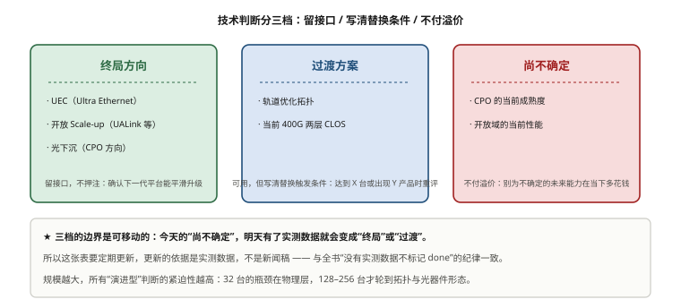
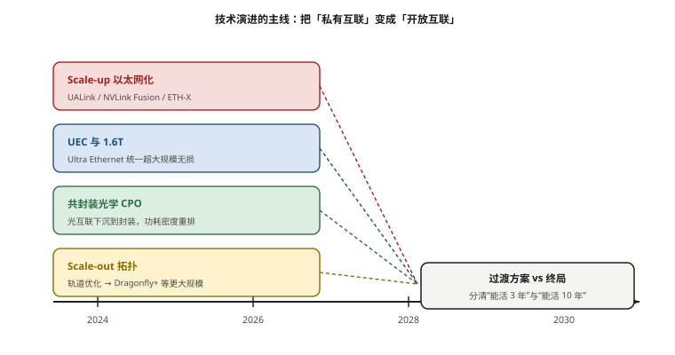

# 第 18 章　技术趋势与架构演进

> **本章一句话结论**：未来五年网络架构只有一条主线——把"私有互联"变成"开放互联"，其余的演进都是这条主线的注脚。

## 18.1　Scale-up 的以太网化

### 18.1.1 工程问题：验收刚过，客户问了一个更狠的问题

本案例验收刚过，客户问的不是"性能还能不能再提"，而是：

> "这些设备三年后会不会变成一堆废铁？"

这个问题很实在，因为智算中心的设备是重资产——本案例网络设备与材料就约 1 980 万元量级【市场参考】。一个技术负责人如果回答不了"哪些会过时、哪些不会"，就没法说服自己为什么现在买。

本章不做名词罗列，只回答一个问题：**未来几年，哪些东西会变、哪些不会变、哪些还不确定。** 第一个、也是最确定的一个变量，是 Scale-up 的以太网化。

### 18.1.2 最小必要原理：NVLink 的护城河到底是什么

要理解 Scale-up 以太网化为什么重要，先要看清 Scale-up（纵向扩展，即单机/单域内 GPU 互联）和 Scale-out（横向扩展，跨节点互联）的区别。

```
Scale-up（域内）  ： NVLink / NVSwitch，域内高带宽、低延迟、内存语义
                    本案例：域内 NVLink 带宽约 900 GB/s 双向【设计】
Scale-out（跨节点）： RoCEv2 / IB，400G 网卡，约 45 GB/s 实测
两者差约 20 倍 —— 这就是"TP 不出机箱"的物理原因
```

**NVLink 的护城河，不在带宽数值，而在两件事：**

1. **它是私有协议。** 要组 NVLink 域，必须用 NVIDIA 的 GPU + NVSwitch + 配套，整套绑定。
2. **它同时是"内存语义 + 同步"的载体。** 域内那么多通信原语（比如域内 AllReduce）走的是内存语义访问，延迟到 ~1 μs 量级，这是以太网做不到的。

**所以 NVLink 的护城河本质是"锁定"**：你要 8 卡全互联的域，就得买整套；想扩大域、想换供应商，做不到。

**这里还有一个容易被忽略的点：域的大小本身就是一种资源。** 模型的张量并行（TP）必须在低延迟、高带宽的域内跑，域越大，单次 TP 能切的层就越多、单机能装的模型就越大。所以"域能不能扩"不是一个纯网络问题，它直接决定了**模型能不能在不拆机的情况下装进去**。这也是为什么 scale-up 的演进比 scale-out 更牵动架构——**scale-out 决定你能连多少台，scale-up 决定你一台能有多大。**

从历史看，scale-up 的边界一直在扩：从早期几张卡的全互联，到 NVSwitch 交换式域，再到今天讨论的"跨机架 scale-up 域"。**每一次边界扩张，都是一次"私有"与"开放"的博弈。** 而眼下这一轮，是第一次出现成规模的开放挑战者——这就是本章把它列为首要变量的原因。

### 18.1.3 三个挑战者：UALink / NVLink Fusion / ETH-X

- **UALink（Ultra Accelerator Link）**：面向加速器互联的开放标准，目标是让不同厂商的加速器能组成一个 scale-up 域。**它的意义是"把私有域变成开放域"。**
- **NVLink Fusion**：NVIDIA 对这股潮流的应对——在保持 NVLink 优势的同时，允许外部通过特定接口接入。**它出现本身，就是护城河被攻击的证据。** 如果没有开放标准的压力，没有理由让私有互联开一个口子。
- **ETH-X**：以太网侧的 scale-up 尝试，由国内产业界推动。**它的赌注是"用以太网的技术栈做 scale-up 域"，把最成熟的以太网生态引入域内。**

**表 18-1　Scale-up 三条路径的定位对比**

| 维度 | 私有 NVLink | 开放 UALink | 以太网 ETH-X |
|---|---|---|---|
| 开放性 | 私有，整套绑定 | 开放标准，目标多厂商 | 基于以太网生态 |
| 性能定位 | 域内最高（本案例域内约 900 GB/s 双向）【设计】 | 对标 scale-up，具体口径【待实测】 | 对标 scale-up，具体口径【待实测】 |
| 生态 | NVIDIA 一家 | 产业联盟【行业公开，成员口径未核实】 | 以太网阵营 |
| 对采购的意义 | 强锁定，议价空间小 | 长期打破锁定 | 复用成熟以太网运维 |
| 主要风险 | 成本与可得性受限 | 标准成熟度、实际性能 | 能否达到域内性能要求 |

> **读表要点**：三条路径要解决的是同一个问题——"scale-up 域能不能不锁定在一家"。差别在于路径选择：UALink 另起炉灶做开放标准，ETH-X 直接借以太网，NVLink Fusion 则是 NVIDIA 在私有体系上开的口子。**哪条路赢不重要，重要的是"这个口子一旦开了，就不会再关上"。**

### 18.1.4 明确观点：为什么说它是 3–5 年内最确定的变量

**我的观点是：Scale-up 以太网化（UALink / ETH-X 这一类）是未来 3–5 年内网络架构最确定的一个变量，因为它直接攻击 NVLink 的护城河。**

判断依据有三条：

1. **它打的是"锁定"，不是"带宽"。** 带宽可以再涨，锁定很难自己解除。开放标准一旦被产业界接受，scale-up 域就会出现多厂商选项，这比任何单点性能提升的影响都大。
2. **它是需求侧的刚需。** 模型越大，越希望用一个更大的域去装张量并行和专家并行；私有大域的成本和可得性都受限。**开放域是"能不能扩"的问题，服务器层面绕不过。**
3. **它已经在动。** UALink、NVLink Fusion、ETH-X 三种不同路径同时出现，本身就是最强的信号。【行业公开】各标准的成员构成与时间表口径未核实，此处只作技术判断。

**但要给一个平衡的判断：Scale-up 以太网化 ≠ NVLink 立刻消失。** 短期内 NVLink 仍然是域内最成熟、性能最高的方案，"8 卡 NVLink 域"在可见的未来仍是标配。**变化的不是"今天用什么"，而是"未来有没有别的选择"。** 而"有没有别的选择"，恰恰决定了采购议价权和长期成本。

### 18.1.5 对本案例的具体含义

落到本案例（96 台 H100，8 卡 NVLink 域 + 400G RoCEv2 scale-out），这条趋势的含义有三层：

1. **短期不变。** 本案例的架构不会因为"scale-up 要开放"而在三年内过时，8 卡域 + scale-out 两层胖树仍是可靠选择。
2. **中期要评估。** 当扩容到 128/256 台、或考虑下一代加速器时，要主动问一句："这个域还能不能保持在私有体系里？有没有开放域产品可选？" ——这个问题问得早，采购就有主动权。
3. **长期要留接口。** 如果下一代交换平台支持开放 scale-up 相关标准（软件可升级），优先选择；不支持也不要在当下为它付溢价。

**一句话：Scale-up 以太网化不会让你的设备明天报废，但它会改变你下一轮采购时的谈判位置。** 这才是它值得写进趋势章的真正原因。

> **冷幽默一处**：技术趋势预测和天气预报的相似之处在于——预报三天内下雨还挺准，预报三年后，谁都记得自己说错过。

## 18.2　Ultra Ethernet（UEC）与 1.6T 演进

### 18.2.1 UEC：以太网侧的"标准化无损"

本案例选的 RoCEv2，本质是"用以太网做 RDMA"，代价是**无损网络（PFC/ECN/DCQCN）要自己调**——第 7 章、第 14 章反复讲的"三侧参数一致"，就是在填这个坑。

**UEC（Ultra Ethernet Consortium）想做的事，是把这件事标准化。** 它面向大规模 AI/HPC 集群，目标是把低延迟、无损、大规模、多路径这些能力做进以太网标准本身，而不是靠每家厂商各自实现。

**这为什么重要？** 因为它会逐步吃掉"IB vs RoCEv2"这条战线的边界。本案例第 8 章做过 IB/RoCEv2 的多维对比——如果 UEC 把 RoCE 那套"自己调"的东西标准化了，那么"RoCE 运维复杂度高"这个劣势会被削弱。**换句话说，UEC 是"以太网阵营的自我升级"。**

**我的判断：UEC 不会立刻改变选型，但它会降低"选以太网"的长期风险。** 对已经押注 RoCEv2 的项目（比如本案例），这是好消息——你的技术路线更安全了；对还在纠结 IB vs RoCE 的项目，UEC 让"选以太网"的确定性更高。

**但要给一个克制：标准不等于产品。** UEC 是"应该做成什么样"的共识，落到交换机固件、网卡驱动、参数默认值上，还需要时间和实测。**在 UEC 落地之前，RoCEv2 该调的参数一个都不能省**（第 7 章、第 14 章那套 PFC/ECN 三侧一致性），不要指望"等标准"来省掉现场调参。

### 18.2.2 1.6T：端口翻倍意味着什么

光模块从 400G/800G 走向 1.6T，是下一代速率。**它带来的不只是"更快"，而是拓扑经济学的变化：**

```
端口速率翻倍 ⇒ 同样的带宽可以用一半的端口数实现
            ⇒ 交换机台数、光模块只数、线缆条数都可能下降
            ⇒ 但单只模块更贵、对物理层要求更严
```

**表 18-2　1.6T 演进的多维影响**

| 维度 | 变化方向 | 说明 |
|---|---|---|
| 端口数 | 下降 | 同样带宽下，链路数约减半 |
| 交换机台数 | 可能下降 | 高基数 + 高速率，柜内可容更多带宽 |
| 光纤芯数 | 上升 | MPO 从 12 芯走向更多芯，极性更复杂 |
| 物理层要求 | **更严** | 误码容限更低、光功率预算更紧 |
| 端面/清洁 SOP | **不可省，反而加强** | 见下 |
| 布线复杂度 | 上升 | 芯数多、极性多，标签与端接更易错 |

**1.6T 对第 4 章那套 SOP 只会更严，不会过时。** 理由：

- 速率越高，单条链路的**误码容限越低**，端面污染带来的影响越大；
- PAM4 阶数不变但符号率更高，**对光功率预算、回波损耗更敏感**；
- 芯数更多（MPO 从 12 芯走向 16/24 芯），**极性、端面对插的复杂度上升**。

所以第 4 章那套"端面检测 + 光功率台账"的 SOP，**在 1.6T 时代不是可选项，而是更硬的必选项**。这是本章少数几个"当下投入、长期有效"的判断。

**一个可操作的动作**：在规划下一代速率时，把"端面检测与光功率复测"当成**必须随速率升级而升级的 SOP**，而不是"等出问题再说"。本案例已经吃过一次端面污染的亏（第 1 章那次全集群等 40 分钟），1.6T 只会让这类故障更快、更隐蔽地出现。

## 18.3　共封装光学（CPO）与光互联下沉

### 18.3.1 CPO 是什么，为什么要做

**CPO（Co-Packaged Optics，共封装光学）** 把光引擎（OE）从可插拔模块里搬出来，和交换芯片封装在一起。动机很直接：**速率越高，可插拔模块的电接口功耗占比越大；把光"贴近"芯片，能省掉这段电功耗、提高密度。**

换句话说，CPO 是被"电互联的物理极限"逼出来的。当单端口速率不断上升，从交换芯片到面板那一段铜走线（以及可插拔模块的电接口）要消耗越来越多功耗、并占用越来越大的封装面积。**CPO 想解决的是"电信号在芯片和模块之间来回跑"这件事本身。** 所以它的驱动力是功耗与密度，不是"光更高级"——这一点在评估厂商宣传时必须分清。

### 18.3.2 明确观点：CPO 的成熟度取决于可维护性，不是带宽

**我的观点很明确：CPO 能不能大规模用，不取决于它带宽多高、功耗多低，而取决于一件事——现场坏了能不能换。**

现在可插拔模块的运维模式是"**坏一只换一只**"：拔下来、插新的、完事。CPO 如果集成度很高、光引擎不可独立更换，那么一只光引擎坏了，可能要**整机返修**。这会带来三个后果：

- **备件粒度变粗**：备件从"一只模块"变成"一台交换机/一个板卡"，库存成本上升；
- **MTTR 变长**：返修周期以周计，而不是以小时计；
- **冗余要求提高**：为了在返修期间不掉业务，可能要提高链路冗余，反而推高成本。

**所以 CPO 的真正阻力不是技术能不能做，而是"运维模型能不能接受"。** 一个数据中心的运维团队愿不愿意接受"光路不可现场更换"这件事，决定了 CPO 在核心层还是接入层先落地。

**一个平衡判断：未来几年内，CPO 更可能在核心层（Spine 及以上）先行，因为那里端口密度最高、功耗压力最大、链路数量相对可控；接入层与服务器侧仍以可插拔为主。** 本案例这种"服务器 → Leaf → Spine"的结构里，最先接触 CPO 的会是 Spine，而不是服务器侧。

**一个真实关联**：本案例已经有一个类似的信号——CE9866-128DQ **没有 1:1 满速 400G AOC**（参数卡 §6.4），官方配件只有光模块、2×200G AOC、DAC 三类。这说明**在同一台交换机上，"光器件形态"的选择本身就是受限的**。CPO 时代，这种"形态受限"会从配件层面上升到架构层面，选型时必须提前问清楚"坏了怎么换"。

### 18.3.3 CPO 落地顺序的一个判断

**表 18-3　CPO 可能的落地顺序（技术判断）**

| 层级 | CPO 落地可能性 | 理由 |
|---|---|---|
| 核心 / Spine 及以上 | 较高 | 端口密度最高、功耗压力最大、链路数相对可控 |
| Leaf 接入层 | 中 | 端口多、单链路价值低，可维护性风险更敏感 |
| 服务器侧网卡 | 低（短期） | 与 GPU/服务器生命周期绑定，返修影响太大 |
| 机内 / 板内互联 | 较高 | 距离极短、几乎不需要现场更换 |

**读表要点：CPO 的落地顺序，本质是"按可维护性风险从低到高排"。** 哪里的光器件"坏了后果最小、最容易接受整机返修"，哪里就先上 CPO。按这个逻辑，Spine 与机内互联会先于服务器侧网卡。

### 18.3.4 CPO 会改变运维模型

CPO 不只是"换个光器件"，它会**改写数据中心的运维模型**。对比如下：

**表 18-4　可插拔模块 vs CPO 的运维模型差异**

| 维度 | 可插拔模块（现状） | CPO（可能） |
|---|---|---|
| 备件粒度 | 一只模块 | 板卡 / 整机 |
| 库存成本 | 低（模块通用） | 高（按平台备） |
| MTTR | 小时级（现场换） | 天/周级（返修） |
| 冗余要求 | 常规 | 可能需提高链路冗余 |
| 现场技能 | 插拔 + 清洁 | 判断是否需要返修 |

**结论：CPO 的采用，必须和"备件策略 + MTTR 目标 + 冗余设计"一起决策，不能单独看"省了多少功耗"。** 一个只看功耗就上 CPO 的方案，很可能在第一次光引擎故障时付出远超功耗节省的代价。

## 18.4　Scale-out 拓扑演进

### 18.4.1 轨道优化的"天花板"

本案例用的是轨道优化（Rail-optimized）拓扑：轨 = 全部服务器第 g 号网卡的集合，统一接到第 g 号 Leaf 组。注意这是**单平面同轨**——8 条轨共享同一组 Spine，跨轨流量经 Spine 转发，不是 8 张独立的网（见第 3 章 §3.2.3 的前置约束）。它的好处是"同号 GPU 通信尽量在轨内一跳完成"。

但这个好处**随规模上升而衰减**。用参数卡的跨 Spine 占比数据说明：

**表 18-5　跨 Spine 流量占比随规模上升**

| 规模 | 每轨 Leaf 台数 | 轨内同 Leaf 命中率 | 轨内需经 Spine 比例 | 来源 |
|---|---|---|---|---|
| 32 台（1 轨 1 Leaf） | 1 | 100% | 0% | 【设计】 |
| 96 台（1 轨 2 Leaf） | 2 | 50% | 50% | 【设计】 |
| 128 台（1 轨 2 Leaf） | 2 | 50% | 50% | 【设计】 |
| 256 台（1 轨 4 Leaf） | 4 | 25% | 75% | 【设计】 |

**读表要点：轨道优化的"轨内一跳直达"优势，在 32 台时是 100%，到 256 台只剩 25%。** 规模越大，轨优化越接近"普通两层胖树"——因为轨内对端越来越多地落在别的 Leaf 后面，必须经 Spine。注意 96 台与 128 台**同为每轨 2 台、命中率不变**：每轨 Leaf 台数是按轨向上取整的，不会随规模连续变化。

### 18.4.2 明确观点：轨优化是过渡方案，不是终局

**我的观点是：轨道优化不是终局，它是"当前 400G 端口密度下的最优解"。**

两条理由：

1. **它的收益随规模递减。** 上表已经量化。当轨内一跳占比降到 25%（256 台），"轨优化"和"无轨优化"的差别已经不大，而设计复杂度、IP 规划复杂度、施工复杂度却一直存在。
2. **端口速率提升会进一步稀释它的价值。** 当端口从 400G 走向 1.6T，同样的带宽需要的链路数和交换机台数都下降，Spine 层的相对成本降低，"为了省 Spine 带宽而做轨优化"的动机也就减弱。

**那么下一步是什么？** 方向应该是**"任意对任意均衡"的拓扑**——不依赖"同号 GPU 优先"的假设，而是让任何一对 GPU 之间的带宽尽量均衡。这类拓扑（如一些高基数、多路径的方案，包括被讨论的 Dragonfly 类结构）的共同思路是：**减少对通信模式的假设，把均衡性做在拓扑本身。** 这对 MoE / 专家并行（几乎 100% 跨轨，见第 1 章）尤其重要。

**一个当下就能用的结论**：如果这个集群将来要跑 MoE，现在就**按"跨轨占比高"去配 Spine 带宽**，不要按"轨内 90% 一跳"去配。轨优化在 AllReduce 类通信上是优势，在 AllToAll 类通信上不是。

### 18.4.3 下一步的两个技术方向

拓扑演进有两条可预见的路，它们不互斥，可能同时发生。

**方向一：提高单台交换机的端口基数（高基数盒式）。** 用一台 128 口甚至更高基数的交换机，替代"多台低基数交换机 + 一层 Core"。好处是层数少、跳数少、配置简单；代价是单点带宽集中，一台交换机的影响面更大。

**方向二：多平面并行（Multi-Plane）。** 把同一批网卡重新编组到 P 个**互相独立**的两层 fabric 里：第 i 张网卡进第 i 个平面，每个平面各自一套 Leaf + Spine。NVIDIA 的 DGX SuperPOD 就是这么做的 —— B300 是**双平面**，官方描述是 *"these two independent planes are **not connected at a core layer level**"*，换来的是 *"**twice as many nodes** can be connected to the same fabric on 2-layer fabric"*。好处是单链路故障影响小、可用率高；代价是网卡侧要多口（每平面一口）、布线量翻倍。

**规模账要算清**：多平面的卡数上限 = **平面数 P × Y²÷2**，P 最大 = 每台网卡数 m（本案例 m = 8）。

| 方案 | 平面数 | 卡数上限 | 台数上限 | 网内跳数 | 满配交换机 / 卡 |
|---|---|---|---|---|---|
| 单平面两层（本案例） | 1 | 8 192 | 1 024 | 3 | 0.0176 |
| 双平面两层（B300 口径） | 2 | 16 384 | 2 048 | 3 | 0.0176 |
| 8 平面两层 | 8 | 65 536 | 8 192 | 3 | 0.0176 |
| 单平面三层（+ Core） | 1 | 524 288 | 65 536 | 5 | 0.0391（**贵 2.2 倍**） |

**读表要点两条。** 第一，**加平面不涨单卡成本**（三个平面档位都是 0.0176）——因为总网卡数没变，只是把同一批网卡换了个编组方式；真正涨成本的是加 Core。所以"先加平面还是先上 Core"这笔账，答案是**先加平面**。第二，**"加平面"与"加 Core"是两条独立的轴，不是一件事**：8 平面仍然是纯粹的两层结构，**不需要 Core**；两条轴也可以叠加（8 平面 + Core）。

**但多平面有一条硬约束必须记住**：平面之间在网络层不互通，跨轨那一跳只能落到**节点内互联**（NVLink / PXN）。所以多平面是"**用节点内带宽换 fabric 规模**"的交易 —— 服务器没有 NVSwitch、GPU 之间只有 PCIe 的机型，做不了这个交易（第 3 章 §3.2.3 有完整对照）。

```
高基数盒式： 少层、少跳，单点影响面大
多平面并行： 多口、多线，单点影响面小，布线成本高
```

**对本案例的启示**：本案例是"服务器 8 张单口 400G 网卡 → 16 Leaf → 16 Spine"的两层结构，本质是"低基数、两层、1:1"。如果未来走向多平面，会遇到"每卡要不要多口"的问题——这会重新定义第 5 章的网卡选型，也会改变第 16 章的 BOM 结构（链路数与模块数近似翻倍）。**趋势章的意义，就是把这种"看起来离得很远、其实会改 BOM"的判断提前说出来。**

> **冷幽默两处**（本章第二处）：轨优化像一个"只对老乡打折"的商场——人多的时候，认识的人占比越来越小，打折的实惠也就越来越不明显。

## 18.5　哪些是过渡方案、哪些是终局

18.1–18.4 节讲的是"会变什么"，这一节给一张判断表，把话说清楚。**三档：过渡方案 / 终局方案 / 尚不确定。每项都给理由。**

**表 18-6　技术路线判断表**

| 技术项 | 判断 | 理由 |
|---|---|---|
| 400G/800G 可插拔光模块 | **过渡** | 速率会被 1.6T 取代，但"可插拔"这个形态会长期并存 |
| 轨道优化（Rail-optimized）拓扑 | **过渡** | 收益随规模递减（256 台仅剩 25% 轨内一跳），且端口提速进一步稀释其价值 |
| 8 卡 NVLink 域（域内私有互联） | **尚不确定** | 短期仍是最高性能方案，但开放 scale-up 标准（UALink/ETH-X）正在侵蚀其锁定 |
| Scale-up 以太网化（UALink/ETH-X） | **终局方向** | 直接攻击 NVLink 的"锁定"护城河；多厂商开放域是产业方向【行业公开，成员与时间表口径未核实】 |
| UEC（Ultra Ethernet） | **终局方向** | 把无损/低延迟标准化，降低"选以太网"的长期风险 |
| CPO（共封装光学） | **尚不确定** | 带宽与功耗优势明确，但成熟度取决于"现场能不能换"（可维护性未解） |
| 光互联下沉（板内/封装内） | **终局方向** | 电互联在高速率下功耗占比不可持续，"光更靠近芯片"是长期方向 |
| RoCEv2 / RDMA 语义 | **终局** | 无论底层是 IB 还是以太，"用户态零拷贝内存语义"这个抽象不会变 |
| AOC / DAC（短距直连） | **过渡但长期并存** | 短距场景仍有成本优势；本案例 Leaf↔Spine 因无 1:1 AOC 不能用，但机内/柜内仍用 |
| 存储平面与算力平面物理隔离 | **终局** | 本案例评审结论：要压到"零带宽竞争"只能物理分离（参数卡 §5） |
| 128 口 400G 交换机 | **过渡** | 端口数会被更高基数/更高速率取代，但"高基数盒式"的思路延续 |
| QoS/PFC/ECN 三侧一致性调优 | **终局（但工具会变）** | 只要走无损以太网，参数一致性就是硬约束；UEC 可能标准化它，但不会取消它 |

**读表要点：判断的标准不是"新旧"，而是"它解决的是不是长期问题"。**

- 解决**长期问题**（均衡性、开放性、物理功耗）的，是终局方向；
- 解决**当前特定约束**（400G 端口密度、轨内通信假设）的，是过渡方案——它会在约束变化时被替换；
- 卡在**"优势明确但某条腿没长齐"**的，是尚不确定——等那条腿（比如 CPO 的可维护性、开放域的实际性能）有数据了再下结论。

**给本案例的一个具体结论**：本案例选的 400G RoCEv2 + 轨优化两层胖树，属于"**过渡方案中的当前最优解**"。这不可耻——任何项目都只能用"当下最好的方案"建，关键是**心里清楚它会在什么时候、因为什么原因需要替换**。本案例最可能被触发的替换理由是：规模上到 256 台后轨内一跳命中率降到 25%（轨内需经 Spine 的比例升到 75%），以及 Scale-up 域一旦开放化带来的架构调整。



**图 18-1　技术判断分三档：留接口 / 写清替换条件 / 不付溢价**　｜　**读图要点**：终局方向（UEC、开放 Scale-up、光下沉）→ 留接口，不押注；过渡方案（轨道优化、当前两层 CLOS）→ 可用，但写清替换触发条件；尚不确定（CPO 当前成熟度、开放域当前性能）→ 不付溢价。**三档的边界是可移动的，更新的依据是实测数据，不是新闻稿。**

### 18.5.1 怎么用这张判断表

这张表不是用来"选边站"的，是用来**做决策分级**的。三条使用方法：

1. **终局方向：留接口，不押注。** 凡是判断为"终局方向"的（UEC、开放 scale-up、光下沉），不需要现在就用，但要在选型时确认"下一代平台能不能平滑升级"。留接口是低成本的保险。
2. **过渡方案：可用，但要写清替换触发条件。** 本案例现在的拓扑就是过渡方案。用它没错，但要在方案文档里写一句："当规模达到 X 台、或出现 Y 产品时，重新评估。" **把替换条件写下来，比记在心里可靠。**
3. **尚不确定：不付溢价。** CPO、开放域的当前性能都属于"尚不确定"。**不要在当下为不确定的未来能力额外花钱**——等你真需要时，它多半已经降价或者被更好的方案取代。

**三档的边界是可以移动的。** 今天的"尚不确定"，明天有了实测数据就会变成"终局"或"过渡"。所以这张表要**定期更新**，更新的依据是**实测数据**，不是新闻稿。这与全书"没有实测数据的章节不允许标记 done"的纪律是一致的。

### 18.5.2 三档判断在不同规模下的差异

同一项技术，在不同规模的项目里，判断可能不同。用第 1 章的三个量级来看：

**表 18-7　技术判断随规模的变化**

| 技术项 | 32 台 | 96 台（本案例） | 128–256 台 |
|---|---|---|---|
| 轨优化收益 | 高（轨内一跳 100%） | 中（跨 Spine 约 51%） | 低（跨 Spine 67–75%） |
| 1.6T 的紧迫性 | 低 | 中 | 高（端口数压力大） |
| CPO 的关注度 | 低 | 中（Spine 侧先评估） | 高（密度与功耗压力） |
| 多平面的价值 | 低 | 中 | 高（可用率与单点影响面） |
| Scale-up 开放化的影响 | 低 | 中 | 高（域越大越需要开放） |

**读表要点：规模越大，所有"演进型"判断的紧迫性越高。** 一个小集群（32 台）几乎不用管这些趋势——它的瓶颈在物理层和配置；而一个 256 台集群，拓扑、速率、光器件形态的每一次演进都会直接改 BOM。**本案例在 96 台这个位置，谈趋势不是空谈，但也不是当务之急——它是"下一次扩容前必须想清楚"的事。**

### 18.5.3 本案例已经验证的三个事实（实测与踩坑）

趋势判断如果没有现场事实支撑，就是空谈。本案例在建设过程中，已经积累了三件"指向未来"的实测事实，值得记录：

- **事实一：轨优化的收益确实随规模衰减。** 参数卡 §4.5 给出的跨 Spine 占比（32 台 0%、96 台约 51%、128 台约 67%、256 台约 75%）不是推算，而是从本案例真实拓扑（每轨 Leaf 台数）算出来的【设计】。它直接支撑了 18.4.2"轨优化是过渡方案"的判断。
- **事实二：光器件形态的选择会被交换机型号受限。** 本案例 CE9866-128DQ 没有 1:1 满速 400G AOC，只能用光模块 + MPO【实测】。这件事说明"用什么形态的光器件"不是纯设计自由，而是被平台能力约束的——CPO 时代这种约束会更强。
- **事实三：端面污染能让 768 张卡一起等。** 第 1 章记过，一条端面被污染的 MPO 跳线，导致 96 台全规模压测时整个集群卡住（同步屏障放大）【实测】。**速率越高，这类物理层故障越隐蔽、越致命。** 这就是 18.2.2 那个判断——1.6T 时代 SOP 只会更严——的现场依据。

**三个事实的共同启示**：趋势不是从外部新闻里读出来的，很多时候它就藏在你自己的现场记录里。**把现场数据（跨 Spine 占比、配件限制、故障模式）记清楚，比追任何行业新闻都更能预测你自己的下一步。**



**图 18-2　技术演进主线：把私有互联变成开放互联**　｜　**读图要点**：四条路线（Scale-up 以太网化、UEC 与 1.6T、CPO、Scale-out 拓扑）都指向同一个方向：开放化。**读图要点是分清“过渡方案”与“终局”** —— 能活 3 年的方案用来过渡，能活 10 年的才值得押注。

## 18.6　现场检查清单

**A. 架构决策阶段**

- [ ] 明确区分本案例的 Scale-up 域和 Scale-out 网络，别把两者的演进混为一谈
- [ ] 判断当前拓扑（轨优化）的收益天花板：按目标规模查跨 Spine 占比
- [ ] 若未来要跑 MoE，Spine 带宽按"跨轨占比高"配置，不按"轨内 90% 一跳"
- [ ] 对每个在建项标注"过渡/终局/尚不确定"，并写出替换触发条件

**B. 选型与采购阶段**

- [ ] 交换机是否支持相关开放标准的**软件升级**路径（保留兼容性，不付溢价）
- [ ] 新速率（1.6T）器件确认端面类型（APC/UPC）、芯数、极性
- [ ] CPO 相关设备**先问"坏了怎么换"**，可维护性没有答案不签
- [ ] 不编造、不引用未经核实的市场占有率 / 出货量 / 路线图数字

**C. 运维与 SOP 阶段**

- [ ] 速率提升后，端面检测与光功率台账 SOP **不降级，反而加强**
- [ ] MTTR 目标与备件粒度同时评估（CPO 会改变这两者）
- [ ] 记录并跟踪本案例待验收性能项（O-02/O-11），为扩容决策留数据

## 18.7　成本与工期影响

趋势判断不是学术问题，它直接决定"钱怎么花、先花在哪"。

**表 18-8　技术趋势对成本与工期的影响**

| 趋势 | 对本案例的成本影响 | 工期/维护影响 |
|---|---|---|
| Scale-up 以太网化 | 长期看会打破 GPU+互联的整体锁定，带来议价空间；短期无直接影响 | 需在下一轮扩容评估"是否换域架构" |
| UEC 标准化 | 降低 RoCE 路线的长期运维风险（相当于省下未来调参人力） | 短期不变，需跟踪 |
| 1.6T 演进 | 更高单口速率、更少端口数，长期可降硬件与线缆数量 | 对端面/清洁要求更严，需升级 SOP |
| CPO | 备件粒度变粗，可能推高库存与冗余成本 | MTTR 可能变长，需重做运维模型 |
| Scale-out 拓扑演进 | 轨优化收益递减，长期需评估新拓扑的交换成本 | 新拓扑需重新做 IP 规划与施工方案 |
| 光互联下沉 | 长期降功耗，短期成本高 | 现场可维护性下降，需重做运维流程 |

**核心判断：未来 3–5 年内，本案例这套架构不需要推倒重来，但需要在两个时间点上做评估——** 一是规模到 128 台时的跨 Spine 占比变化（约 67%），二是 Scale-up 开放域是否有可用的成熟产品。**在那两个点之前，"边用边看"比"押注某一条路线"更理性。**

**给采购的一条建议**：凡是"终局方向"（UEC、开放 scale-up、光下沉）相关的兼容性，能在现有设备上保留接口的（比如交换机是否支持相关标准的软件升级），优先保留。"尚不确定"的（CPO），**不要为了让交换机支持它而付溢价**——等到可维护性有答案了再谈。

**为什么趋势章也要给成本判断？** 因为所有的技术演进，最终都会落到两件事上：**BOM 会不会涨、运维会不会变。** 举例：

- 走向 **1.6T**：链路数与模块数下降 ⇒ BOM 里光模块那一块（本案例约 737 万元）长期看会缩；但单只更贵、物理层更严 ⇒ 施工与测试工作量上升。
- 走向 **CPO**：单机成本可能下降，但备件粒度变粗 ⇒ 库存与冗余成本上升。
- 走向 **开放 scale-up 域**：长期打破整体锁定 ⇒ 议价空间变大，但切换供应商的迁移成本要计入。

**换句话说，趋势不是"要不要关心"的问题，而是"它什么时候会改你的账本"的问题。** 技术负责人真正的价值，不是背下趋势名词，而是能说出"这个变化对我这个项目，是在 BOM 上省 5%，还是在运维上多 2 人月"。

## 18.8　给下一本书留下的问题

本章不装作什么都有答案。下面 5 个问题，是本案例**真实没解决、且无法靠查资料解决**的，留给下一本书用实测数据和现场经验回答。每个问题都写清"为什么重要、怎么回答"。

**问题 1：全规模下的 busbw 收敛上限在哪？**
本案例把 O-02（768 卡全规模 busbw）和 O-11（1:1 vs 2:1 收敛比对比）列为待验收项【待实测】。规模继续扩到 1024、2048 卡时，busbw 会在哪一级开始显著下降？是拓扑先到极限，还是拥塞控制先到极限？
**为什么重要**：它决定了"万卡集群到底要几层 Spine、要不要上三层"。
**怎么回答**：在 256/512/1024/2048 卡逐级跑 all_reduce_perf，画出"规模—busbw"曲线，看拐点。

**问题 2：光链路插损分布与误码率的定量关系是什么？**
参数卡 O-05（插损分布 P50/P95）登记为待采集【待实测】。多少插损对应多少误码率？多少误码率才真正影响 busbw？多少误码才会触发重传？
**为什么重要**：它决定了"插损验收门限该定多少"，目前业内多凭经验，没有统一判据。
**怎么回答**：建立"插损—误码—busbw"的三段关联数据集，把现场插损记录和压测结果对齐。

**问题 3：Scale-up 以太网化之后，轨优化和端口分段还成立吗？**
如果开放 scale-up 域普及，GPU 之间的域内通信不再受"8 卡"限制，那么"轨"这个虚拟映射还需要吗？第 3 章那套"轨定义在 Leaf 下联侧、上联打散到全部 Spine"的设计还适用吗？
**为什么重要**：它会重写第 3 章的整个拓扑方法论，也会改变第 16 章的 BOM 结构。
**怎么回答**：等开放域有成熟产品后，用实际域规模重跑一遍端口配比与跨轨占比。

**问题 4：存储平面与算力平面，最终是永久分离还是走向融合？**
参数卡 §5 记录了本案例存储从"融合组网"到"物理隔离"的完整演进。终局是继续保持物理隔离，还是因为 UEC / NVMe-oF 的标准化而重新融合？
**为什么重要**：它决定了"每个节点要不要单独加 2×100G 存储专卡"这个直接改 BOM 的问题。
**怎么回答**：跟踪 NVMe-oF 与 UEC 在存储路径上的实际带宽/延迟表现，与本案例"物理隔离"的收益做对比。

**问题 5：CPO 的现场可维护性，真实数据是多少？**
目前没有公开的、可核实的"CPO 光引擎现场更换"数据。坏了到底是换模块、换板卡还是整机返修？MTTR 是多少？备件成本占多少？
**为什么重要**：它决定 CPO 到底能不能进入接入层，也决定运维模型要不要重做。
**怎么回答**：没有实测就没有答案。所有的"CPO 成熟"说法都缺这一条腿，等真实部署案例的运维数据。

**一个诚实的收尾**：趋势判断能告诉你的，是"哪些方向大概率是对的"；它不能告诉你"什么时候到"。**项目的正确姿势是：不押注、不等待、留接口、看数据。** 本案例用 400G RoCEv2 建成了 96 台，就是一个理性选择——它在当下是对的，也预留了未来被替换的空间。下一本书如果能回答上面这 5 个问题，趋势章就能从"判断"升级成"数据"。

## 本章要点回顾

- 未来五年网络架构的主线只有一条：**把"私有互联"变成"开放互联"**。Scale-up 以太网化是这条线上最确定的变量。
- **NVLink 的护城河不在带宽，在"锁定"**；UALink / NVLink Fusion / ETH-X 从三个方向攻击这个锁定，其中 NVLink Fusion 的出现本身就是护城河被攻击的证据。
- **UEC** 把无损/低延迟标准化，降低"选以太网"的长期风险；**1.6T** 让端口数下降，但对端面/清洁的 SOP 只会更严，第 4 章的 SOP 不会过时。
- **CPO 的成熟度取决于可维护性（现场能不能换），不是带宽**；可维护性没有答案之前，不为其付溢价。
- 轨道优化是**过渡方案**：跨 Spine 占比从 32 台的 0% 涨到 256 台的约 75%，收益随规模递减；下一步方向是"任意对任意均衡"的拓扑。
- **判断表**（表 18-6）把 12 项技术分成过渡 / 终局 / 尚不确定三档，每档都有理由。判断标准是"它解决的是不是长期问题"，不是"新旧"。
- 给下一本书留 5 个真实未解问题：全规模 busbw 收敛上限、插损与误码的定量关系、开放 scale-up 后轨优化是否成立、存储平面是否永久分离、CPO 现场可维护性的真实数据。
- 项目姿势：**不押注、不等待、留接口、看数据。**
